[← 返回 MinIO 对象存储目录]({{ '/subjects/MinIO/' | relative_url }})



# 06 单机部署

单机部署的共同点是所有数据路径均位于一台主机。它适合学习、开发和小规模验证；即使使用多块磁盘，**主机本身仍是单点故障**。本章按安装载体区分包、二进制、容器和 Compose，再说明单盘与多盘的差异。跨主机集群见下一章。

## 先确定数据布局

| 布局 | 启动参数 | 故障边界 |
| --- | --- | --- |
| 单机单盘 | 一个持久化目录，例如 `/data/minio` | 不提供盘级冗余；磁盘损坏可能丢失对象。 |
| 单机多盘 | 多个分别挂载的磁盘路径，例如 `/data/minio{1...4}` | 符合版本要求时启用纠删码，可容忍一定数量的磁盘故障，但不能容忍整机故障。 |

多盘示例中的每个路径应对应**独立物理磁盘或独立故障域**。在同一块盘上创建四个目录，只能演示启动语法，不能获得盘级容错。纠删码所需路径数量、奇偶校验配置及可容忍故障数会随部署拓扑和版本变化，部署前应核对所用版本的[单节点单盘](https://min.io/docs/minio/linux/operations/install-deploy-manage/deploy-minio-single-node-single-drive.html)与[单节点多盘](https://min.io/docs/minio/linux/operations/install-deploy-manage/deploy-minio-single-node-multi-drive.html)文档。

## Debian／Ubuntu 包安装

从[官方 Linux 下载页](https://min.io/open-source/download?platform=linux)选择与 CPU 架构匹配的社区版安装包；下载页展示的版本号可能变化，不要把旧截图中的文件名当成固定地址。

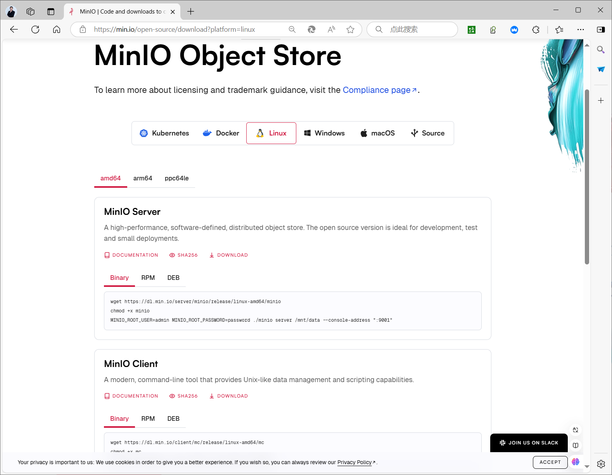

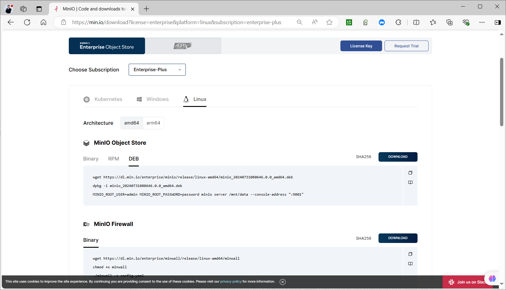

以下以已下载的 `minio.deb` 为例。包通常提供 `/usr/local/bin/minio` 和 systemd 单元；先检查实际单元中的 `User`、`EnvironmentFile`、`MINIO_VOLUMES` 等要求，再启动。

```bash
sudo dpkg -i ./minio.deb
systemctl cat minio.service
sudo install -d -o minio-user -g minio-user /data/minio
```

若系统尚无服务账户，先创建账户和组；若包已创建则不要重复创建。单盘测试环境的 `/etc/default/minio` 可写为：

```ini
MINIO_ROOT_USER=admin
MINIO_ROOT_PASSWORD=请替换为独立的强密码
MINIO_VOLUMES=/data/minio
MINIO_OPTS="--console-address :9001"
```

将环境文件权限收紧，并确认数据目录属于服务账户，然后启动和检查：

```bash
sudo chmod 600 /etc/default/minio
sudo systemctl enable --now minio.service
sudo systemctl status minio.service
sudo journalctl -u minio.service -n 50 --no-pager
curl -f http://127.0.0.1:9000/minio/health/live
```

API 默认在 `9000` 端口，以上示例将 Console 固定在 `9001`。若缺少 `MINIO_VOLUMES`、目录权限不对或端口已占用，`systemctl status` 与 `journalctl` 会给出失败原因。不要从某个旧版本的启动日志推断所有版本的目录、服务用户和选项完全相同。

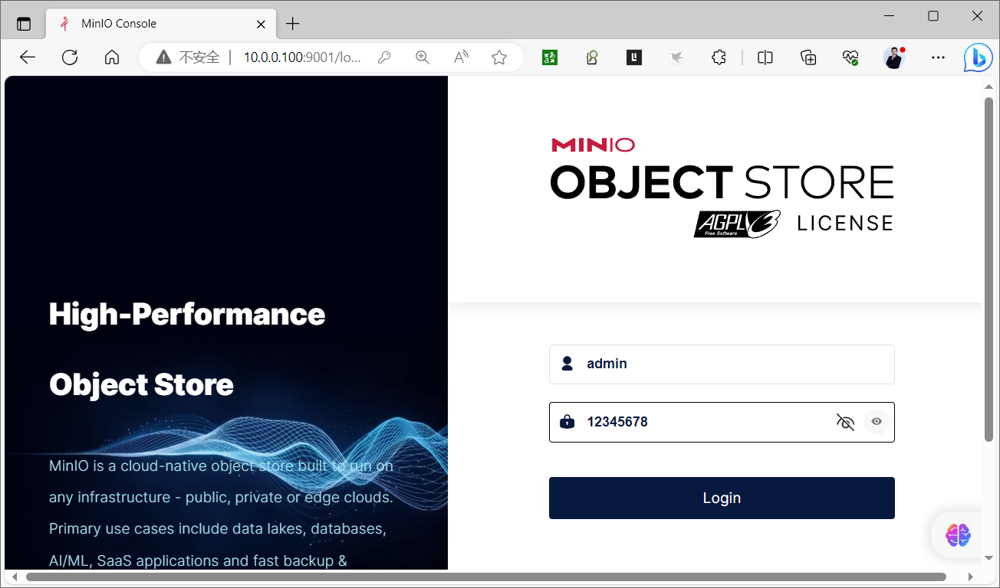

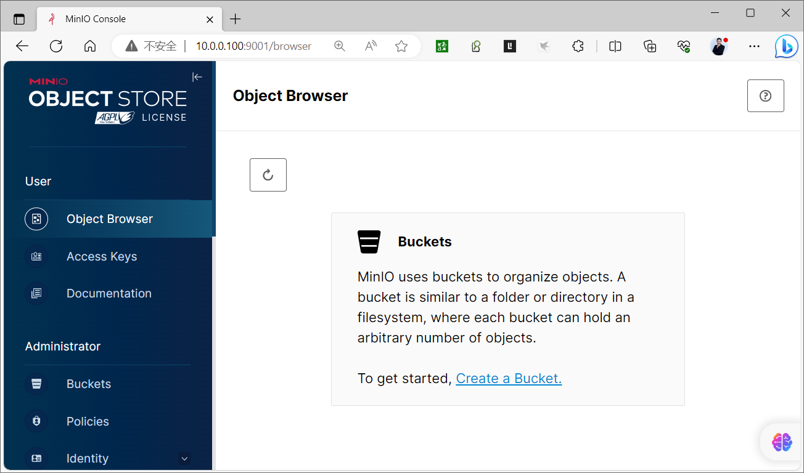

### 单机多盘的环境变量

准备四块独立磁盘并分别挂载到 `/data/minio1` 至 `/data/minio4`，核对挂载和所有权后，将环境文件中的 `MINIO_VOLUMES` 设置为 `"/data/minio{1...4}"`。这里的 `{1...4}` 是 MinIO 识别的连续路径表达式，并非 shell 的 `{1..4}` 展开；不要让 systemd 的环境文件承担 shell 展开。首次初始化后不要随意增删路径或改变挂载顺序。

## RHEL 系包安装

RHEL 系发行版使用与架构匹配的 RPM 包，安装后的服务账户、环境文件与数据目录检查原则相同：

```bash
sudo dnf install ./minio.rpm
systemctl cat minio.service
sudo systemctl enable --now minio.service
```

启动前仍需按单元文件创建环境文件、数据目录并设置所有权；不能仅安装 RPM 就假设服务已经具备可用的凭据和存储路径。

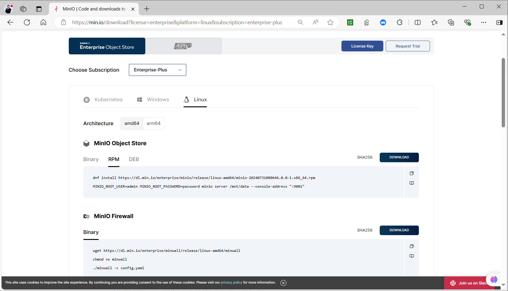

## 二进制部署

不使用发行版包时，可从[社区版发布目录](https://dl.min.io/server/minio/release/)取得对应架构的二进制，并自行配置服务。若下载到的是要求许可证的发行版，启动会提示许可证错误；先核对来源，而不是修改数据目录或忽略错误。

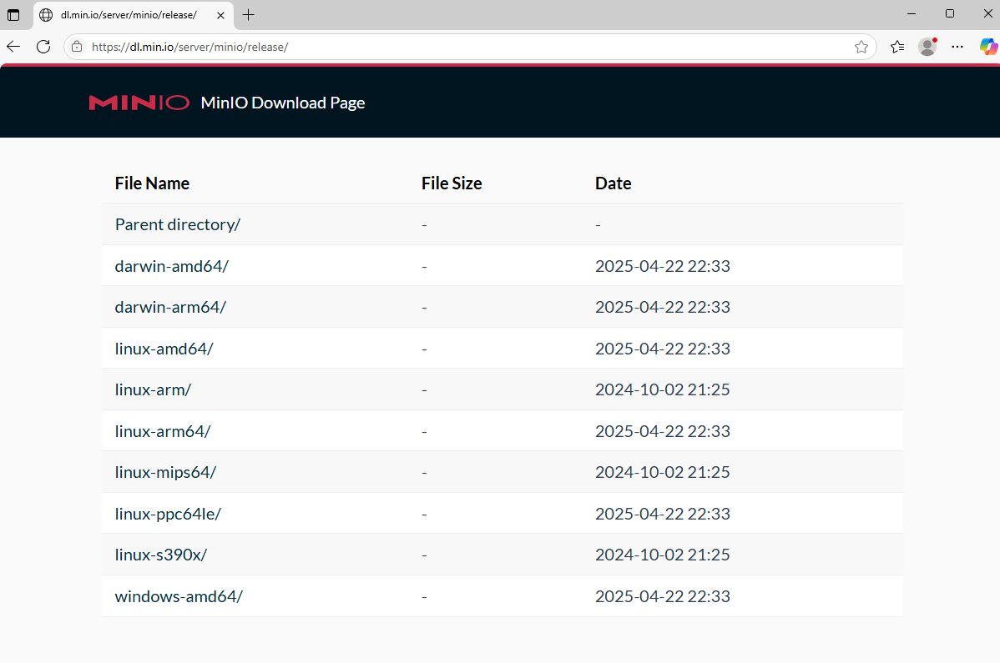

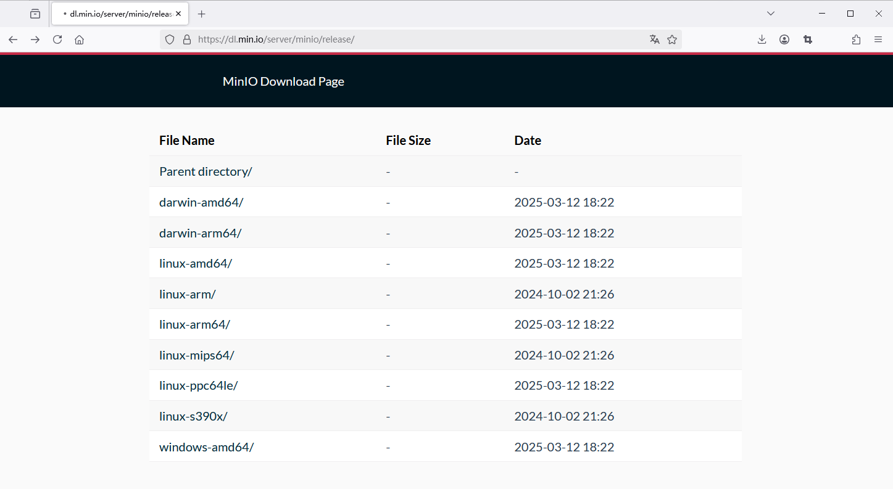

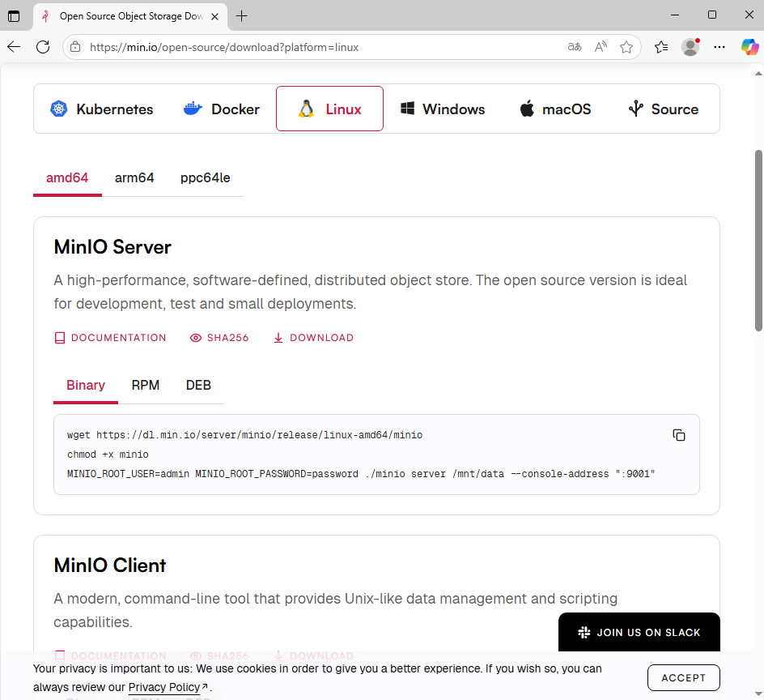

单盘试运行可以先在前台启动，验证路径与端口；凭据在命令环境中仅作示意，实际使用时应由受限环境文件提供：

```bash
sudo install -m 755 ./minio /usr/local/bin/minio
sudo install -d /data/minio
MINIO_ROOT_USER=admin MINIO_ROOT_PASSWORD='请替换为独立的强密码' \
  /usr/local/bin/minio server /data/minio --console-address ':9001'
```

在自建 systemd 单元中，`ExecStart` 应是**完整的一行**，不要把 `--console-address` 与端口拆成两个命令；服务用户必须对数据目录有写权限。凭据建议存放在仅 root 可读的环境文件中，而非直接写进单元文件。原一键安装脚本混合了失效下载链接、明文弱密码和断裂的 `Environment`／`ExecStart` 行，不适合原样执行；包安装提供的单元更利于维护。

## 容器部署

容器本身可重建，数据必须挂载到宿主机持久化目录。以下单盘示例使用官方镜像；`MINIO_ROOT_PASSWORD` 请替换，并固定经验证的镜像版本以避免升级时出现不兼容变化。

```bash
docker run -d --name minio \
  -p 9000:9000 -p 9001:9001 \
  -v /data/minio:/data \
  -e MINIO_ROOT_USER=admin \
  -e MINIO_ROOT_PASSWORD='请替换为独立的强密码' \
  quay.io/minio/minio:RELEASE.2024-11-07T00-52-20Z \
  server /data --console-address ':9001'
docker logs minio
```

单机多盘容器需将各块盘分别挂载到容器内，例如 `/data1` 至 `/data4`，并执行 `server /data{1...4}`。不能把四个卷都绑定到同一宿主机磁盘后宣称获得了纠删码容错。路径数量和所选版本要求须先核对。

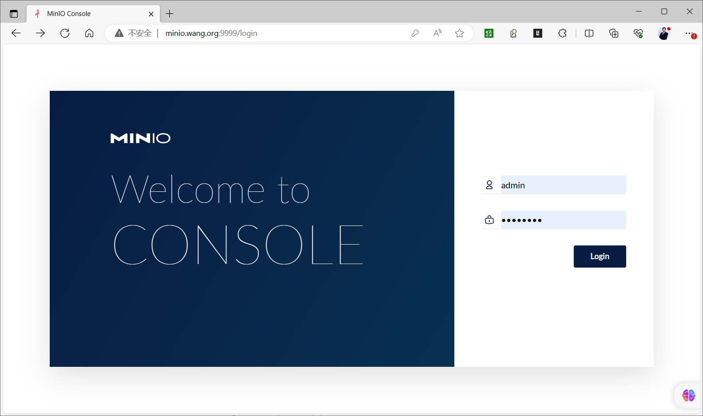

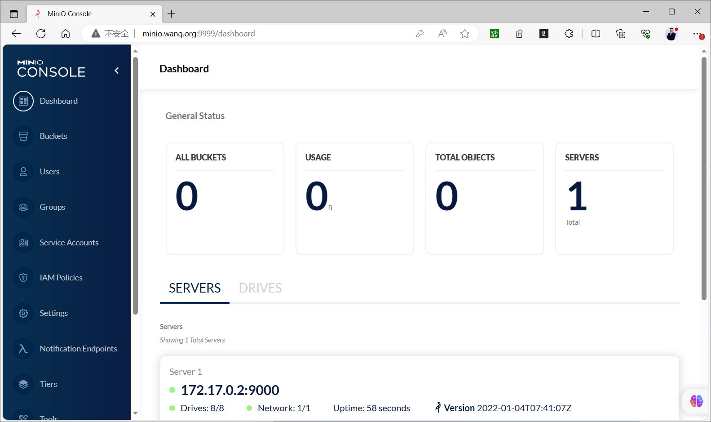

### Docker Compose 单实例

下面 YAML 与终端命令分开，缩进可直接用于 Compose v2；先在当前目录创建 `data` 并确保容器运行用户可写。

```yaml
services:
  minio:
    image: quay.io/minio/minio:RELEASE.2024-11-07T00-52-20Z
    container_name: minio
    restart: unless-stopped
    command: server /data --console-address ':9001'
    environment:
      MINIO_ROOT_USER: admin
      MINIO_ROOT_PASSWORD: ${MINIO_ROOT_PASSWORD}
    ports:
      - '9000:9000'
      - '9001:9001'
    volumes:
      - ./data:/data
    healthcheck:
      test: ['CMD', 'curl', '-f', 'http://localhost:9000/minio/health/live']
      interval: 30s
      timeout: 20s
      retries: 3
```

在同目录的 `.env` 中设置独立强密码并限制文件权限，再验证与启动：

```bash
docker compose config
docker compose up -d
docker compose ps
curl -f http://127.0.0.1:9000/minio/health/live
```

原资料末尾还演示了四个 MinIO 容器加 Nginx 反向代理。它是**多服务节点配置**，应与下一章的分布式拓扑一起学习：若四个容器仍位于一台宿主机，Nginx 负载均衡也不能消除宿主机单点；若要跨主机运行，还必须处理独立磁盘、网络、统一配置和 Console 反向代理的 WebSocket 头。不要把该 Compose 配置误认为单机多盘示例。

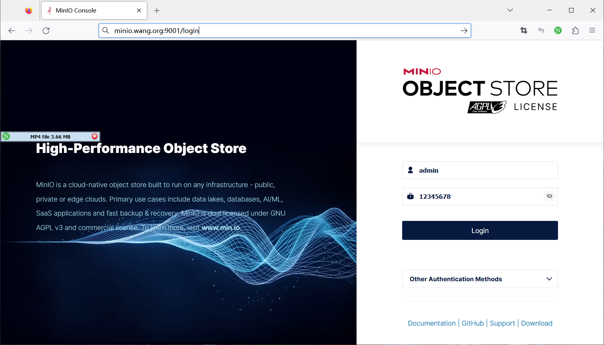

## 验证与后续

先确认进程／容器健康和 `/minio/health/live`，再用浏览器访问 `http://主机:9001`，或使用下一节介绍的 `mc` 创建测试存储桶、上传并读取对象。健康检查只证明服务可响应，不能替代数据备份和故障恢复演练。部署完成后应安排凭据管理、TLS、监控与备份。



<nav class="article-end" aria-label="章节导航">
  <a href="{{ '/subjects/MinIO/05-deployment-modes-and-methods.html' | relative_url }}">← 上一篇：部署模式与方式</a>
  <a href="{{ '/subjects/MinIO/' | relative_url }}">返回 MinIO 对象存储目录</a>
  <a href="{{ '/subjects/MinIO/07-distributed-cluster-deployment.html' | relative_url }}">下一篇：分布式集群部署 →</a>
</nav>
