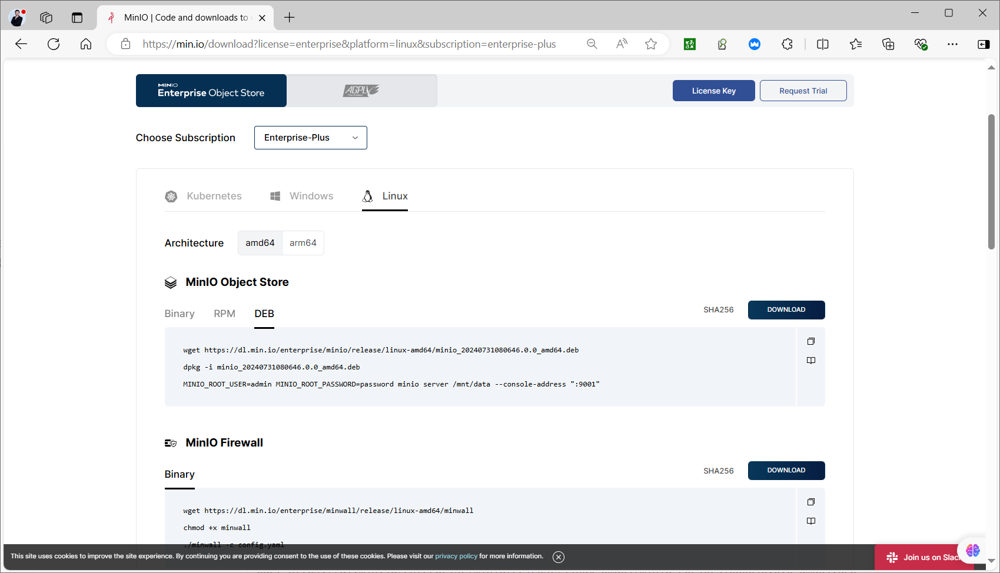
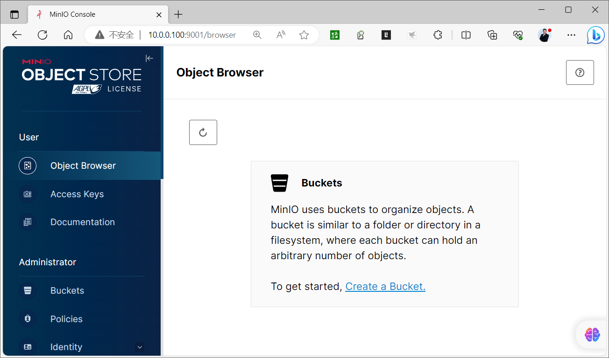
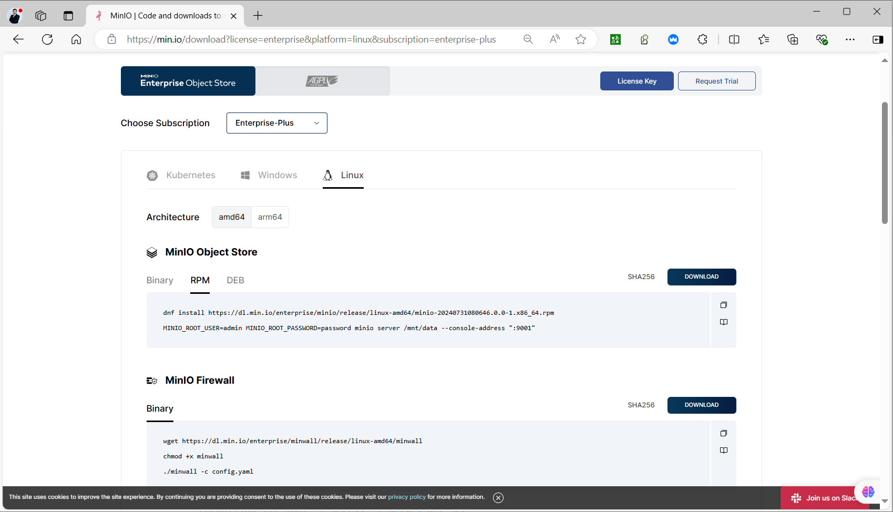
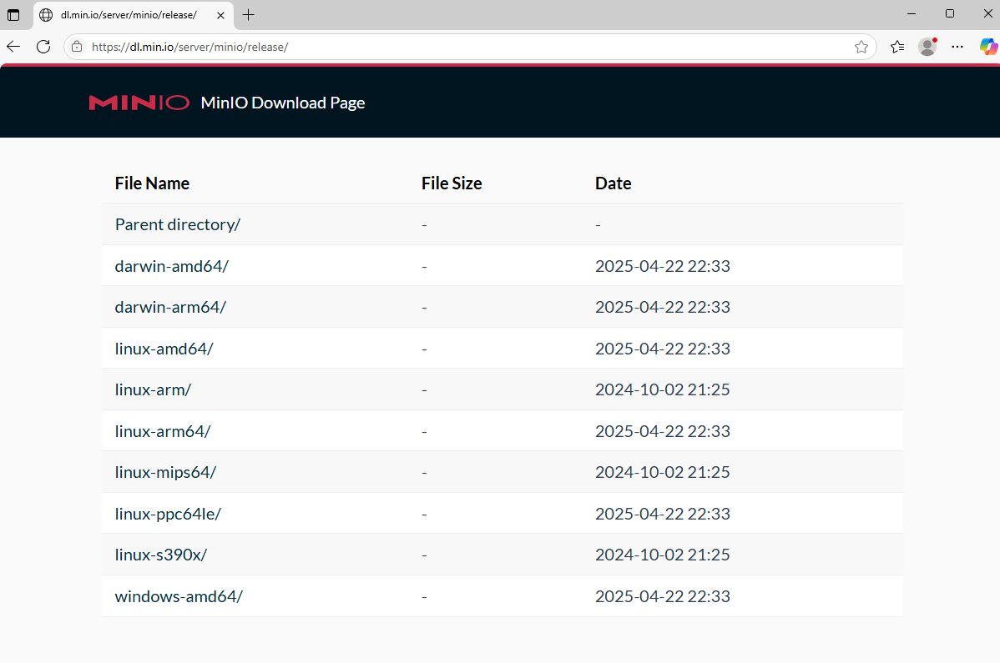
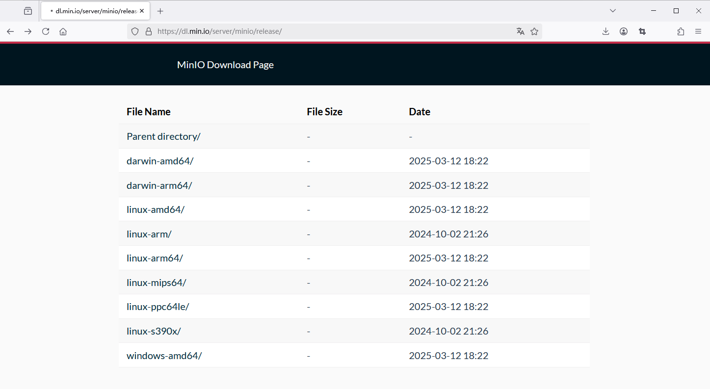
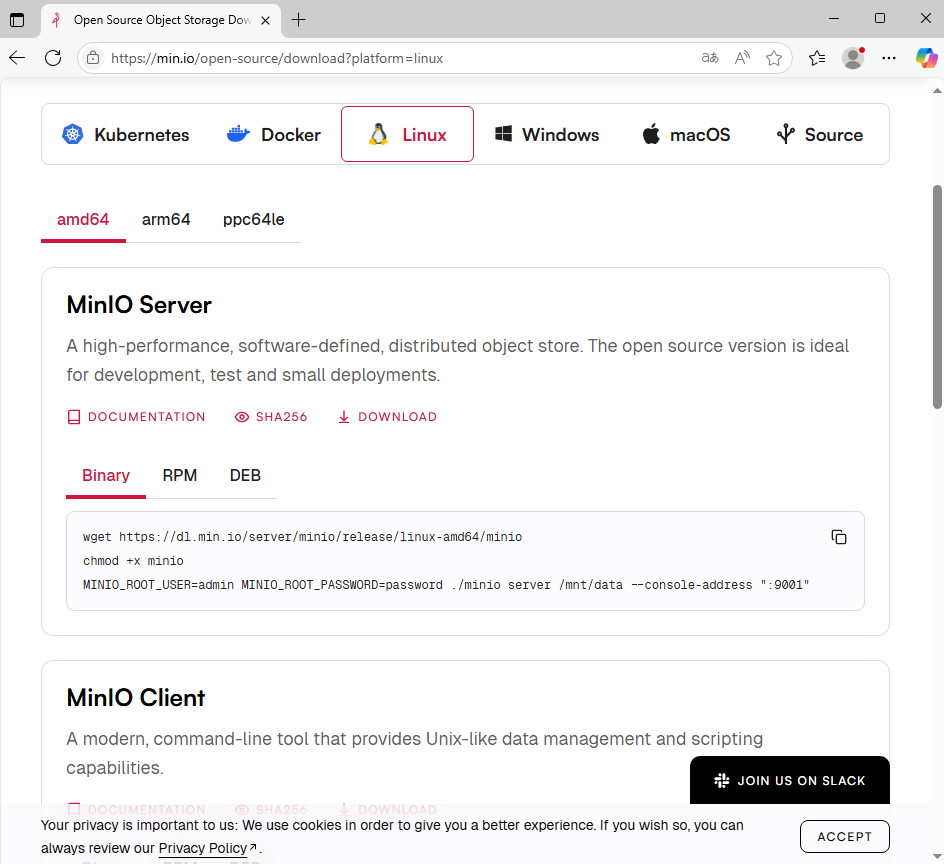
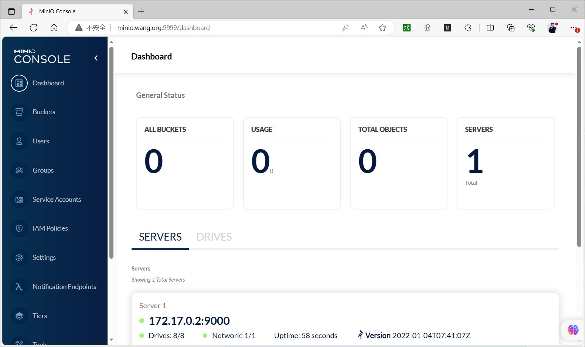

[← 返回MinIO 对象存储目录]({{ '/subjects/MinIO/' | relative_url }})



# 06 单机部署
### 2.2 单机部署

### 单机部署说明

<https://min.io/docs/minio/linux/operations/install-deploy-manage/deploy-minio-single-node-single-drive.html>

<https://min.io/docs/minio/linux/operations/install-deploy-manage/deploy-minio-single-node-multi-drive.html>

<https://min.io/docs/minio/linux/index.html>

<https://www.minio.org.cn/docs/minio/linux/index.html>

minio server的standalone模式，即单机模式，所有管理的磁盘都在一个主机上。

该启动模式一般仅用于实验环境、测试环境、开发环境的验证和学习使用。

在standalone模式下，还可以分为non-erasure code mode和erasure code mode(纠删码)。

non-erasure code mode

当minio server 运行时只传入一个本地磁盘参数。即为 non-erasure code mode

在此启动模式下，对于每一份对象数据， minio直接存储这份数据，不会建立副本，也不会启用纠删码机制。

因此,这种模式无论是服务实例还是磁盘都是”单点"，无任何高可用保障，磁盘损坏就意味着数据丢失。

erasure code mode

此模式需要为minio server实例传入多个本地磁盘参数。

一旦遇到多于一 个磁盘的参数， minio server会自动启用erasure code mode.

erasure code对磁盘的个数是有要求的，至少4个磁盘, 如不满足要求，实例启动将失败。

erasure code启用后，要求传给minio server的endpoint(standalone模式下，即本地磁盘上的目录)至少为4个。

### 包安装

### Debian/Ubuntu包安装

<https://min.io/open-source/download?platform=linux>

<https://min.io/download?license=enterprise&platform=linux&subscription=enterprise-plus>




```text
wget https://dl.min.io/enterprise/minio/release/linux-
amd64/minio_20240731080646.0.0_amd64.deb
dpkg -i minio_20240731080646.0.0_amd64.deb
MINIO_ROOT_USER=admin MINIO_ROOT_PASSWORD=password minio server /mnt/data --
console-address ":9001"
```

范例:  Debian/Ubuntu包安装

```bash
[root@ubuntu2204 ~]#MINIO_VERION=20250723155402.0.0
[root@ubuntu2204 ~]#MINIO_VERION=20241013133411.0.0
[root@ubuntu2204 ~]#MINIO_VERION=20230829230735.0.0
[root@ubuntu2204 ~]#wget https://dl.min.io/server/minio/release/linux-
amd64/archive/minio_${MINIO_VERION}_amd64.deb -O minio.deb
[root@ubuntu2204 ~]#dpkg -i minio.deb
[root@ubuntu2204 ~]#dpkg -L minio
/lib
/lib/systemd
/lib/systemd/system
/lib/systemd/system/minio.service
/usr
/usr/local
/usr/local/bin
/usr/local/bin/minio
[root@ubuntu2204 ~]#which minio
/usr/local/bin/minio
[root@ubuntu2204 ~]#minio -v
minio version RELEASE.2023-08-29T23-07-35Z (commit-
id=07b1281046c8934c47184d1b56c78995ef960f7d)
Runtime: go1.19.12 linux/amd64
License: GNU AGPLv3 <https://www.gnu.org/licenses/agpl-3.0.html>
Copyright: 2015-2023 MinIO, Inc.
#新版service文件
[root@ubuntu2404 ~]#grep -Ev "#|^$" /lib/systemd/system/minio.service
[Unit]
Description=MinIO
Documentation=https://docs.min.io
Wants=network-online.target
After=network-online.target
AssertFileIsExecutable=/usr/local/bin/minio
[Service]
Type=notify
WorkingDirectory=/usr/local
User=minio-user
Group=minio-user
ProtectProc=invisible
EnvironmentFile=-/etc/default/minio
ExecStart=/usr/local/bin/minio server $MINIO_OPTS $MINIO_VOLUMES
Restart=always
LimitNOFILE=1048576
MemoryAccounting=no
TasksMax=infinity
TimeoutSec=infinity
OOMScoreAdjust=-1000
SendSIGKILL=no
[Install]
WantedBy=multi-user.target
#缺失环境变量定义，导致无法启动
[root@ubuntu2404 ~]#ls /etc/default/minio
ls: cannot access '/etc/default/minio': No such file or directory
[root@ubuntu2404 ~]#systemctl enable --now minio.service
Created symlink /etc/systemd/system/multi-user.target.wants/minio.service →
/usr/lib/systemd/system/minio.service.
Job for minio.service failed because the control process exited with error code.
See "systemctl status minio.service" and "journalctl -xeu minio.service" for
details.
```

```bash
#查看service文件
[root@ubuntu2204 ~]#grep -Ev "#|^$" /lib/systemd/system/minio.service
[Unit]
Description=MinIO
Documentation=https://docs.min.io
Wants=network-online.target
After=network-online.target
AssertFileIsExecutable=/usr/local/bin/minio
[Service]
Type=notify
WorkingDirectory=/usr/local
User=minio-user
Group=minio-user
ProtectProc=invisible
EnvironmentFile=-/etc/default/minio
ExecStartPre=/bin/bash -c "if [ -z \"${MINIO_VOLUMES}\" ]; then echo \"Variable
MINIO_VOLUMES not set in /etc/default/minio\"; exit 1; fi"
ExecStart=/usr/local/bin/minio server $MINIO_OPTS $MINIO_VOLUMES
Restart=always
LimitNOFILE=1048576
TasksMax=infinity
TimeoutStopSec=infinity
SendSIGKILL=no
[Install]
WantedBy=multi-user.target
#需要手动创建用户
[root@ubuntu2204 ~]#groupadd -r minio-user
[root@ubuntu2204 ~]#useradd -M -r -s /sbin/nologin -g minio-user minio-user
#准备多个数据目录,minio数据目录不允许和根文件系统在一起，注意：新版允许
[root@ubuntu2204 ~]#mkdir -p /data
[root@ubuntu2204 ~]#lvcreate -n minio -L 10G ubuntu-vg
[root@ubuntu2204 ~]#mkfs.ext4 /dev/ubuntu-vg/minio
[root@ubuntu2204 ~]#echo /dev/ubuntu-vg/minio /data  ext4 defaults 0 0 >>
/etc/fstab
[root@ubuntu2204 ~]#mount -a
[root@ubuntu2204 ~]#mkdir -p /data/minio{1..4}
[root@ubuntu2204 ~]#chown -R minio-user.minio-user /data/
[root@ubuntu2204 ~]#ll  -d /data/minio{1..4}
drwxr-xr-x 3 minio-user minio-user  4096 Oct 17 15:33 /data/minio1/
drwxr-xr-x 3 minio-user minio-user  4096 Oct 17 15:33 /data/minio2/
drwxr-xr-x 3 minio-user minio-user  4096 Oct 17 15:33 /data/minio3/
drwxr-xr-x 3 minio-user minio-user  4096 Oct 17 15:33 /data/minio4/
[root@ubuntu2204 ~]#cat > /etc/default/minio <<EOF
MINIO_ROOT_USER=admin                #默认minioadmin
MINIO_ROOT_PASSWORD=12345678         #默认minioadmin，密码不能低于8位
MINIO_VOLUMES="/data/minio{1...4}"   #必选项
MINIO_OPTS='--console-address :9001' #默认使用随机端口，可以访问9000进行跳转到此随机端口
#MINIO_CONSOLE_ADDRESS=":9001" #功能同上
EOF
[root@ubuntu2204 ~]#systemctl enable --now minio.service
Created symlink /etc/systemd/system/multi-user.target.wants/minio.service →
/lib/systemd/system/minio.service.
[root@ubuntu2204 ~]#systemctl status  minio.service
```

● minio.service - MinIO

```text
Loaded: loaded (/lib/systemd/system/minio.service; enabled; vendor preset:
enabled)
Active: active (running) since Tue 2023-10-17 15:42:50 CST; 5s ago
Docs: https://docs.min.io
Process: 1871 ExecStartPre=/bin/bash -c if [ -z "${MINIO_VOLUMES}" ]; then
echo "Variable MINIO_VOLUMES not set i>
Main PID: 1873 (minio)
Tasks: 7
Memory: 87.7M
CPU: 362ms
CGroup: /system.slice/minio.service
└─1873 /usr/local/bin/minio server --console-address :9001
/data/minio{1...4}
Oct 17 15:42:49 ubuntu2204 systemd[1]: Starting MinIO...
Oct 17 15:42:50 ubuntu2204 systemd[1]: Started MinIO.
Oct 17 15:42:50 ubuntu2204 minio[1873]: MinIO Object Storage Server
Oct 17 15:42:50 ubuntu2204 minio[1873]: Copyright: 2015-2023 MinIO, Inc.
Oct 17 15:42:50 ubuntu2204 minio[1873]: License: GNU AGPLv3
<https://www.gnu.org/licenses/agpl-3.0.html>
Oct 17 15:42:50 ubuntu2204 minio[1873]: Version: RELEASE.2023-08-29T23-07-35Z
(go1.19.12 linux/amd64)
Oct 17 15:42:50 ubuntu2204 minio[1873]: Status:         4 Online, 0 Offline.
Oct 17 15:42:50 ubuntu2204 minio[1873]: S3-API: http://10.0.0.100:9000
http://127.0.0.1:9000
Oct 17 15:42:50 ubuntu2204 minio[1873]: Console: http://10.0.0.100:9001
http://127.0.0.1:9001
Oct 17 15:42:50 ubuntu2204 minio[1873]: Documentation:
https://min.io/docs/minio/linux/index.html
[root@ubuntu2204 ~]#ss -ntlp|grep minio
LISTEN 0      4096       127.0.0.1:9000      0.0.0.0:*    users:
(("minio",pid=1873,fd=10))
LISTEN 0      4096               *:9000            *:*    users:
(("minio",pid=1873,fd=11))
LISTEN 0      4096           [::1]:9000         [::]:*    users:
(("minio",pid=1873,fd=12))
LISTEN 0      4096               *:9001            *:*    users:
(("minio",pid=1873,fd=7))
#登录 http://10.0.0.100:9001/ 用户名密码:admin/12345678
```




### 红帽系统包安装

<https://min.io/download?license=enterprise&platform=linux&subscription=enterprise-plus>



```text
dnf install https://dl.min.io/enterprise/minio/release/linux-amd64/minio-
20240731080646.0.0-1.x86_64.rpm
MINIO_ROOT_USER=admin MINIO_ROOT_PASSWORD=password minio server /mnt/data --
console-address ":9001"
```

范例: 红帽系统包安装

```text
wget https://dl.min.io/server/minio/release/linux-amd64/archive/minio-
20230829230735.0.0.x86_64.rpm -O minio.rpm
sudo dnf install minio.rpm
mkdir ~/minio
minio server ~/minio --console-address :9090
#默认用户和密码
#RootUser: minioadmin
#RootPass: minioadmin
```

### 二进制部署

### 二进制部署单机单磁盘模式

<https://dl.min.io/server/minio/release/>

<https://min.io/download?license=enterprise&platform=linux&subscription=enterprise-plus>







```text
wget https://dl.min.io/server/minio/release/linux-amd64/minio
chmod +x minio
MINIO_ROOT_USER=admin MINIO_ROOT_PASSWORD=password ./minio server /mnt/data --
console-address ":9001"
```

范例: 二进制部署单机单磁盘

```bash
#如果启动报错：原因是下载了enterpise版本
FATAL Unable to validate license, terminating process...: license: no license
found
#国内镜像下载推荐使用
[root@ubuntu2204 ~]#wget https://dl.minio.org.cn/server/minio/release/linux-
amd64/minio
[root@ubuntu2204 ~]#install minio  /usr/local/bin/
#准备数据目录,建议此目录为LVM
[root@ubuntu2204 ~]#mkdir -p /data/minio
#启动服务命令选项说明
#示例: minio server /data/minio --console-address :9090
server #表示start object storage server
--console-address #指定管理后面端口,管理后台登录用户和密码,默认为minioadmin/minioadmin.
也可以通过还境变量MINIO_ROOT_USER（至少3个字符）和MINIO_ROOT_PASSWORD（至少8个字符）进行指
定
#手动执行启动
[root@ubuntu2204 ~]#minio server /data/minio --console-address :9090
#输出信息如下
Formatting 1st pool, 1 set(s), 1 drives per set.
WARNING: Host local has more than 0 drives of set. A host failure will result in
data becoming unavailable.
WARNING: Detected default credentials 'minioadmin:minioadmin', we recommend that
you change these values with 'MINIO_ROOT_USER' and 'MINIO_ROOT_PASSWORD'
environment variables
MinIO Object Storage Server
Copyright: 2015-2023 MinIO, Inc.
License: GNU AGPLv3 <https://www.gnu.org/licenses/agpl-3.0.html>
Version: RELEASE.2023-08-29T23-07-35Z (go1.19.12 linux/amd64)
Status:         1 Online, 0 Offline.
S3-API: http://10.0.0.101:9000  http://10.10.53.81:9000  http://127.0.0.1:9000
RootUser: minioadmin
RootPass: minioadmin
Console: http://10.0.0.101:9090 http://10.10.53.81:9090 http://127.0.0.1:9090
RootUser: minioadmin
RootPass: minioadmin
Command-line: https://min.io/docs/minio/linux/reference/minio-mc.html#quickstart
$ mc alias set myminio http://10.0.0.101:9000 minioadmin minioadmin
Documentation: https://min.io/docs/minio/linux/index.html
Warning: The standard parity is set to 0. This can lead to data loss.
[root@ubuntu2404 ~]#useradd -r -s /sbin/nologin minio
[root@ubuntu2404 ~]#chown minio: /data/minio/
#创建service启动
[root@ubuntu2404 ~]#cat  /lib/systemd/system/minio.service
[Unit]
Description=Minio
After=systemd-networkd.service systemd-resolved.service
Documentation=https://min.io
[Service]
Type=simple
Environment=MINIO_ROOT_USER=admin MINIO_ROOT_PASSWORD=12345678
ExecStart=/usr/local/bin/minio server /data/minio  --console-address ":9001"
Restart=on-failure
User=minio
Group=minio
LimitNOFILE=infinity
LimitNPROC=infinity
LimitCORE=infinity
OOMScoreAdjust=-1000
[Install]
WantedBy=multi-user.target
[root@ubuntu2404 ~]#systemctl daemon-reload
[root@ubuntu2404 ~]#systemctl enable --now minio.service
```

### Shell 脚本实现单机单磁盘模式

范例: 一键安装Shell 脚本实现单机单磁盘模式

```bash
[root@ubuntu2204 ~]#cat install_minio_single_node.sh
#!/bin/bash
#
#FileName:          install_minio_single_node.sh
#Description:       The test script
#支持在线和离线安装
#管理后台用户和密码,注意:用户名至少3个字符,密码至少8个字符,如果不指定下面环境变量，默认用户名/
密码为minioadmin/minioadmin
MINIO_ROOT_USER=admin
MINIO_ROOT_PASSWORD=12345678
#管理后台监听端口
MINIO_PORT=9999
#数据目录
MINIO_DATA=/data/minio
#文件名和下载URL
MINIO_FILE=minio
MINIO_URL="https://dl.minio.org.cn/server/minio/release/linux-
amd64/${MINIO_FILE}"
#MINIO_URL="https://dl.min.io/server/minio/release/linux-amd64/${MINIO_FILE}"
```

```text
HOST_IP=`hostname -I|awk '{print $1}'`
```

```text
COLOR_SUCCESS="echo -e \\033[1;32m"
COLOR_FAILURE="echo -e \\033[1;31m"
END="\033[m"
```

```text
color () {
RES_COL=60
MOVE_TO_COL="echo -en \\033[${RES_COL}G"
SETCOLOR_SUCCESS="echo -en \\033[1;32m"
SETCOLOR_FAILURE="echo -en \\033[1;31m"
SETCOLOR_WARNING="echo -en \\033[1;33m"
SETCOLOR_NORMAL="echo -en \E[0m"
echo -n "$1" && $MOVE_TO_COL
echo -n "["
if [ $2 = "success" -o $2 = "0" ] ;then
${SETCOLOR_SUCCESS}
echo -n $"  OK  "
elif [ $2 = "failure" -o $2 = "1"  ] ;then
${SETCOLOR_FAILURE}
echo -n $"FAILED"
else
${SETCOLOR_WARNING}
echo -n $"WARNING"
fi
${SETCOLOR_NORMAL}
echo -n "]"
echo
}
```

```text
install_minio(){
if  [ ! -e ${MINIO_FILE}  ] ;then
wget ${MINIO_URL} || ${COLOR_FAILURE} "下载失败!" ${END}
fi
install ${MINIO_FILE} /usr/local/bin/minio
useradd -s /sbin/nologin  -r minio
mkdir -p ${MINIO_DATA}
chown -R minio:minio  ${MINIO_DATA}
cat > /lib/systemd/system/minio.service <<EOF
[Unit]
Description=Minio
After=systemd-networkd.service systemd-resolved.service
Documentation=https://min.io
[Service]
Type=simple
Environment=MINIO_ROOT_USER=${MINIO_ROOT_USER}
MINIO_ROOT_PASSWORD=${MINIO_ROOT_PASSWORD}
ExecStart=/usr/local/bin/minio server ${MINIO_DATA} --console-address
":${MINIO_PORT}"
Restart=on-failure
User=minio
Group=minio
LimitNOFILE=infinity
LimitNPROC=infinity
LimitCORE=infinity
OOMScoreAdjust=-1000
[Install]
WantedBy=multi-user.target
EOF
systemctl daemon-reload
systemctl enable --now  minio.service &>/dev/null
systemctl is-active minio.service &>/dev/null
if [ $?  -eq 0 ];then
echo
color "MinIO 安装完成!" 0
echo "------------------------------------------------------------------
-"
echo -e "请访问链接: \E[32;1mhttp://${HOST_IP}:${MINIO_PORT}/\E[0m"
echo -e "用户和密码:
\E[32;1m${MINIO_ROOT_USER}/${MINIO_ROOT_PASSWORD}\E[0m"
else
color "MinIO 安装失败!" 1
exit
fi
}
```

```text
install_minio
```

### 容器化部署

<https://min.io/docs/minio/container/index.html>

范例: 容器化部署单机单磁盘

```text
docker pull registry.cn-beijing.aliyuncs.com/bowenxiaochun/minio:RELEASE.2024-11-
07T00-52-20Z
docker pull minio/minio
```

```bash
#可选
mkdir -p /data/minio
#docker部署
docker run -d \
-p 9000:9000 \
-p 9090:9090 \
--name minio \
-v /data/minio:/data \
-e "MINIO_ROOT_USER=admin" \
-e "MINIO_ROOT_PASSWORD=12345678" \
registry.cn-beijing.aliyuncs.com/bowenxiaochun/minio:RELEASE.2024-11-07T00-52-
20Z server /data --console-address ":9090"
#minio/minio server /data --console-address ":9090"
#podman 部署
podman run -p 9000:9000 -p 9001:9001 minio/minio server /data/minio --console-
address ":9001"
```

范例: Docker 部署单机多磁盘启用纠删除码功能

```bash
[root@ubuntu2204 ~]#docker run -d \
-p 9000:9000 \
-p 9999:9999 \
--name minio \
-e "MINIO_ROOT_USER=admin" \
-e "MINIO_ROOT_PASSWORD=12345678" \
-v /minio/data1:/data1 \
-v /minio/data2:/data2 \
-v /minio/data3:/data3 \
-v /minio/data4:/data4 \
-v /minio/data5:/data5 \
-v /minio/data6:/data6 \
-v /minio/data7:/data7 \
-v /minio/data8:/data8 \
registry.cn-beijing.aliyuncs.com/bowenxiaochun/minio:RELEASE.2024-11-07T00-52-
20Z /data{1...8} --console-address ":9999"
#minio/minio server /data{1...8} --console-address ":9999"
```

```sql
[root@ubuntu2204 ~]#docker logs minio
Automatically configured API requests per node based on available memory on the
system: 17
Status:         8 Online, 0 Offline.
API: http://172.17.0.2:9000  http://127.0.0.1:9000
Console: http://172.17.0.2:9999 http://127.0.0.1:9999
Documentation: https://docs.min.io
You are running an older version of MinIO released 2 years ago
Update:
Run `mc admin update`
[root@ubuntu2204 ~]#tree /minio/
/minio/
├── data1
├── data2
├── data3
├── data4
├── data5
├── data6
├── data7
└── data8
8 directories, 0 files
```




### 基于 Docker Compose 部署

<https://github.com/minio/minio/tree/master/docs/orchestration/docker-compose>

范例：基于 Docker Compose 部署单节点

```yaml
[root@ubuntu2404 ~]#cat docker-compose.yaml
version: '3.8'
services:
minio:
#image: minio/minio:RELEASE.2024-11-07T00-52-20Z
image: registry.cn-beijing.aliyuncs.com/bowenxiaochun/minio:RELEASE.2024-11-
07T00-52-20Z
container_name: minio
restart: always
environment:
MINIO_ROOT_USER: 'admin'
MINIO_ROOT_PASSWORD: '12345678'
MINIO_ADDRESS: ':9000'
MINIO_CONSOLE_ADDRESS: ':9001'
ports:
- "9000:9000"
- "9001:9001"
networks:
- minio_net
volumes:
- ./data:/data
healthcheck:
test: ["CMD", "curl", "-f", "http://localhost:9000/minio/health/live"]
interval: 30s
timeout: 20s
retries: 3
command: server /data
#command: server --console-address ":9001" /data
networks:
minio_net:
driver: bridge
[root@ubuntu2404 ~]#apt update && apt -y install docker-compose python3-pip
[root@ubuntu2404 ~]#docker-compose version
docker-compose version 1.29.2, build unknown
docker-py version: 5.0.3
CPython version: 3.12.3
OpenSSL version: OpenSSL 3.0.13 30 Jan 2024
[root@ubuntu2404 ~]#docker-compose up -d
[root@ubuntu2404 ~]#docker-compose up -d
[root@ubuntu2404 ~]#docker-compose ps
Name               Command                  State
Ports
---------------------------------------------------------------------------------
---------------------------------------------------
minio   /usr/bin/docker-entrypoint ...   Up (healthy)   0.0.0.0:9000-
>9000/tcp,:::9000->9000/tcp,
0.0.0.0:9001-
>9001/tcp,:::9001->9001/tcp
[root@ubuntu2404 ~]#docker network ls
NETWORK ID     NAME             DRIVER    SCOPE
dc0d93c3c604   bridge           bridge    local
92408dddfe8e   host             host      local
f26890b252b5   none             null      local
6354afd6686a   root_minio_net   bridge    local
```

范例: 基于 Docker Compose 部署多服务节点多设备集群并利用 Nginx实现反向代理负载均衡

```yaml
#https://github.com/minio/minio/blob/master/docs/orchestration/docker-
compose/docker-compose.yaml
[root@ubuntu2204 minio]#ls
docker-compose.yaml  nginx.conf
[root@ubuntu2204 minio]#cat docker-compose.yaml
version: '3.7'
# Settings and configurations that are common for all containers
x-minio-common: &minio-common
image: quay.io/minio/minio:RELEASE.2023-08-31T15-31-16Z
command: server --console-address ":9001" http://minio{1...4}/data{1...2}
expose:
- "9000"
- "9001"
environment:
MINIO_ROOT_USER: admin
MINIO_ROOT_PASSWORD: 12345678
# environment:
# MINIO_ROOT_USER: minioadmin
# MINIO_ROOT_PASSWORD: minioadmin
healthcheck:
test: ["CMD", "curl", "-f", "http://localhost:9000/minio/health/live"]
interval: 30s
timeout: 20s
retries: 3
# starts 4 docker containers running minio server instances.
# using nginx reverse proxy, load balancing, you can access
# it through port 9000.
services:
minio1:
<<: *minio-common
hostname: minio1
volumes:
- data1-1:/data1
- data1-2:/data2
minio2:
<<: *minio-common
hostname: minio2
volumes:
- data2-1:/data1
- data2-2:/data2
minio3:
<<: *minio-common
hostname: minio3
volumes:
- data3-1:/data1
- data3-2:/data2
minio4:
<<: *minio-common
hostname: minio4
volumes:
- data4-1:/data1
- data4-2:/data2
nginx:
image: nginx:1.19.2-alpine
hostname: nginx
volumes:
- ./nginx.conf:/etc/nginx/nginx.conf:ro
ports:
- "9000:9000"
- "9001:9001"
depends_on:
- minio1
- minio2
- minio3
- minio4
## By default this config uses default local driver,
## For custom volumes replace with volume driver configuration.
volumes:
data1-1:
data1-2:
data2-1:
data2-2:
data3-1:
data3-2:
data4-1:
data4-2:
#nginx.conf
[root@ubuntu2204 minio]#cat nginx.conf
user  nginx;
worker_processes  auto;
error_log  /var/log/nginx/error.log warn;
pid        /var/run/nginx.pid;
events {
worker_connections  4096;
}
http {
include       /etc/nginx/mime.types;
default_type  application/octet-stream;
log_format  main  '$remote_addr - $remote_user [$time_local] "$request" '
'$status $body_bytes_sent "$http_referer" '
'"$http_user_agent" "$http_x_forwarded_for"';
access_log  /var/log/nginx/access.log  main;
sendfile        on;
keepalive_timeout  65;
# include /etc/nginx/conf.d/*.conf;
upstream minio {
server minio1:9000;
server minio2:9000;
server minio3:9000;
server minio4:9000;
}
upstream console {
ip_hash;
server minio1:9001;
server minio2:9001;
server minio3:9001;
server minio4:9001;
}
server {
listen       9000;
listen  [::]:9000;
server_name  localhost;
# To allow special characters in headers
ignore_invalid_headers off;
# Allow any size file to be uploaded.
# Set to a value such as 1000m; to restrict file size to a specific
value
client_max_body_size 0;
# To disable buffering
proxy_buffering off;
proxy_request_buffering off;
location / {
proxy_set_header Host $http_host;
proxy_set_header X-Real-IP $remote_addr;
proxy_set_header X-Forwarded-For $proxy_add_x_forwarded_for;
proxy_set_header X-Forwarded-Proto $scheme;
proxy_connect_timeout 300;
# Default is HTTP/1, keepalive is only enabled in HTTP/1.1
proxy_http_version 1.1;
proxy_set_header Connection "";
chunked_transfer_encoding off;
proxy_pass http://minio;
}
}
server {
listen       9001;
listen  [::]:9001;
server_name  localhost;
# To allow special characters in headers
ignore_invalid_headers off;
# Allow any size file to be uploaded.
# Set to a value such as 1000m; to restrict file size to a specific
value
client_max_body_size 0;
# To disable buffering
proxy_buffering off;
proxy_request_buffering off;
location / {
proxy_set_header Host $http_host;
proxy_set_header X-Real-IP $remote_addr;
proxy_set_header X-Forwarded-For $proxy_add_x_forwarded_for;
proxy_set_header X-Forwarded-Proto $scheme;
proxy_set_header X-NginX-Proxy true;
# This is necessary to pass the correct IP to be hashed
real_ip_header X-Real-IP;
proxy_connect_timeout 300;
# To support websocket
proxy_http_version 1.1;
proxy_set_header Upgrade $http_upgrade;
proxy_set_header Connection "upgrade";
chunked_transfer_encoding off;
proxy_pass http://console;
}
}
}
#浏览器访问代理:http://minio.bowen.org:9001,用户名密码:minioadmin/minioadmin
```




<nav class="article-end" aria-label="章节导航">
  <a href="{{ '/subjects/MinIO/05-deployment-modes-and-methods.html' | relative_url }}">← Previous: Deployment Modes and Methods</a>
  <a href="{{ '/subjects/MinIO/' | relative_url }}">Back to MinIO Object Storage Index</a>
  <a href="{{ '/subjects/MinIO/07-distributed-cluster-deployment.html' | relative_url }}">Next: Distributed Cluster Deployment →</a>
</nav>
