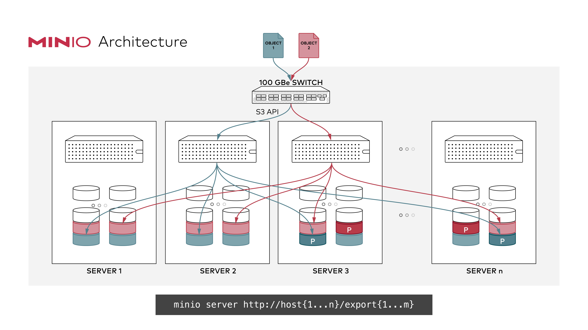
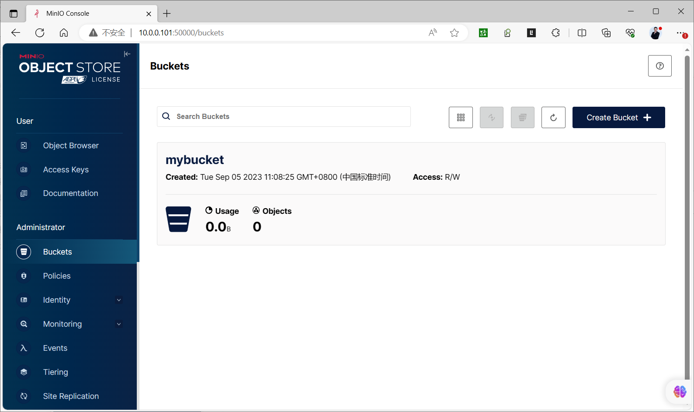
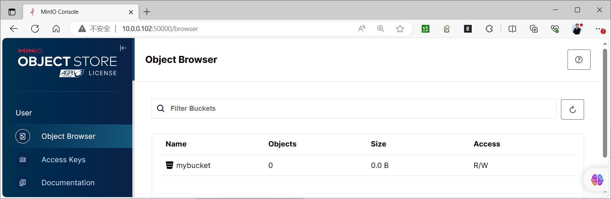
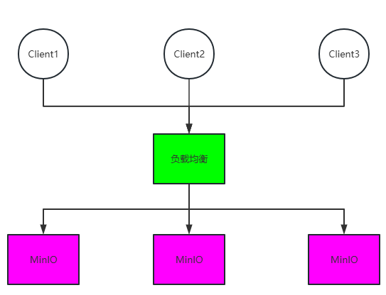
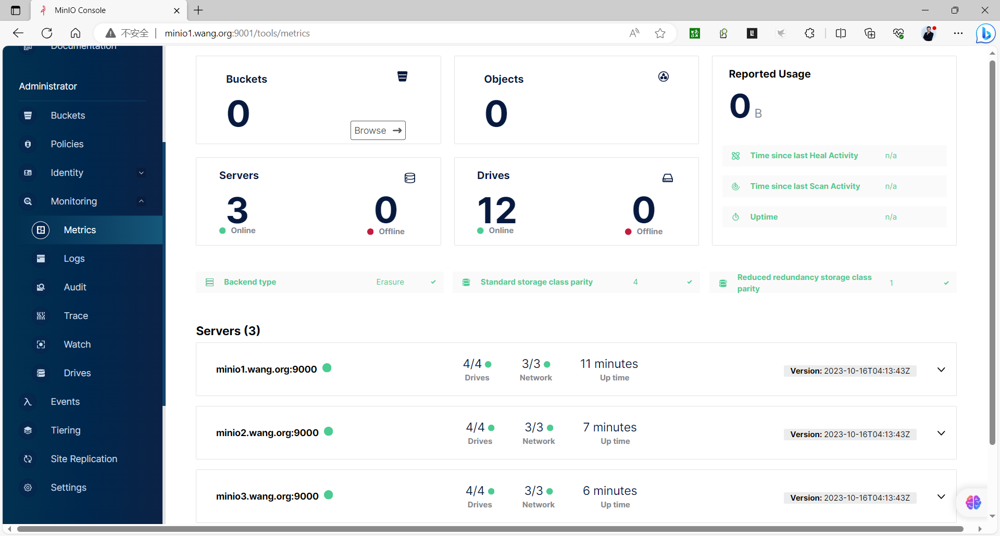
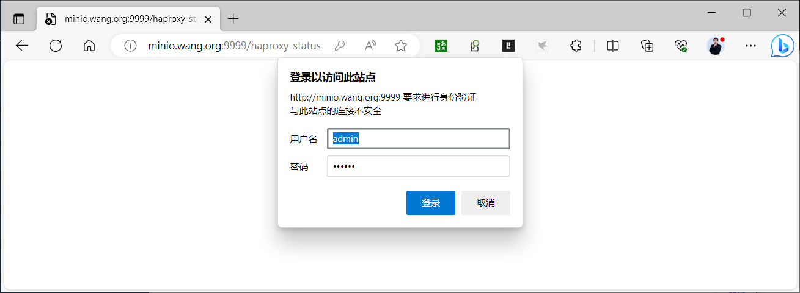
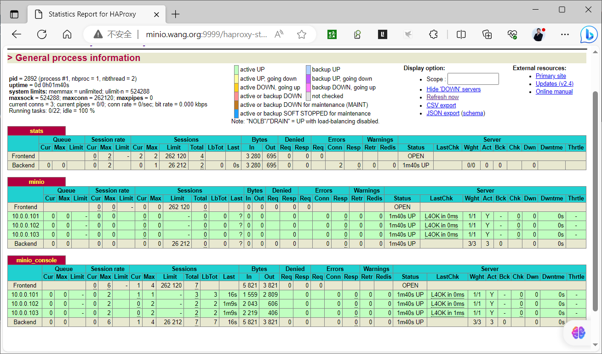
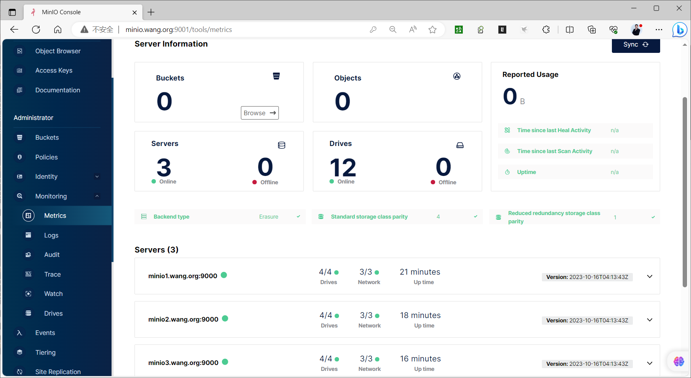

[← Back to MinIO Object Storage Index]({{ '/subjects/MinIO/' | relative_url }})



# 07 Distributed Cluster Deployment
### 2.3 分布式集群部署

### 分布式集群机制

分布式Minio 将在不同的机器上的多块硬盘组成一个对象存储服务。

由于硬盘分布在不同的节点上,分布式MInio有更好的性能，同时避免了单点故障。



分布式Minio优势

数据保护

分布式Minio采用纠删码来防范多个节点宕机和位衰减bit rot。

分布式Minio至少需要4个硬盘，使用分布式Minio 会自动引入纠删码功能。

高可用单机Minio服务存在单点故障，相反，如果是一个有N块硬盘的分布式Minio,只要有N/2硬盘在线， 数据就是安全的。不过你需要至少有N/2+1个硬盘来创建新的对象。

例如，一个16节点Minio集群，每个节点16块硬盘，就算8台服务器宕机，这个集群仍然可读的， 不过需要9台服务器才能写数据。

性能

多个节点负载均衡，提升性能

一致性

Minio在分布式和单机模式下，所有读写操作都严格遵守read-after-write一致性模型。

分布式Minio实现条件

在所有节点运行同样的命令启动一个分布式Minio实例，只需要把硬盘位置做为参数传给minio server命令即可

分布式Minio中的所有节点需要有同样的环境变量MINIO_ACCESS_KEY和MINIO_SECRET_KEY，才能建立分布式集群

注意：新版本使用环境变量 MINIO_ROOT_USER和MINIO_ROOT_PASSWORD

分布式Minio使用的磁盘里必须是干净的，里面没有数据

分布式Minio里的节点时间差不能超过3秒，可以使用NTP来保证时间一致。

分布式Minio注意事项

minio服务器多块数据磁盘需要使用独立的磁盘，在物理底层要相互独立避免遇到磁盘io竞争，导致minio性能直线下降,如果性能下降严重，数据量大时甚至会导致集群不可用

minio数据磁盘最大不超过2T,如果使用lvm逻辑卷，逻辑卷大小也不要超过2T，过大的磁盘或文件系统会导致后期IO延迟较高导致minio性能降低

minio集群共M节点每个节点N块数据磁盘，磁盘只要存活M*N/2，minio集群数据就是安全的，在节点数剩余M/2+1时节点可以正常读写

如果使用lvm方式扩展集群容量，请在部署阶段minio数据目录就使用lvm。

如果需要备份minio集群数据，请准备存放minio集群所有对象数据的空间容量

比如: 一个2T/盘*4块/节点*8节点=64T的集群所有容量的一半存储空间即32T服务器，配置内存 CPU配置不需要太高

如果网络环境允许请把minio集群节点配置双网卡，节点通信网络与客户端访问网络分开避免网络瓶颈

配置反向代理实现MinIO的负载均衡, 可以使用云服务SLB或者2台haproxy/nginx结合keepalived 实现高可用

minio系统中不要安装消耗IO较高的应用,比如:updatedb程序，如安装请排除扫描minio数据目录, 否则可以会导致磁盘io延迟过高，会导致cpu负载过高，从而降低minio性能

### 分布式集群部署案例

<https://min.io/docs/minio/linux/operations/install-deploy-manage/deploy-minio-multi-node-multi-drive.html>

注意:每个数据目录默认不能使用系统的根文件系统 rootfs,必须为独立的文件系统

### 二进制部署分布式集群

范例：3个节点，每节点1块盘

```text
#启动分布式Minio实例，3个节点，每节点1块盘，需要在每个节点上都运行下面的命令
#先在每个主机上将磁盘格式化并挂载至/data/minio目录下,
export MINIO_ROOT_USER=admin
export MINIO_ROOT_PASSWORD=12345678
minio server http://10.0.0.{101..103}:9000/data/minio  --console-address :50000
```

范例：3个节点,每节点4块盘

```text
#先每个主机的四块磁盘格式化,并分别挂载到/minio/dirve{1..4}上
export MINIO_ROOT_USER=admin
export MINIO_ROOT_PASSWORD=12345678
minio server https://10.0.0.{101..103}/minio/drive{1..4}  --console-address
:50000
#输出信息
Waiting for all MinIO sub-systems to be initialize...
Automatically configured API requests per node based on available memory on the
system: 16
All MinIO sub-systems initialized successfully in 3.683865209s
MinIO Object Storage Server
Copyright: 2015-2023 MinIO, Inc.
License: GNU AGPLv3 <https://www.gnu.org/licenses/agpl-3.0.html>
Version: RELEASE.2023-08-29T23-07-35Z (go1.19.12 linux/amd64)
Use `mc admin info` to look for latest server/drive info
Status:         8 Online, 4 Offline.
S3-API: http://10.0.0.101:9000  http://127.0.0.1:9000
RootUser: admin
RootPass: 12345678
Console: http://10.0.0.101:50000 http://127.0.0.1:50000
RootUser: admin
RootPass: 12345678
Command-line: https://min.io/docs/minio/linux/reference/minio-mc.html#quickstart
$ mc alias set myminio http://10.0.0.102:9000 admin 12345678
```

```text
#在每个节点上创建新的bucket和上传文件,在集群中的其它节点上也可以查看到此bucket和上传的文件
```





范例：4个节点每节点4块盘集群

```text
#在4个节点都执行下面指令
export MINIO_ROOT_USER=admin
export MINIO_ROOT_PASSWORD=12345678
minio server http://10.0.0.101/export1 \
http://10.0.0.101/export2 \
http://10.0.0.101/export3 \
http://10.0.0.101/export4 \
http://10.0.0.102/export1 \
http://10.0.0.102/export2 \
http://10.0.0.102/export3 \
http://10.0.0.102/export4 \
http://10.0.0.103/export1 \
http://10.0.0.103/export2 \
http://10.0.0.103/export3 \
http://10.0.0.103/export4 \
http://10.0.0.104/export1 \
http://10.0.0.104/export2 \
http://10.0.0.104/export3 \
http://10.0.0.104/export4 \
--console-address :50000
#或者下面用法
minio server http://10.0.0.10{1..4}/export{1..4} --console-address :50000
```

范例:  基于LVM实现二进制部署MinIO 实现3节点的分布式高可用集群(练习)



```bash
#准备三台主机,在所有节点上做好名称解析
[root@minio1 ~]#cat /etc/hosts
10.0.0.101 minio1.bowen.org
10.0.0.102 minio2.bowen.org
10.0.0.103 minio3.bowen.org
#在所有节点上准备数据目录和用户
#当前环境中有LV，并且VG中有空闲空间，所以基于当前环境创建新LV实现MiniO存储
[root@ubuntu2204 ~]#lsblk
NAME                      MAJ:MIN RM  SIZE RO TYPE MOUNTPOINTS
sda                         8:0    0  200G  0 disk
├─sda1                      8:1    0    1M  0 part
├─sda2                      8:2    0    2G  0 part /boot
└─sda3                      8:3    0  198G  0 part
└─ubuntu--vg-ubuntu--lv 253:0    0   99G  0 lvm  /
sr0                        11:0    1 1024M  0 rom
[root@minio1 ~]#pvs
PV         VG        Fmt  Attr PSize    PFree
/dev/sda3  ubuntu-vg lvm2 a--  <198.00g 99.00g
[root@minio1 ~]#vgs
VG        #PV #LV #SN Attr   VSize    VFree
ubuntu-vg   1   1   0 wz--n- <198.00g 99.00g
[root@minio1 ~]#lvs
LV        VG        Attr       LSize   Pool Origin Data%  Meta%  Move Log
Cpy%Sync Convert
ubuntu-lv ubuntu-vg -wi-ao---- <99.00g
#基于当前VG创建LV
[root@minio1 ~]#lvcreate -n minio -L 10G ubuntu-vg
[root@minio1 ~]#lvs
LV        VG        Attr       LSize   Pool Origin Data%  Meta%  Move Log
Cpy%Sync Convert
minio     ubuntu-vg -wi-a-----  10.00g
ubuntu-lv ubuntu-vg -wi-ao---- <99.00g
#XFS
[root@minio1 ~]#mkfs.xfs  /dev/ubuntu-vg/minio
[root@minio1 ~]#echo /dev/ubuntu-vg/minio /data/ xfs defaults 0 0 >> /etc/fstab
#EXT4
[root@minio1 ~]#mkfs.ext4 /dev/ubuntu-vg/minio
[root@minio1 ~]#echo /dev/ubuntu-vg/minio /data/ ext4 defaults 0 0 >> /etc/fstab
[root@minio1 ~]#mkdir /data/
[root@minio1 ~]#mount -a
[root@minio1 ~]#mkdir -p /data/minio{1..4}
[root@minio1 ~]#useradd -r -s /sbin/nologin minio
[root@minio1 ~]#chown -R minio: /data/minio*
```

```bash
#在所有节点上下载二进制程序
[root@minio1 ~]#wget https://dl.minio.org.cn/server/minio/release/linux-
amd64/minio
[root@minio1 ~]#install minio /usr/local/bin/minio
#在所有节点上准备环境变量文件
[root@minio1 ~]#cat > /etc/default/minio
MINIO_ROOT_USER=admin
MINIO_ROOT_PASSWORD=12345678
MINIO_VOLUMES='http://minio{1...3}.bowen.org:9000/data/minio{1...4}'
MINIO_OPTS='--console-address :9001'
MINIO_PROMETHEUS_AUTH_TYPE="public"
#注意事项
#MINIO_ROOT_USER管理员用户名，MINIO_ROOT_PASSWORD管理员密码
#如果minio服务器IP地址连续可以直接写IP地址写法，如果IP地址不连续,则使用前面在本地hosts解析文
件配置的连续的主机名
#方法例如：MINIO_VOLUMES="http://10.0.0.10{1...3}:9000/data/minio{1..4}"
#在所有节点上创建service文件
[root@minio1 ~]#cat > /lib/systemd/system/minio.service
[Unit]
Description=MinIO
Documentation=https://docs.min.io
Wants=network-noline.target
After=network-noline.target
[Service]
WorkingDirectory=/usr/local
User=minio
Group=minio
EnvironmentFile=-/etc/default/minio
ExecStartPre=/bin/bash -c "if [ -z \"${MINIO_VOLUMES}\" ]; then echo \"Variable
MINIO_VOLUMES not set in /etc/default/minio\"; exit 1; fi"
ExecStart=/usr/local/bin/minio server $MINIO_OPTS $MINIO_VOLUMES
Restart=always
LimitNOFILE=1048576
TasksMax=infinity
OOMScoreAdjust=-1000
[Install]
WantedBy=multi-user.target
```

```bash
#在所有节点启动服务
[root@minio1 ~]#systemctl daemon-reload
[root@minio1 ~]#systemctl enable --now  minio.service
[root@minio1 ~]#systemctl status minio.service
```

● minio.service - MinIO

```text
Loaded: loaded (/lib/systemd/system/minio.service; enabled; vendor preset:
enabled)
Active: active (running) since Tue 2023-10-17 16:28:02 CST; 6s ago
Docs: https://docs.min.io
Process: 1614 ExecStartPre=/bin/bash -c if [ -z "${MINIO_VOLUMES}" ]; then
echo "Variable MINIO_VOLUMES not set i>
Main PID: 1615 (minio)
Tasks: 8 (limit: 2193)
Memory: 145.8M
CPU: 1.008s
CGroup: /system.slice/minio.service
└─1615 /usr/local/bin/minio server --console-address :9001
http://minio{1...3}.bowen.org:9000/data/minio{>
Oct 17 16:28:03 minio1.bowen.org minio[1615]: All MinIO sub-systems initialized
successfully in 10.007151ms
Oct 17 16:28:03 minio1.bowen.org minio[1615]: MinIO Object Storage Server
Oct 17 16:28:03 minio1.bowen.org minio[1615]: Copyright: 2015-2023 MinIO, Inc.
Oct 17 16:28:03 minio1.bowen.org minio[1615]: License: GNU AGPLv3
<https://www.gnu.org/licenses/agpl-3.0.html>
Oct 17 16:28:03 minio1.bowen.org minio[1615]: Version: RELEASE.2023-10-16T04-13-
43Z (go1.21.3 linux/amd64)
Oct 17 16:28:03 minio1.bowen.org minio[1615]: Use `mc admin info` to look for
latest server/drive info
Oct 17 16:28:03 minio1.bowen.org minio[1615]:  Status:         8 Online, 4
Offline.
Oct 17 16:28:03 minio1.bowen.org minio[1615]: S3-API: http://10.0.0.103:9000
http://127.0.0.1:9000
Oct 17 16:28:03 minio1.bowen.org minio[1615]: Console: http://10.0.0.103:9001
http://127.0.0.1:9001
Oct 17 16:28:03 minio1.bowen.org minio[1615]: Documentation:
https://min.io/docs/minio/linux/index.html
[root@minio1 ~]#ss -ntlp |grep minio
LISTEN 0      4096       127.0.0.1:9000      0.0.0.0:*    users:
(("minio",pid=2685,fd=10))
LISTEN 0      4096               *:9000            *:*    users:
(("minio",pid=2685,fd=11))
LISTEN 0      4096           [::1]:9000         [::]:*    users:
(("minio",pid=2685,fd=12))
LISTEN 0      4096               *:9001            *:*    users:
(("minio",pid=2685,fd=24))
#浏览器访问 http://minio{1..3}.bowen.org:9001/ 用户名密码:admin/12345678
```




```bash
#配置反向代理,通过Haproxy或者Nginx实现minio的反向代理
#方式1:Haproxy配置
[root@ubuntu2204 ~]#apt update && apt -y install haproxy
[root@ubuntu2204 ~]#cat   /etc/haproxy/haproxy.cfg
......
listen stats
mode http
bind 0.0.0.0:9999
stats enable
log global
stats uri /haproxy-status
stats auth admin:123456
listen minio
bind 10.0.0.100:9000
mode http
log global
server 10.0.0.101 10.0.0.101:9000 check inter 3000 fall 2 rise 5
server 10.0.0.102 10.0.0.102:9000 check inter 3000 fall 2 rise 5
server 10.0.0.103 10.0.0.103:9000 check inter 3000 fall 2 rise 5
listen minio_console
bind 10.0.0.100:9001
mode http
log global
server 10.0.0.101 10.0.0.101:9001 check inter 3000 fall 2 rise 5
server 10.0.0.102 10.0.0.102:9001 check inter 3000 fall 2 rise 5
server 10.0.0.103 10.0.0.103:9001 check inter 3000 fall 2 rise 5
#方式2:nginx配置文件实现反向代理
[root@ubuntu2204 ~]#apt update && apt -y install nginx
[root@ubuntu2204 ~]#vim /etc/nginx/nginx.conf
....
http {
upstream minio {
server 10.0.0.101:9000;
server 10.0.0.102:9000;
server 10.0.0.103.9000;
}
upstream console {
#ip_hash;
hash $remote_addr;
server 10.0.0.101:9001;
server 10.0.0.102:9001;
server 10.0.0.103:9001;
}
server {
listen 9000;
listen [::]:9000;
server_name localhost;
# To allow special characters in headers
ignore_invalid_headers off;
# Allow any size file to be uploaded.
# Set to a value such as 1000m; to restrict file size to a specific
value
client_max_body_size 0;
# To disable buffering
proxy_buffering off;
location / {
proxy_set_header Host $http_host;
proxy_set_header X-Real-IP $remote_addr;
proxy_set_header X-Forwarded-For $proxy_add_x_forwarded_for;
proxy_set_header X-Forwarded-Proto $scheme;
proxy_connect_timeout 300;
# Default is HTTP/1, keepalive is only enabled in HTTP/1.1
proxy_http_version 1.1;
proxy_set_header Connection "";
chunked_transfer_encoding off;
proxy_pass http://minio;
}
}
server {
listen 9001;
listen [::]:9001;
server_name localhost;
# To allow special characters in headers
ignore_invalid_headers off;
# Allow any size file to be uploaded.
# Set to a value such as 1000m; to restrict file size to a specific
value
client_max_body_size 0;
# To disable buffering
proxy_buffering off;
location / {
proxy_set_header Host $http_host;
proxy_set_header X-Real-IP $remote_addr;
proxy_set_header X-Forwarded-For $proxy_add_x_forwarded_for;
proxy_set_header X-Forwarded-Proto $scheme;
proxy_set_header X-NginX-Proxy true;
# This is necessary to pass the correct IP to be hashed
real_ip_header X-Real-IP;
proxy_connect_timeout 300;
# Default is HTTP/1, keepalive is only enabled in HTTP/1.1
proxy_http_version 1.1;
proxy_set_header Connection "";
chunked_transfer_encoding off;
proxy_pass http://console;
}
}
}
```

```text
#通过Keepalived服务实现Nginx的高可用
略
```

```text
#访问代理查看集群状态, 用户名密码:admin/123456
http://minio.bowen.org:9999/haproxy-status
```





```text
#通过代理访问minio的控制台,用户名密码:admin/12345678
http://minio.bowen.org:9001/
```




### 容器化部署分布式集群

范例：容器化部署

```bash
[root@localhost ~]# docker network create -d macvlan --subnet=192.168.100.0/24 -
-ip-range=192.168.100.0/24 --gateway=192.168.100.1 -o parent=eth0 minio-net
#启动三个节点的容器
[root@localhost ~]#docker run --name minio1 -d --restart always --network
minio-net --ip=192.168.100.101 -v /data/node1/export1:/export1 -v
/data/node1/export2:/export2 -e "MINIO_ROOT_USER=admin" -e "MINO_ROOT_PASSWORD-
123456".-p 9000:9000 -p 9001:9001 minio/minio server
http://192.168.100.10{1..3}/export{1..2}
[root@localhost ~]#docker run --name minio2 -d --restart always --network
minio-net --ip=192.168.100.102 -v /data/node2/export1:/export1 -v
/data/node2/export2:/export2 -e "MINIO_ROOT_USER=admin" -e "MINO_ROOT_PASSWORD-
123456".-p 9000:9000 -p 9001:9001 minio/minio server
http://192.168.100.10{1..3}/export{1..2}
[root@localhost ~]#docker run --name minio3 -d --restart always --network
minio-net --ip=192.168.100.103 -v /data/node3/export1:/export1 -v
/data/node3/export2:/export2 -e "MINIO_ROOT_USER=admin" -e "MINO_ROOT_PASSWORD-
123456".-p 9000:9000 -p 9001:9001 minio/minio server
http://192.168.100.10{1..3}/export{1..2}
```

```bash
[root@localhost ~]#docker logs minio1 minio2 minio3
```



<nav class="article-end" aria-label="章节导航">
  <a href="{{ '/subjects/MinIO/06-standalone-deployment.html' | relative_url }}">← Previous: Standalone Deployment</a>
  <a href="{{ '/subjects/MinIO/' | relative_url }}">Back to MinIO Object Storage Index</a>
  <a href="{{ '/subjects/MinIO/08-kubernetes-deployment.html' | relative_url }}">Next: Kubernetes Deployment →</a>
</nav>
