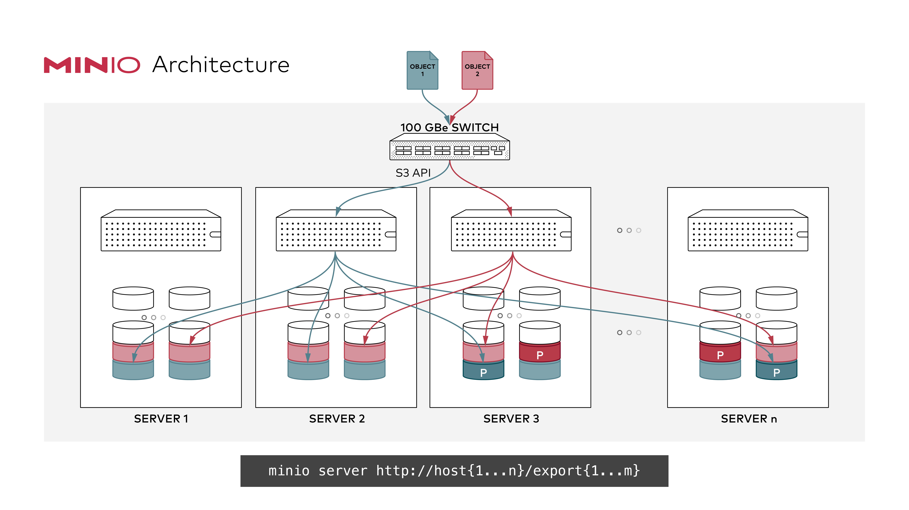
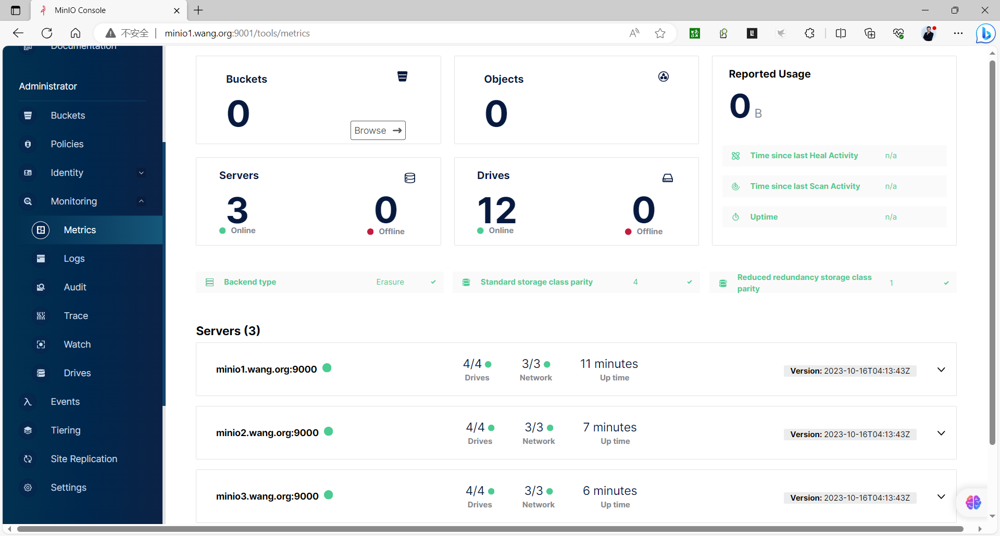
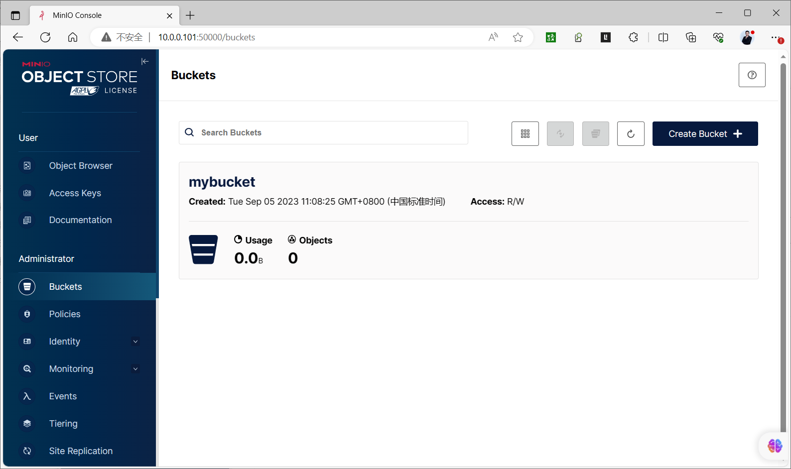
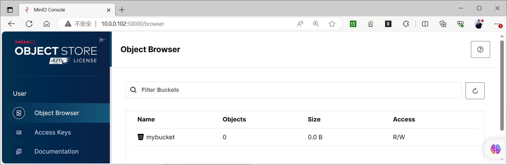
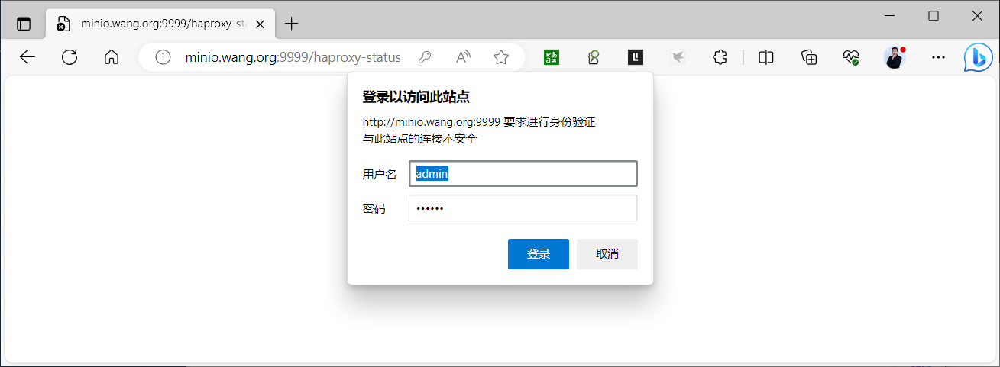
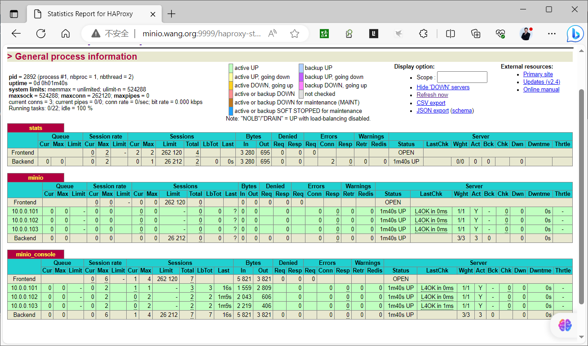
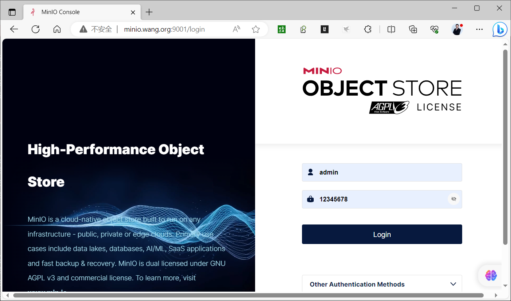
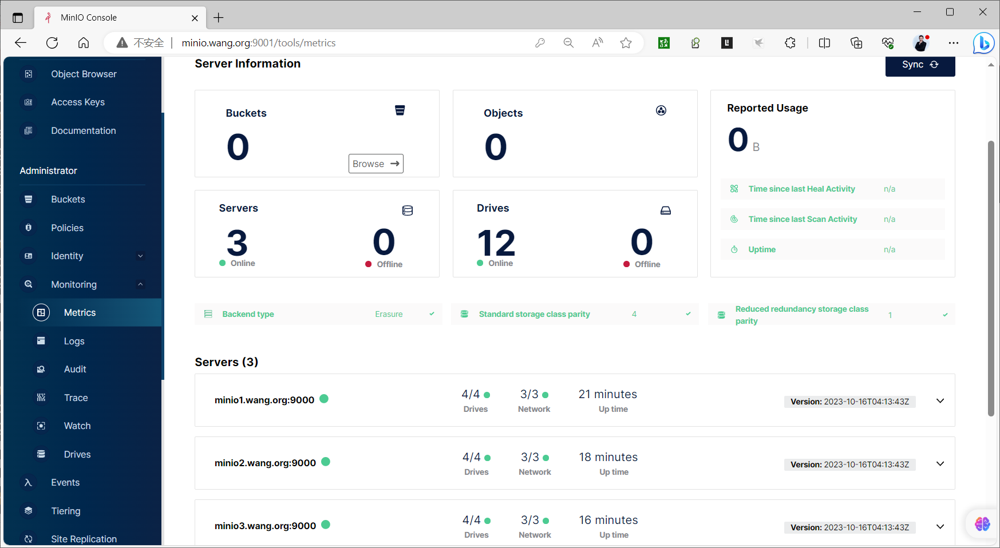

[← 返回 MinIO 对象存储目录]({{ '/subjects/MinIO/' | relative_url }})



# 07 分布式集群部署

本章讨论**跨多台物理主机**的 MinIO 集群。与上一章的单机多盘相比，磁盘分布在不同主机上，才能把主机故障纳入容错设计。仅在一台宿主机上运行多个容器，即使容器有不同 IP 或前置 Nginx，也不是跨主机高可用。



## 理解容错边界

MinIO 把对象编码为数据与校验分片并分布到纠删码集合中的驱动器上。读取、写入各自需要满足相应仲裁；可容忍的故障数与集合规模、校验分片数、对象存储类及故障分布有关，**不能简单套用“总盘数的一半在线就一定可读，半数加一就一定可写”**。例如，16 台主机各 16 盘不意味着任意 8 台故障后都能继续读写：分片在不同纠删码集合中的分布和仲裁都要计入。设计阶段应按具体版本和拓扑做故障演练。

多节点提升可用性和扩展能力，但并不能代替异地备份。位衰减检查、纠删码自愈与版本化各自解决不同问题；误删除、凭据泄露、整站故障仍需独立的保护措施。

部署前逐项确认：

1. 每个节点使用相同的 MinIO 版本、相同的根凭据、相同的端点列表和一致的启动参数。
2. 节点之间的主机名可以互相解析，时钟同步，端口互通；API、Console 与内部节点流量按网络策略分别开放。
3. 数据路径挂载到真实、独立的持久化磁盘。不要把多个目录建在同一块盘或同一个底层逻辑卷上冒充多盘。
4. 新集群使用空数据盘；重启已有集群时则必须保持原磁盘及端点顺序。操作系统重装、替盘与扩容另有专章，不应通过重建空目录“修复”现有集群。
5. 根据容量、磁盘延迟、网络带宽与故障域设计规模。原资料给出的“每盘不超过 2 TB”不是通用硬上限；应参考当前版本的硬件建议和实测负载，而不是把它当成固定限制。

## 四节点、每节点四盘的二进制部署

以下示例主机名 `minio1` 至 `minio4`；每台主机分别将四块独立磁盘挂载到 `/data/minio1` 至 `/data/minio4`。端点表达式使用 MinIO 的 `{1...4}` 展开语法，不是 Bash 的 `{1..4}`。示例是拓扑与配置模板，先核对所用版本的[多节点多盘部署文档](https://min.io/docs/minio/linux/operations/install-deploy-manage/deploy-minio-multi-node-multi-drive.html)。


在四台主机上分别检查名称解析、挂载点、服务用户及二进制：

```bash
getent hosts minio1 minio2 minio3 minio4
findmnt /data/minio1
findmnt /data/minio2
findmnt /data/minio3
findmnt /data/minio4
/usr/local/bin/minio --version
```

LVM 可用于管理卷，但若四个 LV 全来自同一 PV，它们仍共享一块物理盘的故障域。原案例在同一 VG 上划出一个 LV 并创建四个目录，仅适于命令练习，不满足此处的独立磁盘设计。

在各节点创建 `/etc/default/minio`，内容必须一致：

```ini
MINIO_ROOT_USER=admin
MINIO_ROOT_PASSWORD=请替换为各节点一致的强密码
MINIO_VOLUMES="http://minio{1...4}:9000/data/minio{1...4}"
MINIO_OPTS="--console-address :9001"
```

根凭据在各节点相同，但不要使用示例密码。环境文件由 root 持有，权限设为 `600`。如果启用 TLS，端点应统一使用 `https://` 并正确配置证书；不能只改 URL 方案而不安装证书。

```bash
sudo chown root:root /etc/default/minio
sudo chmod 600 /etc/default/minio
```

若发行版包已经提供 `minio.service`，优先检查并使用该服务单元。自建单元时，关键配置如下；`network-online.target` 不要误写成 `network-noline.target`：

```ini
[Unit]
Description=MinIO
Wants=network-online.target
After=network-online.target

[Service]
User=minio
Group=minio
EnvironmentFile=/etc/default/minio
ExecStart=/usr/local/bin/minio server $MINIO_OPTS $MINIO_VOLUMES
Restart=always
LimitNOFILE=1048576

[Install]
WantedBy=multi-user.target
```

将其保存为 `/etc/systemd/system/minio.service` 后，确认 `minio` 账户对四个数据挂载点均可读写，再在各节点启动。首启时端点必须互通；部分节点尚未启动，日志可能显示等待或离线，不应将暂时的健康状态误判成部署成功。

```bash
sudo systemctl daemon-reload
sudo systemctl enable --now minio.service
sudo systemctl status minio.service
sudo journalctl -u minio.service -n 80 --no-pager
```




## 从客户端验证集群

待四台主机及全部预期磁盘上线后，用 `mc` 连接一个 API 节点或负载均衡入口，再检查服务和磁盘状态。不能仅根据 Console 可登录判定数据路径完整。

```bash
mc alias set lab http://minio1:9000 admin '请替换为强密码'
mc admin info lab
mc mb lab/cluster-check
printf 'hello minio\n' > /tmp/minio-check.txt
mc cp /tmp/minio-check.txt lab/cluster-check/check.txt
mc cat lab/cluster-check/check.txt
```

再从另一节点的 API 地址读取同一对象，验证客户端视角的一致性；测试结束后按需清理存储桶。故障演练应在有备份的测试环境进行，并记录实际读写仲裁与自愈结果。





## 入口负载均衡

客户端可通过 HAProxy、Nginx 或云负载均衡访问多个 API 节点。**单个代理实例自身也是单点**，生产环境应为入口配置冗余。代理健康检查与上传超时要与对象大小、网络条件匹配；MinIO Console 还可能使用 WebSocket，代理需传递升级请求头。

下面只展示 Nginx 的核心结构，放入 `http` 配置上下文后先运行 `nginx -t`。对外服务建议启用 TLS，不要把管理 Console 直接暴露到公网。

```nginx
upstream minio_api {
    server minio1:9000;
    server minio2:9000;
    server minio3:9000;
    server minio4:9000;
}

server {
    listen 9000;
    client_max_body_size 0;
    proxy_request_buffering off;
    location / {
        proxy_set_header Host $http_host;
        proxy_set_header X-Real-IP $remote_addr;
        proxy_set_header X-Forwarded-For $proxy_add_x_forwarded_for;
        proxy_set_header X-Forwarded-Proto $scheme;
        proxy_http_version 1.1;
        proxy_pass http://minio_api;
    }
}
```

原材料中的 Nginx 后端 `10.0.0.103.9000` 少了端口冒号；HAProxy 状态页示例还使用了弱口令。两者都不应照抄。Console 入口应另设 upstream、正确处理 WebSocket 的 `Upgrade`／`Connection`，并配置 MinIO 的对外重定向 URL；可根据当前版本的反向代理文档实施。









## 容器方式与本章结论

容器方式可以部署相同的多节点拓扑，但每个容器应运行在不同宿主机，并持久化挂载本机的独立磁盘。原案例用一台主机上的三个 macvlan 容器模拟三个节点，既有断裂参数、拼错的 `MINIO_ROOT_PASSWORD`，也无法抵御宿主机故障；它只能用于演示节点发现，不能作为高可用方案。

部署成功的判据不是“进程都能启动”，而是：拓扑中的所有预期驱动器上线、`mc admin info` 状态符合设计、跨节点读写成功、入口具备冗余，并且已经建立备份和监控。



<nav class="article-end" aria-label="章节导航">
  <a href="{{ '/subjects/MinIO/06-standalone-deployment.html' | relative_url }}">← 上一篇：单机部署</a>
  <a href="{{ '/subjects/MinIO/' | relative_url }}">返回 MinIO 对象存储目录</a>
  <a href="{{ '/subjects/MinIO/08-kubernetes-deployment.html' | relative_url }}">下一篇：Kubernetes 部署 →</a>
</nav>
