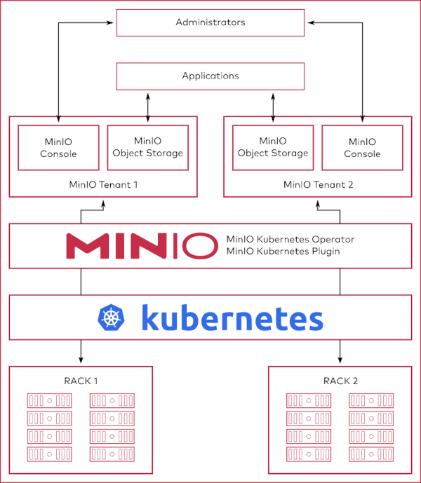

[← 返回MinIO 对象存储目录]({{ '/subjects/MinIO/' | relative_url }})



# 08 基于Kubernetes 部署
### 2.4 基于Kubernetes 部署

<https://github.com/minio/minio/tree/master/docs/orchestration/kubernetes>

基于Kubernetes 部署 MinIO 有多种方法

Manifest YAML 清单文件 MinIO Operator Helm

### YAML清单文件

环境要求: 依赖于一个支持PV动态置备的名称为sc-nfs的StorageClass

service 资源

```yaml
#minio-service.yaml
---
kind: Service
apiVersion: v1
metadata:
name: minio-headless
labels:
app: minio
spec:
clusterIP: None
#publishNotReadyAddresses: true
selector:
app: minio
ports:
- name: http
port: 9000
targetPort: 9000
---
apiVersion: v1
kind: Service
metadata:
name: minio
spec:
type: LoadBalancer
selector:
app: minio
ports:
- port: 9000
targetPort: 9000
name: http
- port: 9001
targetPort: 9001
name: console
---
```

secret 资源

```yaml
#minio-secret.yaml
apiVersion: v1
kind: Secret
metadata:
name: minio-secret
data:
MINIO_ROOT_USER: YWRtaW4=
# username: admin
MINIO_ROOT_PASSWORD: MTIzNDU2Nzg=
# root password: 12345678
```

statefulset 资源

```yaml
#minio-statefulset.yaml
---
apiVersion: apps/v1
kind: StatefulSet
metadata:
name: minio
labels:
app: minio
spec:
serviceName: "minio-headless"
replicas: 4
podManagementPolicy: "Parallel" #并行启动pod，不配置的话模式是按顺序启动pod，minio、
nacos都需要配置并行启动
selector:
matchLabels:
app: minio
template:
metadata:
labels:
app: minio
annotations:
prometheus.io/scrape: "true"
prometheus.io/port: "9000"
prometheus.io/path: "/minio/v2/metrics/node"
#prometheus.io/path: "/minio/v2/metrics/cluster"
#prometheus.io/path: "/minio/v2/metrics/bucket"
spec:
containers:
- name: minio
#image: minio/minio:RELEASE.2023-12-02T10-51-33Z
image: minio/minio:RELEASE.2024-08-03T04-33-23Z
volumeMounts:
- name: data
mountPath: /data
args:
- server
- http://minio-{0...3}.minio-
headless.$(MINIO_POD_NAMESPACE).svc.cluster.local/data
- "--address=:9000"
- "--console-address=:9001"
env:
# MinIO access key and secret key
- name: MINIO_ROOT_USER
valueFrom:
secretKeyRef:
name: minio-secret
key: MINIO_ROOT_USER
- name: MINIO_ROOT_PASSWORD
valueFrom:
secretKeyRef:
name: minio-secret
key: MINIO_ROOT_PASSWORD
- name: MINIO_POD_NAMESPACE
valueFrom:
fieldRef:
fieldPath: metadata.namespace
- name: MINIO_PROMETHEUS_AUTH_TYPE
value: "public"
livenessProbe:
failureThreshold: 3
httpGet:
path: /minio/health/live
port: http
scheme: HTTP
initialDelaySeconds: 120
periodSeconds: 15
successThreshold: 1
timeoutSeconds: 10
ports:
- containerPort: 9000
name: http
protocol: TCP
volumeClaimTemplates:
- metadata:
name: data
spec:
accessModes:
- ReadWriteOnce
resources:
requests:
storage: 10Gi
storageClassName: "sc-nfs"
```

ingress 资源

```yaml
#minio-ingress.yaml
---
apiVersion: networking.k8s.io/v1
kind: Ingress
metadata:
name: minio
spec:
ingressClassName: nginx
rules:
- host: minio.bowen.org
http:
paths:
- path: /
pathType: Prefix
backend:
service:
name: minio
port:
number: 9001
```

### MinIO Operator

<https://github.com/minio/operator/blob/master/README.md>



### Helm 安装

<https://github.com/minio/minio/tree/master/helm/minio>

Configure MinIO Helm repo

```text
helm repo add minio https://charts.min.io/
```

Installing the Chart

Install this chart using:

```text
helm install --namespace minio --set rootUser=rootuser,rootPassword=rootpass123 -
-generate-name minio/minio
```

The command deploys MinIO on the Kubernetes cluster in the default configuration. The configuration section lists the parameters that can be configured during installation. Installing the Chart (toy-setup)

Minimal toy setup for testing purposes can be deployed using:

```text
helm install --set resources.requests.memory=512Mi --set replicas=1 --set
persistence.enabled=false --set mode=standalone --set
rootUser=rootuser,rootPassword=rootpass123 --generate-name minio/minio
```

Upgrading the Chart

You can use Helm to update MinIO version in a live release. Assuming your release is named as my-release , get the values using the command:

```text
helm get values my-release > old_values.yaml
```

Then change the field image.tag in old_values.yaml file with MinIO image tag you want to use. Now update the chart using

```text
helm upgrade -f old_values.yaml my-release minio/minio
```

Default upgrade strategies are specified in the values.yaml file. Update these fields if you'd like to use a different strategy.

Configuration

Refer the Values file for all the possible config fields.

You can specify each parameter using the --set key=value[,key=value] argument to helm install . For example,

```text
helm install --name my-release --set persistence.size=1Ti minio/minio
```

The above command deploys MinIO server with a 1Ti backing persistent volume.

Alternately, you can provide a YAML file that specifies parameter values while installing the chart. For example,

```text
helm install --name my-release -f values.yaml minio/minio
```

Persistence

This chart provisions a PersistentVolumeClaim and mounts corresponding persistent volume to default location /export . You'll need physical storage available in the Kubernetes cluster for this to work. If you'd rather use emptyDir , disable PersistentVolumeClaim by:

```text
helm install --set persistence.enabled=false minio/minio
```

"An emptyDir volume is first created when a Pod is assigned to a Node, and exists as long as that Pod is running on that node. When a Pod is removed from a node for any reason, the data in the emptyDir is deleted forever."

Existing PersistentVolumeClaim

If a Persistent Volume Claim already exists, specify it during installation.

1. Create the PersistentVolume

2. Create the PersistentVolumeClaim

3. Install the chart

```text
helm install --set persistence.existingClaim=PVC_NAME minio/minio
```



<nav class="article-end" aria-label="章节导航">
  <a href="{{ '/subjects/MinIO/07-distributed-cluster-deployment.html' | relative_url }}">← Previous: Distributed Cluster Deployment</a>
  <a href="{{ '/subjects/MinIO/' | relative_url }}">Back to MinIO Object Storage Index</a>
  <a href="{{ '/subjects/MinIO/09-minio-console-management.html' | relative_url }}">Next: MinIO Console Management →</a>
</nav>
