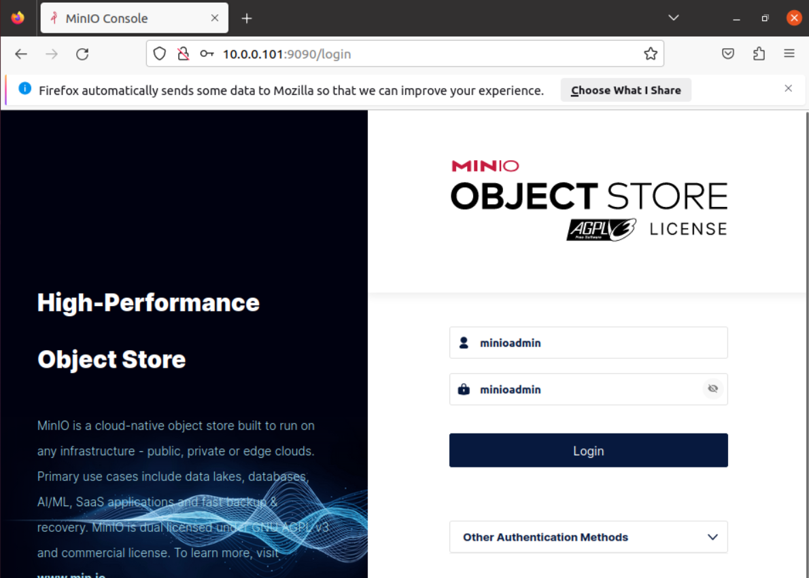
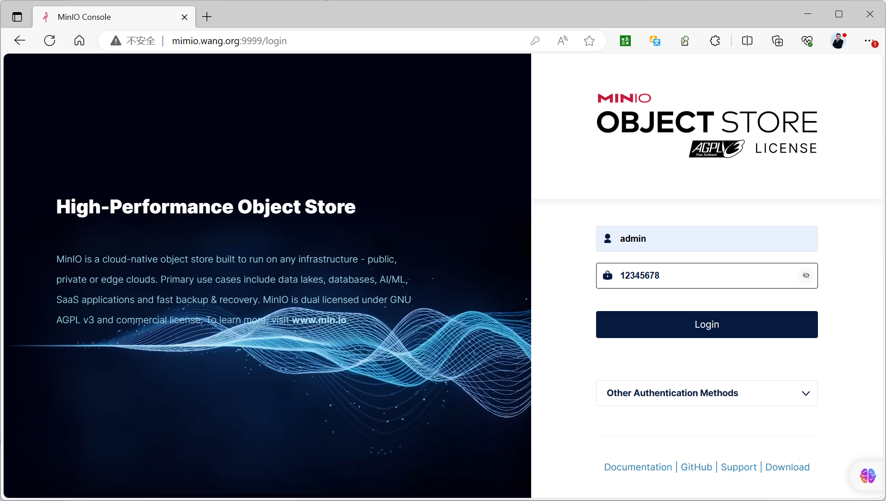
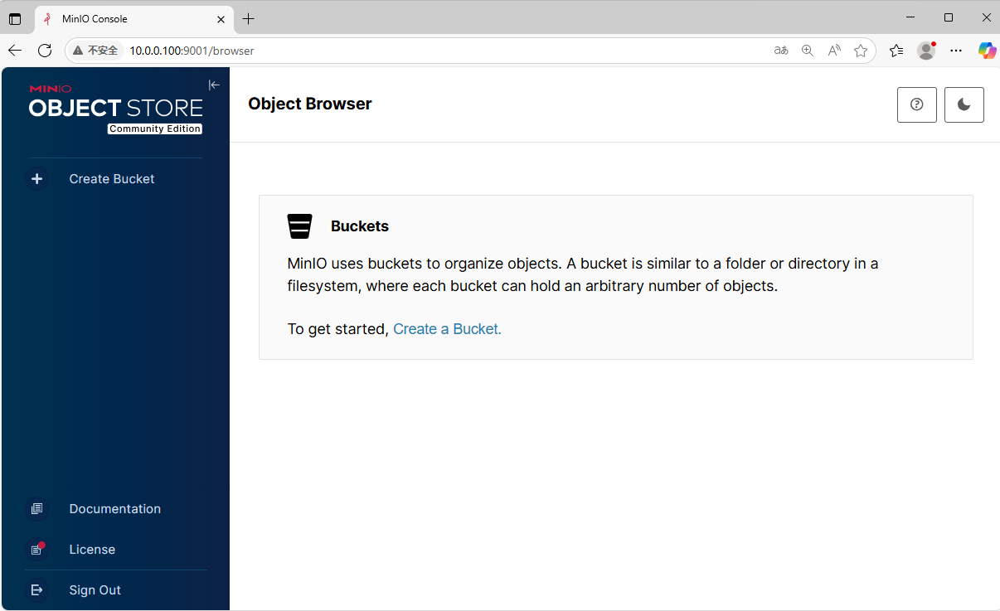
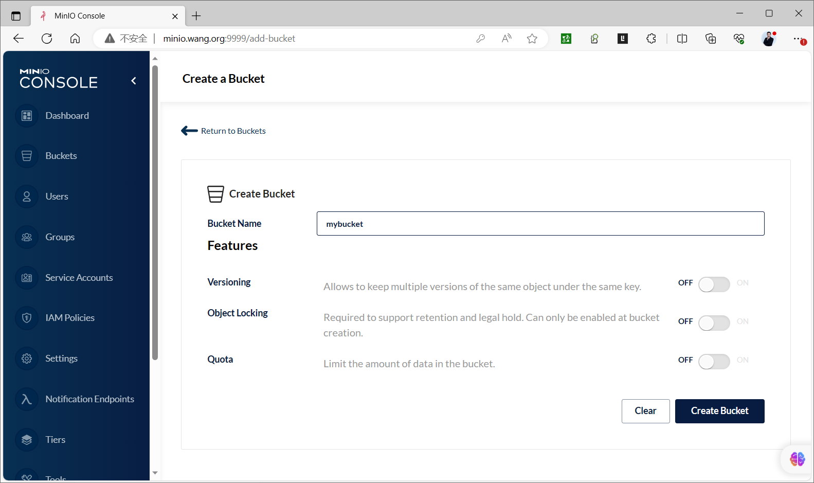
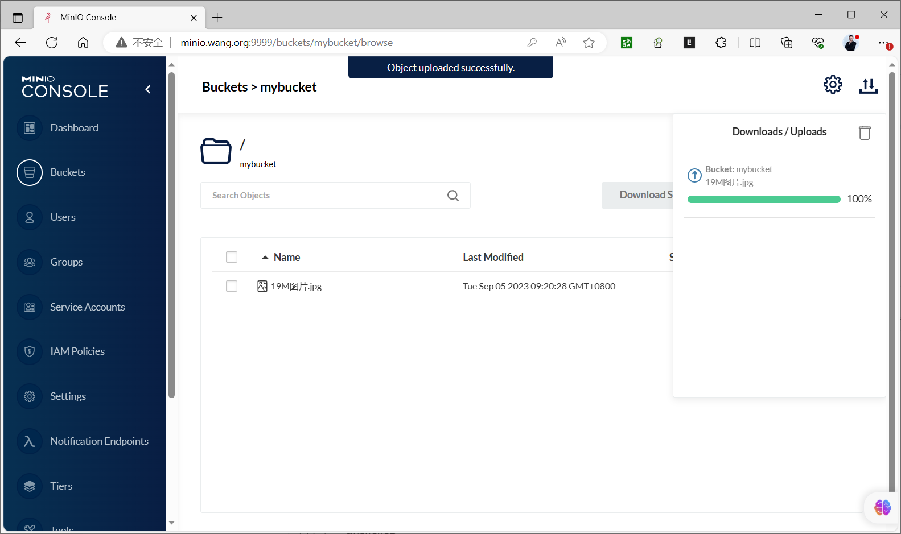
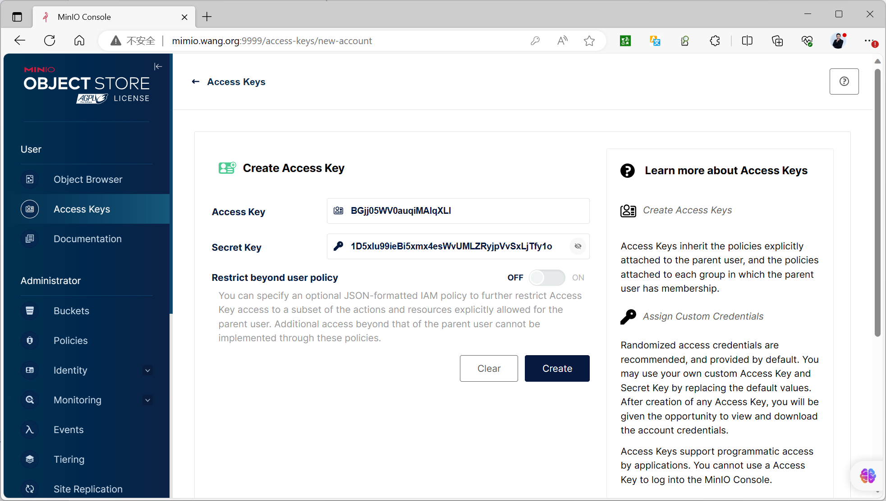
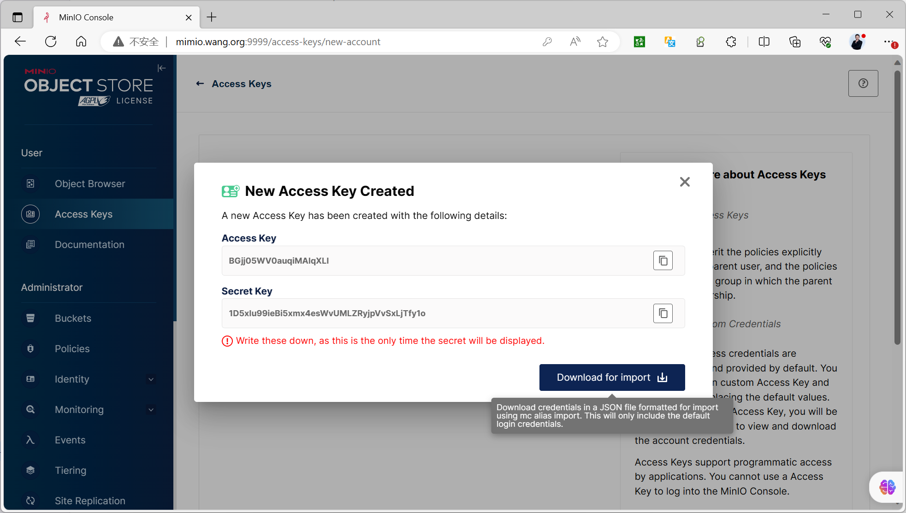

[← Back to MinIO Object Storage Index]({{ '/subjects/MinIO/' | relative_url }})



# 09 MinIO Console Management
## 3 MINIO 使用

### 3.1 MINIO 控制台管理

```text
minio-20250723155402.0.0 版本界面功能发生重大变化
```

### 登录控制台

如果安装时没有指定用户密码信息，则登录默认用户和密码 minioadmin/minioadmin



使用指定用户和密码登录



### 创建Bucket和上传文件

```text
#如下的版本minio-20250723155402.0.0 版本界面功能发生重大变化
```



```bash
#minio.RELEASE.2025-04-22T22-12-26Z以前版本界面
```



```bash
#查看生成目录
[root@ubuntu2204 ~]#tree /minio/
/minio/
├── data1
│ └── mybucket
├── data2
│ └── mybucket
├── data3
│ └── mybucket
├── data4
│ └── mybucket
├── data5
│ └── mybucket
├── data6
│ └── mybucket
├── data7
│ └── mybucket
└── data8
└── mybucket
16 directories, 0 files
#上传文件19M图片的文件
```



```bash
[root@ubuntu2204 ~]#tree /minio/
/minio/
├── data1
│ └── mybucket
│     └── 19M图片.jpg
│         ├── ff0324e9-45d5-4cb3-af1e-b04cb9b948b2
│         │ └── part.1
│         └── xl.meta
├── data2
│ └── mybucket
│     └── 19M图片.jpg
│         ├── ff0324e9-45d5-4cb3-af1e-b04cb9b948b2
│         │ └── part.1
│         └── xl.meta
├── data3
│ └── mybucket
│     └── 19M图片.jpg
│         ├── ff0324e9-45d5-4cb3-af1e-b04cb9b948b2
│         │ └── part.1
│         └── xl.meta
├── data4
│ └── mybucket
│     └── 19M图片.jpg
│         ├── ff0324e9-45d5-4cb3-af1e-b04cb9b948b2
│         │ └── part.1
│         └── xl.meta
├── data5
│ └── mybucket
│     └── 19M图片.jpg
│         ├── ff0324e9-45d5-4cb3-af1e-b04cb9b948b2
│         │ └── part.1
│         └── xl.meta
├── data6
│ └── mybucket
│     └── 19M图片.jpg
│         ├── ff0324e9-45d5-4cb3-af1e-b04cb9b948b2
│         │ └── part.1
│         └── xl.meta
├── data7
│ └── mybucket
│     └── 19M图片.jpg
│         ├── ff0324e9-45d5-4cb3-af1e-b04cb9b948b2
│         │ └── part.1
│         └── xl.meta
└── data8
└── mybucket
└── 19M图片.jpg
├── ff0324e9-45d5-4cb3-af1e-b04cb9b948b2
│ └── part.1
└── xl.meta
32 directories, 16 files
[root@ubuntu2204 ~]#du -sh /minio/
45M /minio/
```

### 创建访问 Access key 和 Secret key

创建 Access Key 和 Secret key  用于访问数据的凭据



注意： 此处的 Secret key  是有一次性显示，需要立即复制保存，否则只能重新生成新的 Access key





<nav class="article-end" aria-label="章节导航">
  <a href="{{ '/subjects/MinIO/08-kubernetes-deployment.html' | relative_url }}">← Previous: Kubernetes Deployment</a>
  <a href="{{ '/subjects/MinIO/' | relative_url }}">Back to MinIO Object Storage Index</a>
  <a href="{{ '/subjects/MinIO/10-minio-client-mc.html' | relative_url }}">Next: MinIO Client (mc) →</a>
</nav>
