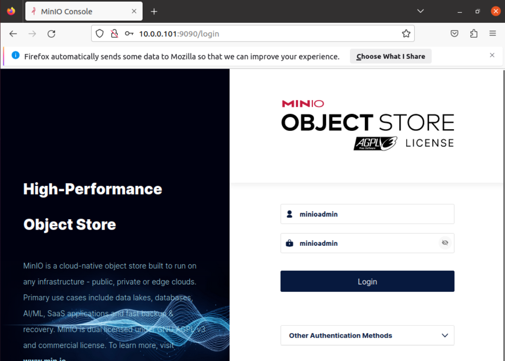
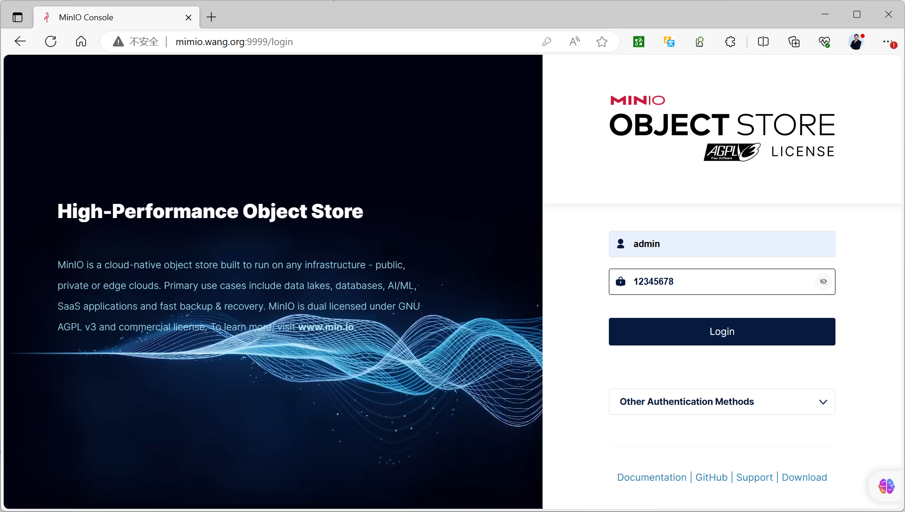
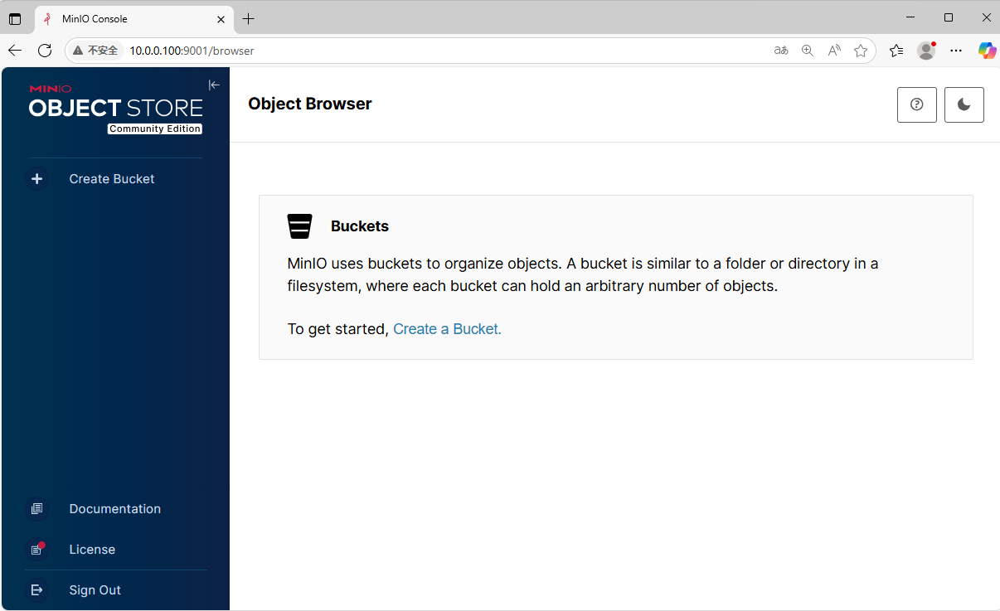
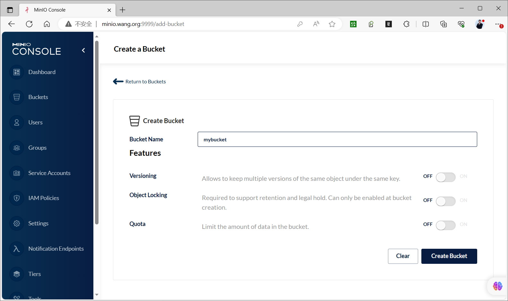
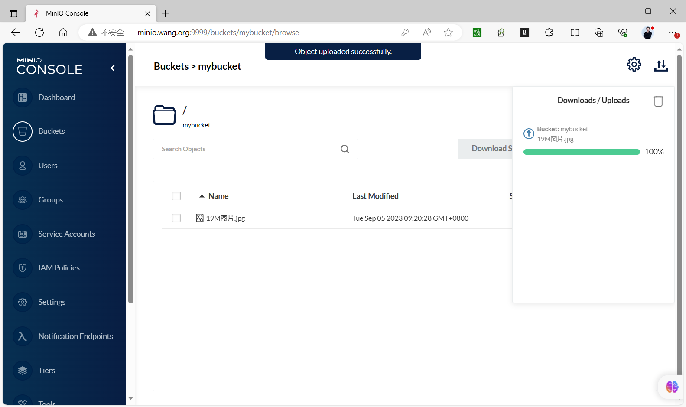
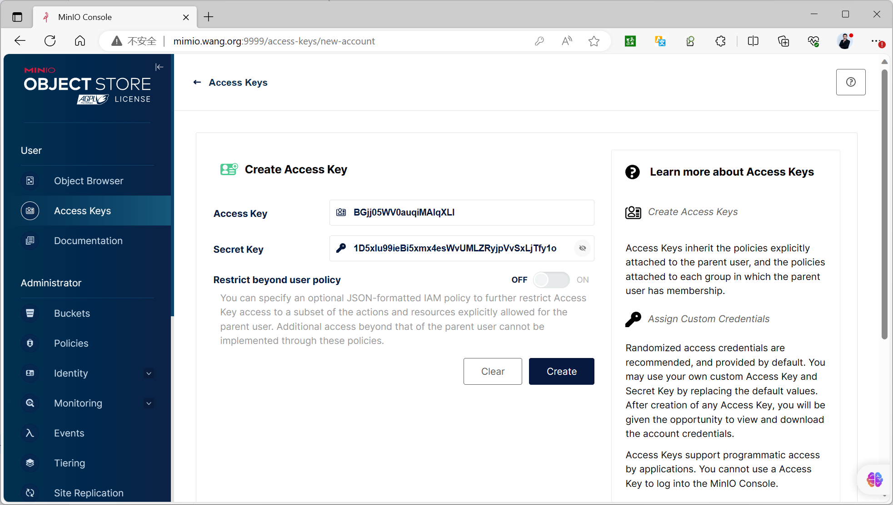
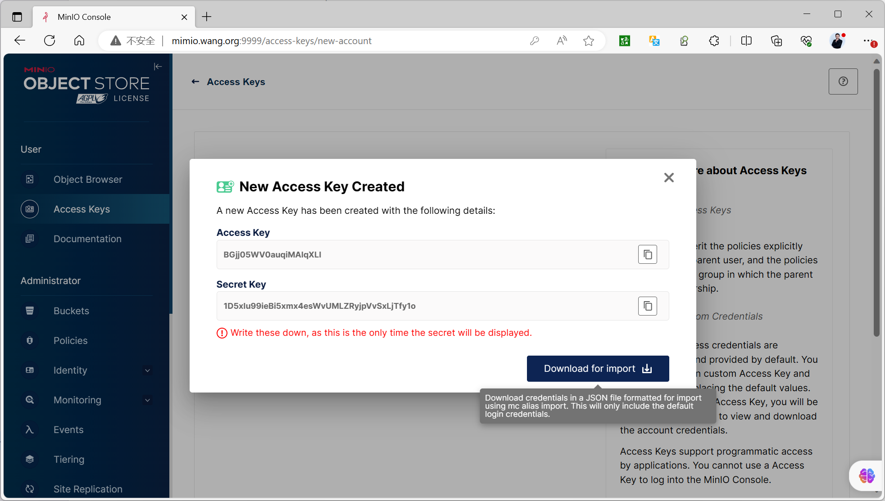

[← 返回 MinIO 对象存储目录]({{ '/subjects/MinIO/' | relative_url }})



# 09 Console 管理

部署完成后，MinIO 提供 S3 API 和网页 Console 两个入口。前面示例把 API 设为 `9000`，Console 设为 `9001`；实际端口以启动参数和代理配置为准。不同发布版本的 Console 菜单位置与可用功能可能变化，因此本节侧重稳定的操作概念，不要求读者机械地对照某一版截图。

## 登录与确认集群状态

在浏览器访问 Console 地址，使用部署时设置的 `MINIO_ROOT_USER` 和 `MINIO_ROOT_PASSWORD` 登录。未显式设置凭据的旧示例可能使用过 `minioadmin/minioadmin`，但这种默认凭据不应保留在实际环境中。若登录失败，先核对访问的是否是 Console 端口，再检查服务日志、代理跳转和凭据来源。

登录后先确认节点、磁盘和服务状态。单机多盘或集群场景下，网页可访问不代表所有数据盘都已上线；运维时还应结合 `mc admin info` 与监控指标检查。

## 创建存储桶并上传对象

存储桶（Bucket）是对象的顶层命名空间。通过 Console 的 Buckets 页面创建测试桶，例如 `mybucket`，再上传一个文件并尝试下载或预览。桶名需符合 S3 命名规则；对象名包含目录样式的 `/` 时，在 S3 中仍是对象键的一部分，不应把它理解成普通文件系统目录。

较新版本与早期版本的界面布局不同，下图分别用于识别“创建桶”和“上传对象”的操作位置。

上传后可从 Console 或下一章的 `mc` 验证对象键、大小与下载内容。原资料展示的磁盘目录含 `xl.meta` 和 `part.1`：这反映 MinIO 在该版本中的内部存储布局，**不是**用户应直接编辑的文件结构。一个对象可能在多个磁盘上呈现分片与元数据，不能据此推断每盘保存完整副本，也不能通过 `tree` 的目录数或 `du` 大小计算对象的逻辑容量。移动、删除与备份对象应通过 S3 API 或 MinIO 管理工具完成。

## 创建访问密钥

应用程序通常不应使用根账户凭据。先为应用建立范围合适的身份与策略，再在 Console 中创建对应的 Access Key／Secret Key。Access Key 相当于标识，Secret Key 是签名秘密；二者结合才能调用 S3 API。应只授予所需存储桶和操作权限，避免把根凭据写进应用配置或仓库。

创建时立即将 Secret Key 保存到适当的密钥管理系统；关闭页面后通常不能再次查看同一密钥，只能新建并轮换。轮换时先让应用接受新密钥，验证访问，再停用旧密钥，避免直接删除造成中断。下一章使用 `mc` 连接 API 端点，演示桶和对象的命令行操作。



<nav class="article-end" aria-label="章节导航">
  <a href="{{ '/subjects/MinIO/08-kubernetes-deployment.html' | relative_url }}">← 上一篇：Kubernetes 部署</a>
  <a href="{{ '/subjects/MinIO/' | relative_url }}">返回 MinIO 对象存储目录</a>
  <a href="{{ '/subjects/MinIO/10-minio-client-mc.html' | relative_url }}">下一篇：MinIO 客户端 mc →</a>
</nav>
