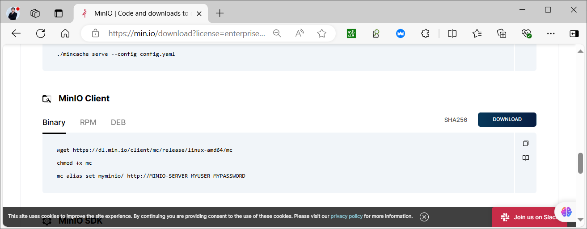
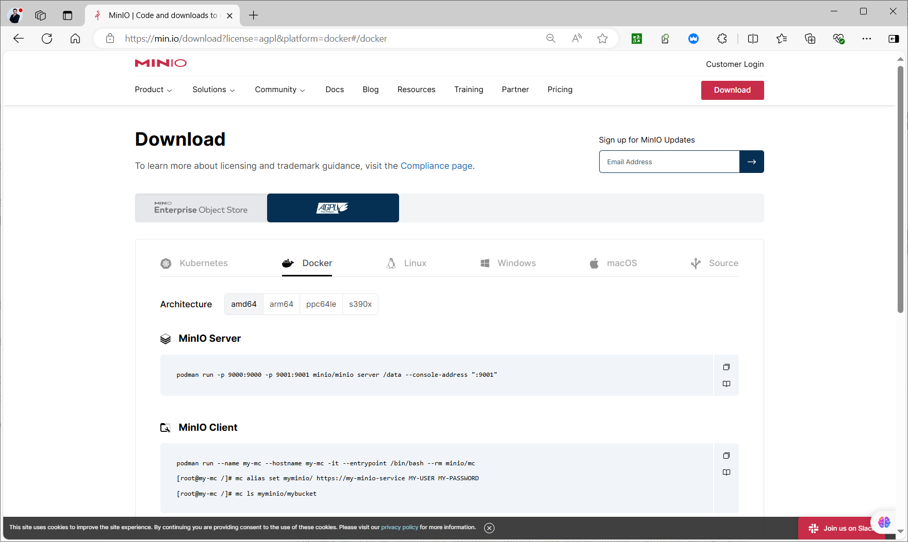

[← Back to MinIO Object Storage Index]({{ '/subjects/MinIO/' | relative_url }})



# 10 MinIO Client (mc)
### 3.2 MINIO 客户端 MC

### MC 介绍

<https://min.io/docs/minio/linux/reference/minio-mc.html>

<https://min.io/docs/minio/linux/reference/minio-mc-admin.html>

MC是MinIO 客户端命令行工具 MinIO Client (mc)

MC 可以用于访问MinIO的文件, 使用方法类似于常用的UNIX命令: 如:Is, cat, cp,rm,diff, find等

它支持文件系统和兼容Amazon S3的云存储服务(AWS Signature v2和v4)。

### MC 部署

### 二进制部署

```text
#二进制部署下载
https://dl.min.io/client/mc/release/linux-amd64/mc
http://dl.minio.org.cn/client/mc/release/linux-amd64/mc
https://min.io/download?
license=enterprise&platform=linux&subscription=enterprise-plus
```



范例: 二进制部署

```bash
#官网下载
[root@ubuntu2204 ~]#wget https://dl.min.io/client/mc/release/linux-amd64/mc
#国内镜像下载
[root@ubuntu2204 ~]#wget http://dl.minio.org.cn/client/mc/release/linux-amd64/mc
[root@ubuntu2204 ~]#install  mc /usr/local/bin/mc
```

### 包安装

<https://min.io/download?license=enterprise&platform=linux&subscription=enterprise-plus>

DEB 包

```text
wget https://dl.min.io/client/mc/release/linux-
amd64/mcli_20240731155833.0.0_amd64.deb
dpkg -i mcli_20240731155833.0.0_amd64.deb
mcli alias set myminio/ http://MINIO-SERVER MYUSER MYPASSWORD
```

RPM 包

```text
dnf install https://dl.min.io/client/mc/release/linux-amd64/mcli-
20240731155833.0.0-1.x86_64.rpm
mcli alias set myminio/ http://MINIO-SERVER MYUSER MYPASSWORD
```

### 容器化部署

```text
#容器化部署
https://min.io/download#/docker
https://min.io/download?license=agpl&platform=docker#/docker
```



范例:容器化部署

```bash
[root@ubuntu2204 ~]#docker run --name my-mc --hostname my-mc -it --entrypoint
/bin/bash --rm minio/mc
[root@my-mc /]# mc alias set myminio/ https://my-minio-service MY-USER MY-
PASSWORD
[root@my-mc /]# mc ls myminio/mybucket
```

### MC 命令使用

### MC 命令说明

```text
#帮助查看
mc --help
mc [GLOBALFLAGS] COMMAND --help
```

常见命令

```sql
ls #列出文件和文件夹
mb  #创建一个存储桶或一一个文件夹
cat  #显示文件和对象内容
pipe #一个STDIN重定向到一一个对象或者文件或者STDOUT
share #生成用于共享的URL
cp  # 拷贝文件和对象
mirror #给存储桶和文件夹做镜像
find  #基于参数查找文件
diff   #对两个文件夹或者存储桶比较差异
rm   #删除文件和对象
events #管理对象通知
watch #监视文件和对象的事件
policy #管理访问策略
config #管理mc配置文件
update #检查软件更新
version #输出版本信息
```

### MC 使用

范例: 查看帮助

```bash
[root@ubuntu2204 ~]#mc
[root@ubuntu2204 ~]#mc --help
NAME:
mc - MinIO Client for object storage and filesystems.
USAGE:
mc [FLAGS] COMMAND [COMMAND FLAGS | -h] [ARGUMENTS...]
COMMANDS:
alias      manage server credentials in configuration file
ls         list buckets and objects
mb         make a bucket
rb         remove a bucket
cp         copy objects
mv         move objects
rm         remove object(s)
mirror     synchronize object(s) to a remote site
cat        display object contents
head       display first 'n' lines of an object
pipe       stream STDIN to an object
find       search for objects
sql        run sql queries on objects
stat       show object metadata
tree       list buckets and objects in a tree format
du         summarize disk usage recursively
retention  set retention for object(s)
legalhold  manage legal hold for object(s)
support    support related commands
license    license related commands
share      generate URL for temporary access to an object
version    manage bucket versioning
ilm        manage bucket lifecycle
quota      manage bucket quota
encrypt    manage bucket encryption config
event      manage object notifications
watch      listen for object notification events
undo       undo PUT/DELETE operations
anonymous  manage anonymous access to buckets and objects
tag        manage tags for bucket and object(s)
diff       list differences in object name, size, and date between two buckets
replicate  configure server side bucket replication
admin      manage MinIO servers
idp        manage MinIO IDentity Provider server configuration
update     update mc to latest release
ready      checks if the cluster is ready or not
ping       perform liveness check
od         measure single stream upload and download
batch      manage batch jobs
GLOBAL FLAGS:
--autocompletion              install auto-completion for your shell
--config-dir value, -C value  path to configuration folder (default:
"/root/.mc")
--quiet, -q                   disable progress bar display
--no-color                    disable color theme
--json                        enable JSON lines formatted output
--debug                       enable debug output
--insecure                    disable SSL certificate verification
--limit-upload value          limits uploads to a maximum rate in KiB/s,
MiB/s, GiB/s. (default: unlimited)
--limit-download value        limits downloads to a maximum rate in KiB/s,
MiB/s, GiB/s. (default: unlimited)
--help, -h                    show help
--version, -v                 print the version
TIP:
Use 'mc --autocompletion' to enable shell autocompletion
COPYRIGHT:
Copyright (c) 2015-2023 MinIO, Inc.
LICENSE:
GNU AGPLv3 <https://www.gnu.org/licenses/agpl-3.0.html>
```

范例: 开启mc命令自动补全功能

```bash
[root@ubuntu2204 ~]#mc --autocompletion
mc: Your shell is set to 'bash', by env var 'SHELL'.
mc: enabled autocompletion in your 'bash' rc file. Please restart your shell.
#上面命令本质上就是修改.bashrc文件
[root@ubuntu2204 ~]#tail -n1 .bashrc
complete -C /usr/local/bin/mc mc
#需要重新登录才能生效
[root@ubuntu2204 ~]#mc
.cache/ data/   .mc/    snap/   .ssh/
[root@ubuntu2204 ~]#exit
#重新登录后,支持自动补会mc命令
[root@ubuntu2204 ~]#mc  <tab> <tab>
admin      cat        encrypt    idp        ls         od         rb         rm
support    update
alias      cp         event      ilm        mb         ping       ready
share      tag        version
anonymous  diff       find       legalhold  mirror     pipe       replicate  sql
tree       watch
batch      du         head       license    mv         quota      retention
stat       undo
```

范例: 查看客户端版本和连接信息

```bash
[root@ubuntu2204 ~]#mc --version
mc version RELEASE.2023-08-01T23-30-57Z (commit-
id=0a529d5e642f1a50a74b256c683be453e26bf7e9)
Runtime: go1.19.12 linux/amd64
Copyright (c) 2015-2023 MinIO, Inc.
License GNU AGPLv3 <https://www.gnu.org/licenses/agpl-3.0.html>
#查看默认连接信息
[root@ubuntu2204 ~]#mc alias ls
gcs
URL       : https://storage.googleapis.com
AccessKey : YOUR-ACCESS-KEY-HERE
SecretKey : YOUR-SECRET-KEY-HERE
API       : S3v2
Path      : dns
local
URL       : http://localhost:9000
AccessKey :
SecretKey :
API       :
Path      : auto
play
URL       : https://play.min.io
AccessKey : Q3AM3UQ867SPQQA43P2F
SecretKey : zuf+tfteSlswRu7BJ86wekitnifILbZam1KYY3TG
API       : S3v4
Path      : auto
s3
URL       : https://s3.amazonaws.com
AccessKey : YOUR-ACCESS-KEY-HERE
SecretKey : YOUR-SECRET-KEY-HERE
API       : S3v4
Path      : dns
[root@ubuntu2204 ~]#cat /root/.mc/config.json
{
"version": "10",
"aliases": {
"gcs": {
"url": "https://storage.googleapis.com",
"accessKey": "YOUR-ACCESS-KEY-HERE",
"secretKey": "YOUR-SECRET-KEY-HERE",
"api": "S3v2",
"path": "dns"
},
"local": {
"url": "http://localhost:9000",
"accessKey": "",
"secretKey": "",
"api": "S3v4",
"path": "auto"
},
"play": {
"url": "https://play.min.io",
"accessKey": "Q3AM3UQ867SPQQA43P2F",
"secretKey": "zuf+tfteSlswRu7BJ86wekitnifILbZam1KYY3TG",
"api": "S3v4",
"path": "auto"
},
"s3": {
"url": "https://s3.amazonaws.com",
"accessKey": "YOUR-ACCESS-KEY-HERE",
"secretKey": "YOUR-SECRET-KEY-HERE",
"api": "S3v4",
"path": "dns"
}
}
}
#默认无法访问
[root@ubuntu2404 ~]#mc admin info local
mc: <ERROR> Unable to get service info. Access Denied.
```

范例:  初始连接配置单机存储

```bash
#建议使用key进行连接
[root@ubuntu2204 ~]#mc alias set minio-server http://minio.bowen.org:9000
Ib4kdhJ3y5E0sbtcp8nH eTbjZq2R06xBgpDNMIqOWQOo7z7rItaSDZEitAAY
Added `minio-server` successfully.
[root@ubuntu2204 ~]#mc admin info minio-server2
```

●  minio1.bowen.org:9000

```text
Uptime: 2 hours
Version: 2024-10-02T17:50:41Z
Network: 3/3 OK
Drives: 4/4 OK
Pool: 1
```

●  minio2.bowen.org:9000

```text
Uptime: 2 hours
Version: 2024-10-02T17:50:41Z
Network: 3/3 OK
Drives: 4/4 OK
Pool: 1
```

●  minio3.bowen.org:9000

```text
Uptime: 2 hours
Version: 2024-10-02T17:50:41Z
Network: 3/3 OK
Drives: 4/4 OK
Pool: 1
┌──────┬──────────────────────┬─────────────────────┬──────────────┐
│ Pool │ Drives Usage         │ Erasure stripe size │ Erasure sets │
│ 1st  │ 1.4% (total: 80 GiB) │ 12                  │ 1            │
└──────┴──────────────────────┴─────────────────────┴──────────────┘
81 MiB Used, 2 Buckets, 17 Objects
12 drives online, 0 drives offline, EC:4
```

```bash
#使用用户名和密码连接
[root@ubuntu2204 ~]#mc alias set local http://127.0.0.1:9000 minioadmin
minioadmin
[root@ubuntu2204 ~]#mc config host ls
[root@ubuntu2204 ~]#mc admin info local
#验证后创建主机连接
[root@ubuntu2204 ~]#mc config host add local http://127.0.0.1:9000 admin
12345678
mc: Configuration written to `/root/.mc/config.json`. Please update your access
credentials.
mc: Successfully created `/root/.mc/share`.
mc: Initialized share uploads `/root/.mc/share/uploads.json` file.
mc: Initialized share downloads `/root/.mc/share/downloads.json` file.
Added `local` successfully.
#查看连接主机
[root@ubuntu2204 ~]#mc config host ls
gcs
URL       : https://storage.googleapis.com
AccessKey : YOUR-ACCESS-KEY-HERE
SecretKey : YOUR-SECRET-KEY-HERE
API       : S3v2
Path      : dns
local
URL       : http://127.0.0.1:9000
AccessKey : minioadmin
SecretKey : minioadmin
API       : s3v4
Path      : auto
play
URL       : https://play.min.io
AccessKey : Q3AM3UQ867SPQQA43P2F
SecretKey : zuf+tfteSlswRu7BJ86wekitnifILbZam1KYY3TG
API       : S3v4
Path      : auto
s3
URL       : https://s3.amazonaws.com
AccessKey : YOUR-ACCESS-KEY-HERE
SecretKey : YOUR-SECRET-KEY-HERE
API       : S3v4
Path      : dns
#配置存放在下面文件中
[root@ubuntu2204 ~]#cat .mc/config.json
{
"version": "10",
"aliases": {
"gcs": {
"url": "https://storage.googleapis.com",
"accessKey": "YOUR-ACCESS-KEY-HERE",
"secretKey": "YOUR-SECRET-KEY-HERE",
"api": "S3v2",
"path": "dns"
},
"local": {
"url": "http://127.0.0.1:9000",
"accessKey": "minioadmin",
"secretKey": "minioadmin",
"api": "S3v4",
"path": "auto"
},
"play": {
"url": "https://play.min.io",
"accessKey": "Q3AM3UQ867SPQQA43P2F",
"secretKey": "zuf+tfteSlswRu7BJ86wekitnifILbZam1KYY3TG",
"api": "S3v4",
"path": "auto"
},
"s3": {
"url": "https://s3.amazonaws.com",
"accessKey": "YOUR-ACCESS-KEY-HERE",
"secretKey": "YOUR-SECRET-KEY-HERE",
"api": "S3v4",
"path": "dns"
}
}
}
```

```bash
#单机显示
[root@ubuntu2204 ~]#mc admin info local
```

●  127.0.0.1:9000

```bash
Uptime: 21 minutes
Version: 2023-08-29T23:07:35Z
Network: 1/1 OK
Drives: 1/1 OK
Pool: 1
Pools:
1st, Erasure sets: 1, Drives per erasure set: 1
0 B Used, 1 Bucket, 0 Objects
1 drive online, 0 drives offline
#查看存储中的数据文件
[root@ubuntu2204 ~]#mc ls local
[2023-09-05 09:19:38 CST]     0B mybucket/
[root@ubuntu2204 ~]#mc ls local/mybucket
[2023-09-05 09:20:28 CST]  18MiB STANDARD 19M图片.jpg
```

范例:  管理分布式存储

```bash
#添加分布式存储的任意一个节点连接
[root@ubuntu2204 ~]#mc config host add minio-cluster http://10.0.0.101:9000
admin 12345678
#查看连接信息
[root@ubuntu2204 ~]#mc config host ls
gcs
URL       : https://storage.googleapis.com
AccessKey : YOUR-ACCESS-KEY-HERE
SecretKey : YOUR-SECRET-KEY-HERE
API       : S3v2
Path      : dns
local
URL       : http://localhost:9000
AccessKey :
SecretKey :
API       :
Path      : auto
minio-cluster
URL       : http://10.0.0.101:9000
AccessKey : admin
SecretKey : 12345678
API       : s3v4
Path      : auto
play
URL       : https://play.min.io
AccessKey : Q3AM3UQ867SPQQA43P2F
SecretKey : zuf+tfteSlswRu7BJ86wekitnifILbZam1KYY3TG
API       : S3v4
Path      : auto
s3
URL       : https://s3.amazonaws.com
AccessKey : YOUR-ACCESS-KEY-HERE
SecretKey : YOUR-SECRET-KEY-HERE
API       : S3v4
Path      : dns
#集群显示
[root@ubuntu2204 ~]#mc admin info minio-cluster
```

●  10.0.0.101:9000

```text
Uptime: 2 hours
Version: 2023-08-29T23:07:35Z
Network: 3/3 OK
Drives: 1/1 OK
Pool: 1
```

●  10.0.0.102:9000

```text
Uptime: 2 hours
Version: 2023-08-29T23:07:35Z
Network: 3/3 OK
Drives: 1/1 OK
Pool: 1
```

●  10.0.0.103:9000

```bash
Uptime: 2 hours
Version: 2023-08-29T23:07:35Z
Network: 3/3 OK
Drives: 1/1 OK
Pool: 1
Pools:
1st, Erasure sets: 1, Drives per erasure set: 3
18 MiB Used, 1 Bucket, 1 Object
3 drives online, 0 drives offline
#测试连通
[root@ubuntu2204 ~]#mc ping -c 1 minio-cluster
1: http://10.0.0.101:9000:9000   min=1.92ms     max=1.92ms     average=1.92ms
errors=0   roundtrip=1.92ms
#查看文件
[root@ubuntu2204 ~]#mc ls minio-cluster
[2023-09-05 11:26:05 CST]     0B mybucket/
[root@ubuntu2204 ~]#mc ls minio-cluster/mybucket
[2023-09-05 14:05:33 CST]  12MiB STANDARD 11M.jpg
[2023-09-05 11:27:21 CST]  18MiB STANDARD image-19M.jpg
#查看存储目录大小
[root@ubuntu2204 ~]#mc du minio-cluster
30MiB   2 objects
#删除连接信息
[root@ubuntu2204 ~]#mc config host rm  minio-cluster
Removed `minio-cluster` successfully.
#确认删除
[root@ubuntu2204 ~]#mc config host ls
```

范例: 文件下载上传

```bash
[root@ubuntu2204 ~]#mc ls minio-cluster/mybucket
[2023-09-05 14:05:33 CST]  12MiB STANDARD 11M.jpg
[2023-09-05 11:27:21 CST]  18MiB STANDARD image-19M.jpg
#下载
[root@ubuntu2204 ~]#mc cp minio-cluster/mybucket/11M.jpg .
...000/mybucket/11M.jpg: 11.51 MiB / 11.51 MiB
```

━━━━━━━━━━━━━━━━━━━━━━━━━━━━━━━━━━━━━━━━━━━━━━━━━━━━━━━━━━━━━━━━━━━━━━━ 152.93 MiB/s 0s

```bash
[root@ubuntu2204 ~]#ls
11M.jpg  data  mc  snap
#上传
[root@ubuntu2204 ~]#mc cp /var/log/syslog minio-cluster/mybucket
/var/log/syslog:         717.02 KiB / 717.02 KiB
```

━━━━━━━━━━━━━━━━━━━━━━━━━━━━━━━━━━━━━━━━━━━━━━━━━━━━━━━━━━━━━━━━━━━━━━ 22.96 MiB/s

```text
0s[root@ubuntu2204 ~]#mc ls minio-cluster/mybucket
[2023-09-05 14:05:33 CST]  12MiB STANDARD 11M.jpg
[2023-09-05 11:27:21 CST]  18MiB STANDARD image-19M.jpg
[2023-09-05 14:44:16 CST] 717KiB STANDARD syslog
```

```bash
#上传日录,需要加-r选项,注意:目录以/后缀表示只上传目录的内容,并不上传目录本身
[root@ubuntu2204 ~]#mc cp -r /etc/netplan/ minio-cluster/mybucket
...nstaller-config.yaml: 754 B / 754 B
```

━━━━━━━━━━━━━━━━━━━━━━━━━━━━━━━━━━━━━━━━━━━━━━━━━━━━━━━━━━━━━━━━━━━━━━━━━━━━━━━━ 32.28

```bash
KiB/s 0s[root@ubuntu2204 ~]#mc ls minio-cluster/mybucket
[2023-09-05 14:47:54 CST]   305B STANDARD 01-netcfg.yaml
[2023-09-05 14:47:54 CST]   333B STANDARD 01-netcfg.yaml.bak
[2023-09-05 14:05:33 CST]  12MiB STANDARD 11M.jpg
[2023-09-05 11:27:21 CST]  18MiB STANDARD image-19M.jpg
[2023-09-05 14:44:16 CST] 717KiB STANDARD syslog
[2023-09-05 14:48:00 CST]     0B bak/
#上传日录,需要加-r选项,注意:目录不以/后缀表示会上传目录本身及内容
[root@ubuntu2204 ~]#mc cp -r /etc/netplan minio-cluster/mybucket
...nstaller-config.yaml: 754 B / 754 B
```

━━━━━━━━━━━━━━━━━━━━━━━━━━━━━━━━━━━━━━━━━━━━━━━━━━━━━━━━━━━━━━━━━━━━━━━━━━━━━━━━ 28.04

```bash
KiB/s 0s[root@ubuntu2204 ~]#mc ls minio-cluster/mybucket
[2023-09-05 14:47:54 CST]   305B STANDARD 01-netcfg.yaml
[2023-09-05 14:47:54 CST]   333B STANDARD 01-netcfg.yaml.bak
[2023-09-05 14:05:33 CST]  12MiB STANDARD 11M.jpg
[2023-09-05 11:27:21 CST]  18MiB STANDARD image-19M.jpg
[2023-09-05 14:44:16 CST] 717KiB STANDARD syslog
[2023-09-05 14:48:13 CST]     0B bak/
[2023-09-05 14:48:13 CST]     0B netplan/
#删除多个文件
[root@ubuntu2204 ~]#mc rm  minio-cluster/mybucket/01-netcfg.yaml.bak minio-
cluster/mybucket/01-netcfg.yaml
```

```bash
#查看目录结构
[root@ubuntu2204 ~]#mc tree minio-cluster
minio-cluster
└─ mybucket
└─ netplan
└─ bak
#删除目录
[root@ubuntu2204 ~]#mc rm -r --force  minio-cluster/mybucket/netplan/bak
Removed `minio-cluster/mybucket/netplan/bak/00-installer-config.yaml`.
[root@ubuntu2204 ~]#mc tree minio-cluster
minio-cluster
└─ mybucket
└─ netplan
```

范例:  管理bucket

```bash
#创建bucket
[root@ubuntu2204 ~]#mc mb minio-cluster/bucket01
Bucket created successfully `minio-cluster/bucket01`.
[root@ubuntu2204 ~]#mc ls minio-cluster
[2023-09-05 15:00:06 CST]     0B bucket01/
[2023-09-05 11:26:05 CST]     0B mybucket/
#上传文件
[root@ubuntu2204 ~]#mc cp /etc/issue minio-cluster/bucket01
[root@ubuntu2204 ~]#mc tree -f  minio-cluster/bucket01
minio-cluster/bucket01
└─ issue
#不能直接删除不为空的bucket
[root@ubuntu2204 ~]#mc rb minio-cluster/bucket01
mc: <ERROR> `minio-cluster/bucket01` is not empty. Retry this command with ‘--
force’ flag if you want to remove `minio-cluster/bucket01` and all its contents
#强制删除不为空的bucket
[root@ubuntu2204 ~]#mc rb --force  minio-cluster/bucket01
Removed `minio-cluster/bucket01` successfully.
#确认删除
[root@ubuntu2204 ~]#mc ls minio-cluster
[2023-09-05 11:26:05 CST]     0B mybucket/
```



<nav class="article-end" aria-label="章节导航">
  <a href="{{ '/subjects/MinIO/09-minio-console-management.html' | relative_url }}">← Previous: MinIO Console Management</a>
  <a href="{{ '/subjects/MinIO/' | relative_url }}">Back to MinIO Object Storage Index</a>
  <a href="{{ '/subjects/MinIO/11-accessing-minio-with-programming-apis.html' | relative_url }}">Next: Accessing MinIO with Programming APIs →</a>
</nav>
