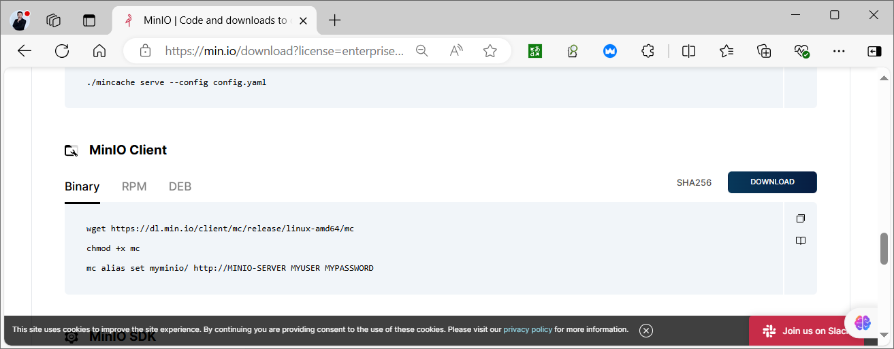
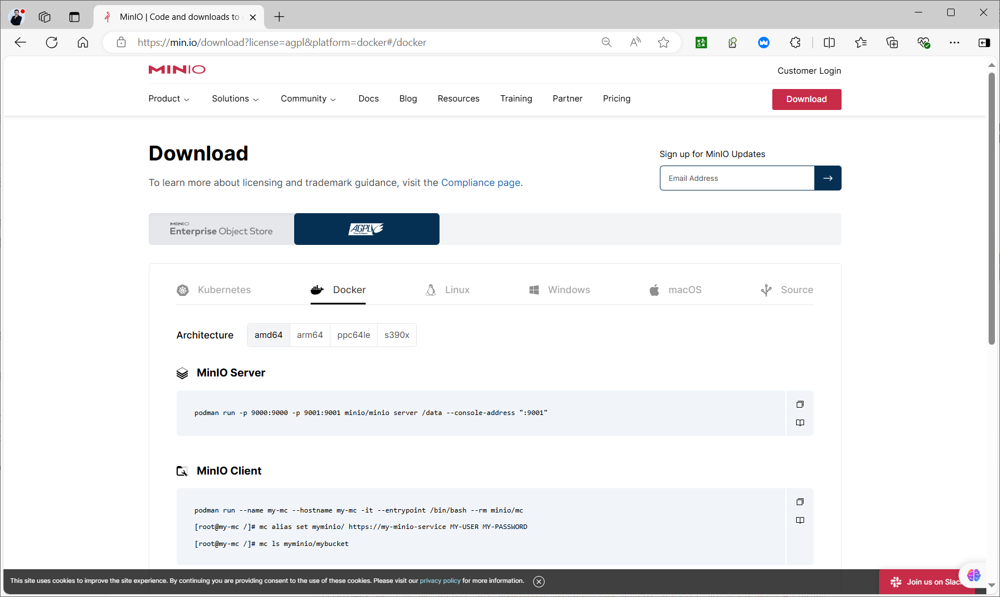

[← 返回 MinIO 对象存储目录]({{ '/subjects/MinIO/' | relative_url }})



# 10 MinIO 客户端 mc

`mc` 是 MinIO 的命令行客户端，既能操作本地文件，也能通过 S3 API 管理 MinIO 或其他兼容 S3 的服务。命令名借鉴了 `ls`、`cp`、`cat`、`rm` 等常见文件工具，但目标 `别名/存储桶/对象键` 并不是本地文件路径。集群管理类命令通常位于 `mc admin` 下，需相应权限。

参考：[mc 命令索引](https://min.io/docs/minio/linux/reference/minio-mc.html)与[mc admin 命令索引](https://min.io/docs/minio/linux/reference/minio-mc-admin.html)。不同版本可用子命令可能变化，实际使用前先看 `mc --help` 和 `mc <子命令> --help`。

## 安装客户端

从官方发布目录选择与平台、架构匹配的客户端。Linux amd64 二进制示例：

```bash
curl -fsSLo mc https://dl.min.io/client/mc/release/linux-amd64/mc
sudo install -m 755 mc /usr/local/bin/mc
mc --version
```

也可下载相应的 DEB／RPM 包安装；包名可能是 `mcli`，安装后应检查提供的可执行文件名。不要把企业版下载页的旧版本文件名直接拼接成社区版地址。



容器中临时运行时，可用 `minio/mc` 镜像；若希望别名跨容器重建保留，需要将 `~/.mc` 映射到受保护的持久目录。容器必须能解析并访问目标服务地址，而宿主机的 `localhost` 在容器中通常指容器自己。



## 配置连接别名

`mc alias set` 后依次是别名、**API 地址**、访问密钥和秘密密钥；别名末尾不加 `/`。连接 Console 的 `9001` 端口会失败，应使用 API 的 `9000` 或其代理入口。

```bash
mc alias set lab http://127.0.0.1:9000 ACCESS_KEY SECRET_KEY
mc alias list
mc admin info lab
```

为业务操作使用专门的访问密钥和最小权限策略；`mc admin info` 则需要管理权限。若桶对象读写成功但 `mc admin info` 返回 Access Denied，先检查身份的管理策略，不要误判服务不可用。客户端别名通常保存在用户的 `~/.mc/config.json`，其中可能包含凭据，须限制文件权限并避免提交到仓库。终端命令行中的密钥也可能留在 shell 历史和进程列表中，应按环境使用专用凭据注入方式。

单机与集群的别名配置完全相同；连接集群时可指定任一健康节点，但生产客户端更适合使用有冗余的 API 负载均衡入口。`mc admin info` 可检查节点、驱动器、存储池和纠删码状态；输出随服务版本和拓扑而变化，不能把某次实验中的“12 drives online”当作通用判据。

## 桶与对象的常用操作

下面使用测试桶 `lab-example` 串起创建、上传、读取、下载和检查流程：

```bash
mc mb lab/lab-example
printf 'hello MinIO\n' > /tmp/hello.txt
mc cp /tmp/hello.txt lab/lab-example/hello.txt
mc ls lab/lab-example/
mc stat lab/lab-example/hello.txt
mc cat lab/lab-example/hello.txt
mc cp lab/lab-example/hello.txt /tmp/hello-downloaded.txt
```

`mc ls lab` 列出桶，`mc ls lab/lab-example/` 列出桶中的对象。`mc stat` 查看对象元数据，`mc du` 统计逻辑用量，`mc tree` 可按前缀呈现树状视图；这些输出并不等于底层磁盘的实际占用。

目录上传使用 `mc cp --recursive` 或 `mc mirror`。对象存储没有传统目录，路径前缀是否包含本地目录名取决于源路径末尾是否带 `/`，正式迁移前应先用少量文件验证目标键名：

```bash
mc cp --recursive ./docs/ lab/lab-example/docs/
mc ls --recursive lab/lab-example/docs/
mc mirror ./docs/ lab/lab-example/docs/
```

`mc mirror` 常用于同步，但“镜像”不天然等于可靠备份：误删、覆盖、版本、对象锁和同步方向都要另外设计。使用 `--remove` 等会删除目标对象的选项前，先确认差异范围。

## 删除与清理

删除单个对象用 `mc rm`；非空桶不能直接 `mc rb`。以下清理仅针对本节刚创建的测试桶，执行前再次确认别名和桶名：

```bash
mc rm lab/lab-example/hello.txt
mc rm --recursive --force lab/lab-example/docs/
mc rb --force lab/lab-example
```

带 `--force` 的递归删除会影响桶内所有匹配对象；若开启版本化，还需理解删除标记与历史版本的区别。移除本机连接别名用 `mc alias remove lab`，它只删客户端配置，不会删除服务端数据。

## 排障顺序

连接失败时依次检查 API URL、DNS／网络、TLS 证书、访问密钥、策略权限与服务健康状态。`mc --debug` 可辅助定位请求，但调试日志可能包含敏感信息，分享前应审阅。命令自动补全是客户端便利功能，不影响连接或对象语义。



<nav class="article-end" aria-label="章节导航">
  <a href="{{ '/subjects/MinIO/09-minio-console-management.html' | relative_url }}">← 上一篇：Console 管理</a>
  <a href="{{ '/subjects/MinIO/' | relative_url }}">返回 MinIO 对象存储目录</a>
  <a href="{{ '/subjects/MinIO/11-accessing-minio-with-programming-apis.html' | relative_url }}">下一篇：编程接口访问 MinIO →</a>
</nav>
