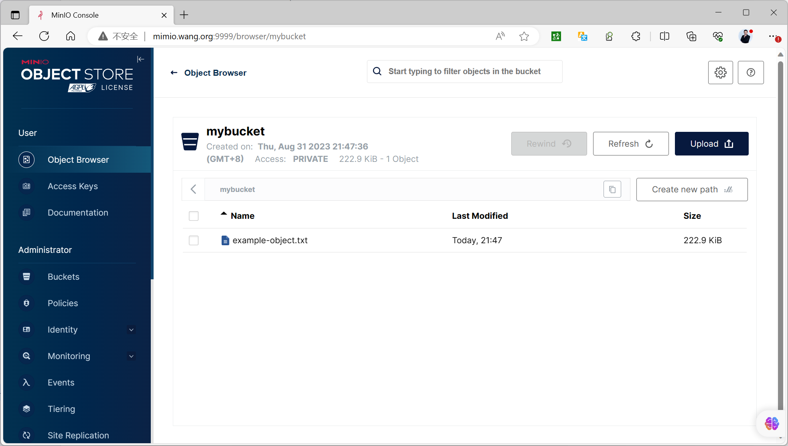
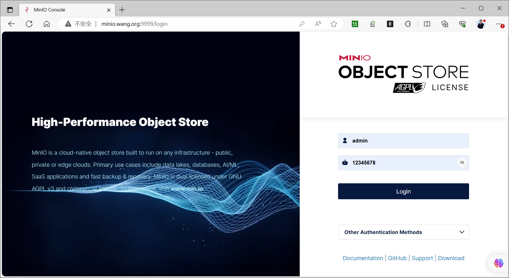
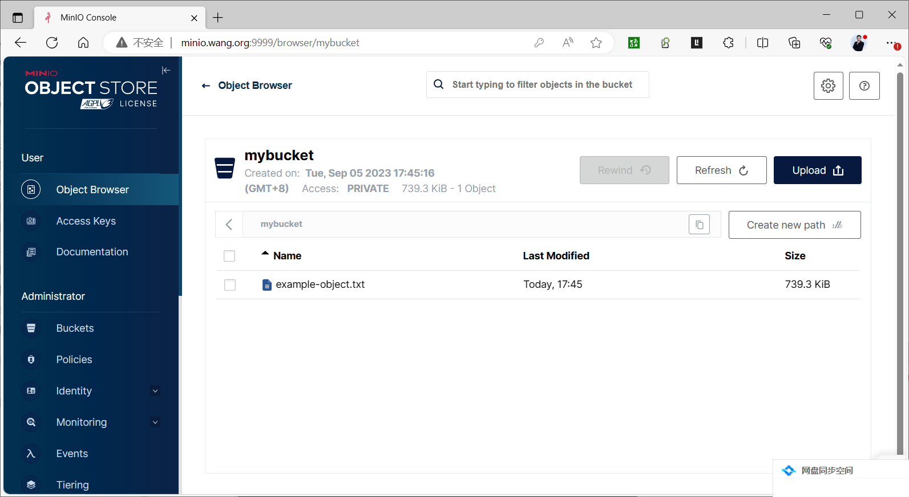

[← 返回MinIO 对象存储目录]({{ '/subjects/MinIO/' | relative_url }})



# 11 编程语言API访问
### 3.3 编程语言API访问

<https://min.io/docs/minio/linux/developers/minio-drivers.html>


### Python 访问

<https://min.io/docs/minio/linux/developers/minio-drivers.html#python-sdk>

<https://min.io/docs/minio/linux/developers/python/minio-py.html>

<https://github.com/minio/minio-py/tree/master/examples>

范例：

```bash
[root@ubuntu2204 ~]#apt update && apt -y install python3-pip
[root@ubuntu2204 ~]#python3 -m pip config set global.index-url
https://mirrors.aliyun.com/pypi/simple/
[root@ubuntu2404 ~]#pip3 install minio --break-system-packages
[root@ubuntu2204 ~]#pip3 install minio
#使用以下代码作为示例来访问 MinIO 服务器
[root@ubuntu2204 ~]#cat access_minio.py
#!/usr/bin/python3
import os
from minio import Minio
from minio.error import S3Error
#from minio.error import (ResponseError, BucketAlreadyOwnedByYou,
BucketAlreadyExists)
# 初始化MinIO客户端
minio_client = Minio(
endpoint='localhost:9000',
access_key="kH3qu9EQdPY6L7Y4bvA4",
secret_key="jC7ravHdJG5Gkre5T9sNrhXECWJF5suNIYkBrxu5",
secure=False  # 如果使用SSL，请将此项设置为True
)
bucket_name = "mybucket"
object_name = "example-object.txt"
local_file_path = "/var/log/syslog"
try:
# 检查存储桶是否存在，如果不存在则创建
if not minio_client.bucket_exists(bucket_name):
minio_client.make_bucket(bucket_name)
print(f"Bucket '{bucket_name}' created successfully.")
else:
print(f"Bucket '{bucket_name}' already exists.")
# 上传文件到存储桶
minio_client.fput_object(bucket_name, object_name, local_file_path)
print(f"Successfully uploaded '{local_file_path}' to '{object_name}'.")
except ResponseError as e:
print(f"An error occurred: {e}")
# 下载存储桶中的对象
downloaded_file_path = "example-object.txt"
try:
minio_client.fget_object(bucket_name, object_name, downloaded_file_path)
print(f"Successfully downloaded '{object_name}' to
'{downloaded_file_path}'.")
except ResponseError as e:
print(f"An error occurred while downloading '{object_name}': {e}")
#运行程序
[root@ubuntu2204 ~]#python3 access_minio.py
Bucket 'mybucket' created successfully.
Successfully uploaded '/var/log/syslog' to 'example-object.txt'.
Successfully downloaded 'example-object.txt' to 'example-object.txt'.
#查看存储的数据文件
[root@ubuntu2204 ~]#tree /data/minio/
/data/minio/
└── mybucket
└── example-object.txt
├── 16add02d-b997-49fc-b03e-637856b3c1be
│   └── part.1
└── xl.meta
3 directories, 2 files
```



### Golang 访问

<https://min.io/docs/minio/linux/developers/go/minio-go.html>

在运行代码之前，确保已经安装了 Go，并且已经启动了一个 MinIO 服务器并获取accessKey和 secretKey

注意：要求golang-v1.20以上版本

```bash
#示例代码
[root@ubuntu2204 minio-demo]#ls
main.go
[root@ubuntu2204 minio-demo]#cat main.go
package main
import (
"context"
"fmt"
"log"
"github.com/minio/minio-go/v7"
"github.com/minio/minio-go/v7/pkg/credentials"
)
func main() {
endpoint := "localhost:9000"
accessKey := "xCLmTTXFrBGRYCY2eqh7"                    //指定事先生成的
accessKey,也可以使用MINIO_ROOT_USER
secretKey := "SmfdeMiZwRWIfoO4iKwkaGe0scBxDmbQvNWCr1"  //指定事先生成的
secretKey,也可以使用MINIO_ROOT_PASSWORD
useSSL := false // Change to true if you're using SSL
// Initialize a new MinIO client object.
minioClient, err := minio.New(endpoint, &minio.Options{
Creds:  credentials.NewStaticV4(accessKey, secretKey, ""),
Secure: useSSL,
})
if err != nil {
log.Fatalln(err)
}
bucketName := "mybucket"
objectName := "example-object.txt"
localFilePath := "/var/log/syslog"
ctx := context.Background()
// Create a new bucket if it doesn't exist.
err = minioClient.MakeBucket(ctx, bucketName, minio.MakeBucketOptions{})
if err != nil {
exists, errBucketExists := minioClient.BucketExists(ctx, bucketName)
if errBucketExists == nil && exists {
fmt.Printf("Bucket '%s' already exists.\n", bucketName)
} else {
log.Fatalln(err)
}
} else {
fmt.Printf("Created bucket '%s'.\n", bucketName)
}
// Upload a file to the bucket.
_, err = minioClient.FPutObject(ctx, bucketName, objectName, localFilePath,
minio.PutObjectOptions{})
if err != nil {
log.Fatalln(err)
}
fmt.Printf("Successfully uploaded '%s' to '%s'.\n", localFilePath,
objectName)
// Download the uploaded object.
downloadFilePath := "downloaded/file.txt"
err = minioClient.FGetObject(ctx, bucketName, objectName, downloadFilePath,
minio.GetObjectOptions{})
if err != nil {
log.Fatalln(err)
}
fmt.Printf("Successfully downloaded '%s' to '%s'.\n", objectName,
downloadFilePath)
}
#安装golang，注意：要求go-v1.20以上版本
[root@ubuntu2204 minio-demo]#bash install_go.sh
#配置代理
[root@ubuntu2204 minio-demo]#export GOPROXY=https://goproxy.cn
#初始化项和,指定默认的程序名为minio-demo
[root@ubuntu2204 minio-demo]#go mod init minio-demo
go: creating new go.mod: module minio-demo
go: to add module requirements and sums:
go mod tidy
#生成初始化文件
[root@ubuntu2204 minio-demo]#ls
go.mod  main.go
[root@ubuntu2204 minio-demo]#cat go.mod
module minio-demo
go 1.18
#下载相关依赖
[root@ubuntu2204 minio-demo]#go get github.com/minio/minio-go/v7
go: added github.com/dustin/go-humanize v1.0.1
go: added github.com/google/uuid v1.3.0
go: added github.com/json-iterator/go v1.1.12
go: added github.com/klauspost/compress v1.16.7
go: added github.com/klauspost/cpuid/v2 v2.2.5
go: added github.com/minio/md5-simd v1.1.2
go: added github.com/minio/minio-go/v7 v7.0.63
go: added github.com/minio/sha256-simd v1.0.1
go: added github.com/modern-go/concurrent v0.0.0-20180306012644-bacd9c7ef1dd
go: added github.com/modern-go/reflect2 v1.0.2
go: added github.com/rs/xid v1.5.0
go: added github.com/sirupsen/logrus v1.9.3
go: added golang.org/x/crypto v0.12.0
go: added golang.org/x/net v0.14.0
go: added golang.org/x/sys v0.11.0
go: added golang.org/x/text v0.12.0
go: added gopkg.in/ini.v1 v1.67.0
[root@ubuntu2204 minio-demo]#ls
go.mod  go.sum  main.go
[root@ubuntu2204 minio-demo]#cat go.mod
module minio-demo
go 1.18
require (
github.com/dustin/go-humanize v1.0.1 // indirect
github.com/google/uuid v1.3.0 // indirect
github.com/json-iterator/go v1.1.12 // indirect
github.com/klauspost/compress v1.16.7 // indirect
github.com/klauspost/cpuid/v2 v2.2.5 // indirect
github.com/minio/md5-simd v1.1.2 // indirect
github.com/minio/minio-go/v7 v7.0.63 // indirect
github.com/minio/sha256-simd v1.0.1 // indirect
github.com/modern-go/concurrent v0.0.0-20180306012644-bacd9c7ef1dd //
indirect
github.com/modern-go/reflect2 v1.0.2 // indirect
github.com/rs/xid v1.5.0 // indirect
github.com/sirupsen/logrus v1.9.3 // indirect
golang.org/x/crypto v0.12.0 // indirect
golang.org/x/net v0.14.0 // indirect
golang.org/x/sys v0.11.0 // indirect
golang.org/x/text v0.12.0 // indirect
gopkg.in/ini.v1 v1.67.0 // indirect
)
[root@ubuntu2204 minio-demo]#cat go.sum
github.com/davecgh/go-spew v1.1.0/go.mod
h1:J7Y8YcW2NihsgmVo/mv3lAwl/skON4iLHjSsI+c5H38=
github.com/davecgh/go-spew v1.1.1/go.mod
h1:J7Y8YcW2NihsgmVo/mv3lAwl/skON4iLHjSsI+c5H38=
github.com/dustin/go-humanize v1.0.1
h1:GzkhY7T5VNhEkwH0PVJgjz+fX1rhBrR7pRT3mDkpeCY=
github.com/dustin/go-humanize v1.0.1/go.mod
h1:Mu1zIs6XwVuF/gI1OepvI0qD18qycQx+mFykh5fBlto=
......
#编译默认生成项目名称的二进制程序
[root@ubuntu2204 minio-demo]#CGO_ENABLED=0 go build
#或者编译生成指定的二进制程序名
[root@ubuntu2204 minio-demo]#CGO_ENABLED=0 go build -o minio-demo
[root@ubuntu2204 minio-demo]#ls
go.mod  go.sum  main.go  minio-demo
#运行
[root@ubuntu2204 minio-demo]#./minio-demo
Created bucket 'mybucket'.
Successfully uploaded '/var/log/syslog' to 'example-object.txt'.
Successfully downloaded 'example-object.txt' to 'downloaded/file.txt'.
[root@ubuntu2204 minio-demo]#tree
.
├── downloaded
│   └── file.txt
├── go.mod
├── go.sum
├── main.go
└── minio-demo
1 directory, 5 files
[root@ubuntu2204 minio-demo]#diff downloaded/file.txt /var/log/syslog
#登录验证文件上传成功
```





### JAVA 访问

<https://min.io/docs/minio/linux/developers/java/minio-java.html>

范例

```python
import io.minio.BucketExistsArgs;
import io.minio.MakeBucketArgs;
import io.minio.MinioClient;
import io.minio.UploadObjectArgs;
import io.minio.errors.MinioException;
import java.io.IOException;
import java.security.InvalidKeyException;
import java.security.NoSuchAlgorithmException;
public class FileUploader {
public static void main(String[] args)
throws IOException, NoSuchAlgorithmException, InvalidKeyException {
try {
// Create a minioClient with the MinIO server playground, its access key
and secret key.
MinioClient minioClient =
MinioClient.builder()
.endpoint("https://play.min.io")
.credentials("Q3AM3UQ867SPQQA43P2F",
"zuf+tfteSlswRu7BJ86wekitnifILbZam1KYY3TG")
.build();
// Make 'asiatrip' bucket if not exist.
boolean found =
minioClient.bucketExists(BucketExistsArgs.builder().bucket("asiatrip").build())
;
if (!found) {
// Make a new bucket called 'asiatrip'.
minioClient.makeBucket(MakeBucketArgs.builder().bucket("asiatrip").build());
} else {
System.out.println("Bucket 'asiatrip' already exists.");
}
// Upload '/home/user/Photos/asiaphotos.zip' as object name 'asiaphotos-
2015.zip' to bucket
// 'asiatrip'.
minioClient.uploadObject(
UploadObjectArgs.builder()
.bucket("asiatrip")
.object("asiaphotos-2015.zip")
.filename("/home/user/Photos/asiaphotos.zip")
.build());
System.out.println(
"'/home/user/Photos/asiaphotos.zip' is successfully uploaded as "
+ "object 'asiaphotos-2015.zip' to bucket 'asiatrip'.");
} catch (MinioException e) {
System.out.println("Error occurred: " + e);
System.out.println("HTTP trace: " + e.httpTrace());
}
}
}
```



<nav class="article-end" aria-label="章节导航">
  <a href="{{ '/subjects/MinIO/10-minio-client-mc.html' | relative_url }}">← Previous: MinIO Client (mc)</a>
  <a href="{{ '/subjects/MinIO/' | relative_url }}">Back to MinIO Object Storage Index</a>
  <a href="{{ '/subjects/MinIO/12-automatic-recovery-after-a-node-service-restart.html' | relative_url }}">Next: Automatic Recovery After a Node Service Restart →</a>
</nav>
