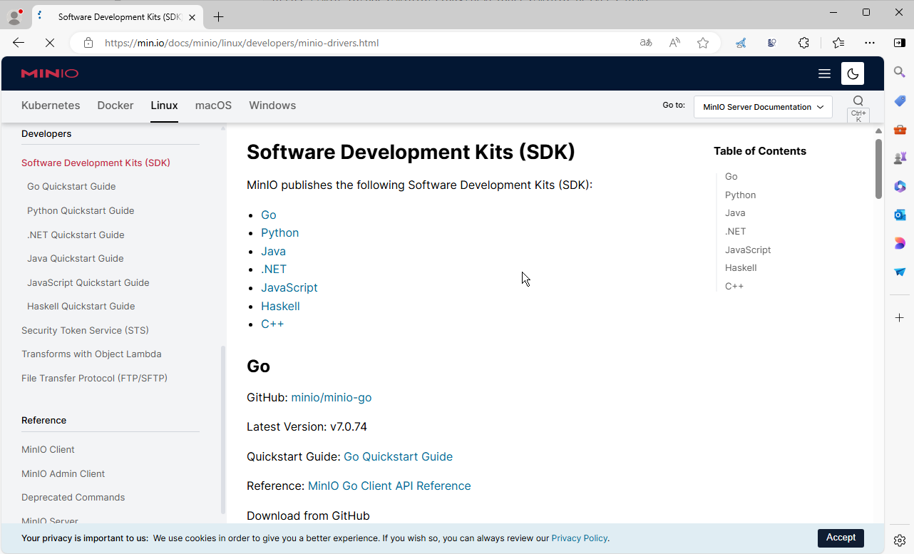
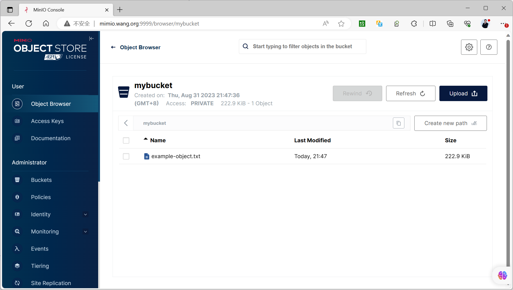
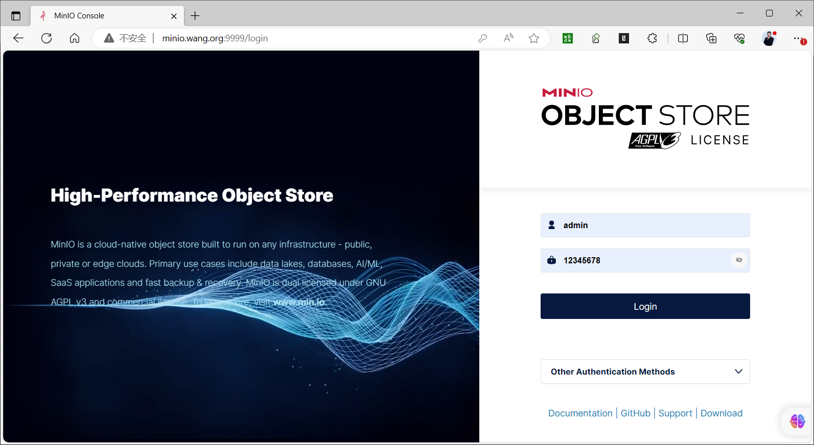
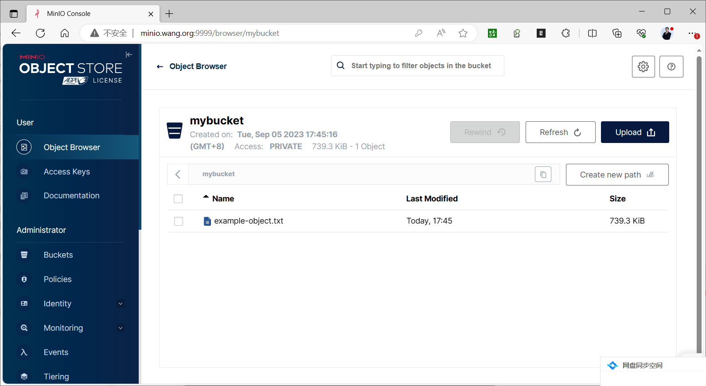

[← 返回 MinIO 对象存储目录]({{ '/subjects/MinIO/' | relative_url }})



# 11 编程接口访问 MinIO

MinIO 实现 S3 兼容 API，应用可使用 MinIO 官方 SDK 或相应语言的 S3 SDK。无论使用 Python、Go 还是 Java，基本流程都是：配置 **API 端点**与访问密钥、确认存储桶、上传对象、再下载验证。API 地址不是 Console 地址；上一章示例中分别为 `9000` 和 `9001`。



以下代码以测试桶 `mybucket` 和本地文件 `example.txt` 为例。先通过 Console 创建一个仅授予测试桶所需权限的访问密钥，把端点、Access Key 与 Secret Key 放进运行环境；不要把凭据硬编码进代码或提交到仓库。若端点启用了 HTTPS，SDK 的 TLS 设置也必须对应开启。

## Python：上传与下载

参考 [minio-py 文档](https://min.io/docs/minio/linux/developers/python/minio-py.html)。建议在虚拟环境中安装，不要为了演示而使用 `--break-system-packages` 修改系统 Python：

```bash
python3 -m venv .venv
. .venv/bin/activate
python -m pip install minio
```

将以下内容保存为 `access_minio.py`。`endpoint` 不带 URL 方案；`secure` 根据 `MINIO_SECURE` 决定。异常用当前 SDK 的 `S3Error` 捕获，原资料中的 `ResponseError` 已不适用于这段示例。

```python
import os
from pathlib import Path

from minio import Minio
from minio.error import S3Error

client = Minio(
    os.environ.get("MINIO_ENDPOINT", "127.0.0.1:9000"),
    access_key=os.environ["MINIO_ACCESS_KEY"],
    secret_key=os.environ["MINIO_SECRET_KEY"],
    secure=os.environ.get("MINIO_SECURE", "false").lower() == "true",
)

bucket = "mybucket"
source = Path("example.txt")
destination = Path("downloaded.txt")
source.write_text("hello MinIO\n", encoding="utf-8")

try:
    if not client.bucket_exists(bucket):
        client.make_bucket(bucket)
    client.fput_object(bucket, source.name, str(source))
    client.fget_object(bucket, source.name, str(destination))
    print(destination.read_text(encoding="utf-8"))
except S3Error as exc:
    raise SystemExit(f"S3 操作失败：{exc}") from exc
```

运行前在当前终端配置 `MINIO_ACCESS_KEY`、`MINIO_SECRET_KEY` 和必要时的 `MINIO_ENDPOINT`；执行 `python access_minio.py` 后确认输出为 `hello MinIO`。对象的底层磁盘布局由服务端管理，不要通过直接修改 `xl.meta` 或 `part.1` 来“修复”上传结果。



## Go：使用 minio-go/v7

参考 [minio-go 文档](https://min.io/docs/minio/linux/developers/go/minio-go.html)。Go SDK 通过 `context.Context` 传递取消与超时信号，适合在服务端应用中把请求生命周期传入对象操作。下面示例读取环境变量，避免把实验密钥写入源码。

```go
package main

import (
    "context"
    "fmt"
    "log"
    "os"

    "github.com/minio/minio-go/v7"
    "github.com/minio/minio-go/v7/pkg/credentials"
)

func main() {
    endpoint := os.Getenv("MINIO_ENDPOINT")
    if endpoint == "" {
        endpoint = "127.0.0.1:9000"
    }
    accessKey := os.Getenv("MINIO_ACCESS_KEY")
    secretKey := os.Getenv("MINIO_SECRET_KEY")
    if accessKey == "" || secretKey == "" {
        log.Fatal("请配置 MINIO_ACCESS_KEY 和 MINIO_SECRET_KEY")
    }

    client, err := minio.New(endpoint, &minio.Options{
        Creds: credentials.NewStaticV4(accessKey, secretKey, ""),
        Secure: os.Getenv("MINIO_SECURE") == "true",
    })
    if err != nil {
        log.Fatal(err)
    }

    ctx := context.Background()
    bucket := "mybucket"
    exists, err := client.BucketExists(ctx, bucket)
    if err != nil {
        log.Fatal(err)
    }
    if !exists {
        if err := client.MakeBucket(ctx, bucket, minio.MakeBucketOptions{}); err != nil {
            log.Fatal(err)
        }
    }

    if err := os.WriteFile("example.txt", []byte("hello MinIO\n"), 0600); err != nil {
        log.Fatal(err)
    }
    _, err = client.FPutObject(ctx, bucket, "example.txt", "example.txt", minio.PutObjectOptions{})
    if err != nil {
        log.Fatal(err)
    }
    if err := client.FGetObject(ctx, bucket, "example.txt", "downloaded.txt", minio.GetObjectOptions{}); err != nil {
        log.Fatal(err)
    }
    fmt.Println("上传及下载完成")
}
```

在空目录中执行 `go mod init minio-demo`、`go get github.com/minio/minio-go/v7`、`go run .`。Go 版本要求随 SDK 版本调整，请以当前模块说明为准；原资料同时写“要求 Go 1.20 以上”和 `go.mod` 中的 `go 1.18`，不能把两者视为一致的要求。





## Java：同一工作流

参考 [MinIO Java SDK 文档](https://min.io/docs/minio/linux/developers/java/minio-java.html)。通过 Maven／Gradle 引入当前兼容的 `io.minio:minio` 版本后，构建客户端、确认桶、上传对象。以下展示核心调用；应由应用配置或密钥服务注入环境变量。

```java
import io.minio.BucketExistsArgs;
import io.minio.MakeBucketArgs;
import io.minio.MinioClient;
import io.minio.UploadObjectArgs;

public class FileUploader {
    public static void main(String[] args) throws Exception {
        String endpoint = System.getenv().getOrDefault("MINIO_URL", "http://127.0.0.1:9000");
        String accessKey = System.getenv("MINIO_ACCESS_KEY");
        String secretKey = System.getenv("MINIO_SECRET_KEY");
        if (accessKey == null || secretKey == null) {
            throw new IllegalStateException("缺少 MinIO 访问凭据");
        }

        MinioClient client = MinioClient.builder()
                .endpoint(endpoint)
                .credentials(accessKey, secretKey)
                .build();
        String bucket = "mybucket";
        if (!client.bucketExists(BucketExistsArgs.builder().bucket(bucket).build())) {
            client.makeBucket(MakeBucketArgs.builder().bucket(bucket).build());
        }
        client.uploadObject(UploadObjectArgs.builder()
                .bucket(bucket)
                .object("example.txt")
                .filename("example.txt")
                .build());
        System.out.println("上传完成：" + bucket + "/example.txt");
    }
}
```

Java 示例只展示上传；可用 `DownloadObjectArgs` 下载验证。真实应用还需设置连接超时、重试、日志、凭据轮换和异常处理。上传完成后，以 SDK 返回结果或 `mc stat` 验证对象，不要把磁盘内部的文件数量当成 API 成功依据。



<nav class="article-end" aria-label="章节导航">
  <a href="{{ '/subjects/MinIO/10-minio-client-mc.html' | relative_url }}">← 上一篇：MinIO 客户端 mc</a>
  <a href="{{ '/subjects/MinIO/' | relative_url }}">返回 MinIO 对象存储目录</a>
  <a href="{{ '/subjects/MinIO/12-automatic-recovery-after-a-node-service-restart.html' | relative_url }}">下一篇：节点重启后的自动恢复 →</a>
</nav>
