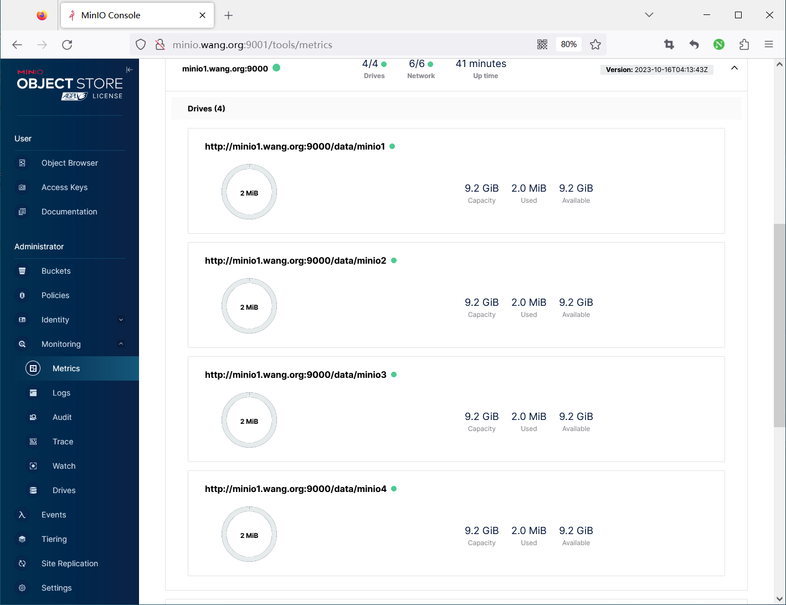
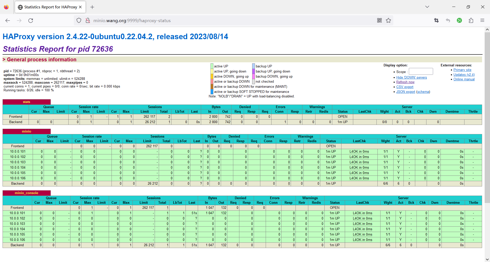
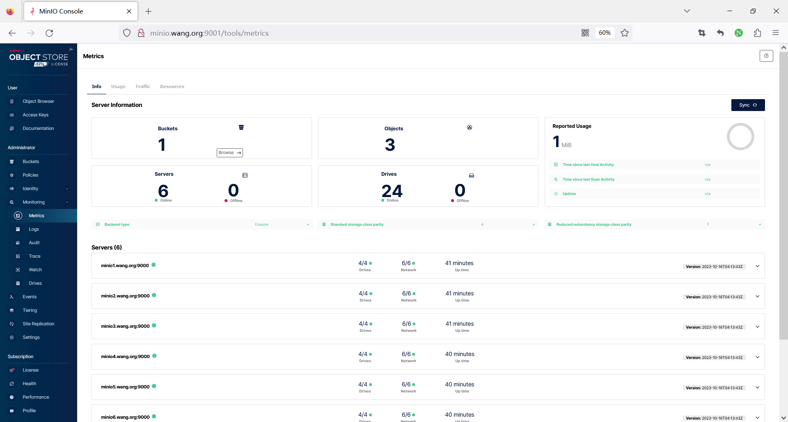

[← Back to MinIO Object Storage Index]({{ '/subjects/MinIO/' | relative_url }})



# 14 Scaling Out
## 5 MINIO 扩容和缩容

### 5.1 扩容

通常当MinIO容量使用到70%时,建议考虑进行扩容。

扩容有两种方案

通过LVM逻辑卷扩容,前提安装时事先使用LVM 通过一个相同规格的集群扩容

### 基于 LVM 扩容

使用lvm逻辑卷进行扩容minio集群，通过在原有节点增加硬盘来进行扩容minio集群

如果通过lvm逻辑卷扩容，部署原有集群时,minio数据目录需要使用lvm逻辑卷

lvm逻辑卷单个的大小不要超过2T，文件系统过大会导致minio集群IO降低

例如：部署原有MinIO集群时使用4块1T的磁盘使用逻辑卷的方式部署四个数据目录，之后扩容时再增加 4块1T新的磁盘把四个数据目录扩容到2T，相应的minio集群容量也会扩容1倍

范例: 添加新磁盘扩容

```text
#添加新磁盘到pv
#pvcreate /dev/sdc
#把pv添加到卷组
#vgextend minio /dev/sdc
#扩容逻辑卷
lvresize -r -l +100%FREE /dev/ubuntu-vg/minio
```

范例: 基于2.3.2.1 环境LVM扩容

扩容前查看如下



在所有节点上执行下面操作扩容

```bash
[root@minioX ~]#lvextend -r -L +10G /dev/ubuntu-vg/minio
```

扩容后,可查看到如下效果


### 通过增加相同规格的集群节点扩容

扩容流程

扩容需要准备一个跟原有minio服务器相同规格的集群，进行服务器初始化以及安装minio 需要所有minio服务器的配置文件进行修改，并重启所有节点的服务最后负载均衡服务中添加新节点服务器

注意

集群扩容时，需要新准备一个和原有集群相同或整数倍的节点和磁盘资源。

比如原集群为8节点16个数据盘,则可以扩展为16节点32数据盘,或者24个节点48块磁盘

扩容节点的数据盘大小配置要跟原有集群一致

新加的所有节点必须是没旧MinIO数据新系统，如果有需要清除干净

范例：扩展现有的分布式集群

```text
#例如启动MinIO原有集群，共1024块磁盘，命令行如下:
export MINIO_ROOT_USER=admin
export MINIO_ROOT_PASSWORD=12345678
minio server http://host{1...32}/export{1...32}
#MinIO支持通过命令，指定新的集群来扩展现有集群(纠删码模式)，扩展后磁盘为2048块，命令行如下:
export MINIO_ROOT_USER=admin
export MINIO_ROOT_PASSWORD=12345678
#扩展增加一倍空间
minio server http://host{1...32}/export{1...32} http://host{33...64
}/export{1...32}
#扩展增加两倍空间
minio server http://host{1...32}/export{1...32} http://host{33...64
}/export{1...32} http://host{65...96 }/export{1...32}
#新的对象上传请求会自动分配到最少使用的集群节点上。通过以上扩展策略，您就可以按需扩展您的集群。重
新配置后重启集群，会立即在集群中生效，并对现有集群无影响。如上命令中，我们可以把原来的集群看做一
个区，新增集群看做另一个区，新对象按每个区域中的可用空间比例放置在区域中。在每个区域内，基于确定
性哈希算法确定位置。
#说明:您添加的每个区域必须具有与原始区域相同的磁盘数量（纠删码集)大小，以便维持相同的数据冗余
SLA。例如，第一个区有8个磁盘，您可以将集群扩展为16个、32个或1024个磁盘的区域，您只需确保部署的
SLA是原始区域的倍数即可。
```

范例: 基于 2.3.2.1 基于LVM实现二进制部署MinIO 实现3节点的分布式高可用集群的环境扩容

```bash
#在原有集群节点停上河北务
[root@ubuntu2404 ~]#systemctl stop minio.service
#在所有节点修改hosts文件
[root@ubuntu2204 ~]#vim  /etc/hosts
10.0.0.101 minio1.bowen.org
10.0.0.102 minio2.bowen.org
10.0.0.103 minio3.bowen.org
#添加下面三行
10.0.0.104 minio4.bowen.org
10.0.0.105 minio5.bowen.org
10.0.0.106 minio6.bowen.org
#在新添加的节点上执行
[root@minio4 ~]#lvcreate -n minio -l 100%free  ubuntu-vg
#[root@minio4 ~]#lvcreate -n minio -L 10G ubuntu-vg
[root@minio4 ~]#mkfs.ext4 /dev/ubuntu-vg/minio
[root@minio4 ~]#mkdir /data/
[root@minio4 ~]#echo /dev/ubuntu-vg/minio /data/ ext4 defaults 0 0 >> /etc/fstab
[root@minio4 ~]#mount -a
[root@minio4 ~]#mkdir -p /data/minio{1..4}
#在新添加的节点上准备用户和权限
[root@minio4 ~]#useradd -r -s /sbin/nologin minio
[root@minio4 ~]#chown -R minio: /data/minio{1..4}
#在新添加的节点上准备程序
[root@minio4 ~]#scp minio1.bowen.org:/usr/local/bin/minio /usr/local/bin/minio
#在所有节点上修改配置文件
[root@minio1 ~]#vim /etc/default/minio
MINIO_ROOT_USER=admin
MINIO_ROOT_PASSWORD=12345678
#只修改下面行
MINIO_VOLUMES='http://minio{1...3}.bowen.org:9000/data/minio{1...4}
http://minio{4...6}.bowen.org:9000/data/minio{1...4}'
MINIO_OPTS='--console-address :9001'
MINIO_PROMETHEUS_AUTH_TYPE="public"
#复制配置到新的节点上
[root@minio4 ~]#scp minio1.bowen.org:/etc/default/minio /etc/default/minio
#复制service配置到新的节点上
[root@minio4 ~]#scp minio1.bowen.org:/lib/systemd/system/minio.service
/lib/systemd/system/minio.service
[root@minio4 ~]#cat /lib/systemd/system/minio.service
[Unit]
Description=MinIO
Documentation=https://docs.min.io
Wants=network-noline.target
After=network-noline.target
[Service]
WorkingDirectory=/usr/local
User=minio
Group=minio
EnvironmentFile=-/etc/default/minio
ExecStartPre=/bin/bash -c "if [ -z \"${MINIO_VOLUMES}\" ]; then echo \"Variable
MINIO_VOLUMES not set in /etc/default/minio\"; exit 1; fi"
ExecStart=/usr/local/bin/minio server $MINIO_OPTS $MINIO_VOLUMES
Restart=always
[Install]
WantedBy=multi-user.target
#在所有节点上重启服务
[root@minio4 ~]#systemctl daemon-reload
[root@minio4 ~]#systemctl enable --now minio.service
[root@minio4 ~]#systemctl restart minio.service
#查看日志
[root@minio1 ~]#tail -f /var/log/syslog
Oct 19 12:02:09 minio1 minio[75077]: Waiting for all MinIO sub-systems to be
initialize...
Oct 19 12:02:09 minio1 minio[75077]: Automatically configured API requests per
node based on available memory on the system: 15
Oct 19 12:02:09 minio1 minio[75077]: All MinIO sub-systems initialized
successfully in 14.008095ms
......
#修改haproxy代理配置
[root@ubuntu2204 ~]#vim /etc/haproxy/haproxy.cfg
.....
listen minio
bind 10.0.0.100:9000
mode http
log global
server 10.0.0.101 10.0.0.101:9000 check inter 3000 fall 2 rise 5
server 10.0.0.102 10.0.0.102:9000 check inter 3000 fall 2 rise 5
server 10.0.0.103 10.0.0.103:9000 check inter 3000 fall 2 rise 5
server 10.0.0.104 10.0.0.104:9000 check inter 3000 fall 2 rise 5
server 10.0.0.105 10.0.0.105:9000 check inter 3000 fall 2 rise 5
server 10.0.0.106 10.0.0.106:9000 check inter 3000 fall 2 rise 5
listen minio_console
bind 10.0.0.100:9001
mode http
log global
server 10.0.0.101 10.0.0.101:9001 check inter 3000 fall 2 rise 5
server 10.0.0.102 10.0.0.102:9001 check inter 3000 fall 2 rise 5
server 10.0.0.103 10.0.0.103:9001 check inter 3000 fall 2 rise 5
server 10.0.0.104 10.0.0.104:9001 check inter 3000 fall 2 rise 5
server 10.0.0.105 10.0.0.105:9001 check inter 3000 fall 2 rise 5
server 10.0.0.106 10.0.0.106:9001 check inter 3000 fall 2 rise 5
[root@ubuntu2204 ~]#systemctl reload haproxy
#登录Haproxy,查看状态
```



```text
#登录控制台,可看到扩容成功
```





<nav class="article-end" aria-label="章节导航">
  <a href="{{ '/subjects/MinIO/13-recovering-a-node-after-os-reinstallation.html' | relative_url }}">← Previous: Recovering a Node After OS Reinstallation</a>
  <a href="{{ '/subjects/MinIO/' | relative_url }}">Back to MinIO Object Storage Index</a>
  <a href="{{ '/subjects/MinIO/15-scaling-in.html' | relative_url }}">Next: Scaling In →</a>
</nav>
