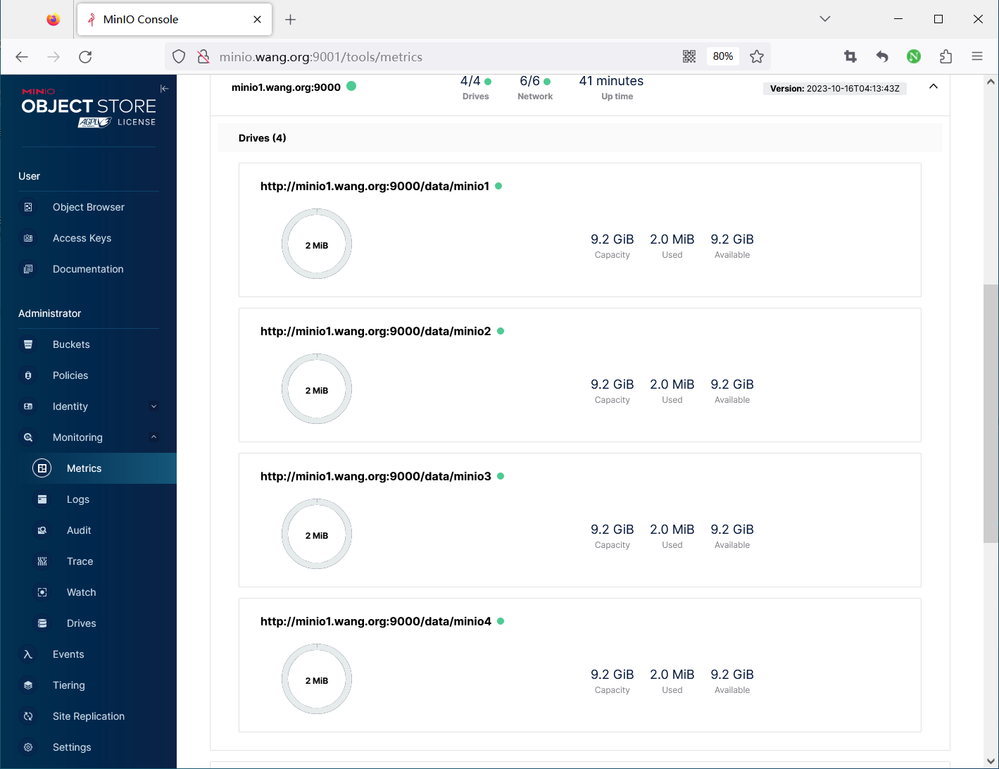
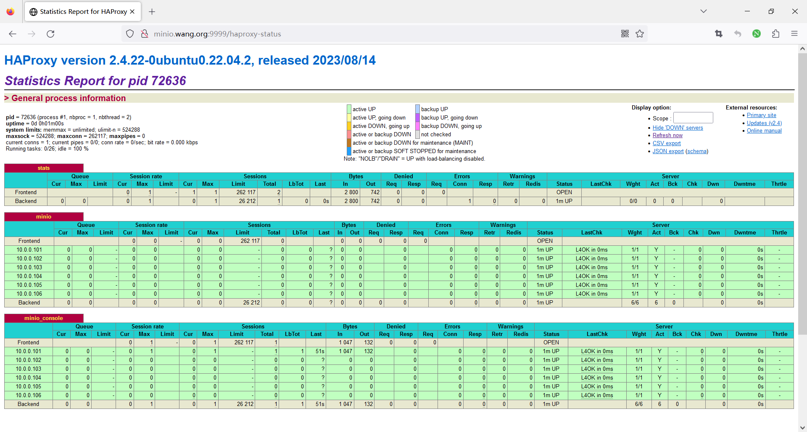
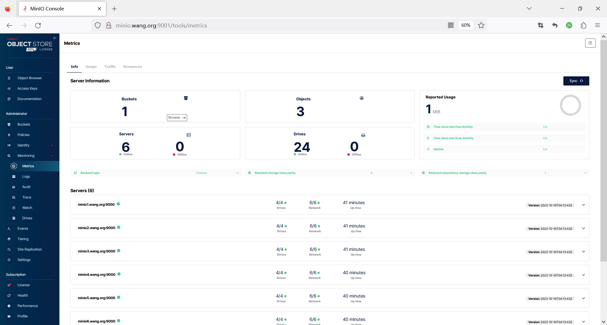

[← 返回 MinIO 对象存储目录]({{ '/subjects/MinIO/' | relative_url }})



# 14 扩容

当容量、对象数量或吞吐接近规划阈值时，应提前扩容，而不是等到空间耗尽。原资料以“使用率 70%”作为提醒，可以作为运维预警起点，但实际触发点还要考虑写入增长速度、可用容量计算、纠删码开销和扩容所需时间。

先区分两种不同动作：**扩大已有数据卷**改变文件系统容量，不增加 MinIO 的磁盘／节点故障域；**增加服务器池**为集群加入新的节点和独立磁盘，可扩展故障域及容量。二者不能互相替代，也不能把一个大 LVM 卷切成多个目录当作多盘扩容。

## 扩大现有 LVM 数据卷

只有原数据路径本来就位于可扩展 LV 上，并且所用 MinIO 版本及存储方案允许此操作时，才考虑扩卷。先备份、核对底层 PV／VG／LV 与文件系统类型，确认新增物理磁盘不会让多个逻辑“磁盘”共享同一故障域。原资料的“LV 不得超过 2 TB”不是通用硬限制；实际限制应从版本文档、硬件能力和性能测试获得。



例如，确认 `/dev/ubuntu-vg/minio` 是目标 LV 且 VG 有空闲空间后，文件系统与 LV 可由 `lvextend -r` 一起增长：

```bash
lsblk -f
pvs
vgs
lvs
findmnt /data
sudo lvextend -r -L +10G /dev/ubuntu-vg/minio
findmnt /data
df -h /data
```

上述命令只是该 LV 的示例，不能套用到每个节点的所有磁盘。扩容后应检查 MinIO 报告的可用容量、对象读写与服务日志；操作前还需明确文件系统在线扩容能力与回滚办法。


## 增加服务器池

分布式集群可通过新增服务器池增加容量。已有池与新增池的节点数、驱动器数、纠删码集合和版本兼容性受当前 MinIO 版本约束，**不能仅凭“与原集群规格相同或整数倍”这一句话下结论**。先根据官方扩容文档设计新池，再在测试环境模拟启动与故障恢复。

以第 07 章的四节点、每节点四盘拓扑为例，原池的端点为：

```text
http://minio{1...4}:9000/data/minio{1...4}
```

计划新增 `minio5` 至 `minio8` 四个节点，每个节点也有四块独立新盘。扩容后的配置**保留原池端点不变**，将新池作为第二组参数追加：

```ini
MINIO_VOLUMES="http://minio{1...4}:9000/data/minio{1...4} http://minio{5...8}:9000/data/minio{1...4}"
```

这里展示的是配置形态，不是让读者在生产环境直接替换文件并一次性重启全部节点。扩容实施应按版本文档确定停机或滚动步骤，避免在仍有故障节点时操作。原资料的演示命令中 `{33...64
}` 被硬换行打断，不能作为 shell 命令使用。

建议按下面顺序准备和验证：

1. 扩容前记录 `mc admin info`、已有池的端点列表、版本、容量和健康状态；确认备份可恢复，现有集群没有未处理的离线盘。
2. 为新增节点准备独立磁盘、挂载、网络、时间同步、主机名解析、相同服务版本与根凭据；新盘应为空，不能混入旧 MinIO 元数据。
3. 在所有相关节点保持一致的完整池列表和启动配置，按当前版本的扩容操作手册执行启停；不要随意改变原池端点的拼写、顺序或路径。
4. 新池上线后检查各节点与驱动器、健康端点、跨池对象读写，再将新节点加入负载均衡后端。
5. 观察容量分布和性能。新增池不会自动把所有旧对象平均搬过去；若版本支持且业务需要，可评估 `mc admin rebalance`，先阅读该命令的版本说明、成本与中断风险。





负载均衡器增加新节点后，还需验证 API 与 Console 的代理配置。单个 HAProxy 实例本身仍是入口单点。**扩容成功**的判断应包括新池全部预期驱动器在线、可用容量变化符合预期、对象读写正常、监控与备份覆盖新节点，而不仅是 Console 出现了新主机名。



<nav class="article-end" aria-label="章节导航">
  <a href="{{ '/subjects/MinIO/13-recovering-a-node-after-os-reinstallation.html' | relative_url }}">← 上一篇：系统重装后的节点恢复</a>
  <a href="{{ '/subjects/MinIO/' | relative_url }}">返回 MinIO 对象存储目录</a>
  <a href="{{ '/subjects/MinIO/15-scaling-in.html' | relative_url }}">下一篇：缩容 →</a>
</nav>
