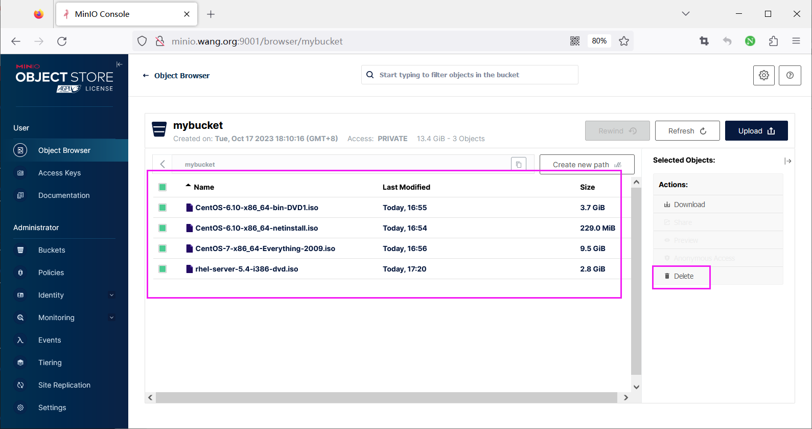
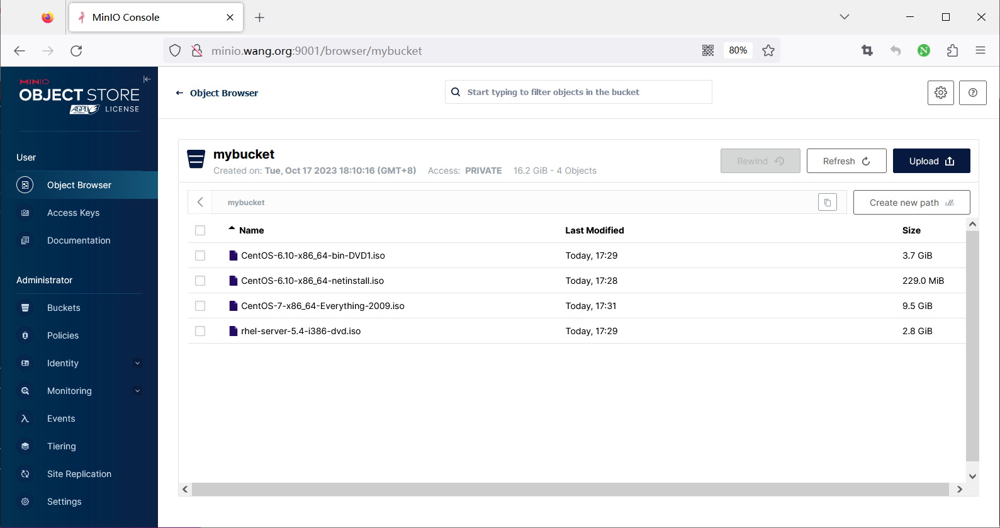

[← 返回 MinIO 对象存储目录]({{ '/subjects/MinIO/' | relative_url }})



# 17 备份与恢复示例

上一章解释了对象级备份的能力边界；本节把一次备份、增量复制、验证与测试恢复连成完整流程。示例使用测试桶 `mybucket`，备份目标是独立主机上的 `/backup/minio/mybucket`。实际运行前，应确认备份主机的容量、访问控制和故障域，而不是把备份放在 MinIO 数据盘旁边。

## 记录备份前状态

`mc` 和 `rclone` 都连接 MinIO 的 API 端口。为备份任务创建专用只读访问身份，并用 `rclone config` 建立别名 `minio`；不要把根账户密码或配置文件展示在日志、脚本和仓库中。

```bash
mc ls minio
mc du minio/mybucket
rclone lsd minio:
rclone size minio:mybucket
```

记录对象数、逻辑容量和桶策略。如果 `mc` 的别名与 `rclone` 的 remote 同名，它们仍存放在各自的配置中，不会自动共享凭据。原材料一处配置 `minio-cluster`，随后却用 `minio-server` 上传，这是两个不同别名；示例统一使用 `minio`。

## 首次复制与增量复制

先复制，再检查源与目标：

```bash
rclone copy minio:mybucket /backup/minio/mybucket \
  --transfers 8 --progress --log-file /backup/minio/backup.log
rclone check minio:mybucket /backup/minio/mybucket
```

首次运行会传输所有可见对象。下次同样执行 `copy`，工具会按后端能力判断哪些对象已存在且未变化，只传输需更新的内容：

```bash
rclone copy minio:mybucket /backup/minio/mybucket \
  --transfers 8 --progress --log-file /backup/minio/backup.log
rclone check minio:mybucket /backup/minio/mybucket
```

原案例用 `rclone sync` 做“增量备份”，容易将源端误删传播到目标端；`copy` 不会因此删除目标旧文件。不过，目标中保留的旧文件不是有恢复时间点的版本备份，也可能与源端已覆盖对象同名。正式方案应增加快照或版本保留，并测试对象元数据和历史版本的恢复。`--checksum` 也不是绝对的 MD5 校验：多段上传等场景下对象 ETag 未必是内容 MD5，应依据后端支持的校验方式解读结果。

## 在独立测试桶中恢复

不要为了测试恢复而先删除生产桶。原截图显示删除后桶中 `0 objects`，它只能说明当时数据被清空，不是推荐的演练方法。



预先建立测试桶 `mybucket-restore-test`，用具有写入权限的恢复身份配置 rclone remote `restore`，再复制备份目录：

```bash
rclone mkdir restore:mybucket-restore-test
rclone copy /backup/minio/mybucket restore:mybucket-restore-test \
  --transfers 8 --progress --log-file /backup/minio/restore.log
rclone check /backup/minio/mybucket restore:mybucket-restore-test
rclone size restore:mybucket-restore-test
```

创建测试桶需要相应权限，若测试桶已存在应先确认内容再决定是否复用。除了 `rclone check`，还应抽样下载并核对应用能否读取，检查内容类型、标签、权限、生命周期、版本和对象锁等是否达到恢复目标。若这些属性不在普通对象复制范围内，要另行恢复。测试完成后按保留策略清理测试桶，不要影响源桶与备份目录。



最终将备份任务的退出码、传输量、差异检查结果和恢复演练时间记录到监控中。只有能够在目标环境成功读取所需对象，备份才算经过验证。



<nav class="article-end" aria-label="章节导航">
  <a href="{{ '/subjects/MinIO/16-backup-and-restore-overview.html' | relative_url }}">← 上一篇：备份与恢复概述</a>
  <a href="{{ '/subjects/MinIO/' | relative_url }}">返回 MinIO 对象存储目录</a>
  <a href="{{ '/subjects/MinIO/18-minio-monitoring-overview.html' | relative_url }}">下一篇：MinIO 监控概述 →</a>
</nav>
