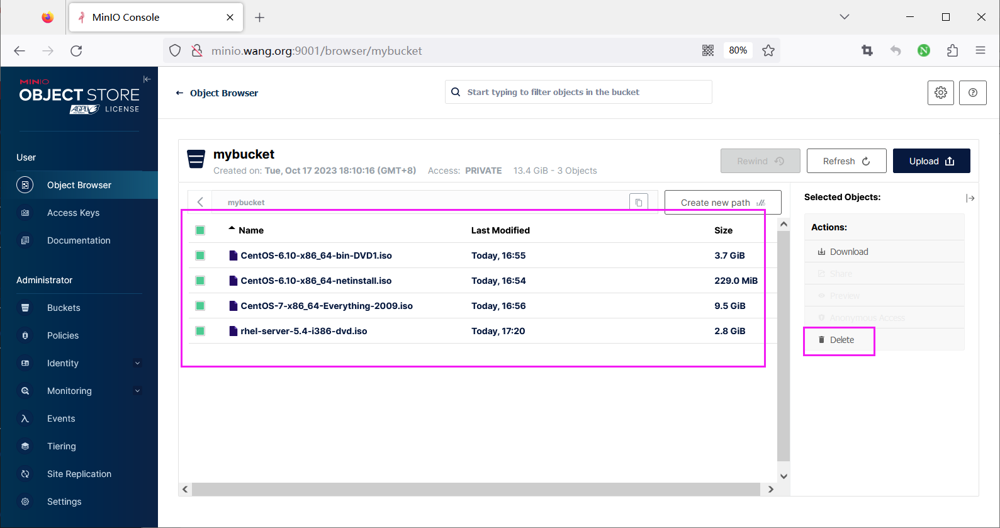
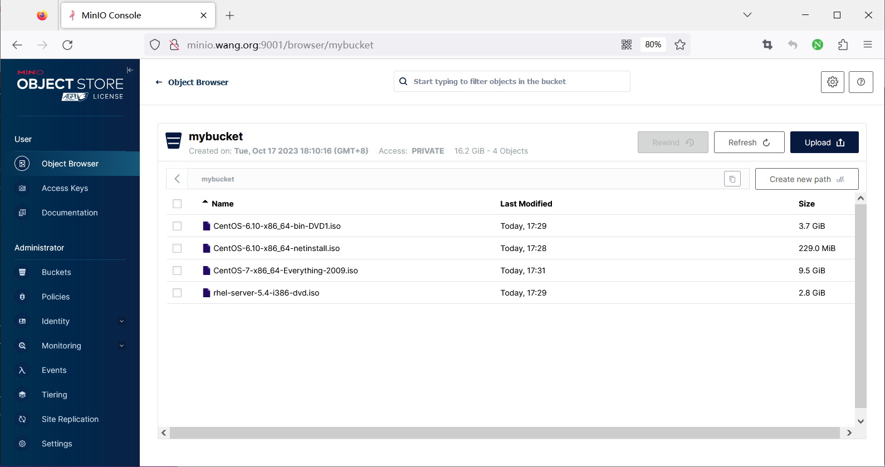

[← Back to MinIO Object Storage Index]({{ '/subjects/MinIO/' | relative_url }})



# 17 Backup and Restore Examples
### 6.2 备份还原案例

### 数据备份

范例: 备份

```bash
#创建连接
[root@ubuntu2204 ~]#mc config host add minio-cluster http://minio.bowen.org:9000
admin 12345678
[root@ubuntu2204 ~]#mc config host ls
gcs
URL       : https://storage.googleapis.com
AccessKey : YOUR-ACCESS-KEY-HERE
SecretKey : YOUR-SECRET-KEY-HERE
API       : S3v2
Path      : dns
local
URL       : http://10.0.0.100:9000
AccessKey : admin
SecretKey : 12345678
API       : s3v4
Path      : auto
minio-cluster
URL       : http://minio.bowen.org:9000
AccessKey : admin
SecretKey : 12345678
API       : s3v4
Path      : auto
play
URL       : https://play.min.io
AccessKey : Q3AM3UQ867SPQQA43P2F
SecretKey : zuf+tfteSlswRu7BJ86wekitnifILbZam1KYY3TG
API       : S3v4
Path      : auto
s3
URL       : https://s3.amazonaws.com
AccessKey : YOUR-ACCESS-KEY-HERE
SecretKey : YOUR-SECRET-KEY-HERE
API       : S3v4
Path      : dns
#查看备份的bucket的大小
[root@ubuntu2204 ~]#mc ls minio-cluster
[2023-10-17 18:10:16 CST]     0B mybucket/
[root@ubuntu2204 ~]#mc du  minio-cluster
13GiB   3 objects
[root@ubuntu2204 ~]#mc du  minio-cluster/mybucket
13GiB   3 objects   mybucket
#准备rclone的配置文件
[root@ubuntu2204 ~]#apt update && apt -y install rclone
[root@ubuntu2204 ~]#mkdir  -p .config/rclone
[root@ubuntu2204 ~]#cat >  .config/rclone/rclone.conf
[minio]
type = s3
provider = Minio
evn_auth = false
access_key_id = admin
secret_access_key = 12345678
region = beijing-1
endpoint = http://minio.bowen.org:9000
#验证配置
[root@ubuntu2204 ~]#rclone lsd minio:
-1 2023-10-17 18:10:16        -1 mybucket
#第一次执行完全备份
#说明:备份目录/data/minio-bak/会自动创建,无需事先创建
[root@ubuntu2204 ~]#rclone sync minio:/mybucket /data/minio-bak/ -vP
2023-10-19 17:17:08 INFO  : CentOS-6.10-x86_64-netinstall.iso: Copied (new)
2023-10-19 17:18:18 INFO  : CentOS-6.10-x86_64-bin-DVD1.iso: Multi-thread Copied
(new)
2023-10-19 17:18:42 INFO  : CentOS-7-x86_64-Everything-2009.iso: Multi-thread
Copied (new)
Transferred:       13.441G / 13.441 GBytes, 100%, 130.502 MBytes/s, ETA 0s
Transferred:            3 / 3, 100%
Elapsed time:      1m45.5s
2023/10/19 17:18:42 INFO  :
Transferred:       13.441G / 13.441 GBytes, 100%, 130.502 MBytes/s, ETA 0s
Transferred:            3 / 3, 100%
Elapsed time:      1m45.5s
#查看备份后的文件
[root@ubuntu2204 ~]#ls /data/minio-bak/
CentOS-6.10-x86_64-bin-DVD1.iso    CentOS-7-x86_64-Everything-2009.iso
CentOS-6.10-x86_64-netinstall.iso
#在MinIO新上传一个文件后,执行增量备份
[root@ubuntu2204 ~]#mc cp rhel-server-5.4-i386-dvd.iso minio-server/mybucket
#执行增量备份
[root@ubuntu2204 ~]#rclone sync minio:/mybucket /data/minio-bak/ -vP --checksum
2023-10-19 17:21:23 INFO  : rhel-server-5.4-i386-dvd.iso: Multi-thread Copied
(new)
Transferred:        2.799G / 2.799 GBytes, 100%, 64.035 MBytes/s, ETA 0s  #只备份
变化文件
Checks:                 3 / 3, 100%
Transferred:            1 / 1, 100%
Elapsed time:        44.8s
2023/10/19 17:21:38 INFO  :
Transferred:        2.799G / 2.799 GBytes, 100%, 64.035 MBytes/s, ETA 0s
Checks:                 3 / 3, 100%
Transferred:            1 / 1, 100%
Elapsed time:        44.8s
#查看备份后的文件
[root@ubuntu2204 ~]#ls /data/minio-bak/
CentOS-6.10-x86_64-bin-DVD1.iso    CentOS-7-x86_64-Everything-2009.iso
CentOS-6.10-x86_64-netinstall.iso  rhel-server-5.4-i386-dvd.iso
```

### 数据还原

```text
#在控制台删除MinIO文件
```



```bash
#查看数据被清空
[root@ubuntu2204 ~]#mc du  minio-cluster/mybucket
0B  0 objects   mybucket
#还原数据，即使mybucket不存在，也可以自动恢复创建
[root@ubuntu2204 ~]#rclone sync /data/minio-bak/ minio:/mybucket --transfers=8 -
-update -v -P
2023-10-19 17:28:47 INFO  : CentOS-6.10-x86_64-netinstall.iso: Copied (new)
2023-10-19 17:29:47 INFO  : rhel-server-5.4-i386-dvd.iso: Copied (new)
2023-10-19 17:30:02 INFO  : CentOS-6.10-x86_64-bin-DVD1.iso: Copied (new)
2023-10-19 17:31:31 INFO  : CentOS-7-x86_64-Everything-2009.iso: Copied (new)
Transferred:       16.241G / 16.241 GBytes, 100%, 98.526 MBytes/s, ETA 0s
Transferred:            4 / 4, 100%
Elapsed time:      2m48.8s
2023/10/19 17:31:31 INFO  :
Transferred:       16.241G / 16.241 GBytes, 100%, 98.526 MBytes/s, ETA 0s
Transferred:            4 / 4, 100%
Elapsed time:      2m48.8s
#验证数据还原
[root@ubuntu2204 ~]#mc du  minio-cluster/mybucket
16GiB   4 objects   mybucket
```

登录控制台,验证数据还原





<nav class="article-end" aria-label="章节导航">
  <a href="{{ '/subjects/MinIO/16-backup-and-restore-overview.html' | relative_url }}">← Previous: Backup and Restore Overview</a>
  <a href="{{ '/subjects/MinIO/' | relative_url }}">Back to MinIO Object Storage Index</a>
  <a href="{{ '/subjects/MinIO/18-minio-monitoring-overview.html' | relative_url }}">Next: MinIO Monitoring Overview →</a>
</nav>
