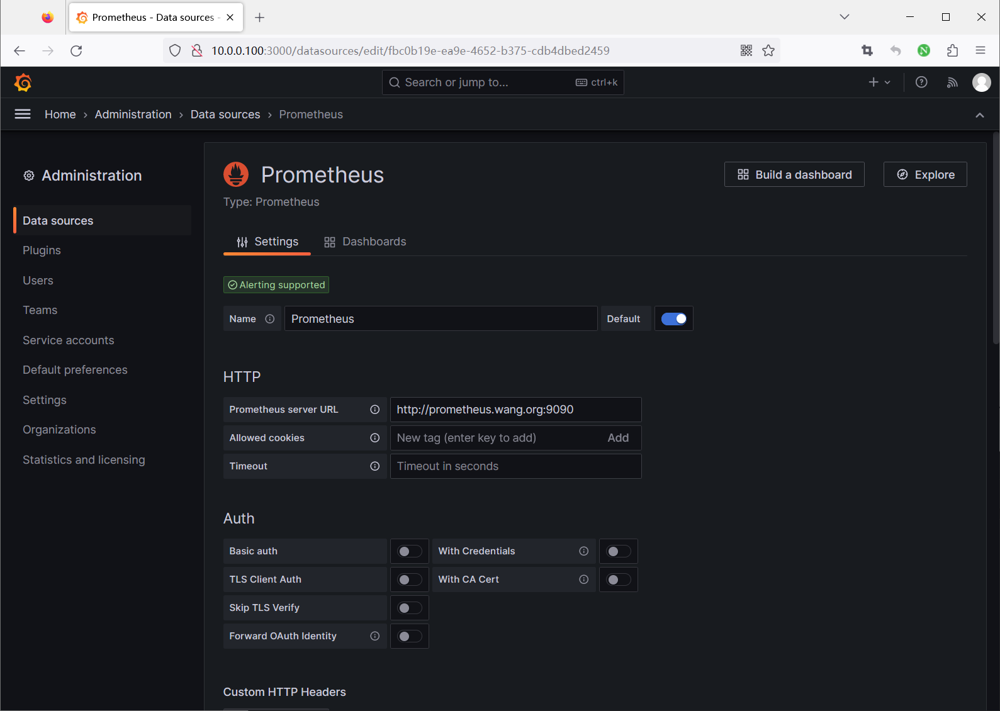
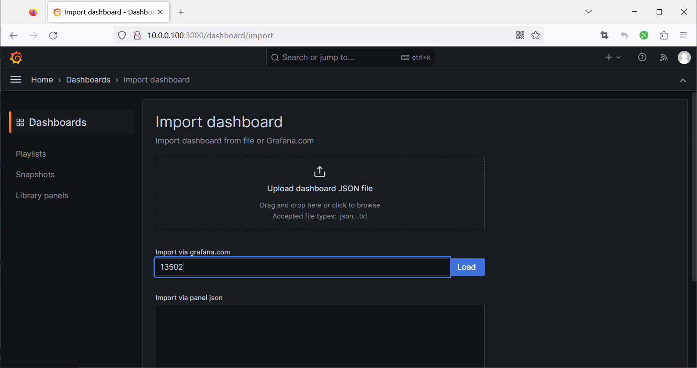
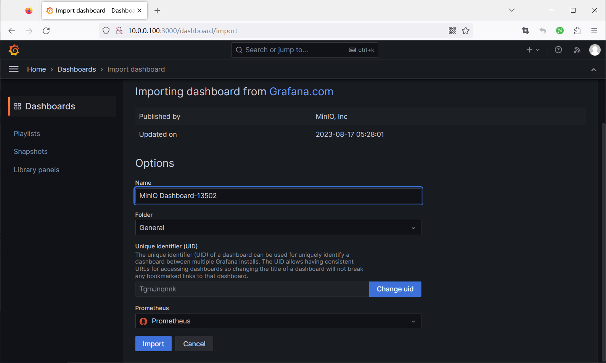
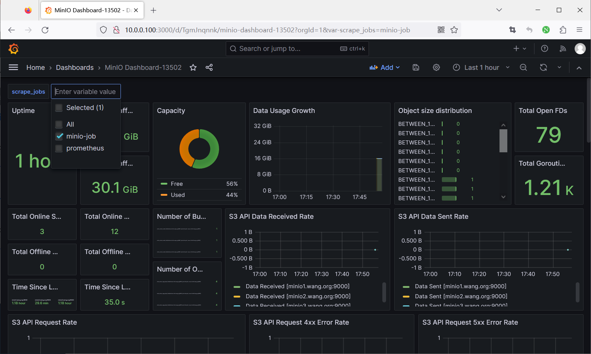
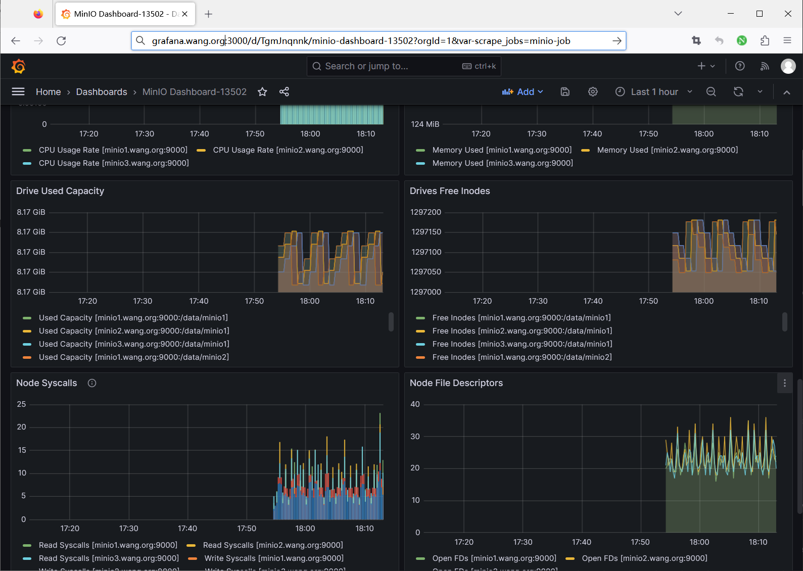

[← Back to MinIO Object Storage Index]({{ '/subjects/MinIO/' | relative_url }})



# 19 Monitoring MinIO with Prometheus and Grafana
### 7.2 MINIO 通过 Prometheus 和 Grafana 监控案例

范例:

```bash
[root@ubuntu2204 ~]#curl -s  http:minio.bowen.org:9000/minio/v2/metrics/cluster
|head
# HELP minio_audit_failed_messages Total number of messages that failed to send
since start
# TYPE minio_audit_failed_messages counter
minio_audit_failed_messages{server="minio1.bowen.org:9000",target_id="sys_console
_0"} 0
minio_audit_failed_messages{server="minio2.bowen.org:9000",target_id="sys_console
_0"} 1
minio_audit_failed_messages{server="minio3.bowen.org:9000",target_id="sys_console
_0"} 0
minio_audit_failed_messages{server="minio4.bowen.org:9000",target_id="sys_console
_0"} 0
minio_audit_failed_messages{server="minio5.bowen.org:9000",target_id="sys_console
_0"} 1
minio_audit_failed_messages{server="minio6.bowen.org:9000",target_id="sys_console
_0"} 0
# HELP minio_audit_target_queue_length Number of unsent messages in queue for
target
# TYPE minio_audit_target_queue_length gauge
```

```bash
#利用MC工具添加MinIO连接
[root@ubuntu2204 ~]#mc config host add minio-cluster http://minio.bowen.org:9000
admin 12345678
Added `minio-cluster` successfully.
[root@ubuntu2204 ~]#mc admin  info minio-cluster
```

●  minio1.bowen.org:9000

```text
Uptime: 2 hours
Version: 2023-10-16T04:13:43Z
Network: 6/6 OK
Drives: 4/4 OK
Pool: 1
```

●  minio2.bowen.org:9000

```text
Uptime: 2 hours
Version: 2023-10-16T04:13:43Z
Network: 6/6 OK
Drives: 4/4 OK
Pool: 1
```

●  minio3.bowen.org:9000

```text
Uptime: 2 hours
Version: 2023-10-16T04:13:43Z
Network: 6/6 OK
Drives: 4/4 OK
Pool: 1
```

●  minio4.bowen.org:9000

```text
Uptime: 2 hours
Version: 2023-10-16T04:13:43Z
Network: 6/6 OK
Drives: 4/4 OK
Pool: 2
```

●  minio5.bowen.org:9000

```text
Uptime: 2 hours
Version: 2023-10-16T04:13:43Z
Network: 6/6 OK
Drives: 4/4 OK
Pool: 2
```

●  minio6.bowen.org:9000

```text
Uptime: 2 hours
Version: 2023-10-16T04:13:43Z
Network: 6/6 OK
Drives: 4/4 OK
Pool: 2
Pools:
1st, Erasure sets: 1, Drives per erasure set: 12
2nd, Erasure sets: 1, Drives per erasure set: 12
2.6 MiB Used, 1 Bucket, 4 Objects
24 drives online, 0 drives offline
```

```bash
#自动生成Promethus配置
[root@ubuntu2204 ~]#mc admin  prometheus  generate  minio-cluster
scrape_configs:
- job_name: minio-job
bearer_token:
eyJhbGciOiJIUzUxMiIsInR5cCI6IkpXVCJ9.eyJpc3MiOiJwcm9tZXRoZXVzIiwic3ViIjoiYWRtaW4
iLCJleHAiOjQ4NTEyOTYzODJ9.iKHE1uXVPKYAixlJBAIpnb2btslig6WNZz6KQqSWBv7qUnNfYqnqIU
dq1f6mMAmq_G3pfU_pEJmpPfl1jRrQaw
metrics_path: /minio/v2/metrics/cluster
scheme: http
static_configs:
- targets: ['minio.bowen.org:9000']
```

```bash
#安装prometheus和grafana
过程略
#配置Prometheus
[root@ubuntu2204 ~]#vim /usr/local/prometheus/conf/prometheus.yml
......
scrape_configs:
# The job name is added as a label `job=<job_name>` to any timeseries scraped
from this config.
- job_name: "prometheus"
# metrics_path defaults to '/metrics'
# scheme defaults to 'http'.
static_configs:
- targets: ["localhost:9090"]
#添加前面自动生成Promethus配置如下
- job_name: minio-job
bearer_token:
eyJhbGciOiJIUzUxMiIsInR5cCI6IkpXVCJ9.eyJpc3MiOiJwcm9tZXRoZXVzIiwic3ViIjoiYWRtaW4
iLCJleHAiOjQ4NTEyOTYzODJ9.iKHE1uXVPKYAixlJBAIpnb2btslig6WNZz6KQqSWBv7qUnNfYqnqIU
dq1f6mMAmq_G3pfU_pEJmpPfl1jRrQaw
metrics_path: /minio/v2/metrics/cluster
scheme: http
static_configs:
- targets: ['minio.bowen.org:9000']
[root@ubuntu2204 ~]#systemctl reload prometheus.service
#安装grafana
[root@ubuntu2404 ~]#wget
https://mirrors.tuna.tsinghua.edu.cn/grafana/apt/pool/main/g/grafana/grafana_11.
4.0_amd64.deb
[root@ubuntu2204 ~]#wget
https://mirrors.tuna.tsinghua.edu.cn/grafana/apt/pool/main/g/grafana/grafana_11.
3.0_amd64.deb
[root@ubuntu2204 ~]#wget
https://mirrors.tuna.tsinghua.edu.cn/grafana/apt/pool/main/g/grafana/grafana_11.
1.3_amd64.deb
[root@ubuntu2204 ~]#apt install ./grafana_11.1.3_amd64.deb
[root@ubuntu2204 ~]#systemctl enable --now  grafana-server
#使用默认用户/密码:admin/admin
http://10.0.0.100:3000/
```

```text
#在Grafana添加Prometheus数据源和导入13502模板
```













<nav class="article-end" aria-label="章节导航">
  <a href="{{ '/subjects/MinIO/18-minio-monitoring-overview.html' | relative_url }}">← Previous: MinIO Monitoring Overview</a>
  <a href="{{ '/subjects/MinIO/' | relative_url }}">Back to MinIO Object Storage Index</a>
</nav>
