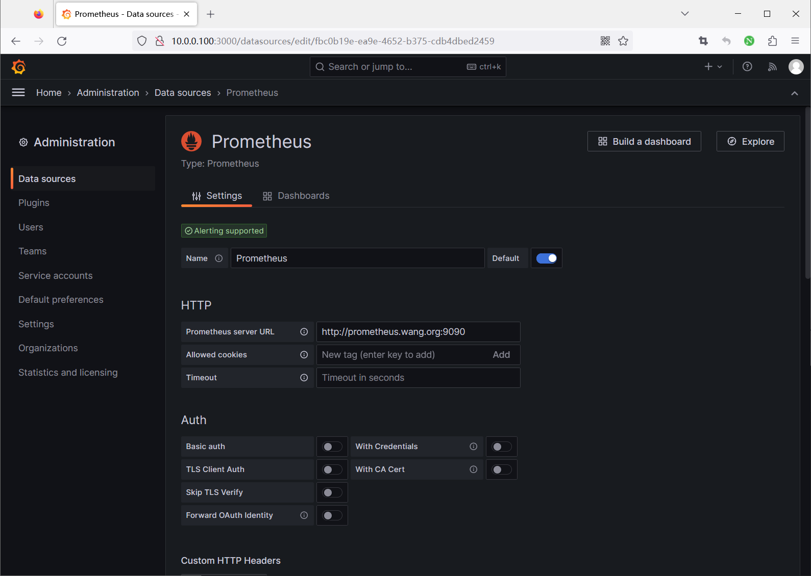
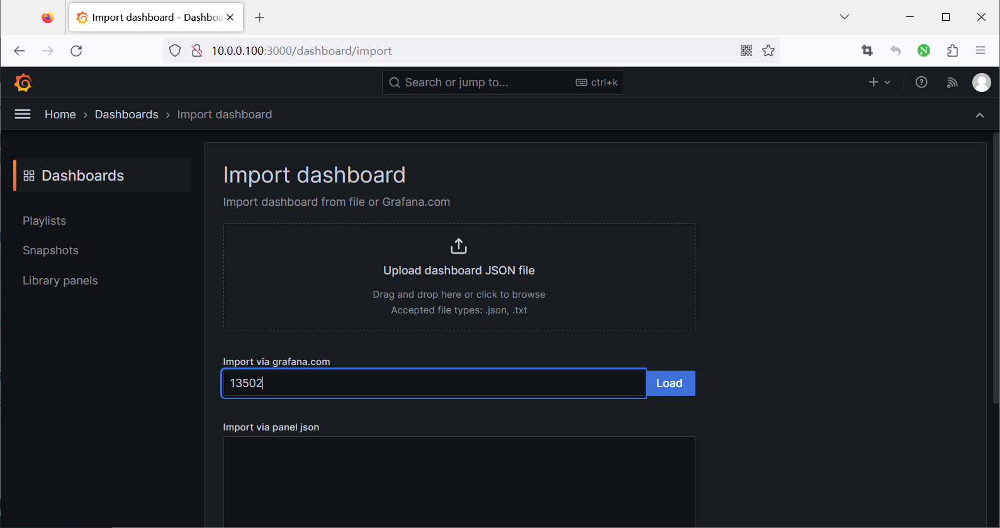
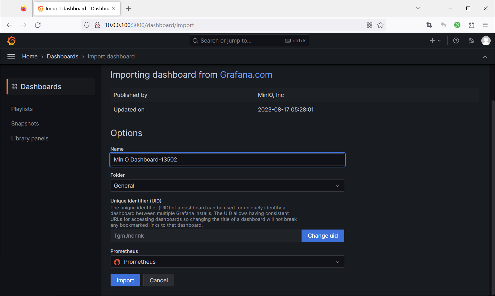
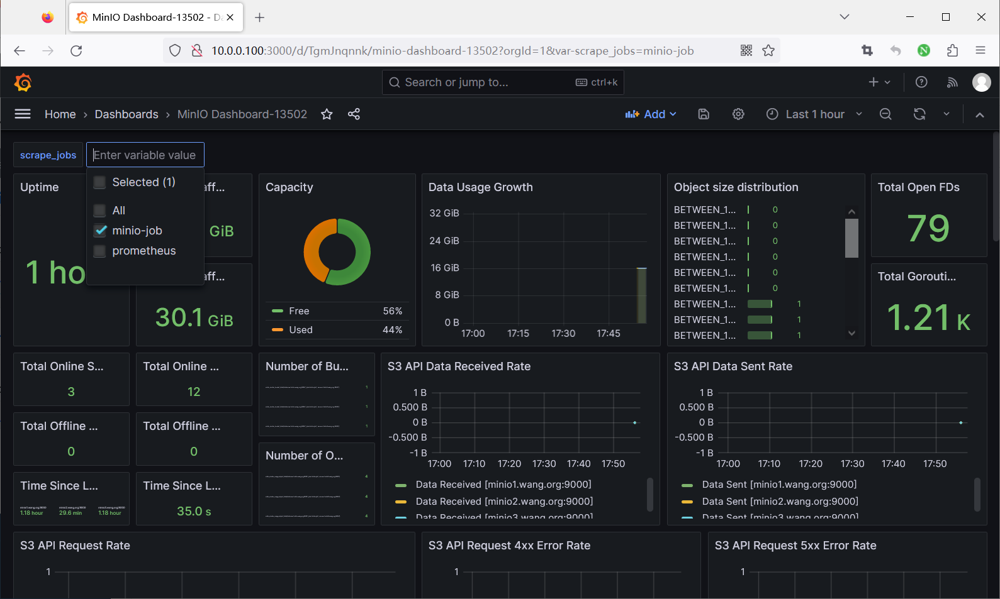
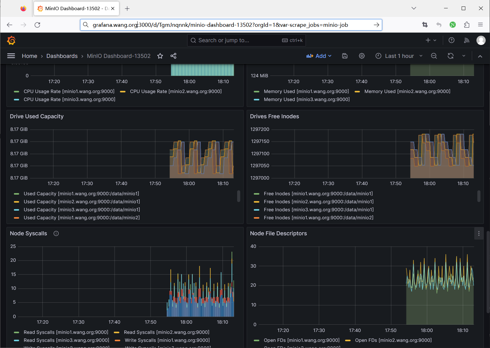

[← 返回 MinIO 对象存储目录]({{ '/subjects/MinIO/' | relative_url }})



# 19 Prometheus 与 Grafana 监控

本章把 MinIO 指标采集到 Prometheus，再通过 Grafana 查看。操作顺序是：确认指标端点与认证 → 配置抓取 → 验证目标状态和样本 → 连接 Grafana → 建立告警。原资料中 `curl http:minio...` 缺少 `//`，并把完整 Bearer Token 写进文章；以下示例保留流程而不暴露可用凭据。

## 1. 生成并检查抓取配置

给 `mc` 配置具有管理权限的别名后，先检查 MinIO 节点及磁盘状态，再根据**当前服务端和 mc 版本**生成 Prometheus 抓取配置：

```bash
mc admin info minio-cluster
mc admin prometheus generate minio-cluster
```

生成结果会包含指标路径、scheme、目标与 Bearer Token；不同版本可能使用 v2 或 v3 指标端点。将 Token 作为秘密存入 Prometheus 可读取、其他用户不可读的文件，不要粘贴到仓库或截图中。若使用 HTTPS，应保持证书验证，不要为了抓取成功而关闭 TLS 校验。

指标端点可先在监控节点上测试连接；若需要鉴权，需带受保护的 Token：

```bash
curl -fsS --header "Authorization: Bearer ${MINIO_METRICS_TOKEN}" \
  https://minio.example.internal:9000/minio/v2/metrics/cluster | head
```

这里只用 v2 路径说明命令结构；若生成配置为 v3，就以生成结果为准。`curl` 得到 `# HELP` 和指标样本表示端点可访问，仍需在 Prometheus 中确认抓取成功。

## 2. 配置 Prometheus

将以下任务加入现有 `prometheus.yml` 的 `scrape_configs`，不要再写第二个同名顶层键。Token 文件路径以 Prometheus 服务用户可读为准；生产环境优先使用 TLS API 入口。

```yaml
scrape_configs:
  - job_name: minio-cluster
    scheme: https
    metrics_path: /minio/v2/metrics/cluster
    bearer_token_file: /etc/prometheus/secrets/minio-metrics-token
    static_configs:
      - targets:
          - minio.example.internal:9000
```

在发布配置前运行 `promtool check config /etc/prometheus/prometheus.yml`，再按部署方式重载 Prometheus。打开 Prometheus 的 **Status → Targets**，确认 `minio-cluster` 为 `UP`；若为 `DOWN`，先查目标地址、路径、Token、TLS 与网络连通性。对于节点级指标，为每个 MinIO 节点建立独立目标，不能只抓一个负载均衡地址就认为已覆盖全部节点。

## 3. 接入 Grafana

在 Grafana 中添加 Prometheus 数据源，使用 Grafana 服务端可访问的 Prometheus URL，并执行 **Save & test**。随后可导入 [MinIO Dashboard 13502](https://grafana.com/grafana/dashboards/13502-minio-dashboard/) 作为观察起点；若面板为空，核对数据源、job 标签、指标名及 MinIO 版本。不要假设任何旧 Dashboard 对新版本指标零修改兼容。











## 4. 从图表走向告警

至少为采集目标失联、离线驱动器、可用容量下降、请求错误与延迟、后台修复失败建立告警，并按业务情况监控备份任务及入口负载均衡。为告警设置持续时间与静默策略，避免一次短暂重启触发大量误报。通过一次受控演练验证：服务或采集链路异常时能收到告警，恢复后告警会正确清除。

指标显示正常只说明观测链路工作；仍要结合定期对象读取、备份校验和恢复演练判断数据可用性。



<nav class="article-end" aria-label="章节导航">
  <a href="{{ '/subjects/MinIO/18-minio-monitoring-overview.html' | relative_url }}">← 上一篇：MinIO 监控概述</a>
  <a href="{{ '/subjects/MinIO/' | relative_url }}">返回 MinIO 对象存储目录</a>
</nav>
