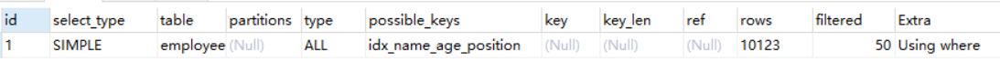
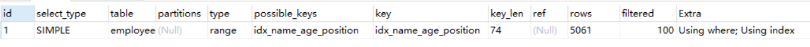
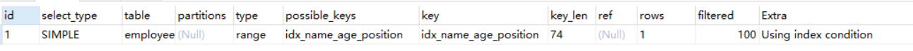

[← 返回 MySQL 性能调优目录]({{ '/subjects/MySQL-Performance/' | relative_url }})



# 08 优化器选索引与统计信息

## 不把 FORCE INDEX 当作默认答案

优化器比较表扫描、范围扫描、回表、排序和连接等路径的估计成本。数据倾斜或过期统计信息会造成估算偏差；先用 `EXPLAIN ANALYZE` 对照实际行数，再检查索引基数、直方图与 `ANALYZE TABLE`。直方图主要补充非索引列值分布，不是所有估算问题的万能修复。

```sql
SHOW INDEX FROM employees;
EXPLAIN ANALYZE SELECT * FROM employees WHERE name > 'zzz';
-- 仅在可控环境验证统计信息刷新效果
ANALYZE TABLE employees;
```

`FORCE INDEX` 与全表扫描、索引回表的对比表明：强制索引不必然更快。提示可用于诊断或极少数稳定场景，但会与数据分布、版本升级和新索引相互影响；上线前应做回归，并准备移除提示。MySQL 8.0 的不可见索引可用于评估删除索引的影响，但要先确认查询是否依赖它。[官方参考：不可见索引](https://dev.mysql.com/doc/refman/8.0/en/invisible-indexes.html)。


## 统计信息与优化器成本分析

### Mysql如何选择合适的索引

```sql
EXPLAIN select * from employees where name > 'a';
```



如果用name索引需要遍历name字段联合索引树，然后还需要根据遍历出来的主键值去主键索引树里再去查出最终数据，成本比全表扫描还高，可以用覆盖索引优化，这样只需要遍历name字段的联合索引树就能拿到所有结果，如下：

```sql
EXPLAIN select name,age,position from employees where name > 'a' ;
```



```sql
EXPLAIN select * from employees where name > 'zzz' ;
```



对于上面这两种 name>'a' 和 name>'zzz' 的执行结果，mysql最终是否选择走索引或者一张表涉及多个索引，mysql最终如何选择索引，我们可以用trace工具来一查究竟，开启trace工具会影响mysql性能，所以只能临时分析sql使用，用完之后立即关闭

trace工具用法：

```text
mysql> set session optimizer_trace="enabled=on",end_markers_in_json=on;  --开启trace
mysql> select * from employees where name > 'a' order by position;
mysql> SELECT * FROM information_schema.OPTIMIZER_TRACE;

查看trace字段：
{
  "steps": [
    {
      "join_preparation": {    --第一阶段：SQL准备阶段，格式化sql
        "select#": 1,
        "steps": [
          {
            "expanded_query": "/* select#1 */ select `employees`.`id` AS `id`,`employees`.`name` AS `name`,`employees`.`age` AS `age`,`employees`.`position` AS `position`,`employees`.`hire_time` AS `hire_time` from `employees` where (`employees`.`name` > 'a') order by `employees`.`position`"
          }
        ] /* steps */
      } /* join_preparation */
    },
    {
      "join_optimization": {    --第二阶段：SQL优化阶段
        "select#": 1,
        "steps": [
          {
            "condition_processing": {    --条件处理
              "condition": "WHERE",
              "original_condition": "(`employees`.`name` > 'a')",
              "steps": [
                {
                  "transformation": "equality_propagation",
                  "resulting_condition": "(`employees`.`name` > 'a')"
                },
                {
                  "transformation": "constant_propagation",
                  "resulting_condition": "(`employees`.`name` > 'a')"
                },
                {
                  "transformation": "trivial_condition_removal",
                  "resulting_condition": "(`employees`.`name` > 'a')"
                }
              ] /* steps */
            } /* condition_processing */
          },
          {
            "substitute_generated_columns": {
            } /* substitute_generated_columns */
          },
          {
            "table_dependencies": [    --表依赖详情
              {
                "table": "`employees`",
                "row_may_be_null": false,
                "map_bit": 0,
                "depends_on_map_bits": [
                ] /* depends_on_map_bits */
              }
            ] /* table_dependencies */
          },
          {
            "ref_optimizer_key_uses": [
            ] /* ref_optimizer_key_uses */
          },
          {
            "rows_estimation": [    --预估表的访问成本
              {
                "table": "`employees`",
                "range_analysis": {
                  "table_scan": {     --全表扫描情况
                    "rows": 10123,    --扫描行数
                    "cost": 2054.7    --查询成本
                  } /* table_scan */,
                  "potential_range_indexes": [    --查询可能使用的索引
                    {
                      "index": "PRIMARY",    --主键索引
                      "usable": false,
                      "cause": "not_applicable"
                    },
                    {
                      "index": "idx_name_age_position",    --辅助索引
                      "usable": true,
                      "key_parts": [
                        "name",
                        "age",
                        "position",
                        "id"
                      ] /* key_parts */
                    }
                  ] /* potential_range_indexes */,
                  "setup_range_conditions": [
                  ] /* setup_range_conditions */,
                  "group_index_range": {
                    "chosen": false,
                    "cause": "not_group_by_or_distinct"
                  } /* group_index_range */,
                  "analyzing_range_alternatives": {    --分析各个索引使用成本
                    "range_scan_alternatives": [
                      {
                        "index": "idx_name_age_position",
                        "ranges": [
                          "a < name"      --索引使用范围
                        ] /* ranges */,
                        "index_dives_for_eq_ranges": true,
                        "rowid_ordered": false,    --使用该索引获取的记录是否按照主键排序
                        "using_mrr": false,
                        "index_only": false,       --是否使用覆盖索引
                        "rows": 5061,              --索引扫描行数
                        "cost": 6074.2,            --索引使用成本
                        "chosen": false,           --是否选择该索引
                        "cause": "cost"
                      }
                    ] /* range_scan_alternatives */,
                    "analyzing_roworder_intersect": {
                      "usable": false,
                      "cause": "too_few_roworder_scans"
                    } /* analyzing_roworder_intersect */
                  } /* analyzing_range_alternatives */
                } /* range_analysis */
              }
            ] /* rows_estimation */
          },
          {
            "considered_execution_plans": [
              {
                "plan_prefix": [
                ] /* plan_prefix */,
                "table": "`employees`",
                "best_access_path": {    --最优访问路径
                  "considered_access_paths": [   --最终选择的访问路径
                    {
                      "rows_to_scan": 10123,
                      "access_type": "scan",     --访问类型：为scan，全表扫描
                      "resulting_rows": 10123,
                      "cost": 2052.6,
                      "chosen": true,            --确定选择
                      "use_tmp_table": true
                    }
                  ] /* considered_access_paths */
                } /* best_access_path */,
                "condition_filtering_pct": 100,
                "rows_for_plan": 10123,
                "cost_for_plan": 2052.6,
                "sort_cost": 10123,
                "new_cost_for_plan": 12176,
                "chosen": true
              }
            ] /* considered_execution_plans */
          },
          {
            "attaching_conditions_to_tables": {
              "original_condition": "(`employees`.`name` > 'a')",
              "attached_conditions_computation": [
              ] /* attached_conditions_computation */,
              "attached_conditions_summary": [
                {
                  "table": "`employees`",
                  "attached": "(`employees`.`name` > 'a')"
                }
              ] /* attached_conditions_summary */
            } /* attaching_conditions_to_tables */
          },
          {
            "clause_processing": {
              "clause": "ORDER BY",
              "original_clause": "`employees`.`position`",
              "items": [
                {
                  "item": "`employees`.`position`"
                }
              ] /* items */,
              "resulting_clause_is_simple": true,
              "resulting_clause": "`employees`.`position`"
            } /* clause_processing */
          },
          {
            "reconsidering_access_paths_for_index_ordering": {
              "clause": "ORDER BY",
              "steps": [
              ] /* steps */,
              "index_order_summary": {
                "table": "`employees`",
                "index_provides_order": false,
                "order_direction": "undefined",
                "index": "unknown",
                "plan_changed": false
              } /* index_order_summary */
            } /* reconsidering_access_paths_for_index_ordering */
          },
          {
            "refine_plan": [
              {
                "table": "`employees`"
              }
            ] /* refine_plan */
          }
        ] /* steps */
      } /* join_optimization */
    },
    {
      "join_execution": {    --第三阶段：SQL执行阶段
        "select#": 1,
        "steps": [
        ] /* steps */
      } /* join_execution */
    }
  ] /* steps */
}

结论：全表扫描的成本低于索引扫描，所以mysql最终选择全表扫描

mysql> select * from employees where name > 'zzz' order by position;
mysql> SELECT * FROM information_schema.OPTIMIZER_TRACE;

查看trace字段可知索引扫描的成本低于全表扫描，所以mysql最终选择索引扫描

mysql> set session optimizer_trace="enabled=off";    --关闭trace
```



<nav class="article-end" aria-label="章节导航">
  <a href="{{ '/subjects/MySQL-Performance/07-order-group.html' | relative_url }}">← 上一篇：排序与分组的优化边界</a>
  <a href="{{ '/subjects/MySQL-Performance/' | relative_url }}">返回专题目录</a>
  <a href="{{ '/subjects/MySQL-Performance/09-pagination-covering.html' | relative_url }}">下一篇：深度分页与覆盖扫描 →</a>
</nav>
