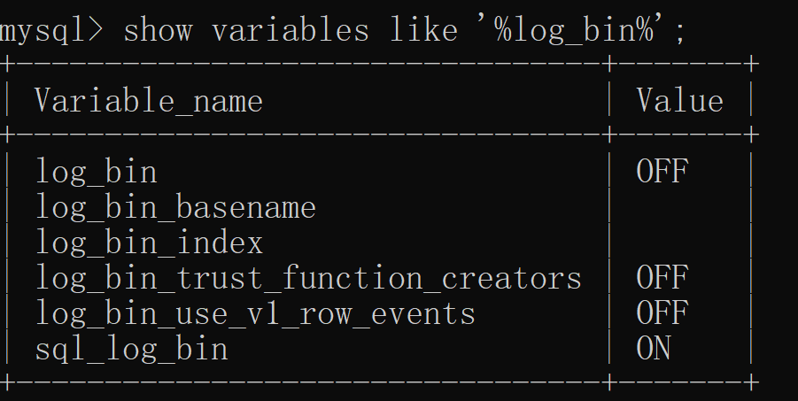
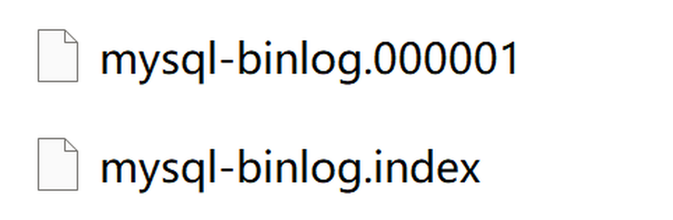
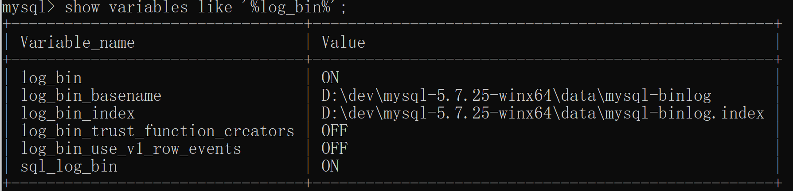

[← 返回 MySQL 性能调优目录]({{ '/subjects/MySQL-Performance/' | relative_url }})



# 20 binlog 与提交一致性

## Server 层日志与引擎日志的衔接

binlog 是 MySQL Server 层的二进制变更日志，用于复制和时间点恢复；redo 是 InnoDB 引擎的崩溃恢复机制。为避免“引擎已提交但 binlog 缺失”或相反的持久化不一致，MySQL 将事务提交与 binlog 写入协调起来，常称两阶段提交。不能把 binlog 当作唯一备份，也不能用手工删除当前日志文件来释放空间。

```sql
SHOW VARIABLES LIKE 'log_bin';
SHOW VARIABLES LIKE 'binlog_format';
SHOW VARIABLES LIKE 'sync_binlog';
SHOW BINARY LOGS;
```

`mysqlbinlog` 可用于查看 binlog；误删恢复应先在隔离测试环境演练。真实恢复须从经过校验的全量备份加 binlog 重放，并明确停止位置、GTID/事务边界和复制拓扑。清理日志前确认备份和所有副本的需求。[官方参考：binlog](https://dev.mysql.com/doc/refman/8.0/en/binary-log.html)。


## binlog 格式、持久化与恢复演练

### binlog二进制归档日志

binlog 记录事务更改，常用于复制与时间点恢复；ROW、STATEMENT、MIXED 格式记录的不是同一种“SQL 语句文本”。

启动binlog记录功能，会影响服务器性能，但如果需要恢复数据或主从复制功能，则好处则大于对服务器的影响。

```sql
# 查看binlog相关参数
show variables like '%log_bin%';
```



MySQL 8.0 的 binlog 通常默认启用，实际状态应以 SHOW VARIABLES 和配置为准；图示为特定实例的参数结果。

以下保留原案例的配置意图，并改用 MySQL 8.0 常用的保留期参数；部署前先确认实例已有的 binlog 设置、复制拓扑和恢复窗口。

```ini
[mysqld]
# 相对路径按服务器数据目录解析；生产环境应明确日志存储位置。
log-bin=mysql-binlog
# 复制拓扑中的 server-id 必须唯一；是否需要显式设置取决于版本和配置。
server-id=1
binlog_format=ROW
binlog_expire_logs_seconds=1296000
max_binlog_size=200M
```

重启数据库后我们再去看data数据目录会多出两个文件，第一个就是binlog日志文件，第二个是binlog文件的索引文件，这个文件管理了所有的binlog文件的目录。



当然也可以执行命令查看有多少binlog文件

```sql
show binary logs;
```

```sql
show variables like '%log_bin%';
```



- `log_bin`：当前实例是否启用 binlog。
- `log_bin_basename`：binlog 文件的基础路径和名称，滚动时会追加序号。
- `log_bin_index`：列出本实例 binlog 文件的索引文件。
- `sql_log_bin`：会话级写入开关。关闭会使该会话事务缺失于 binlog，影响复制与时间点恢复；仅在明确的运维方案下使用，不能作为常规优化手段。

binlog 的日志格式

用参数 binlog_format 可以设置binlog日志的记录格式，mysql支持三种格式类型：

- STATEMENT 记录语句，体积可能较小，但非确定性语句和环境差异需谨慎处理。

- ROW 记录受影响行的变化，通常更适合可靠复制与精确恢复分析，但体积与写入开销可能增加。

- MIXED 按语句选择格式；部署前应核对当前版本、复制拓扑与 binlog_format 的实际配置。

binlog写入磁盘机制

sync_binlog 决定 binlog 刷盘节奏；MySQL 8.0 的默认值通常为 1，但应以实例实际值为准。

- 为0的时候，表示每次提交事务都只 write 到page cache，由系统自行判断什么时候执行 fsync 写入磁盘。虽然性能得到提升，但是机器宕机，page cache里面的 binlog 会丢失。

- 设为 1 时每次提交要求刷盘，通常提高 binlog 耐久性；仍依赖底层存储正确履行刷盘语义。

- 设为 N（N>1）时可以批量刷盘；整机故障可能影响最近未刷盘的事务，具体窗口需结合负载与实现评估。

发生以下任何事件时, binlog日志文件会重新生成：

- 服务器启动或重新启动

- 服务器刷新日志，执行命令flush logs

- 日志文件大小达到 max_binlog_size 值，默认值为 1GB

清理 binlog 前先确认备份、复制副本和保留策略

```sql
SHOW BINARY LOGS;
-- 确认所有副本追平并已完成备份后，按版本使用 PURGE BINARY LOGS TO 'mysql-binlog.000006';
-- 不把 RESET MASTER 当作日常清理命令。
```

查看 binlog 日志文件

可以用 MySQL 自带的 `mysqlbinlog` 查看 binlog 内容；下面的路径和输出来自 MySQL 5.7 案例，实际文件名以 `SHOW BINARY LOGS` 为准。

```bash
# 查看 binlog（二进制日志，命令行方式）
mysqlbinlog --no-defaults -v --base64-output=decode-rows D:/dev/mysql-5.7.25-winx64/data/mysql-binlog.000007

# 按时间或文件位置限定读取范围；这些选项需要 -- 前缀。
mysqlbinlog --no-defaults -v --base64-output=decode-rows --start-datetime="2023-01-21 00:00:00" --stop-datetime="2023-02-01 00:00:00" D:/dev/mysql-5.7.25-winx64/data/mysql-binlog.000007
mysqlbinlog --no-defaults -v --base64-output=decode-rows --start-position=5000 --stop-position=20000 D:/dev/mysql-5.7.25-winx64/data/mysql-binlog.000007
```

执行mysqlbinlog命令

```bash
mysqlbinlog --no-defaults -v --base64-output=decode-rows D:/dev/mysql-5.7.25-winx64/data/mysql-binlog.000007
```

查出来的binlog日志文件内容如下：

```sql
/*!50530 SET @@SESSION.PSEUDO_SLAVE_MODE=1*/;
/*!50003 SET @OLD_COMPLETION_TYPE=@@COMPLETION_TYPE,COMPLETION_TYPE=0*/;
DELIMITER /*!*/;
# at 4
#230127 21:13:51 server id 1  end_log_pos 123 CRC32 0x084f390f  Start: binlog v 4, server v 5.7.25-log created 230127 21:13:51 at startup
# Warning: this binlog is either in use or was not closed properly.
ROLLBACK/*!*/;
# at 123
#230127 21:13:51 server id 1  end_log_pos 154 CRC32 0x672ba207  Previous-GTIDs
# [empty]
# at 154
#230127 21:22:48 server id 1  end_log_pos 219 CRC32 0x8349d010  Anonymous_GTID  last_committed=0        sequence_number=1       rbr_only=yes
/*!50718 SET TRANSACTION ISOLATION LEVEL READ COMMITTED*//*!*/;
SET @@SESSION.GTID_NEXT= 'ANONYMOUS'/*!*/;
# at 219
#230127 21:22:48 server id 1  end_log_pos 291 CRC32 0xbf49de02  Query   thread_id=3     exec_time=0     error_code=0
SET TIMESTAMP=1674825768/*!*/;
SET @@session.pseudo_thread_id=3/*!*/;
SET @@session.foreign_key_checks=1, @@session.sql_auto_is_null=0, @@session.unique_checks=1, @@session.autocommit=1/*!*/;
SET @@session.sql_mode=1342177280/*!*/;
SET @@session.auto_increment_increment=1, @@session.auto_increment_offset=1/*!*/;
/*!\C utf8 *//*!*/;
SET @@session.character_set_client=33,@@session.collation_connection=33,@@session.collation_server=33/*!*/;
SET @@session.lc_time_names=0/*!*/;
SET @@session.collation_database=DEFAULT/*!*/;
BEGIN
/*!*/;
# at 291
#230127 21:22:48 server id 1  end_log_pos 345 CRC32 0xc4ab653e  Table_map: `test`.`account` mapped to number 99
# at 345
#230127 21:22:48 server id 1  end_log_pos 413 CRC32 0x54a124bd  Update_rows: table id 99 flags: STMT_END_F
### UPDATE `test`.`account`
### WHERE
###   @1=1
###   @2='lilei'
###   @3=1000
### SET
###   @1=1
###   @2='lilei'
###   @3=2000
# at 413
#230127 21:22:48 server id 1  end_log_pos 444 CRC32 0x23355595  Xid = 10
COMMIT/*!*/;
# at 444
。。。
```

能看到里面有具体执行的修改伪sql语句以及执行时的相关情况。

binlog日志文件恢复数据

时间点恢复应以已验证的全量备份为基线，再按 binlog 事务边界回放；下面的位置示例只用于隔离演练。

```sql
# 先执行刷新日志的命令生成一个新的binlog文件mysql-binlog.000008，后面我们的修改操作日志都会记录在最新的这个文件里
flush logs;
# 执行两条插入语句
INSERT INTO `test`.`account` (`id`, `name`, `balance`) VALUES ('4', 'zhuge', '666');
INSERT INTO `test`.`account` (`id`, `name`, `balance`) VALUES ('5', 'zhuge1', '888');
# 假设现在误操作执行了一条删除语句把刚新增的两条数据删掉了
delete from account where id > 3;
```

# 现在需要恢复被删除的两条数据，我们先查看binlog日志文件

```bash
mysqlbinlog --no-defaults -v --base64-output=decode-rows D:/dev/mysql-5.7.25-winx64/data/mysql-binlog.000008
```

文件内容如下：

```sql
。。。。。。
SET @@SESSION.GTID_NEXT= 'ANONYMOUS'/*!*/;
# at 219
#230127 23:32:24 server id 1  end_log_pos 291 CRC32 0x4528234f  Query   thread_id=5     exec_time=0     error_code=0
SET TIMESTAMP=1674833544/*!*/;
SET @@session.pseudo_thread_id=5/*!*/;
SET @@session.foreign_key_checks=1, @@session.sql_auto_is_null=0, @@session.unique_checks=1, @@session.autocommit=1/*!*/;
SET @@session.sql_mode=1342177280/*!*/;
SET @@session.auto_increment_increment=1, @@session.auto_increment_offset=1/*!*/;
/*!\C utf8 *//*!*/;
SET @@session.character_set_client=33,@@session.collation_connection=33,@@session.collation_server=33/*!*/;
SET @@session.lc_time_names=0/*!*/;
SET @@session.collation_database=DEFAULT/*!*/;
BEGIN
/*!*/;
# at 291
#230127 23:32:24 server id 1  end_log_pos 345 CRC32 0x7482741d  Table_map: `test`.`account` mapped to number 99
# at 345
#230127 23:32:24 server id 1  end_log_pos 396 CRC32 0x5e443cf0  Write_rows: table id 99 flags: STMT_END_F
### INSERT INTO `test`.`account`
### SET
###   @1=4
###   @2='zhuge'
###   @3=666
# at 396
#230127 23:32:24 server id 1  end_log_pos 427 CRC32 0x8a0d8a3c  Xid = 56
COMMIT/*!*/;
# at 427
#230127 23:32:40 server id 1  end_log_pos 492 CRC32 0x5261a37e  Anonymous_GTID  last_committed=1        sequence_number=2       rbr_only=yes
/*!50718 SET TRANSACTION ISOLATION LEVEL READ COMMITTED*//*!*/;
SET @@SESSION.GTID_NEXT= 'ANONYMOUS'/*!*/;
# at 492
#230127 23:32:40 server id 1  end_log_pos 564 CRC32 0x01086643  Query   thread_id=5     exec_time=0     error_code=0
SET TIMESTAMP=1674833560/*!*/;
BEGIN
/*!*/;
# at 564
#230127 23:32:40 server id 1  end_log_pos 618 CRC32 0xc26b6719  Table_map: `test`.`account` mapped to number 99
# at 618
#230127 23:32:40 server id 1  end_log_pos 670 CRC32 0x8e272176  Write_rows: table id 99 flags: STMT_END_F
### INSERT INTO `test`.`account`
### SET
###   @1=5
###   @2='zhuge1'
###   @3=888
# at 670
#230127 23:32:40 server id 1  end_log_pos 701 CRC32 0xb5e63d00  Xid = 58
COMMIT/*!*/;
# at 701
#230127 23:34:23 server id 1  end_log_pos 766 CRC32 0xa0844501  Anonymous_GTID  last_committed=2        sequence_number=3       rbr_only=yes
/*!50718 SET TRANSACTION ISOLATION LEVEL READ COMMITTED*//*!*/;
SET @@SESSION.GTID_NEXT= 'ANONYMOUS'/*!*/;
# at 766
#230127 23:34:23 server id 1  end_log_pos 838 CRC32 0x687bdf88  Query   thread_id=7     exec_time=0     error_code=0
SET TIMESTAMP=1674833663/*!*/;
BEGIN
/*!*/;
# at 838
#230127 23:34:23 server id 1  end_log_pos 892 CRC32 0x4f7b7d6a  Table_map: `test`.`account` mapped to number 99
# at 892
#230127 23:34:23 server id 1  end_log_pos 960 CRC32 0xc47ac777  Delete_rows: table id 99 flags: STMT_END_F
### DELETE FROM `test`.`account`
### WHERE
###   @1=4
###   @2='zhuge'
###   @3=666
### DELETE FROM `test`.`account`
### WHERE
###   @1=5
###   @2='zhuge1'
###   @3=888
# at 960
#230127 23:34:23 server id 1  end_log_pos 991 CRC32 0x386699fe  Xid = 65
COMMIT/*!*/;
SET @@SESSION.GTID_NEXT= 'AUTOMATIC' /* added by mysqlbinlog */ /*!*/;
DELIMITER ;
# End of log file
。。。。。。
```

找到两条插入数据的sql，每条sql的上下都有BEGIN和COMMIT，我们找到第一条sql BEGIN前面的文件位置标识 at 219(这是文件的位置标识)，再找到第二条sql COMMIT后面的文件位置标识 at 701

在独立恢复实例中先还原并校验备份，再按事务边界选取日志范围。下例的 `219` 至 `701` 对应上面展示的 **000008** 文件内两笔 INSERT 事务，`--stop-position=701` 停在误删事务开始前；不要将它误写为下一份日志文件。重放前还须核对该实例的 GTID 与 binlog 设置，避免把演示命令直接作用于线上库。

```bash
mysqlbinlog --no-defaults --start-position=219 --stop-position=701 D:/dev/mysql-5.7.25-winx64/data/mysql-binlog.000008 | mysql --login-path=restore test

# 时间条件可辅助定位，但同一秒可能有多笔事务；精确重放优先使用核实后的事件位置或 GTID。
mysqlbinlog --no-defaults --start-datetime="2023-01-27 23:32:24" --stop-datetime="2023-01-27 23:34:23" D:/dev/mysql-5.7.25-winx64/data/mysql-binlog.000008 > recovery-preview.sql
```

演练结束后核对关键表行数、业务查询结果和复制状态；不能只看到命令成功就判定恢复完成。

仅凭残存 binlog 不一定能完整恢复历史状态；需要有可用备份、完整日志链与明确的恢复目标。

全量备份频率要由 RPO、RTO、数据规模和 binlog 保留期决定；常见恢复链是可验证的全量备份，加上备份时间点之后连续、完整的 binlog。必须定期做恢复演练，而非只检查备份文件是否存在。

小规模实例可用 `mysqldump` 生成逻辑备份。下面假定 `mysql_config_editor` 已分别配置 `backup`、`restore` 登录路径；备份时不要执行会破坏一致性快照的 DDL。大库可选物理备份，但同样需要保存恢复起点和验证可恢复性。

```bash
mysqldump --login-path=backup --single-transaction --routines --events --triggers --databases test > backup-test.sql
mysqldump --login-path=backup --single-transaction test account > backup-account.sql

mysql --login-path=restore < backup-test.sql
```

`--single-transaction` 主要保证 InnoDB 一致性快照；若含非事务表需另定策略。时间点恢复还要记录备份对应的 binlog 文件/位置或 GTID，并确认后续日志链完整。

为什么会有redo log和binlog两份日志呢？

binlog 属于 Server 层，主要用于复制与时间点恢复；redo 属于 InnoDB，用于数据页尚未刷盘时的崩溃恢复。两者服务的目标不同，不能互相替代。MySQL 的历史版本曾广泛使用 MyISAM，而 InnoDB 的事务与 redo 机制使其具备崩溃恢复能力。

InnoDB 的 crash-safe 依赖 redo、检查点及恢复流程；已提交事务的耐久边界仍受 `innodb_flush_log_at_trx_commit`、`sync_binlog` 与底层存储刷盘语义影响。



<nav class="article-end" aria-label="章节导航">
  <a href="{{ '/subjects/MySQL-Performance/19-redo-undo.html' | relative_url }}">← 上一篇：redo、undo 与提交耐久性</a>
  <a href="{{ '/subjects/MySQL-Performance/' | relative_url }}">返回专题目录</a>
  <a href="{{ '/subjects/MySQL-Performance/21-checkpoint-crash-recovery.html' | relative_url }}">下一篇：checkpoint、刷盘与崩溃恢复 →</a>
</nav>
