[← 返回 Prometheus 目录]({{ '/subjects/Prometheus/' | relative_url }})



# 01 监控系统与 Prometheus 入门

学习 Prometheus 前，先把监控系统的链路串起来：系统产生状态数据，采集端定期取得样本，存储端按时间保存，查询与规则将样本转为可解释的结果，仪表盘和告警帮助人做判断。Prometheus 主要处理其中的**指标（metrics）**；日志与追踪也属于可观测性的重要信号，但不是把它们直接塞进 Prometheus 时序库。

## 1. 监控系统在观察什么

可观测性关心能否由系统的输出推断其内部状态。对线上服务而言，常见信号有指标、日志和追踪：指标适合看趋势和聚合，日志保留离散事件细节，追踪解释一次请求经过的服务链路。它们互补而不互相替代。

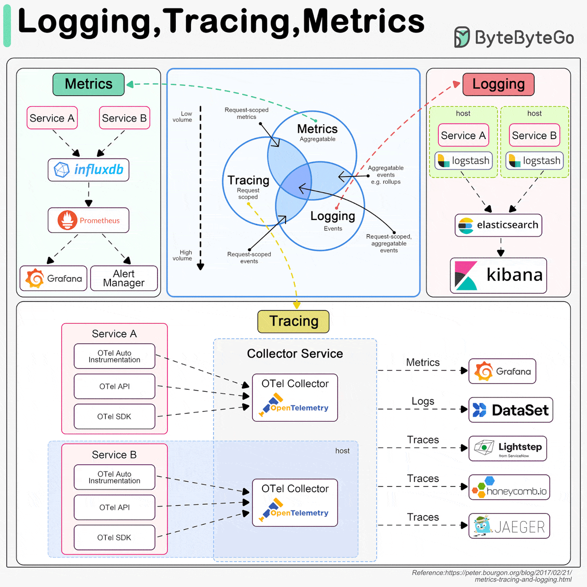


一个可用的指标监控系统通常包含：

1. **数据来源**：主机、网络设备、数据库、应用与业务接口暴露状态。
2. **采集**：按设定周期从目标读取指标，或通过代理、网关转换为可采集格式。
3. **存储**：把指标值与采集时间一起保存，供范围查询和趋势分析。
4. **处理与展示**：对原始序列求速率、聚合、比例，在图表中展示。
5. **告警**：定期评估异常条件，再由通知组件分组和发送。

硬件可经管理接口暴露温度、电源等信息；应用可直接提供 `/metrics`；老系统可由 Exporter 转换。例如“CPU 使用率高”若只有一个瞬间的数值，难以判断是否需要处理；连续五分钟的变化、涉及的实例和同期请求错误率更有解释力。

### 从资源指标走向用户体验

应同时监控主机资源、应用运行和业务结果。资源侧看 CPU、内存、磁盘、网络及数据库；服务侧看可用性、延迟、请求量与错误；业务侧看订单、登录、支付等关键过程。容量趋势可以用于规划，但不能把监控数据直接等同于精确的业务计费记录。

面向服务的常用切入点是“四个黄金信号”：

| 信号 | 要回答的问题 | 示例 |
| --- | --- | --- |
| 延迟 | 请求花了多久？成功与失败请求是否不同？ | 请求耗时分位数 |
| 流量 | 当前有多少工作负载？ | 每秒请求数 |
| 错误 | 失败占比和绝对数量是多少？ | 5xx 错误率 |
| 饱和度 | 服务离容量上限还有多远？ | CPU 节流、队列长度、磁盘空间 |

命令行工具适合即时排障，集中监控平台适合持续采集、跨实例查询和历史比较；选型要看运维规模与需求，不宜把某种旧监控工具简单描述成“只能用于传统业务”。

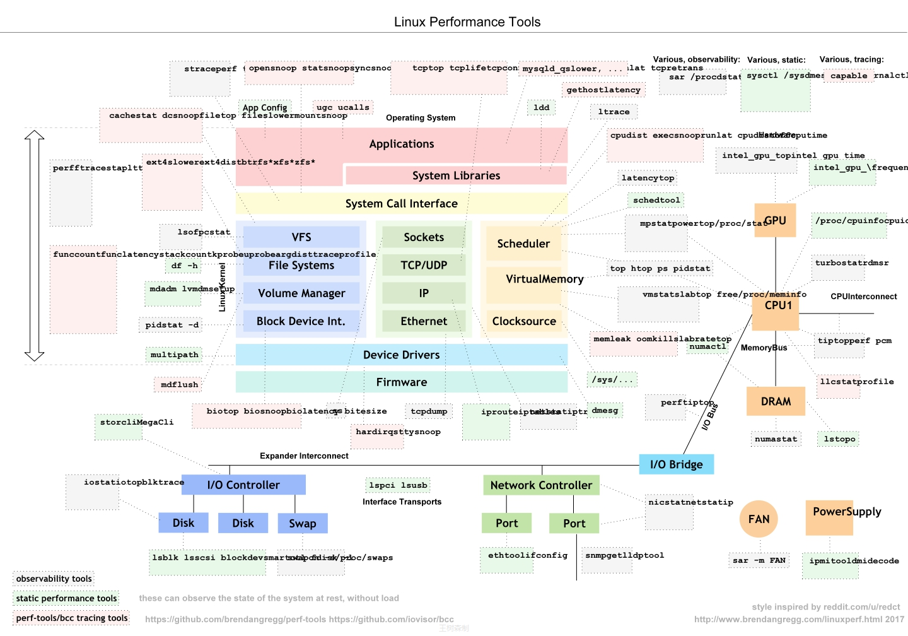


## 2. 为什么使用时序数据库

时间序列是按时间排列的样本，例如某台主机每 15 秒上报一次空闲 CPU 累计秒数。每个样本包含时间戳和值；同一指标加上不同标签组合，会形成不同序列。时序系统擅长按时间范围写入、查询和聚合，但性能并非“每秒百万点”或“每点 1～2 字节”的固定承诺，实际受标签基数、抓取频率、保留期和硬件影响。

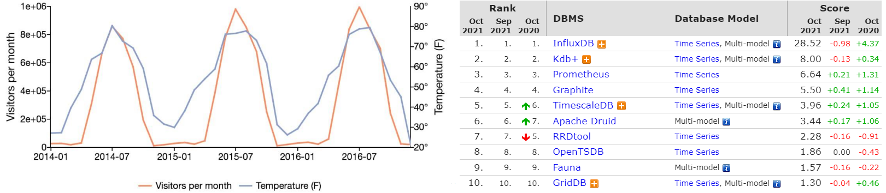

Prometheus 自带本地 TSDB，单个 Prometheus Server 可以独立抓取和查询。**它本身不是开箱即用的分布式多副本数据库**。需要更长保留期、集中跨集群查询或高可用时，可部署多个独立副本并结合远端存储/查询组件；相应架构留在后续章节讨论。

## 3. Prometheus 的组成与工作流

Prometheus 是开源指标监控系统，提供抓取、时序存储、PromQL 查询及规则评估。核心服务主动向目标发起 HTTP 抓取（pull）；目标可以由应用客户端库直接暴露指标，也可以由 Node Exporter、数据库 Exporter 等转换已有状态。静态配置、文件、DNS 或 Kubernetes 等服务发现方式负责告诉 Prometheus 去哪里抓取。


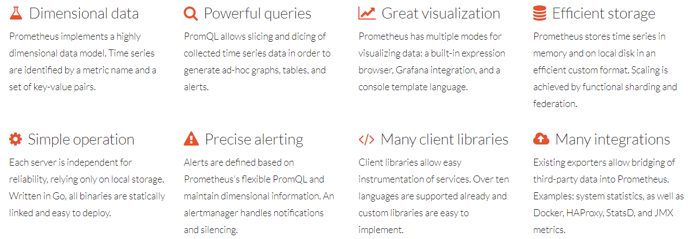

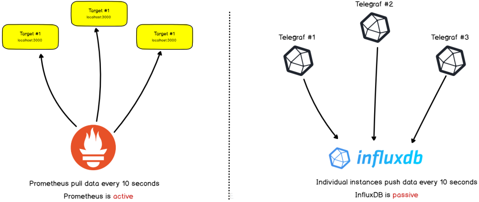

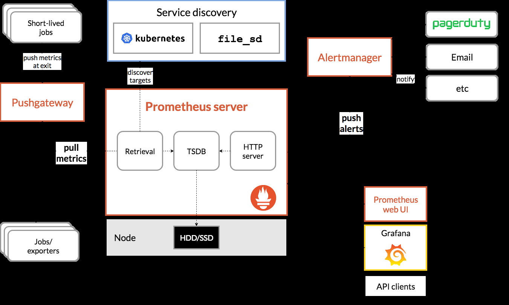

一次典型流程是：

1. Prometheus 按 `scrape_interval` 从 Target 的指标端点抓取样本。
2. 样本进入本地 TSDB，PromQL 可按时间与标签查询。
3. 记录规则可定期计算并保存新序列；告警规则产生告警事件。
4. Alertmanager 接收告警并进行分组、去重、静默和通知路由。
5. Grafana 等客户端通过 Prometheus HTTP API 查询并展示结果。

短命批处理任务可能在下次抓取前就退出，可先把任务结果推送到 Pushgateway，**再由 Prometheus 抓取 Pushgateway**。Pushgateway 不是任意长期服务的通用推送替代方案，也需要管理旧任务指标的生命周期。

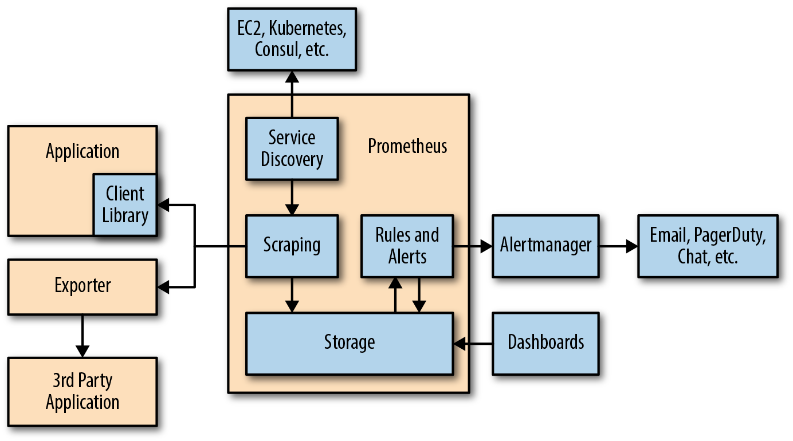

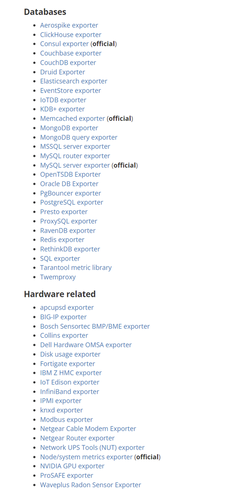

原资料在两页重复使用了同一幅生态图，读者只需把握上述各组件的职责。Prometheus 本身已经具备 PromQL、规则评估和简单 Web UI；Grafana 提供更丰富的可视化，Alertmanager 负责通知，而不是说“分析和告警全都不由 Prometheus 负责”。

## 4. 指标名称、标签与样本

一条时间序列由**指标名 + 完整标签集合**唯一确定。下面的两个样本指标名相同，但 `method` 不同，所以是两条序列：

```text
http_requests_total{job="api",instance="api-1:8080",method="GET"}  120
http_requests_total{job="api",instance="api-1:8080",method="POST"} 18
```

传统指标名通常匹配 `[a-zA-Z_:][a-zA-Z0-9_:]*`；冒号主要保留给记录规则命名。标签名有自己的命名约束，`__` 前缀留给 Prometheus 内部使用。**不要把用户 ID、请求 ID 这类几乎无限变化的值作为标签**：每增加一种独特标签组合就产生新序列，可能迅速推高内存和存储开销。


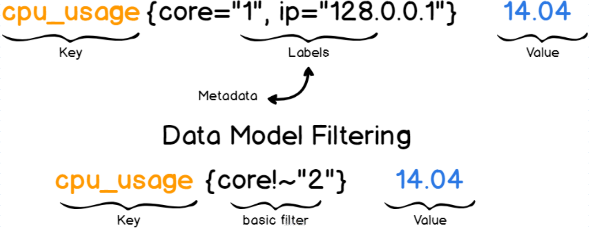

常见指标类型包括 Counter（只增计数器，重启后归零）、Gauge（可升可降的当前值）、Histogram（按桶统计分布）和 Summary（客户端侧摘要）。暴露文本常包含 `# HELP` 和 `# TYPE` 行，便于说明指标含义与类型：

```text
# HELP http_requests_total 已处理的 HTTP 请求总数
# TYPE http_requests_total counter
http_requests_total{method="GET"} 120
```

配置中的一个抓取目标通常称为 `instance`，同类目标组成一个 `job`；它们也是常见的序列标签。`up{job="api",instance="api-1:8080"}` 为 1 表示最近一次抓取成功，为 0 表示失败。抓取成功不等于业务功能一定健康，仍需配合应用指标与探测。

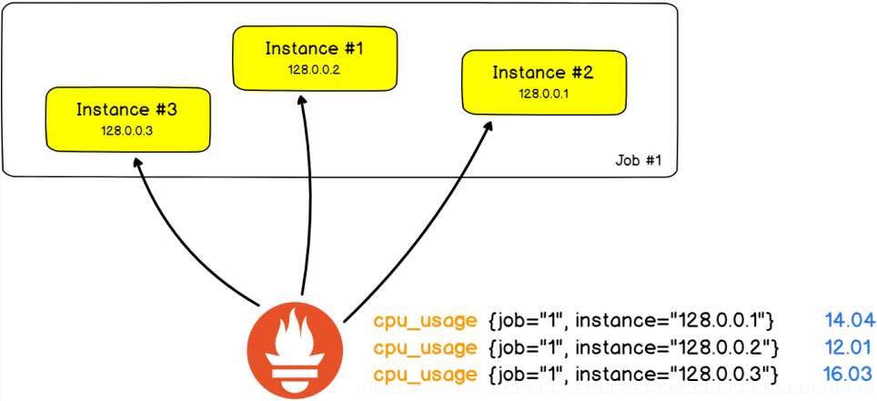

## 5. 采集、存储、查询与告警的边界

应用可通过客户端库直接暴露指标；Exporter 替不支持 Prometheus 格式的系统转译数据；Pushgateway 用于合适的短命任务。它们的目标都是让 Prometheus 最终能通过 HTTP 抓到样本。

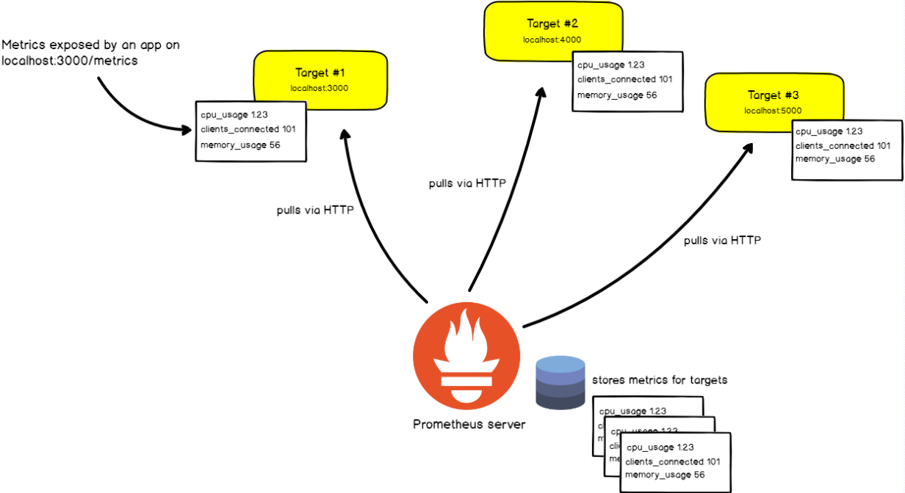

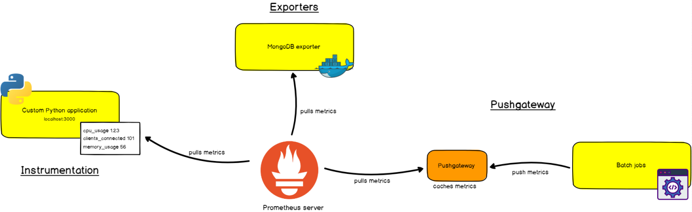

本地存储将近期样本保存在 head 中并通过 WAL（预写日志）辅助崩溃恢复，随后压缩为持久化 block。WAL 不是“把数据直接存入 chunk 文件”的同义词，block 也不是每两小时永远固定不变的最终形态，后续会继续压缩合并。查询与保留期规划应基于实际样本量和磁盘容量。

PromQL 可选取某一时刻的即时向量，也可选取时间窗口内的范围向量，进而计算 `rate()`、聚合或比例。例如 `rate(http_requests_total[5m])` 关注最近五分钟的每秒请求速率，而不是累计请求总数。

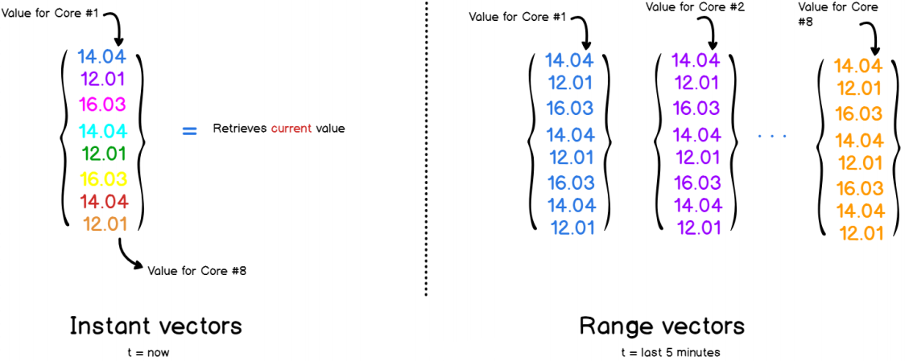

告警规则在 Prometheus 中评估，Alertmanager 接手通知的分组、路由和静默。指标出现异常值、规则被触发、通知送达是三个不同环节，排查时应逐段验证。

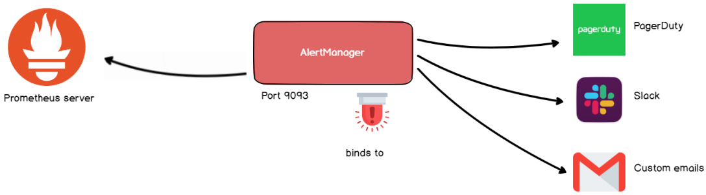



<nav class="article-end" aria-label="章节导航">
  <a href="{{ '/subjects/Prometheus/' | relative_url }}">返回 Prometheus 目录</a>
  <a href="{{ '/subjects/Prometheus/02-prometheus-deployment.html' | relative_url }}">下一章：部署 Prometheus →</a>
</nav>
