[← 返回 Prometheus 目录]({{ '/subjects/Prometheus/' | relative_url }})



# 01 Prometheus 介绍

# 1 Prometheus 介绍

## 1.1 监控系统组成

可观测性Observerbility诞生于几十年前的控制理论,可观测性指的是一种能力，是通过检查其输出来衡量系统内部状态的能⼒。这些输出体现内部系统状态的能力越强，可观测性也就越好。

2018年，CNCF 率先将“可观测性”一词引入 IT 领域，并称可观测性是云原生时代必须具备的能力。自此，“可观测性”成为云原生技术领域最热门的话题之一。随后，CNCF 出版的《可观测性白皮书》对此做了详细的介绍。其中提到的“可观测性三⼤信号”（也称为三大支柱），即指标Metrics、日志Logging、追踪（Tracing，也成为 IT 领域的通识


一个完整的监控系统需要包括如下功能：数据产生、数据采集、数据存储、数据处理、数据展示分析、告警


### 1.1.1 数据来源

我们如果要监控数据，首先得有数据，也就是说，这些数据应该可以被记录下来，或者被暴露出来，数据常见的产生、直接或间接暴露方式的方式如下

硬件本身的记录信息 - 以文件或者以内存属性的方式存在
应用业务的接口 - 主动暴露软件本身的运行状态，比如 redis info、各种status等  
相关的信息采集工具 - 方便收集数据或者采集数据的系统级别的命令等  

注意：这些数据在长时间的运行过程中，都是以固定的"属性指标"来描述他们，我们把这些称为 metric。

监控系统就需要对每个环境的每一个指标都要进行数据的获取，并且按照用户需要的方式提供给用户来使用。

### 1.1.2 数据采集

对于上面所说的Metric指标数据，我们通常不会只获取一次，而是需要持续性、周期性的方式来采集。根据数据采集方式的不同划分为了两个分类：

软件方式：
agent: 专用的软件的一种应用机制。  

http:  基于http 协议实现数据采集
ssh: 系统常见的一种应用通信机制，但是并非所有系统都支持。  
SNMP: 简单网络管理协议(Simple Network Management Protocol),是工作在各种网络设备中的一种机  
制。  
硬件方式：  
IPMI: 智慧平台管理接口(Intelligent Platform Management Interface)是一种工业标准用于采集硬件设  
备的各种物理健康状态数据，如温度、电压、风扇工作状态、电源状态等。  

注意：由于每个业务场景，需要采集的指标数量是不确定的，有时只是一个业务场景，就需要采集数百个指标，如果按照上述所说的周期性采集的方式来说，数据的采集量是相当大的

### 1.1.3 数据存储

由于我们采集到的"样本数据"，不是一次性使用的，尤其是单个数据是没有意义的，我们需要将这些数据存储下来，在后续的工作场景中进行聚合操作，从而来满足我们的需求。所以这些数据的存储也是一个非常重要的点。同时，我们在后续使用这些数据的时候，不仅仅要知道这些数据，还要知道这些数据的时间属性--什么时候的数据。所以这些数据在存储的时候，必须有一个重要的时间维度。所以我们一般将这种用于监控场景的数据，称为时间序列数据 - TS(Time series data),专门用于存储这些数据的数据库，称其为时序数据库(TSDB Time series database)

时序列数据库是用来存储时序列（time-series）数据并以时间（点或区间）建立索引的软件

一般时序列数据都具备以下特点

数据结构简单：某一度量指标在某一时间点只会有一个值，没有复杂的结构（嵌套、层次等）和关系
（关联、主外键等）  
数据量大：由于时序列数据由所监控的大量数据源来产生、收集和发送，比如主机、IoT设备、终端或  
App等  

### 1.1.4 数据处理

如果仅仅采集到的是原始的数据，本身往往没有太大的意义，通常还需要对数据进行各种聚合和处理操作才可以正常的用于工作分析场景。

### 1.1.5 数据分析展示

对于各种聚合操作之后的数据，我们也需要进行分析和展示

无论是采集到的时序数据，还是经过聚合分析之后的统计数据，由于数据量巨大,用肉眼观察很难能够看得情楚，尤其是通过表格来查看成千上万条数据，来分析其内在的逻辑趋势关系更是如此。

所以，对于监控系统来说，其本身的数据可视化功能是非常重要的，以各种图形演示的方式展示数据的发展趋势，方便进行分析。

### 1.1.6 告警

需要在某些特殊情况下，提醒我们去看相关的数据，所以我们就需要根据日常工作中采集到的数据，来分析出正常的状态值，然后将其作为一个阈值指标。

接下来在后续数据采集的时候，让实时的数据，与阈值进行比较，一旦超出阈值判断机制，就通过告警机制通知给我们,从而及进行处理,

采集到的数据达到一定的条件,比如磁盘空间满等,应该自动触发告警提示,比如:微信,邮件,短信等,方便及时发现问题并解决

## 1.2 监控内容和方法

### 1.2.1 监控内容

#### 1.2.1.1 资源数据

硬件设备：服务器、路由器、交换机、IO系统等

系统资源：OS、网络、容器、VM实例

应用软件：Nginx、MySQL、Java应用等

#### 1.2.1.2 业务服务

业务状态：服务通信、服务运行、服务下线、性能指标、QPS、DAU(Daily Active User )日活、转化率、业务接口(登陆，注册，聊天，留⾔)、产品转化率、充值额度、⽤户投诉等

一般故障：访问缓慢、存储空间不足，数据同步延迟，主机宕机、主机不可达

严重故障：服务不可用、集群故障

#### 1.2.1.3 趋势分析

数据统计：时间序列数据展示历史数据等

数据预测：事件什么时候发生、持续时间、发生概率是多大等,比如:电商大促时间

### 1.2.2 监控方法

Google 的四个黄金指标

常用于在服务级别帮助衡量终端用户体验、服务中断、业务影响等层面的问题，适用于应用及服务监控

延迟(Latency)
服务请求所需要的时长，例如HTTP请求平均延迟  
应用程序响应时间会受到所有核心系统资源（包括网络、存储、CPU和内存）延迟的影响  
需要区分失败请求和成功请求  
流量(Traffic)，也称为吞吐量  
衡量服务的容量需求，例如每秒处理的HTTP请求数QPS或者数据库系统的事务数量TPS  

吞吐量指标包括每秒Web请求、API调用等示例，并且被描述为通常表示为每秒请求数的需求
错误(Errors)  
失败的请求（流量)的数量，通常以绝对数量或错误请求占请求总数的百分比表示，请求失败的速率，用  
于衡量错误发生的情况  
例如：HTTP 500错误数等显式失败，返回错误内容或无效内容等隐式失败，以及由策略原因导致的失败  
(例如强制要求响应时间超过30毫秒的请求视为错误)  
饱和度(Saturation)  
衡量资源的使用情况,用于表达应用程序有多"满"  
资源的整体利用率，包括CPU（容量、配额、节流)、内存(容量、分配)、存储（容量、分配和 I/O吞吐  
量)和网络  
例如：内存、CPU、I/O、磁盘等资源的使用量  

## 1.3 监控设施实现方式

对于Linux系统来说，它的系统监控的实现方式很多，主要有系统命令、开源软件、监控平台等

### 1.3.1 系统命令

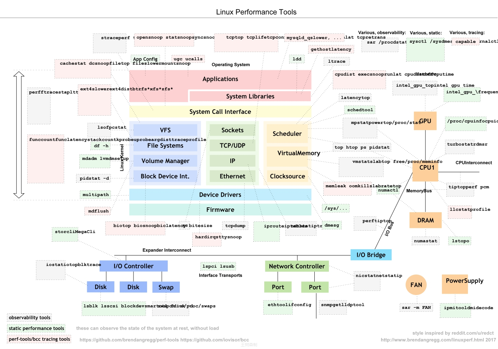

### 1.3.2 开源软件


对于传统的业务数据监控来说，Zabbix 监控软件是优秀的，由于 Zabbix 诞生的时代业务数据量相对不是太多，所以它默认采取的是关系型数据库作为后端存储。

所以随着业务场景的发展，尤其是微服务、云原生场景的发展，大量数据的存储和动态容器的监控缺失成为了 Zabbix 本身的限制。所以就出现了另外一种监控软件 Prometheus。

### 1.3.3 监控平台

一些云服务商提供了监控平台可以实现监控功能


## 1.4 时序数据库

### 1.4.1 什么是序列数据

参考资料：https://db-engines.com/en/ranking/time+series+dbms

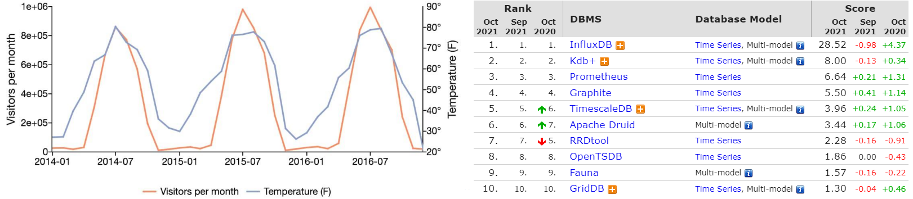

时间序列数据(TimeSeries Data) : 按照时间顺序记录系统、设备状态变化的数据被称为时序数据。

时序数据库记录的数据以时间为横座标,纵坐标为数据

时间序列数据库 (Time Series Database , 简称 TSDB) 是一种高性能、低成本、稳定可靠的在线时间序列数据库服务，提供高效读写、高压缩比存储、时序数据插值及聚合计算等服务，广泛应用于物联网（IoT）设备监控系统、企业能源管理系统（EMS）、生产安全监控系统和电力检测系统等行业场景；除此以外，还提供时空场景的查询和分析的能力。

TSDB 具备秒级写入百万级时序数据的性能，提供高压缩比低成本存储、预降采样、插值、多维聚合计算、可视化查询结果等功能，解决由设备采集点数量巨大、数据采集频率高造成的存储成本高、写入和查询分析效率低的问题。

TSDB是一个分布式时间序列数据库，具备多副本高可用能力。同时在高负载大规模数据量的情况下可以方便地进行弹性扩容，方便用户结合业务流量特点进行动态规划与调整。

应用的场景：

物联网设备无时无刻不在产生海量的设备状态数据和业务消息数据，这些数据有助于进行设备监控、业
务分析预测和故障诊断。  
传统电力化工以及工业制造行业需要通过实时的监控系统进行设备状态检测，故障发现以及业务趋势分  
析。  
系统运维和业务实时监控,通过对大规模应用集群和机房设备的监控，实时关注设备运行状态、资源利用  
率和业务趋势，实现数据化运营和自动化开发运维。  

### 1.4.2 时间序列数据特点

大部分时间都是顺序写入操作，很少涉及修改数据
删除操作都是删除一段时间的数据，而不涉及到删除无规律数据  
读操作一般都是升序或者降序  
高效的压缩算法，节省存储空间，有效降低 IO,存储成本低  
TSDB 使用高效的数据压缩技术，将单个数据点的平均使用存储空间降为1~2个字节，可以降低90%存储  
使用空间，同时加快数据写入的速度。  
高性能读写, 每秒百万级数据点写入，亿级数据点聚合结果秒级返回  

## 1.5 Prometheus 简介

### 1.5.1 Prometheus 简介


Prometheus 普罗米修斯是希腊神话中的一个人物，他从太阳神阿波罗那里盗走火种送给人类，给人类带来了光明，是一位让人敬仰的神

Prometheus 是一款时序(time series）数据库TSDB，也是一款设计用于实现基于目标(Target)的监控系统的关键组件，结合其它组件，例如Altermanager、Pushgateway和Grafana等，可构成一个完整的监控系统

Prometheus 启发于 Google 的 borgmon 监控系统，在一定程度上可以理解为，是Google BorgMon监控系统的开源版本。

该软件由工作在 SoundCloud 的 google 前员工在 2012 年创建，作为社区开源项目进行开发，并于 2015 年正式发布。2016 年，Prometheus 正式加入 CNCF(Cloud Native Computing Foundation)，成为继Kubernetes之后第二个在CNCF托管的项目, 现已广泛用于在容器和微服务领域中得到了广泛的应用，当然不仅限于此

云原生: https://landscape.cncf.io/

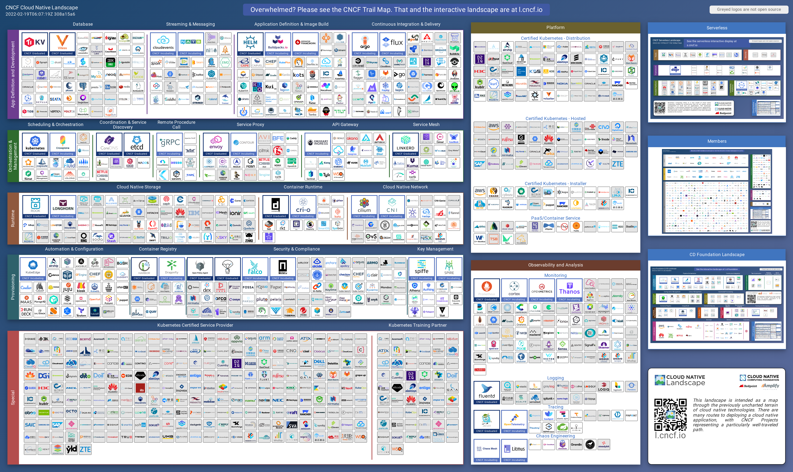

Prometheus 本身基于Go语言开发的一套开源的系统监控报警框架和时序列数据库(TSDB)。

Prometheus 的监控功能很完善和全面，性能也足够支撑上万台规模的集群。

网站：https://prometheus.io/

github：https://github.com/prometheus

其特点主要如下：

支持多维数据模型：由度量名和键值对组成的时间序列数据
内置时间序列数据库TSDB(Time Series Database )  
支持PromQL(Prometheus Query Language)查询语言，可以完成非常复杂的查询和分析，对图表展示  
和告警非常有意义  
支持 HTTP 的 Pull 方式采集时间序列数据  
支持 PushGateway 采集瞬时任务的数据  
支持静态配置和服务发现两种方式发现目标  
多种可视化和仪表盘,支持第三方 Dashboard,比如:Grafana  

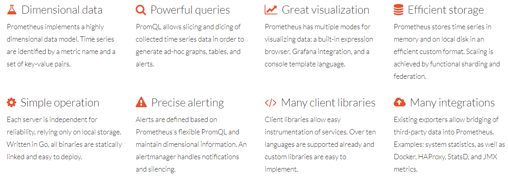

数据特点

监控指标，采用独创的指标格式，我们称之为Prometheus格式，这个格式在监控场景中很常见。
数据标签，支持多维度标签，每个独立的标签组合都代表一个独立的时间序列  
数据处理，Prometheus内部支持多种数据的聚合、切割、切片等功能。  
数据存储，Prometheus支持双精度浮点型数据存储和字符串  

适用场景

Prometheus 非常适合记录任何纯数字时间序列。它既适合以机器为中心的监控场景，也适合于高度动态的面向服务的体系结构的监控场景。尤其是在微服务世界中，它对多维数据收集和查询的支持是一种特别的优势。

Prometheus的设计旨在提高可靠性，使其成为中断期间要使用的系统，以使您能够快速诊断问题。每个Prometheus服务器都是独立的，而不依赖于网络存储或其他远程服务。当基础结构的其他部分故障时，您可以依靠它，并且无需设置广泛的基础结构即可使用它。

由于Prometheus重视可靠性。在故障情况下，我们可以查看有关系统的可用统计信息。但是如果您需要100％的准确性，则Prometheus并不是一个不错的选择，因为所收集的数据可能不会足够详细和完整。在这种情况下，最好使用其他系统来收集和分析数据以进行计费，并使用Prometheus进行其余的监视。

Prometheus 不足

不支持集群化
被监控集群规模过大后本身性能有一定瓶颈  
中文支持不好  
功能不完整，需要结合其它组件实现监控的全部功能  

### 1.5.2 Prometheus 架构

官方文档:
https://prometheus.io/docs/
https://prometheus.io/docs/introduction/overview/

#### 1.5.2.1 数据获取逻辑

Prometheus 同其它TSDB相比有一个非常典型的特性：

它主动从各Target上"拉取（pull)"数据，相当于Zabbix里的被动模式,而非等待被监控端的"推送（push）"

两个方式各有优劣，其中，Pull模型的优势在于：集中控制：有利于将配置集在 Prometheus Server上完成，包括指标及采取速率等,Prometheus的根本目标在于收集在Target上预先完成聚合的聚合型数据，而非一款由事件驱动的存储系统

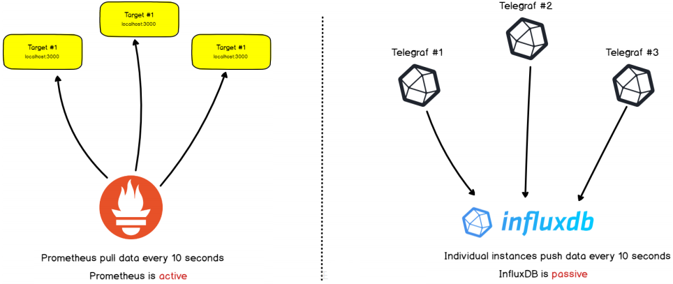

#### 1.5.2.2 Prometheus 架构
https://github.com/prometheus/prometheus

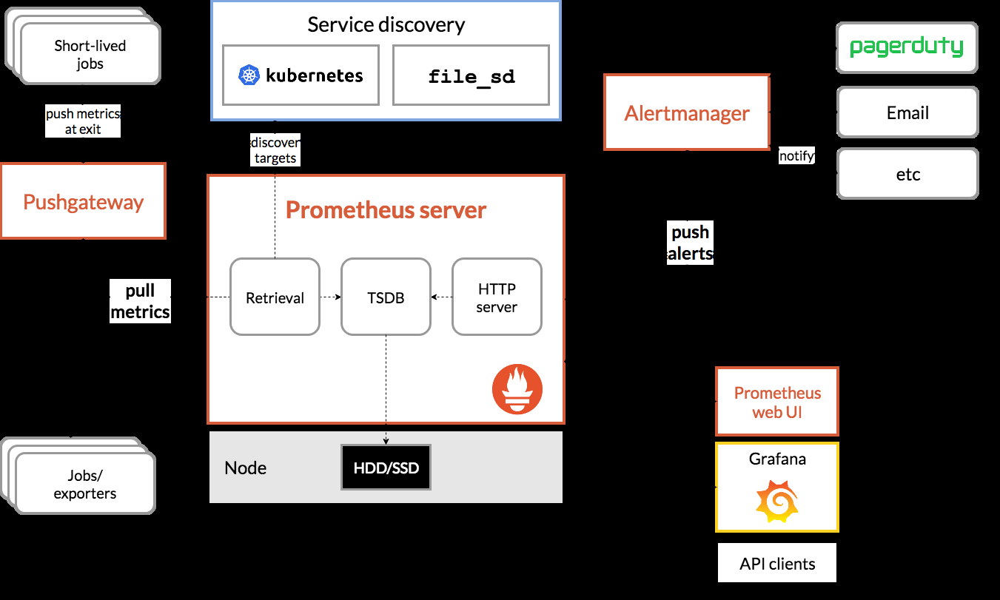
```text
  Short-lived jobs  Service Discovery  PagerDuty  Email  ...
                        DNS
                        Kubernetes
                        Consul
                                      notify
                        ...
                        Custom integration
         Pushgateway
                        Alertmanager
                                     find
                                         targets
                        Prometheus Server
                        push alerts
                 pull metrics
                        Retrieval  Storage  PromQL
                        Web UI
                        Grafana
                        API clients
                        Node  HDD / SSD
   Jobs / Exporters
                Prometheus Server
```

Prometheus 的主要模块包括：

prometheus
时序数据存储、监控指标管理  
可视化  
Prometheus web UI : 集群状态管理、promQL  
Grafana:非常全面的可视化套件  
数据采集  
Exporter: 为当前的客户端暴露出符合 Prometheus 规格的数据指标,Exporter 以守护进程的模式运行井  
开始采集数据,Exporter 本身也是一个http_server 可以对http请求作出响应返回数据 (K/V形式的  
metrics)  

Pushgateway : 拉模式下数据的采集工具
监控目标  
服务发现 :文件方式、dns方式、console方式、k8s方式  

告警:
alertmanager  

Prometheus 由几个主要的软件组件组成，其职责概述如下

组件  解析

Prometheus  彼此独立运行，仅依靠其本地存储来实现其核心功能：抓取时序数据，规则处理和警
Server  报等。  

客户端库，为需要监控的服务生成相应的 metrics 并暴露给 Prometheus server。当
Client Library  
Prometheus server 来 pull 时，直接返回实时状态的 metrics。  

exporter采集类型已经很丰富，但是依然需要很多自定义的监控数据,用
pushgateway可以实现自定义的监控数据,任意灵活想做什么都可以做到  
exporter的开发需要使用真正的编程语言，不支持shell这种快速脚本,而  
Push  pushgateway开发去容易的多  
Gateway  pushgateway主要用于短期的 jobs。由于这类 jobs 存在时间较短，可能在  
Prometheus 来 pull 之前就消失了。为此，这次 jobs 可以直接向 Prometheus  
server 端推送它们的 metrics。这种方式主要用于服务层面的 metrics，对于机器层  
面的 metrices，需要使用 node exporter  

Exporters  部署到第三方软件主机上，用于暴露已有的第三方服务的 metrics 给 Prometheus。

从 Prometheus server 端接收到 alerts 后，会进行去除重复数据，分组，并路由到
Alertmanager  对应的接受方式，以高效向用户完成告警信息发送。常见的接收方式有：电子邮件，  
pagerduty，OpsGenie, webhook 等,一些其他的工具。  

Data
Prometheus Web UI （Prometheus Server内建），及Grafana等  
Visualization  

Service  动态发现待监控的Target，从而完成监控配置的重要组件，在容器化环境中尤为有
Discovery  用；该组件目前由Prometheus Server内建支持；  

在上诉的组件中，大多数都是用Go编写的，因此易于构建和部署为静态二进制文件。

#### 1.5.2.3 工作流程

Prometheus server 定期从配置好的 jobs 或者 exporters 中拉取Pull metrics，或者接收来自
Pushgateway 发过来的 metrics，或者从其他的 Prometheus server 中拉 metrics。  
Prometheus server 在本地存储收集到的 metrics，并运行已定义好的 alert rules，记录新的时间序列  
或者向 Alertmanager 推送警报，实现一定程度上的完全冗余功能。  
Alertmanager 根据配置文件，对接收到的警报进行去重分组，根据路由配置，向对应主机发出告警。  
集成Grafana或其他API作为图形界面，用于可视化收集的数据。  

#### 1.5.2.4 生态组件

Prometheus 只负责时序型指标数据的采集及存储

其它的功能,如: 数据的分析、聚合及直观展示以及告警等功能并非由Prometheus Server所负责,需要配合其它组件实现

支持丰富的 Exporter 实现各种应用的监控
https://prometheus.io/docs/instrumenting/exporters/

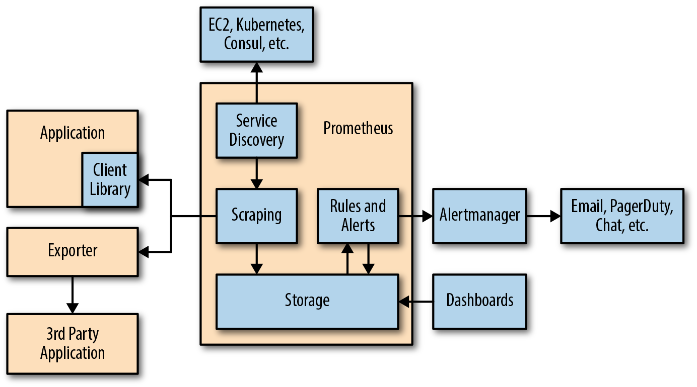


### 1.5.3 Prometheus 数据模型

Prometheus中存储的数据为时间序列，即基于同一度量标准或者同一时间维度的数据流。

除了时间序列数据的正常存储之外，Prometheus还会基于原始数据临时生成新的时间序列数据，用于后续查询的依据或结果。

每个时间序列都由metric名称(表示某项指标或者度量)和标签(键值对形式,表示属性,其为可选项)组合成唯一标识。

#### 1.5.3.1 Metric 名字

该指标Metric名字应该有意义，用于表示 metric 的一般性功能，例如：http_requests_total  表示 http
请求的总数。  
metric 名字由 ASCII 字符，数字，下划线，以及冒号组成，且必须满足正则表达式 - -  - - -  
```text
                        [azAZ_:][azAZ0
```

的查询需求。
```text
   9_:]*
```

注意：冒号是为用户定义的记录规则保留的。


#### 1.5.3.2 标签

标签是以键值对的样式而存在，不同的标签用于表示时间序列的不同维度标识
基本格式：  
```text
     <metric name>{<label name>=<label value>, …}
     #示例样式：
     http_requests_total{method="POST",endpoint="/api/tracks"}
     解析： http_requests_total{method="POST"} 表示所有 http 请求中的 POST 请求，
     endpoint="/api/tracks"表示请求的url地址是/api/tracks。当 method="GET" 时，则为新的一个
     metric
```

标签中的键名由 ASCII 字符，数字，以及下划线组成，且必须满足正则表达式 [a-zA-Z_:][a-zA-Z0-
9_:]*。以__开头的标签名称保留供内部使用  
标签值可以包含任何Unicode字符，标签值为空的标签被认为等同于不存在的标签  

查询语言允许基于这些维度进行过滤和聚合。更改任何标签值，包括添加或删除标签，都会创建一个新的时间序列。

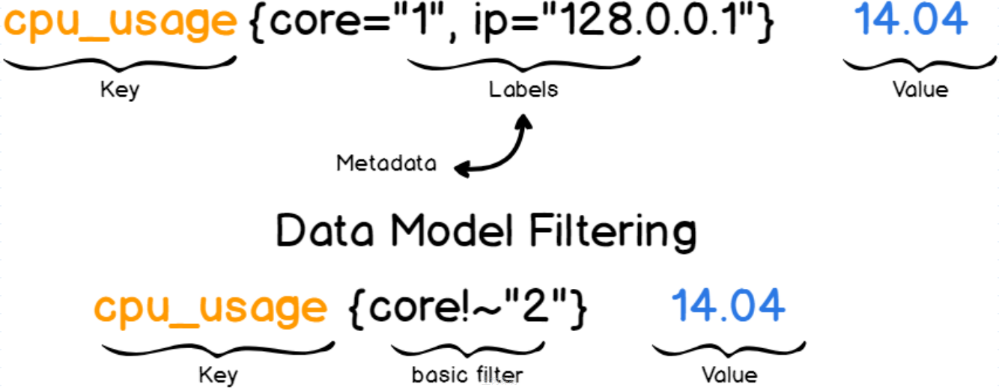

#### 1.5.3.3 数据格式

Prometheus 对收集的数据有一定的格式要求，本质上就是将收集的数据转化为对应的文本格式，并提供响应给Prometheus Server的 http 请求。

Exporter 收集的数据转化的文本内容以行 (\n) 为单位，空行将被忽略, 文本内容最后一行为空行

三部分

文本内容，如果以 # 开头通常表示注释。

以 # HELP 开头表示 metric 帮助说明。

以 # TYPE 开头表示定义 metric 类型，包含 counter, gauge, histogram, summary, 和 untyped 类型。

其他表示一般注释，供阅读使用，将被 Prometheus 忽略。

#### 1.5.3.4 任务 Job 和实例 Instance

一个单独 scrape(<host>:<port>)的目标 Target 也称为一个实例 instance，通常为IP:PORT形式,对应于单个应用的进程。

一组同种类型的 instances集合称为一个 job，主要用于保证可扩展性和可靠性。

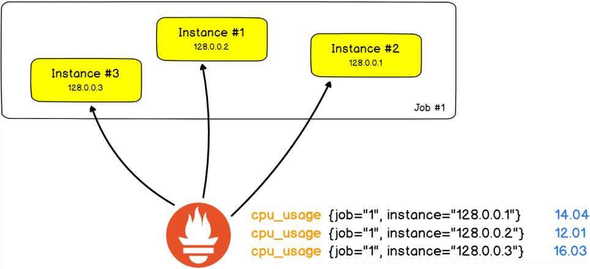

例如：一个 API 服务 job 包含四个 instances
```text
job: api-server
instance 1: 1.2.3.4:5670
instance 2: 1.2.3.4:5671
instance 3: 5.6.7.8:5670
instance 4: 5.6.7.8:5671
```

对于任务实例来说，还可以借助于特殊的字符串来表示通用的功能，常见的使用样式如下：
```text
#判断任务是否健康，1代表正常，0代表不正常
up{job="<job-name>", instance="<instance-id>"}
#获取任务的持续时间
scrape_duration_seconds{job="<job-name>", instance="<instance-id>"}
#任务执行后剩余的样本数
scrape_samples_post_metric_relabeling{job="<job-name>", instance="<instance-id>"}
#暴露的样本数量
scrape_samples_scraped{job="<job-name>", instance="<instance-id>"}
#样本的大概数量
scrape_series_added{job="<job-name>", instance="<instance-id>"}
```

总结

数据模型：metric名称+标签
数据类型：Counter+Gauge+Histogram+Summary  
任务：多个instances组成一个jobs  

### 1.5.4 Prometheus 数据处理

#### 1.5.4.1 数据获取

这些metric数据，是基于HTTP call方式来进行获取的，从对方的配置文件中指定的网络端点(endpoint,即IP:Port,表示一个应用)上周期性获取指标数据。每一个端点上几乎不可能只有一个数据指标。

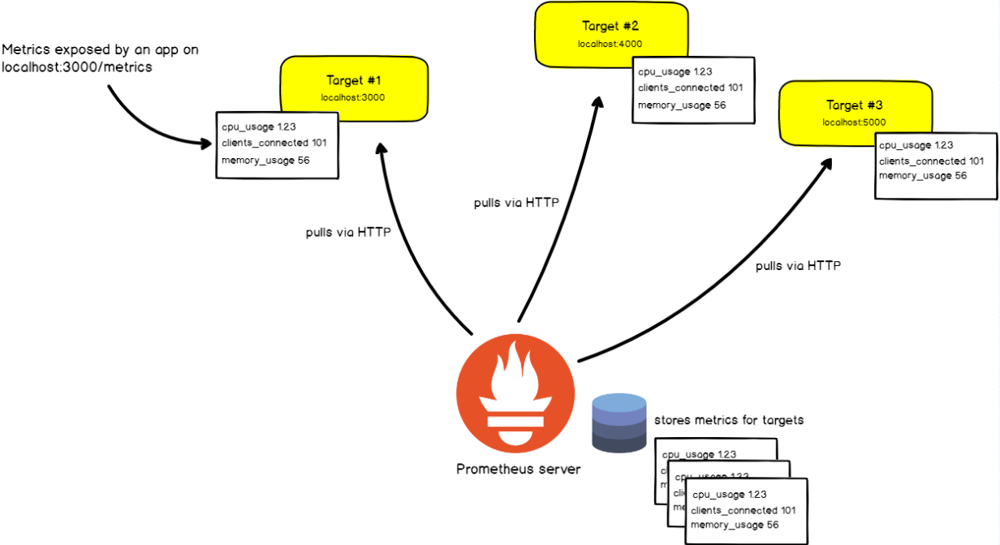

Prometheus的Metric 指标都必须以http的方式暴露出来，因此 prometheus无法直接获取内核等相关数据的原因，只能借助于其他的机制才可以。

prometheus默认支持通过三种类型的途径从目标上"抓取（Scrape）"指标数据

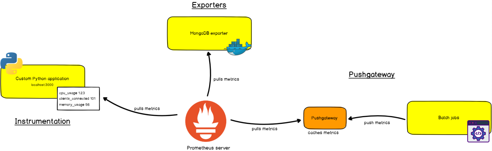

方式  解析

指附加到应用程序中形成内置的检测系统，采集数据并暴露出来的客户端库，暴露
Instrumentation  
的方式也是http方式，常用于较新出现的自身天然就支持Prometheus的应用  

部署到对应节点上，负责从目标应用程序上采集和聚合原始格式的数据，并转换或
Exporters  聚合为Prometheus格式的指标，以http方式向外暴露本地节点数据后，常用于较  
早期出现的原本并不支持Prometheus的应用  

执行被监控节点的作业任务（通常不是持续执行的守护进程，而是周期性的作业）
Pushgateway  主动Push数据到 Pushgateway,并转换成 Prometheus 格式数据，然后  
Prometheus再pull 此数据  

#### 1.5.4.2 数据存储

Prometheus 采用的是time-series(时间序列)的方式以一种自定义的格式存储在本地硬盘上

Prometheus的本地T-S(time-series)数据库以每两小时为间隔, 分成Block为单位存储，每一个Block中又分为多个Chunk文件

Chunk是作为存储的基本单位,用来存放采集过来的数据的T-S数据,包括metadata和索引文件(index)。

Index文件是对metrics(对应一次KV采集数据)和 labels(标签)进行索引之后存储在chunk文件中

Prometheus平时是将采集过来的数据先都存放在内存之中, 以类似缓存的方式用于加快搜索和访问。

Prometheus提供一种保护机制叫做WAL( Write-Ahead Logging )可以将数据存入硬盘中的chunk文件，当出现宕机时，重新启动时利用此日志系统来恢复加载至内存
```bash
[root@prometheus ~]#tree /usr/local/prometheus/data
/usr/local/prometheus/data
├── 01G9RSD61ZEF16T5YGE91K49MZ
│   ├── chunks
│   │   └── 000001
│   ├── index
│   ├── meta.json
│   └── tombstones
├── 01G9RZ8VXF2FHHB18CW0594P8T
│   ├── chunks
│   │   └── 000001
│   ├── index
│   ├── meta.json
│   └── tombstones
├── chunks_head
│   ├── 000002
│   └── 000003
├── lock
├── queries.active
└── wal
    ├── 00000000
    ├── 00000001
    └── 00000002
6 directories, 15 files
```

#### 1.5.4.3 数据分析

Prometheus提供了数据查询语言 PromQL（全称为Prometheus Query Language），支持用户进行实时的数据查询及聚合操作；

PromQL支持处理两种向量，并内置提供了一组用于数据处理的函数

即时向量：在最近一次的单个时间戳上采集和跟踪的数据指标,即时间点数据
时间范围向量：指定时间范围内的所有时间戳上的数据指标,即时间段数据  

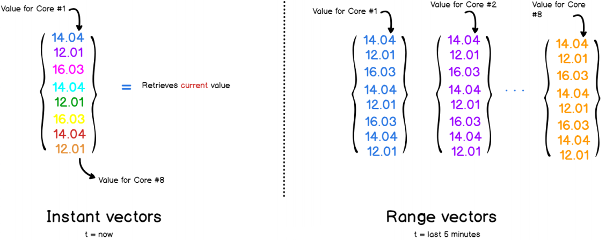

#### 1.5.4.4 数据告警

抓取到异常值后，Prometheus支持通过告警（Alert）机制向用户发送反馈或警示，以触发用户能够及时采取应对措施；但是Prometheus Server仅负责生成告警指示，具体的告警行为由另一个独立的应用程序AlertManager负责

告警指示由Prometheus Server基于用户提供的告警规则周期性计算生成
Alertmanager接收到Prometheus Server 发来的告警指示后，基于用户定义的告警路由(route)向告警  
接收人发送告警信息；  

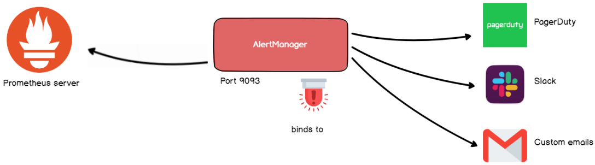



<nav class="article-end" aria-label="章节导航">
  <a href="{{ '/subjects/Prometheus/' | relative_url }}">返回 Prometheus 目录</a>
  <a href="{{ '/subjects/Prometheus/02-prometheus-deployment.html' | relative_url }}">下一章：Prometheus 部署与配置 →</a>
</nav>
