[← 返回 Prometheus 目录]({{ '/subjects/Prometheus/' | relative_url }})



# 02 Prometheus 部署与配置

# 2 Prometheus 部署和监控

Prometheus部署相关软件版本

| 软件 | 地址 |
| --- | --- |
| prometheus | https://github.com/prometheus/prometheus/releases/download/v2.30.3/prometheus-2.30.3.linux-amd64.tar.gz |
| alertmanager | https://github.com/prometheus/alertmanager/releases/download/v0.23.0/alertmanager-0.23.0.linux-amd64.tar.gz |
| node_exporter | https://github.com/prometheus/node_exporter/releases/download/v1.2.2/node_exporter-1.2.2.linux-amd64.tar.gz |
| mysqld_exporter | https://github.com/prometheus/mysqld_exporter/releases/download/v0.13.0/mysqld_exporter-0.13.0.linux-amd64.tar.gz |
| grafana | https://dl.grafana.com/enterprise/release/grafana-enterprise_8.2.1_amd64.deb |

## 2.1 Prometheus 部署和配置

### 2.1.1 常见部署方式
https://prometheus.io/docs/prometheus/latest/installation/

包安装
RHEL系统:  
https://packagecloud.io/app/prometheus-rpm/release/search

Ubuntu和Debian
可直接使用apt命令使用内置仓库直接安装  
二进制安装  
https://prometheus.io/download/

基于 Ansbile 部署
https://github.com/prometheus-community/ansible

基于 Docker 运行
https://prometheus.io/docs/prometheus/latest/installation/

基于 Docker Compose安装
https://github.com/mohamadhoseinmoradi/Docker-Compose-Prometheus-and-Grafana/blob/master/docker-compose.yml

基于 Kubernetes 安装
https://github.com/coreos/kube-prometheus
https://github.com/prometheus-operator/kube-prometheus
https://github.com/prometheus-community/helm-charts

### 2.1.2 包安装

#### 2.1.2.1 Ubuntu 包安装
```bash
#ubuntu24.04
[root@ubuntu2404 ~]#apt list  prometheus
Listing... Done
prometheus/noble-security,noble-updates,noble-updates,noble-security 2.45.3+ds-
2ubuntu0.2 amd64
N: There is 1 additional version. Please use the '-a' switch to see it
#ubuntu22.04
[root@ubuntu2204 ~]#apt list prometheus
正在列表... 完成
prometheus/jammy 2.31.2+ds1-1ubuntu1 amd64
[root@ubuntu2204 ~]#apt -y install  prometheus
[root@ubuntu2204 ~]#ss -ntl
State   Recv-Q           Send-Q  Local Address:Port   Peer Address:Port
Process
LISTEN  0  4096  127.0.0.53%lo:53          0.0.0.0:*
LISTEN  0  128  0.0.0.0:22          0.0.0.0:*
LISTEN  0  128  127.0.0.1:6010        0.0.0.0:*
LISTEN  0  4096                *:9100              *:*
LISTEN  0  128              [::]:22             [::]:*
LISTEN  0  128             [::1]:6010           [::]:*
LISTEN  0  4096                *:9090              *:*
#ubuntu20.04
[root@ubuntu2004 ~]#apt list prometheus
正在列表... 完成
prometheus/focal,now 2.15.2+ds-2 amd64 [已安装]
[root@ubuntu2004 ~]#apt -y install  prometheus
#安装完成,服务自动启动
[root@ubuntu2204 ~]#systemctl status prometheus
● prometheus.service - Monitoring system and time series database
     Loaded: loaded (/lib/systemd/system/prometheus.service; enabled; vendor preset:
enabled)
     Active: active (running) since Sat 2022-10-22 11:21:06 CST; 2min 41s ago
       Docs: https://prometheus.io/docs/introduction/overview/
             man:prometheus(1)
   Main PID: 2424 (prometheus)
      Tasks: 8 (limit: 2200)
     Memory: 25.8M
        CPU: 311ms
     CGroup: /system.slice/prometheus.service
             └─2424 /usr/bin/prometheus
10月 22 11:21:06 ubuntu2204.bowen.org prometheus[2424]: ts=2022-10-22T03:21:06.348Z
caller=head.go:481 level=info component=tsdb msg="Replaying on-d>
10月 22 11:21:06 ubuntu2204.bowen.org prometheus[2424]: ts=2022-10-22T03:21:06.348Z
caller=head.go:515 level=info component=tsdb msg="On-disk memory>
10月 22 11:21:06 ubuntu2204.bowen.org prometheus[2424]: ts=2022-10-22T03:21:06.348Z
caller=head.go:521 level=info component=tsdb msg="Replaying WAL,>
10月 22 11:21:06 ubuntu2204.bowen.org prometheus[2424]: ts=2022-10-22T03:21:06.349Z
caller=head.go:592 level=info component=tsdb msg="WAL segment lo>
10月 22 11:21:06 ubuntu2204.bowen.org prometheus[2424]: ts=2022-10-22T03:21:06.349Z
caller=head.go:598 level=info component=tsdb msg="WAL replay com>
10月 22 11:21:06 ubuntu2204.bowen.org prometheus[2424]: ts=2022-10-22T03:21:06.350Z
caller=main.go:850 level=info fs_type=EXT4_SUPER_MAGIC
10月 22 11:21:06 ubuntu2204.bowen.org prometheus[2424]: ts=2022-10-22T03:21:06.350Z
caller=main.go:853 level=info msg="TSDB started"
10月 22 11:21:06 ubuntu2204.bowen.org prometheus[2424]: ts=2022-10-22T03:21:06.350Z
caller=main.go:980 level=info msg="Loading configuration file" f>
10月 22 11:21:10 ubuntu2204.bowen.org prometheus[2424]: ts=2022-10-22T03:21:10.399Z
caller=main.go:1017 level=info msg="Completed loading of configu>
10月 22 11:21:10 ubuntu2204.bowen.org prometheus[2424]: ts=2022-10-22T03:21:10.399Z
caller=main.go:795 level=info msg="Server is ready to receive we
#内置了node exporter
[root@ubuntu2204 ~]#systemctl status prometheus-node-exporter.service
● prometheus-node-exporter.service - Prometheus exporter for machine metrics
     Loaded: loaded (/lib/systemd/system/prometheus-node-exporter.service; enabled;
vendor preset: enabled)
     Active: active (running) since Mon 2024-03-18 09:38:15 CST; 5min ago
       Docs: https://github.com/prometheus/node_exporter
   Main PID: 2195 (prometheus-node)
      Tasks: 6 (limit: 2196)
     Memory: 8.5M
        CPU: 1.228s
     CGroup: /system.slice/prometheus-node-exporter.service
             └─2195 /usr/bin/prometheus-node-exporter
3月 18 09:38:15 ubuntu2204.bowen.org prometheus-node-exporter[2195]: ts=2024-03-
18T01:38:15.083Z caller=node_exporter.go:115 level=info collector=thermal_zone
3月 18 09:38:15 ubuntu2204.bowen.org prometheus-node-exporter[2195]: ts=2024-03-
18T01:38:15.083Z caller=node_exporter.go:115 level=info collector=time
3月 18 09:38:15 ubuntu2204.bowen.org prometheus-node-exporter[2195]: ts=2024-03-
18T01:38:15.083Z caller=node_exporter.go:115 level=info collector=timex
3月 18 09:38:15 ubuntu2204.bowen.org prometheus-node-exporter[2195]: ts=2024-03-
18T01:38:15.083Z caller=node_exporter.go:115 level=info collector=udp_queues
3月 18 09:38:15 ubuntu2204.bowen.org prometheus-node-exporter[2195]: ts=2024-03-
18T01:38:15.083Z caller=node_exporter.go:115 level=info collector=uname
3月 18 09:38:15 ubuntu2204.bowen.org prometheus-node-exporter[2195]: ts=2024-03-
18T01:38:15.083Z caller=node_exporter.go:115 level=info collector=vmstat
3月 18 09:38:15 ubuntu2204.bowen.org prometheus-node-exporter[2195]: ts=2024-03-
18T01:38:15.083Z caller=node_exporter.go:115 level=info collector=xfs
3月 18 09:38:15 ubuntu2204.bowen.org prometheus-node-exporter[2195]: ts=2024-03-
18T01:38:15.083Z caller=node_exporter.go:115 level=info collector=zfs
3月 18 09:38:15 ubuntu2204.bowen.org prometheus-node-exporter[2195]: ts=2024-03-
18T01:38:15.085Z caller=node_exporter.go:199 level=info msg="Listening on"
address=:9100
3月 18 09:38:15 ubuntu2204.bowen.org prometheus-node-exporter[2195]: ts=2024-03-
18T01:38:15.087Z caller=tls_config.go:195 level=info msg="TLS is disabled."
http2=false
[root@ubuntu2204 ~]#ss -ntlp|grep prometheus
LISTEN 0  4096               *:9090            *:*    users:
(("prometheus",pid=2969,fd=4))
LISTEN 0  4096               *:9100            *:*    users:(("prometheus-
node",pid=2195,fd=3))
[root@ubuntu2204 ~]#ps aux|grep prometheus
prometh+  2195 0.3  1.0 1087388 20124 ?       Ssl  09:38   0:01
/usr/bin/prometheus-node-exporter
prometh+  2969 0.1  2.7 1340308 55168 ?       Ssl  09:38   0:00
/usr/bin/prometheus
root        3270 0.0  0.1   9584 2200 pts/0    S+  09:45   0:00 grep --color=auto
prometheus
#访问如下链接可以看到如下显示
http://<prometheus服务器IP>:9090
```

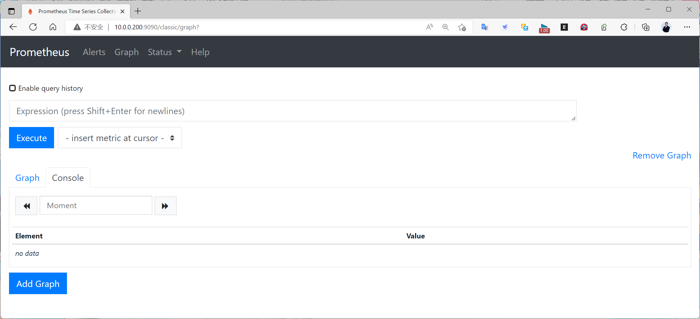

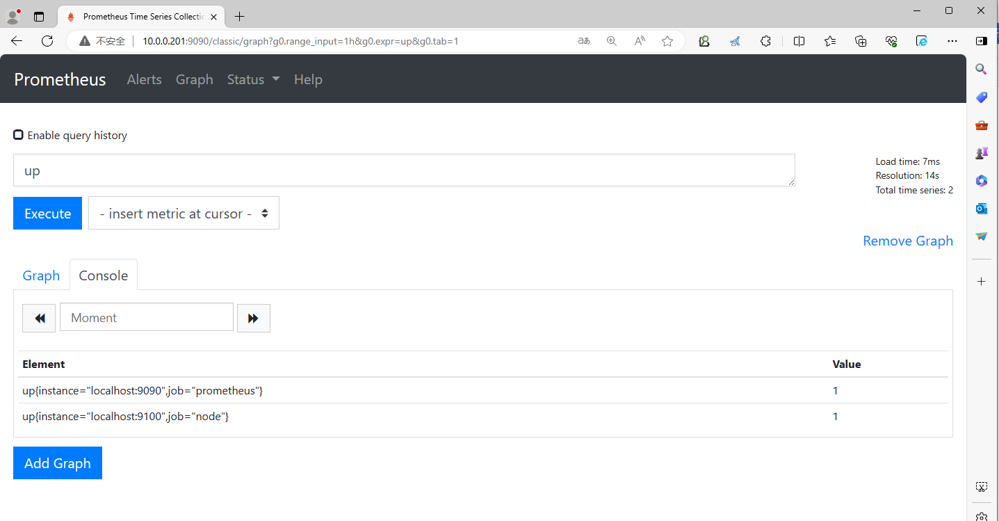

#### 2.1.2.2 RHEL/Rocky/CentOS

RHEL/Rocky/CentOS上默认没有Prometheus的仓库，可自行配置基于yum repository安装Prometheus-Server
https://packagecloud.io/app/prometheus-rpm/release/search

范例：Repo配置
```text
[prometheus]
name=prometheus
baseurl=https://packagecloud.io/prometheus-rpm/release/el/$releasever/$basearch
repo_gpgcheck=1
enabled=1
gpgkey=https://packagecloud.io/prometheus-rpm/release/gpgkey
       https://raw.githubusercontent.com/lest/prometheus-rpm/master/RPM-GPG-KEY-prometheus-rpm
gpgcheck=1
metadata_expire=300
```

### 2.1.3 二进制安装 Prometheus

#### 2.1.3.1 下载二进制包并解压

官方下载:
https://prometheus.io/download/
https://github.com/prometheus/prometheus/releases

版本选择

生产建议安装LTS版本

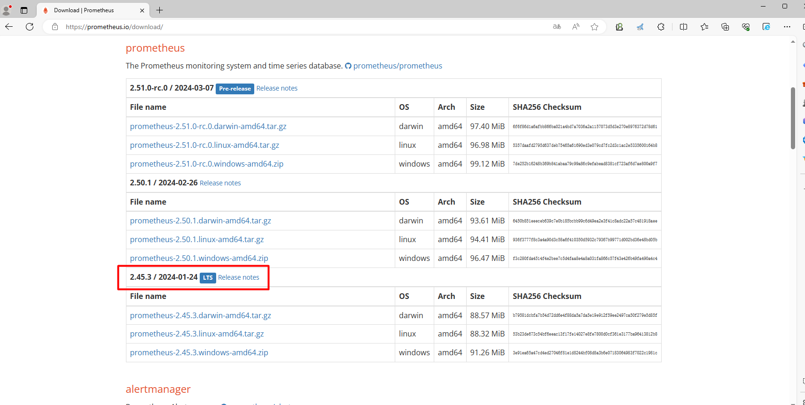

范例
```yaml
[root@prometheus local]#pwd
/usr/local/
[root@prometheus local]#wget
https://github.com/prometheus/prometheus/releases/download/v2.19.2/prometheus-2.19.2.linux-amd64.tar.gz
[root@prometheus local]#ls -l prometheus-2.19.2.linux-amd64.tar.gz
-rw-r--r-- 1 root root 64152439 Jul  5 21:13 prometheus-2.19.2.linux-amd64.tar.gz
[root@prometheus local]#tar xvf prometheus-2.19.2.linux-amd64.tar.gz
[root@prometheus local]#ln -s prometheus-2.19.2.linux-amd64 prometheus
[root@prometheus local]#cd prometheus/
[root@prometheus ~]#ll /usr/local/prometheus/
总计 244920
drwxr-xr-x  4 1001 127  4096 2月 26 20:14 ./
drwxr-xr-x 11 root root      4096 3月 18 10:16 ../
drwxr-xr-x  2 1001 127  4096 2月 26 20:11 console_libraries/
drwxr-xr-x  2 1001 127  4096 2月 26 20:11 consoles/
-rw-r--r-- 1 1001 127  11357 2月 26 20:11 LICENSE
-rw-r--r-- 1 1001 127  3773 2月 26 20:11 NOTICE
-rwxr-xr-x 1 1001 127 129611890 2月 26 19:38 prometheus*
-rw-r--r-- 1 1001 127  934 2月 26 20:11 prometheus.yml
-rwxr-xr-x 1 1001 127 121143706 2月 26 19:38 promtool*
#创建相关目录,data目录是默认的存放数据目录,可以不创建,系统会自动创建,可以通过选项--
storage.tsdb.path="data/"修改
[root@prometheus prometheus]#mkdir  bin conf data
[root@prometheus prometheus]#file prometheus promtool
prometheus: ELF 64-bit LSB executable, x86-64, version 1 (SYSV), statically linked,
Go
BuildID=NpyFR4ESJYOHWWGfgc3o/_g6Q7FhzIlY9p7fEuTT_/_hJVqxtCSeXTjgAypiEV/Lt9fFIUyGNB1xb
2o87RA, with debug_info, not stripped
promtool:   ELF 64-bit LSB executable, x86-64, version 1 (SYSV), statically linked,
Go BuildID=eu2ASXh8vHzr4S9EC1Ke/z4IV19knGW4oYEa-
S9Mn/9F7KfLX9cXRzxRB4pHUD/wdIWzIVH5jrMtanJ5x6e, with debug_info, not stripped
[root@prometheus prometheus]#ldd prometheus promtool
prometheus:
    不是动态可执行文件
promtool:
    不是动态可执行文件
[root@prometheus prometheus]#mv prometheus promtool bin/
[root@prometheus prometheus]#mv prometheus.yml conf/
[root@prometheus prometheus]#useradd -r -s /sbin/nologin prometheus
[root@prometheus prometheus]#chown -R prometheus.prometheus /usr/local/prometheus/
#修改环境变量
[root@prometheus ~]#vim /etc/profile
export PROMETHEUS_HOME=/usr/local/prometheus
export PATH=${PROMETHEUS_HOME}/bin:$PATH
[root@prometheus ~]#source /etc/profile
#查看配置文件,默认可不修改
[root@prometheus ~]#grep -Ev "^ *#|^$" /usr/local/prometheus/conf/prometheus.yml
global:
  scrape_interval: 15s # Set the scrape interval to every 15 seconds. Default is
every 1 minute.
  evaluation_interval: 15s # Evaluate rules every 15 seconds. The default is every 1
minute.
alerting:
  alertmanagers:
    - static_configs:
         - targets:
rule_files:
scrape_configs:
  - job_name: "prometheus"
    static_configs:
      - targets: ["localhost:9090"]
#属性解析：主要是global和 scrape_configs 两部分的配置，保持默认即可
#检查配置文件是否正确
[root@prometheus ~]#promtool check config /usr/local/prometheus/conf/prometheus.yml
Checking /usr/local/prometheus/conf/prometheus.yml
  SUCCESS: 0 rule files found
```

#### 2.1.3.2 创建 service 文件
```ini
[root@prometheus ~]#cat > /lib/systemd/system/prometheus.service <<EOF
[Unit]
Description=Prometheus Server
Documentation=https://prometheus.io/docs/introduction/overview/
After=network.target
[Service]
Restart=on-failure
User=prometheus
Group=prometheus
WorkingDirectory=/usr/local/prometheus/
ExecStart=/usr/local/prometheus/bin/prometheus --
config.file=/usr/local/prometheus/conf/prometheus.yml --web.enable-lifecycle
ExecReload=/bin/kill -HUP \$MAINPID
LimitNOFILE=65535
[Install]
WantedBy=multi-user.target
EOF
#配置解析：
#需要将定制的prometheus的配置文件和数据目录作为启动参数配置好
#其它的参数，可以基于prometheus --help 查看更多
[root@prometheus ~]#systemctl daemon-reload
[root@prometheus ~]#systemctl enable --now prometheus.service
[root@prometheus ~]#ss -tnlp |grep prometheus
LISTEN   0  128                       *:9090         *:*        users:
(("prometheus",pid=84755,fd=10))
#选项--web.enable-lifecycle支持reload加载修改过的配置
[root@prometheus ~]#curl -X POST http://prometheus.bowen.org:9090/-/reload
#选项--web.enable-lifecycle支持远程关闭prometheus服务，安全风险
[root@ubuntu2204 ~]#curl -X POST http://prometheus.bowen.org:9090/-/quit
#没有配置--web.enable-lifecycle,也可以用reload加载
[root@prometheus ~]#systemctl reload prometheus
#结果显示：可以看到当前主机上可以看到一个端口9090，可通过下面地址看到prometheus的服务页面
```

范例: 查看prometheus命令选项
```bash
[root@prometheus ~]#/usr/local/prometheus/bin/prometheus --help
usage: prometheus [<flags>]
The Prometheus monitoring server
Flags:
  -h, --help                     Show context-sensitive help (also try --help-long
and --help-man).
      --version                  Show application version.
      --config.file="prometheus.yml"
                                 Prometheus configuration file path.
      --web.listen-address="0.0.0.0:9090"
                                 Address to listen on for UI, API, and telemetry.
      --web.config.file=""       [EXPERIMENTAL] Path to configuration file that can
enable TLS or authentication.
      --web.read-timeout=5m      Maximum duration before timing out read of the
request, and closing idle connections.
      --web.max-connections=512  Maximum number of simultaneous connections.
      --web.external-url=<URL>   The URL under which Prometheus is externally
reachable (for example, if Prometheus is served via a
                                 reverse proxy). Used for generating relative and
absolute links back to Prometheus itself. If the
                                 URL has a path portion, it will be used to prefix
all HTTP endpoints served by Prometheus. If
                                 omitted, relevant URL components will be derived
automatically.
      --web.route-prefix=<path>  Prefix for the internal routes of web endpoints.
Defaults to path of --web.external-url.
      --web.user-assets=<path>   Path to static asset directory, available at /user.
      --web.enable-lifecycle     Enable shutdown and reload via HTTP request.
      --web.enable-admin-api     Enable API endpoints for admin control actions.
      --web.enable-remote-write-receiver
                                 Enable API endpoint accepting remote write requests.
      --web.console.templates="consoles"
                                 Path to the console template directory, available at
/consoles.
      --web.console.libraries="console_libraries"
                                 Path to the console library directory.
      --web.page-title="Prometheus Time Series Collection and Processing Server"
                                 Document title of Prometheus instance.
      --web.cors.origin=".*"     Regex for CORS origin. It is fully anchored.
Example: 'https?://(domain1|domain2)\.com'
      --storage.tsdb.path="data/"
                                 Base path for metrics storage. Use with server mode
only.
      --storage.tsdb.retention=STORAGE.TSDB.RETENTION
                                 [DEPRECATED] How long to retain samples in storage.
This flag has been deprecated, use
                        "storage.tsdb.retention.time" instead. Use with
server mode only.
      --storage.tsdb.retention.time=STORAGE.TSDB.RETENTION.TIME
                                 How long to retain samples in storage. When this
flag is set it overrides "storage.tsdb.retention".
                                 If neither this flag nor "storage.tsdb.retention"
nor "storage.tsdb.retention.size" is set, the
                                 retention time defaults to 15d. Units Supported: y,
w, d, h, m, s, ms. Use with server mode only.
      --storage.tsdb.retention.size=STORAGE.TSDB.RETENTION.SIZE
                                 Maximum number of bytes that can be stored for
blocks. A unit is required, supported units: B, KB,
                                 MB, GB, TB, PB, EB. Ex: "512MB". Based on powers-of-
2, so 1KB is 1024B. Use with server mode only.
      --storage.tsdb.no-lockfile
                                 Do not create lockfile in data directory. Use with
server mode only.
      --storage.tsdb.allow-overlapping-blocks
                                 Allow overlapping blocks, which in turn enables
vertical compaction and vertical query merge. Use
                                 with server mode only.
      --storage.tsdb.head-chunks-write-queue-size=0
                                 Size of the queue through which head chunks are
written to the disk to be m-mapped, 0 disables the
                                 queue completely. Experimental. Use with server mode
only.
      --storage.agent.path="data-agent/"
                                 Base path for metrics storage. Use with agent mode
only.
      --storage.agent.wal-compression
                                 Compress the agent WAL. Use with agent mode only.
      --storage.agent.retention.min-time=STORAGE.AGENT.RETENTION.MIN-TIME
                                 Minimum age samples may be before being considered
for deletion when the WAL is truncated Use with
                                 agent mode only.
      --storage.agent.retention.max-time=STORAGE.AGENT.RETENTION.MAX-TIME
                                 Maximum age samples may be before being forcibly
deleted when the WAL is truncated Use with agent
                                 mode only.
      --storage.agent.no-lockfile
                                 Do not create lockfile in data directory. Use with
agent mode only.
      --storage.remote.flush-deadline=<duration>
                                 How long to wait flushing sample on shutdown or
config reload.
      --storage.remote.read-sample-limit=5e7
                                 Maximum overall number of samples to return via the
remote read interface, in a single query. 0
                                 means no limit. This limit is ignored for streamed
response types. Use with server mode only.
      --storage.remote.read-concurrent-limit=10
                                 Maximum number of concurrent remote read calls. 0
means no limit. Use with server mode only.
      --storage.remote.read-max-bytes-in-frame=1048576
                                 Maximum number of bytes in a single frame for
streaming remote read response types before
                                 marshalling. Note that client might have limit on
frame size as well. 1MB as recommended by
                                 protobuf by default. Use with server mode only.
      --rules.alert.for-outage-tolerance=1h
                                 Max time to tolerate prometheus outage for restoring
"for" state of alert. Use with server mode
                                 only.
      --rules.alert.for-grace-period=10m
                                 Minimum duration between alert and restored "for"
state. This is maintained only for alerts with
                                 configured "for" time greater than grace period. Use
with server mode only.
      --rules.alert.resend-delay=1m
                                 Minimum amount of time to wait before resending an
alert to Alertmanager. Use with server mode
                                 only.
      --alertmanager.notification-queue-capacity=10000
                                 The capacity of the queue for pending Alertmanager
notifications. Use with server mode only.
      --query.lookback-delta=5m  The maximum lookback duration for retrieving metrics
during expression evaluations and federation.
                                 Use with server mode only.
      --query.timeout=2m         Maximum time a query may take before being aborted.
Use with server mode only.
      --query.max-concurrency=20
                                 Maximum number of queries executed concurrently. Use
with server mode only.
      --query.max-samples=50000000
                                 Maximum number of samples a single query can load
into memory. Note that queries will fail if they
                                 try to load more samples than this into memory, so
this also limits the number of samples a query
                                 can return. Use with server mode only.
      --enable-feature= ...      Comma separated feature names to enable. Valid
options: agent, exemplar-storage,
                                 expand-external-labels, memory-snapshot-on-shutdown,
promql-at-modifier, promql-negative-offset,
                                 promql-per-step-stats, remote-write-receiver
(DEPRECATED), extra-scrape-metrics,
                                 new-service-discovery-manager, auto-gomaxprocs. See
https://prometheus.io/docs/prometheus/latest/feature_flags/ for more details.
      --log.level=info           Only log messages with the given severity or above.
One of: [debug, info, warn, error]
      --log.format=logfmt        Output format of log messages. One of: [logfmt,
json]
```

#### 2.1.3.3 测试访问
```text
#浏览器访问:
http:/prometheus.bowen.org:9090/
```

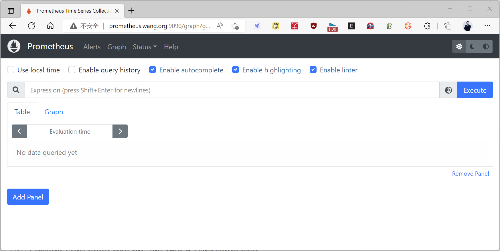

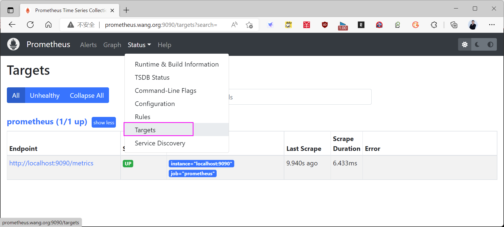
```text
#浏览器访问:
http://prometheus.bowen.org:9090/metrics
```

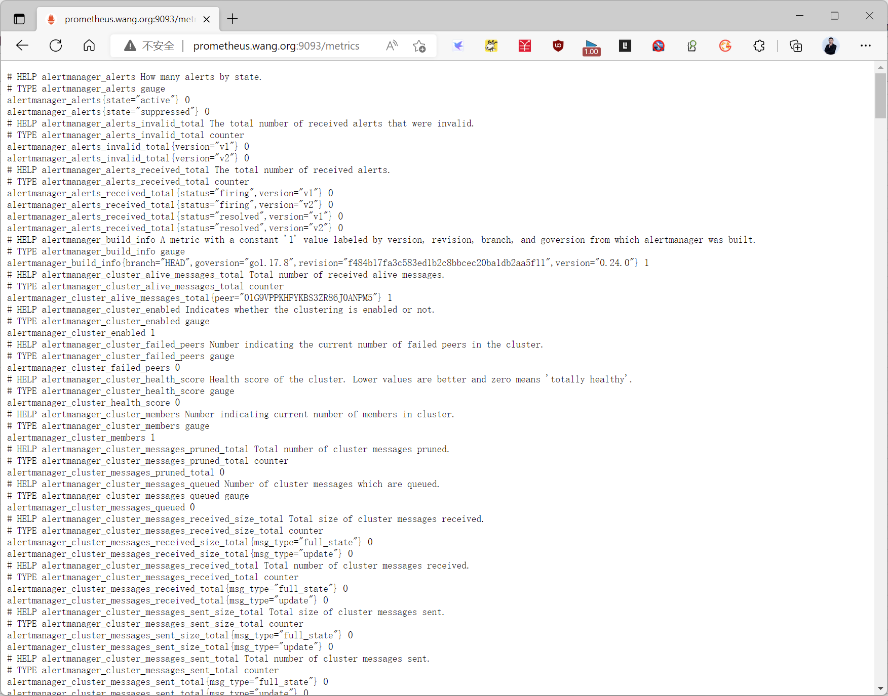
```bash
[root@prometheus ~]#curl http://localhost:9090/metrics
# HELP go_gc_duration_seconds A summary of the pause duration of garbage collection
cycles.
# TYPE go_gc_duration_seconds summary
go_gc_duration_seconds{quantile="0"} 3.3093e-05
go_gc_duration_seconds{quantile="0.25"} 6.2107e-05
go_gc_duration_seconds{quantile="0.5"} 9.2564e-05
go_gc_duration_seconds{quantile="0.75"} 0.000143356
go_gc_duration_seconds{quantile="1"} 0.002131003
go_gc_duration_seconds_sum 0.032219258
go_gc_duration_seconds_count 248
# HELP go_goroutines Number of goroutines that currently exist.
......
```

#### 2.1.3.4 Dashboard 菜单说明
```text
#一级目录解析
Alerts  #Prometheus的告警信息菜单
Graph   #Prometheus的图形展示界面，这是prometheus默认访问的界面
Status  #Prometheus的状态数据界面
Help    #Prometheus的帮助信息界面
#Status子菜单,在Status菜单下存在很多的子选项，其名称和功能效果如下：
Runtime & Build Information         服务主机的运行状态信息及内部的监控项基本信息
Command-Line Flags                  启动时候从配置文件中加载的属性信息
Configuration                       配置文件的具体内容(yaml格式)
Rules                               查询、告警、可视化等数据分析动作的规则记录
Targets                             监控的目标对象，包括主机、服务等以endpoint形式存在
Service Discovery                   自动发现的各种Targets对象列表
```

点击一级菜单Graph，该界面的基本功能分区样式如下

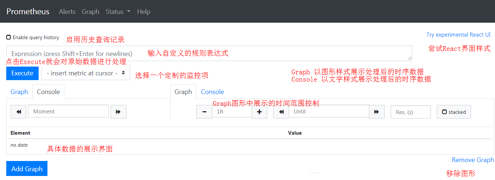

注意：

我们选择监控项的作用就是生成规则表达式，当然，规则表达式的功能远远超过选择监控项的功能。

但是这些定制采集数据的表达式，在刷新的时候，就没有了，这也是我们需要可视化插件的原因。

我们选择一个监控项"scrape_duration_seconds"，然后点击"Execute"，查看效果

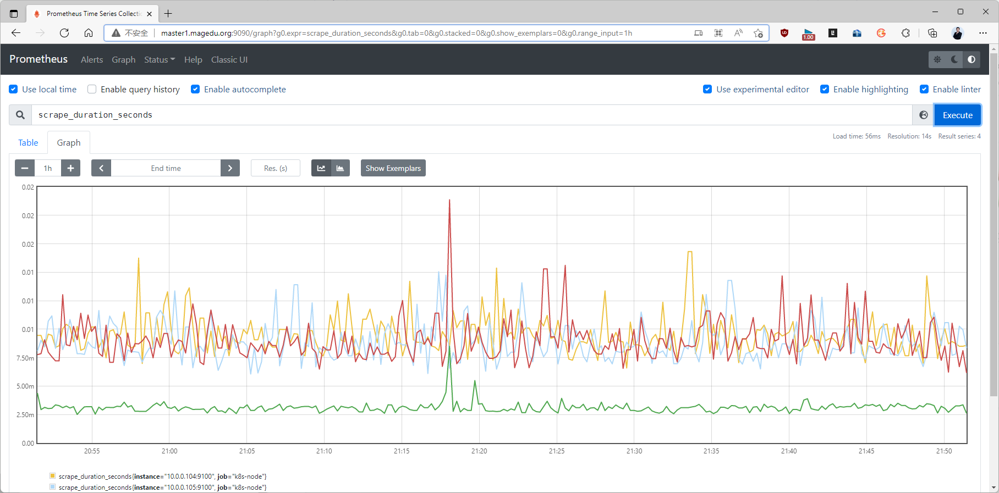

#### 2.1.3.5 API 访问

Prometheus提供了一组管理API，以简化自动化和集成。
https://prometheus.io/docs/prometheus/latest/management_api/
https://prometheus.io/docs/prometheus/latest/querying/api/

注意：{ip:port} 是Prometheus所在的IP和端口

健康检查
GET {ip:port}/-/healthy  
该端点始终返回200，应用于检查Prometheus的运行状况。  
准备检查  
GET {ip:port}/-/ready  
当Prometheus准备服务流量（即响应查询）时，此端点返回200。  
加载配置  
PUT  {ip:port}/-/reload  
POST {ip:port}/-/reload  
关闭服务  
PUT  {ip:port}/-/quit  
POST {ip:port}/-/quit  

范例:
```ini
[root@ubuntu2204 ~]#cat /lib/systemd/system/prometheus.service
......
[Service]
ExecStart=/usr/local/prometheus/bin/prometheus --
config.file=/usr/local/prometheus/conf/prometheus.yml --web.enable-lifecycle
......
#无需打开web.enable-lifecycle
[root@ubuntu2204 ~]#telnet http://prometheus.bowen.org 9090
Trying 10.0.0.100...
Connected to 10.0.0.100.
Escape character is '^]'.
GET /-/healthy HTTP/1.0
HTTP/1.0 200 OK
Date: Fri, 13 Sep 2024 01:39:01 GMT
Content-Length: 30
Content-Type: text/plain; charset=utf-8
Prometheus Server is Healthy.
Connection closed by foreign host.
[root@ubuntu2204 ~]#curl  http://prometheus.bowen.org:9090/-/healthy
Prometheus Server is Healthy.
#无需打开web.enable-lifecycle
[root@ubuntu2204 ~]#curl  http://prometheus.bowen.org:9090/-/ready
Prometheus Server is Ready.
#修改配置后可以加载服务而无需重启服务，需要打开打开web.enable-lifecycle
[root@ubuntu2204 ~]#curl -X POST http://prometheus.bowen.org:9090/-/reload
#关闭服务，需要打开打开web.enable-lifecycle
[root@ubuntu2204 ~]#curl -X POST http://prometheus.bowen.org:9090/-/quit
Requesting termination... Goodbye!
[root@ubuntu2204 ~]#systemctl is-active prometheus
inactive
#取消--web.enable-lifecycle选项，关闭API中的Load和quit功能，仍然支持healthy和ready
[root@ubuntu2204 ~]#vim /lib/systemd/system/prometheus.service
......
[Service]
ExecStart=/usr/local/prometheus/bin/prometheus --
config.file=/usr/local/prometheus/conf/prometheus.yml
......
[root@ubuntu2204 ~]#systemctl daemon-reload && systemctl restart prometheus
[root@prometheus ~]#curl -X POST http://prometheus.bowen.org:9090/-/quit
Lifecycle API is not enabled.
[root@prometheus ~]#curl -X POST http://prometheus.bowen.org:9090/-/reload
Lifecycle API is not enabled.
```

#### 2.1.3.6 优化配置

Prometheus 命令支持选项如下
```text
https://prometheus.io/docs/prometheus/latest/command-line/prometheus/
Flag  Description  Default
                        Show context-sensitive help
- , --  (also try --help-long and --help-
 h help
                        man).
--  Show application version.
 version
                        Prometheus configuration file
--
 config.file  prometheus.yml
                        path.
                        Address to listen on for UI, API,
--  -
 web.listenaddress  0.0.0.0:9090
                        and telemetry.
                        The ratio of reserved
                        GOMEMLIMIT memory to the
--  -
 autogomemlimit.ratio  0.9
                        detected maximum container
                        or system memory
                        [EXPERIMENTAL] Path to
--web.config.file  configuration file that can
                        enable TLS or authentication.
                        Maximum duration before
--  -  timing out read of the request,
 web.readtimeout  5m
                        and closing idle connections.
                        Maximum number of
--  -
 web.maxconnections  512
                        simultaneous connections.
                        The URL under which
                        Prometheus is externally
                        reachable (for example, if
                        Prometheus is served via a
                        reverse proxy). Used for
                        generating relative and
                        absolute links back to
--  -
 web.externalurl
                        Prometheus itself. If the URL
                        has a path portion, it will be
                        used to prefix all HTTP
                        endpoints served by
                        Prometheus. If omitted,
                        relevant URL components will
                        be derived automatically.
                        Prefix for the internal routes of
--  -  web endpoints. Defaults to path
 web.routeprefix
                        of --web.external-url.
                        Path to static asset directory,
--  -
 web.userassets
                        available at /user.
                        Enable shutdown and reload via
--  -
 web.enablelifecycle  false
                        HTTP request.
                        Enable API endpoints for admin
--web.enable-admin-api  false
                        control actions.
                        Enable API endpoint accepting
--  -  -  -
 web.enableremotewritereceiver  false
                        remote write requests.
                        List of the remote write
                        protobuf messages to accept
--  -  -  -  -  when receiving the remote
 web.remotewritereceiver.acceptedprotobuf
                        prometheus.WriteRequest
                        writes. Supported values:
messages
                        prometheus.WriteRequest,
                        io.prometheus.write.v2.Request
Flag  Description  Default
                        Path to the console template
--
 web.console.templates  consoles
                        directory, available at /consoles.
                        Path to the console library
--
 web.console.libraries  console_libraries
                        directory.
                        Prometheus Time Series
                        Document title of Prometheus
--  -
 web.pagetitle  Collection and
                        instance.
                        Processing Server
                        Regex for CORS origin. It is fully
--  anchored. Example:  domain2).com'
 web.cors.origin
                        'https?://(domain1\
                        Base path for metrics storage.
--
 storage.tsdb.path  data/
                        Use with server mode only.
                        [DEPRECATED] How long to
                        retain samples in storage. This
                        flag has been deprecated, use
--
 storage.tsdb.retention
                        "storage.tsdb.retention.time"
                        instead. Use with server mode
                        only.
                        How long to retain samples in
                        storage. When this flag is set it
                        overrides
                        "storage.tsdb.retention". If
                        neither this flag nor
--storage.tsdb.retention.time  "storage.tsdb.retention" nor
                        "storage.tsdb.retention.size" is
                        set, the retention time defaults
                        to 15d. Units Supported: y, w, d,
                        h, m, s, ms. Use with server
                        mode only.
                        Maximum number of bytes that
                        can be stored for blocks. A unit
                        is required, supported units: B,
--  KB, MB, GB, TB, PB, EB. Ex:
 storage.tsdb.retention.size
                        "512MB". Based on powers-of-
                        2, so 1KB is 1024B. Use with
                        server mode only.
                        Do not create lockfile in data
--  -  directory. Use with server mode
 storage.tsdb.nolockfile  false
                        only.
                        Size of the queue through
                        which head chunks are written
                        to the disk to be m-mapped, 0
--  -  -  -  -
 storage.tsdb.headchunkswritequeuesize  0
                        disables the queue completely.
                        Experimental. Use with server
                        mode only.
                        Base path for metrics storage.
--storage.agent.path  data-agent/
                        Use with agent mode only.
                        Compress the agent WAL. Use
--  -
 storage.agent.walcompression  true
                        with agent mode only.
Flag  Description  Default
                        Minimum age samples may be
                        before being considered for
--  -  deletion when the WAL is
 storage.agent.retention.mintime
                        truncated Use with agent mode
                        only.
                        Maximum age samples may be
                        before being forcibly deleted
--  -
 storage.agent.retention.maxtime
                        when the WAL is truncated Use
                        with agent mode only.
                        Do not create lockfile in data
--storage.agent.no-lockfile  directory. Use with agent mode  false
                        only.
                        How long to wait flushing
--  -  sample on shutdown or config
 storage.remote.flushdeadline  1m
                        reload.
                        Maximum overall number of
                        samples to return via the
                        remote read interface, in a
--storage.remote.read-sample-limit  single query. 0 means no limit.  5e7
                        This limit is ignored for
                        streamed response types. Use
                        with server mode only.
                        Maximum number of
                        concurrent remote read calls. 0
--  -  -
 storage.remote.readconcurrentlimit  10
                        means no limit. Use with server
                        mode only.
                        Maximum number of bytes in a
                        single frame for streaming
                        remote read response types
                        before marshalling. Note that
--  - -  - -  client might have limit on frame
 storage.remote.readmaxbytesinframe  1048576
                        size as well. 1MB as
                        recommended by protobuf by
                        default. Use with server mode
                        only.
                        Max time to tolerate
                        prometheus outage for
--  -  -
 rules.alert.foroutagetolerance  1h
                        restoring "for" state of alert.
                        Use with server mode only.
                        Minimum duration between
                        alert and restored "for" state.
                        This is maintained only for
--  -  -
 rules.alert.forgraceperiod  10m
                        alerts with configured "for" time
                        greater than grace period. Use
                        with server mode only.
                        Minimum amount of time to
                        wait before resending an alert
--  -
 rules.alert.resenddelay  1m
                        to Alertmanager. Use with
                        server mode only.
Flag  Description  Default
                        Global concurrency limit for
                        independent rules that can run
                        concurrently. When set,
--  -  -  "query.max-concurrency" may
 rules.maxconcurrentevals  4
                        need to be adjusted
                        accordingly. Use with server
                        mode only.
                        The capacity of the queue for
                        pending Alertmanager
--  -  -
 alertmanager.notificationqueuecapacity  10000
                        notifications. Use with server
                        mode only.
                        Send any outstanding
                        Alertmanager notifications
                        when shutting down. If false,
--  -  -  - -  any outstanding Alertmanager
 alertmanager.drainnotificationqueueonshutdown  true
                        notifications will be dropped
                        when shutting down. Use with
                        server mode only.
                        The maximum lookback
                        duration for retrieving metrics
--  -  during expression evaluations
 query.lookbackdelta  5m
                        and federation. Use with server
                        mode only.
                        Maximum time a query may
--  take before being aborted. Use
 query.timeout  2m
                        with server mode only.
                        Maximum number of queries
--  -  executed concurrently. Use
 query.maxconcurrency  20
                        with server mode only.
                        Maximum number of samples a
                        single query can load into
                        memory. Note that queries will
                        fail if they try to load more
--query.max-samples  50000000
                        samples than this into memory,
                        so this also limits the number of
                        samples a query can return.
                        Use with server mode only.
                        Comma separated feature
                        names to enable. Valid options:
                        agent, auto-gomemlimit,
                        exemplar-storage, expand-
                        external-labels, memory-
                        snapshot-on-shutdown,
                        promql-per-step-stats, promql-
                        experimental-functions,
                        remote-write-receiver
--  -  (DEPRECATED), extra-scrape-
 enablefeature
                        metrics, new-service-discovery-
                        manager, auto-gomaxprocs, no-
                        default-scrape-port, native-
                        histograms, otlp-write-receiver,
                        created-timestamp-zero-
                        ingestion, concurrent-rule-eval.
                        See https://prometheus.io/docs/prometheus/latest/feature_fla
                        gs/ for more details.
Flag  Description  Default
                        Only log messages with the
--  given severity or above. One of:
 log.level  info
                        [debug, info, warn, error]
                        Output format of log messages.
--
 log.format  logfmt
                        One of: [logfmt, json]
```

Prometheus 选项
```bash
[root@prometheus ~]#/usr/local/prometheus/bin/prometheus --help
.......
--web.enable-lifecycle #可以支持http方式实现reload和shutdown功能，可以被远程关毕服务，有安全
风险，不建议开启，默认关闭
--web.read-timeout=5m  #Maximum duration before timing out read of the request, and
closing idle connections. 请求连接的最⼤等待时间,可以防⽌太多的空闲连接占⽤资源
--web.max-connections=512 #Maximum number of simultaneous connections. 最⼤链接数
--storage.tsdb.retention=15d #How long to retain samples in the storage.prometheus开
始采集监控数据后 会存在内存中和硬盘中对于保留期限的设置,此值太长会导致硬盘和内存都吃不消,但太短要查历
史数据就没有了,企业中一般设置15天为宜,默认值为0
--storage.tsdb.path="data/" #Base path for metrics storage. 存储数据路径,建议独立分区,防
     ⽬
止把根 录塞满,默认data/目录
--query.timeout=2m #Maximum time a query may take before being aborted.此为默认值2m
--query.max-concurrency=20 #Maximum number of queries executed concurrently.此为默认值
20
```

查看配置

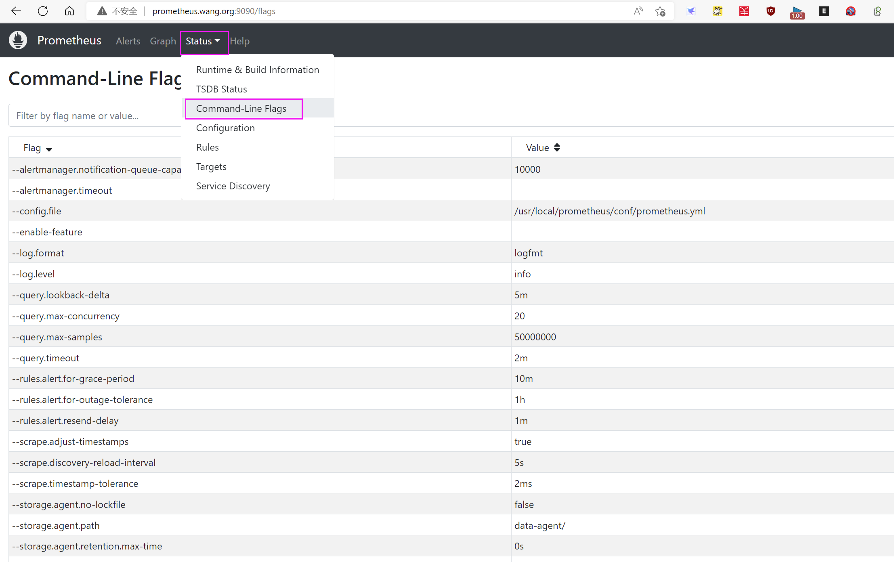

### 2.1.4 容器化启动
https://prometheus.io/docs/prometheus/latest/installation/

范例：官方镜像
```dockerfile
https://github.com/prometheus/prometheus/blob/main/Dockerfile
ARG ARCH="amd64"
ARG OS="linux"
FROM quay.io/prometheus/busybox-${OS}-${ARCH}:latest
LABEL maintainer="The Prometheus Authors <prometheus-developers@googlegroups.com>"
LABEL org.opencontainers.image.source="https://github.com/prometheus/prometheus"
ARG ARCH="amd64"
ARG OS="linux"
COPY .build/${OS}-${ARCH}/prometheus        /bin/prometheus
COPY .build/${OS}-${ARCH}/promtool          /bin/promtool
COPY documentation/examples/prometheus.yml  /etc/prometheus/prometheus.yml
COPY LICENSE                                /LICENSE
COPY NOTICE                                 /NOTICE
COPY npm_licenses.tar.bz2                   /npm_licenses.tar.bz2
WORKDIR /prometheus
RUN chown -R nobody:nobody /etc/prometheus /prometheus && chmod g+w /prometheus
USER       nobody
EXPOSE     9090
VOLUME     [ "/prometheus" ]
ENTRYPOINT [ "/bin/prometheus" ]
CMD        [ "--config.file=/etc/prometheus/prometheus.yml", \
              "--storage.tsdb.path=/prometheus" ]
```

#### 2.1.4.1 范例: Docker 启动

自定义镜像
```dockerfile
[root@ubuntu2204 prometheus-docker]#ls
Dockerfile  prometheus  prometheus.yml  promtool
[root@ubuntu2204 prometheus-docker]#ll -h
total 276M
drwxr-xr-x 2 root root 4.0K Dec  2 15:54 ./
drwx------ 7 root root 4.0K Dec  2 15:55 ../
-rw-r--r-- 1 root root  268 Dec  2 15:54 Dockerfile
-rwxr-xr-x 1 root root 143M Dec  2 15:50 prometheus*
-rw-r--r-- 1 root root  934 Dec  2 15:50 prometheus.yml
-rwxr-xr-x 1 root root 134M Dec  2 15:50 promtool*
[root@ubuntu2204 prometheus-docker]#cat Dockerfile
#FROM registry.cn-beijing.aliyuncs.com/bowen/alpine:3.20.0
FROM scratch
COPY * /usr/local/prometheus/
EXPOSE 9090
WORKDIR /usr/local/prometheus/
VOLUME /usr/local/prometheus/data
CMD ["/usr/local/prometheus/prometheus", "--
config.file=/usr/local/prometheus/prometheus.yml"]
[root@ubuntu2204 prometheus-docker]#docker build -t prometheus:v3.0.1-scratch
[root@ubuntu2204 prometheus-docker]#docker images
REPOSITORY                                             TAG              IMAGE ID
  CREATED              SIZE
prometheus                                             v3.0.1-scratch   39321a262c92
  About a minute ago   289MB
prometheus                                             v3.0.1           28096254ebc9
  16 minutes ago       297MB
[root@ubuntu2204 prometheus-docker]#docker run -p 9091:9090 --name myprom -d
prometheus:v3.0.1-scratch
[root@ubuntu2204 prometheus-docker]#docker ps
CONTAINER ID   IMAGE               COMMAND                  CREATED
STATUS              PORTS                                       NAMES
72f6f42d461c   prometheus:v3.0.1   "/bin/sh -c '/usr/lo…"   About a minute ago   Up
About a minute   0.0.0.0:9091->9090/tcp, :::9091->9090/tcp   myprom
```

官方镜像
```bash
#简单启动
#默认容器的配置文件路径/etc/prometheus/prometheus.yml。数据存储路径默认为/prometheus
[root@prometheus ~]#docker run -d --name prometheus -p 9090:9090 prom/prometheus
#定制配置，持久化
[root@ubuntu2204 ~]#docker run -d --name prometheus -p 9090:9090 -v
./prometheus.yml:/etc/prometheus/prometheus.yml -v prometheus_data:/prometheus
prom/prometheus:v2.53.0
#定制配置文件启动
[root@prometheus ~]#docker run -d --add-host "prometheus.bowen.org:10.0.0.201" --
name=prometheus -p 9090:9090 -v ./prometheus.yml:/etc/prometheus/prometheus.yml
prom/prometheus --web.enable-lifecycle
#定制启动
[root@prometheus ~]#docker run -d --add-host "prometheus.bowen.org:10.0.0.201" --
name=prometheus -p 9090:9090 -v /root/prometheus.yml:/prometheus-
config/prometheus.yml  prom/prometheus --web.enable-lifecycle --
config.file=/prometheus-config/prometheus.yml
#浏览器访问:http://prometheus服务器:9090/
```

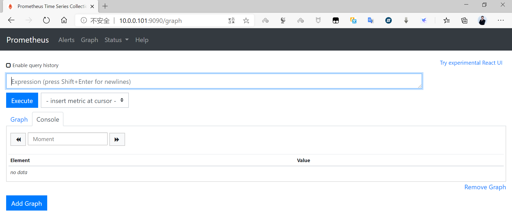

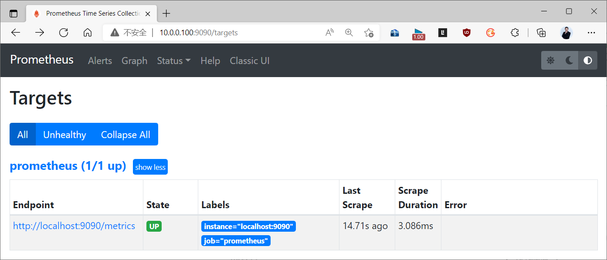

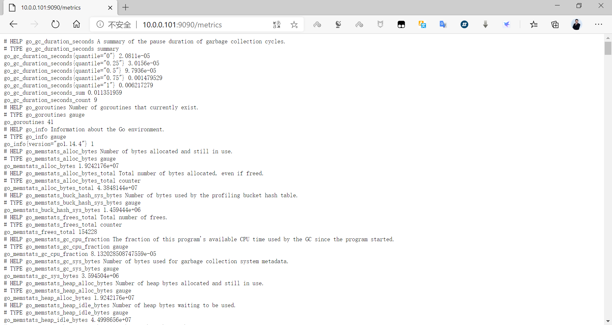

#### 2.1.4.2 范例：Docker compose
```yaml
version: '3.6'
volumes:
    prometheus_data: {}
networks:
  monitoring:
    driver: bridge
services:
  prometheus:
    image: prom/prometheus:v2.40.2
    volumes:
      - ./prometheus/:/etc/prometheus/
      - prometheus_data:/prometheus
    command:
      - '--config.file=/etc/prometheus/prometheus.yml'
      - '--storage.tsdb.path=/prometheus'
      - '--web.console.libraries=/usr/share/prometheus/console_libraries'
      - '--web.console.templates=/usr/share/prometheus/consoles'
      - '--web.enable-lifecycle'
    networks:
      - monitoring
    ports:
      - 9090:9090
    restart: always
```

#### 2.1.4.3 范例：基于 Docker Compose 实现 Prometheus,alertmanager,Grafana

集成服务部署
https://github.com/mohamadhoseinmoradi/Docker-Compose-Prometheus-and-Grafana/blob/master/docker-compose.yml

范例:
```yaml
#注意: 此文件默认没有暴露9090,3000等服务端口,cadvisor的镜像为gcr.io默认无法下载
version: '2.1'
networks:
  monitor-net:
    driver: bridge
volumes:
    prometheus_data: {}
    grafana_data: {}
services:
  prometheus:
    image: prom/prometheus:v2.17.1
    container_name: prometheus
    volumes:
      - ./prometheus:/etc/prometheus
      - prometheus_data:/prometheus
    command:
      - '--config.file=/etc/prometheus/prometheus.yml'
      - '--storage.tsdb.path=/prometheus'
      - '--web.console.libraries=/etc/prometheus/console_libraries'
      - '--web.console.templates=/etc/prometheus/consoles'
      - '--storage.tsdb.retention.time=200h'
      - '--web.enable-lifecycle'
    restart: unless-stopped
    expose:
      - 9090
    ports:                       #添加端口映射
      - "9090:9090"
    networks:
      - monitor-net
    labels:
      org.label-schema.group: "monitoring"
  alertmanager:
    image: prom/alertmanager:v0.20.0
    container_name: alertmanager
    volumes:
      - ./alertmanager:/etc/alertmanager
    command:
      - '--config.file=/etc/alertmanager/config.yml'
      - '--storage.path=/alertmanager'
    restart: unless-stopped
    expose:
      - 9093
    networks:
      - monitor-net
    labels:
      org.label-schema.group: "monitoring"
  nodeexporter:
    image: prom/node-exporter:v0.18.1
    container_name: nodeexporter
    volumes:
      - /proc:/host/proc:ro
      - /sys:/host/sys:ro
      - /:/rootfs:ro
    command:
      - '--path.procfs=/host/proc'
      - '--path.rootfs=/rootfs'
      - '--path.sysfs=/host/sys'
      - '--collector.filesystem.ignored-mount-points=^/(sys|proc|dev|host|etc)($$|/)'
    restart: unless-stopped
    expose:
      - 9100
    networks:
      - monitor-net
    labels:
      org.label-schema.group: "monitoring"
  cadvisor:
    #image: gcr.io/google-containers/cadvisor:v0.34.0  #注释此行,添加下面一行
    image: google/cadvisor:v0.33.0
    #image: bowen/cadvisor:v0.37.0
    container_name: cadvisor
    volumes:
      - /:/rootfs:ro
      - /var/run:/var/run:rw
      - /sys:/sys:ro
      - /var/lib/docker:/var/lib/docker:ro
      #- /cgroup:/cgroup:ro #doesn't work on MacOS only for Linux
    restart: unless-stopped
    expose:
      - 8080
    networks:
      - monitor-net
    labels:
      org.label-schema.group: "monitoring"
  grafana:
    image: grafana/grafana:6.7.2
    container_name: grafana
    volumes:
      - grafana_data:/var/lib/grafana
      - ./grafana/provisioning:/etc/grafana/provisioning
    environment:
      - GF_SECURITY_ADMIN_USER=${ADMIN_USER}
      - GF_SECURITY_ADMIN_PASSWORD=${ADMIN_PASSWORD}
      - GF_USERS_ALLOW_SIGN_UP=false
    restart: unless-stopped
    expose:
      - 3000
    ports:                       #添加端口映射
      - "3000:3000"
    networks:
      - monitor-net
    labels:
      org.label-schema.group: "monitoring"
  pushgateway:
    image: prom/pushgateway:v1.2.0
    container_name: pushgateway
    restart: unless-stopped
    expose:
      - 9091
    networks:
      - monitor-net
    labels:
      org.label-schema.group: "monitoring"
  caddy:
    image: stefanprodan/caddy
    container_name: caddy
    #ports:                    注释以下行
    #  - "3000:3000"
    #  - "9090:9090"
    #  - "9093:9093"
    #  - "9091:9091"
    volumes:
      - ./caddy:/etc/caddy
    environment:
      - ADMIN_USER=${ADMIN_USER}
      - ADMIN_PASSWORD=${ADMIN_PASSWORD}
    restart: unless-stopped
    networks:
      - monitor-net
    labels:
      org.label-schema.group: "monitoring"
```

### 2.1.5 Ansible 部署
https://github.com/prometheus-community/ansible/tree/main/roles/prometheus

### 2.1.6 配置文件说明

Prometheus可以通过命令行或者配置文件的方式对服务进行配置。

命令行方式一般用于不可变的系统参数配置，例如存储位置、要保留在磁盘和内存中的数据量等；配置
文件用于定义与数据动态获取相关的配置选项和文件等内容。  
命令行方式的配置属性可以通过 prometheus -h 的方式来获取，这些配置属性主要在服务启动时候设  
置.  
配置文件方式，需要在prometheus.yml 文件中修改配置属性，该配置文件的内容是以YAML格式编写  
的。  

官方文档:
https://prometheus.io/docs/prometheus/latest/configuration/configuration/

默认情况下，Prometheus 的配置文件有四部分组成，效果如下：
```yaml
]# egrep -v '^#|  #|^$' prometheus.yml
global:
  scrape_interval:     15s # Set the scrape interval to every 15 seconds. Default is
every 1 minute.
  evaluation_interval: 15s # Evaluate rules every 15 seconds. The default is every 1
minute.
  # scrape_timeout is set to the global default (10s). #采集超时时长,此值不要超过
scrape_interval
alerting:
  alertmanagers:
  - static_configs:
    - targets:
rule_files:
scrape_configs:
  - job_name: 'prometheus'
    static_configs:
    - targets: ['localhost:9090']
```

配置解析：
```text
#核心配置：
global          #全局配置内容
alerting        #触发告警相关的配置，主要是与Alertmanager相关的设置。
rule_files      #各种各样的外置规则文件配置，包含了各种告警表达式、数据查询表达式等
scrape_configs  #监控项的配置列表，这是最核心的配置
#除了默认的四项配置之外，prometheus还有另外可选的其它配置如下
#扩展配置(8项)
tls_config、static_config、relabel_config、metric_relabel_configs、
alert_relabel_configs、alertmanager_config、remote_write、remote_read
#平台集成配置(12项)
azure_sd_config、consul_sd_config、dns_sd_config、ec2_sd_config、openstack_sd_config、
file_sd_config、gce_sd_config、kubernetes_sd_config、marathon_sd_config、
nerve_sd_config、serverset_sd_config、triton_sd_config
```

scrape_configs 管理

scrape_configs 是操作最多的一个配置段，它指定了一组监控目标及其细节配置参数，这些目标和参数描述了如何获取指定主机上的时序数据。配置样例如下：
```yaml
scrape_configs:
  - job_name: '<job_name>'
    static_configs:
      - targets: [ '<host_ip:host_port>', ... ]
        labels: { <labelname>: <labelvalue> ... }
#配置解析：
#在一般情况下，一个scrape_configs配置需要指定一个或者多个job，根据我们之前对基本概念的了解，每一个
job都是一系列的instance集合，借助job我们可以将目标主机进行分组管理。
#对于job内部的每一个instance的配置，都需要借助于static_configs参数获取目标列表，只要在该列表位置
的目标，都可以被Prometheus动态服务自动发现。
#static_configs可以借助于 targets 以ip+port 方式发现目标，也可以使用labels以标签方式发现目标。
```

语法检查
```bash
[root@prometheus ~]#promtool check config /usr/local/prometheus/conf/prometheus.yml
```



<nav class="article-end" aria-label="章节导航">
  <a href="{{ '/subjects/Prometheus/01-prometheus-introduction.html' | relative_url }}">← 上一章：Prometheus 介绍</a>
  <a href="{{ '/subjects/Prometheus/' | relative_url }}">返回 Prometheus 目录</a>
  <a href="{{ '/subjects/Prometheus/03-node-exporter.html' | relative_url }}">下一章：Node Exporter 安装与采集 →</a>
</nav>
