[← 返回 Prometheus 目录]({{ '/subjects/Prometheus/' | relative_url }})



# 02 部署、验证与配置 Prometheus

Prometheus Server 负责发现目标、抓取指标、保存本地时序数据、执行 PromQL 和规则。本篇把原资料中交织的 apt、RPM、二进制、Docker、Compose 和整套监控栈示例拆成**可选部署路径**：选择其中一种安装 Prometheus，随后用同一套检查方法确认服务和配置。Node Exporter、Grafana 与 Alertmanager 分别在后续章节部署，不必在本章一次安装所有组件。

## 选择部署路径

| 方式 | 适用情形 | 需要注意 |
| --- | --- | --- |
| 系统包 | 希望由发行版管理升级、服务和目录 | 仓库版本可能不同于上游最新版本，配置路径以包为准 |
| 官方二进制 | 需要明确控制 Prometheus 版本和启动参数 | 自行管理系统服务、升级与数据目录 |
| Docker/Compose | 已有容器运行环境 | 必须持久化 TSDB，配置文件与数据卷要分开 |
| Kubernetes/Operator | 已使用 Kubernetes 管理监控栈 | 后续章节讨论，不与单机步骤混用 |

原资料列出的 Prometheus 2.19、2.30、2.53、3.0 等命令分别来自不同时间，不能当作同一套安装指令。选择版本时应查 [Prometheus 官方下载页](https://prometheus.io/download/) 和项目发布说明，核对架构、支持周期以及配置兼容性。

## 路径一：发行版软件包

在 Ubuntu/Debian 上可先查看仓库提供的版本，再安装。包可能附带或建议 Node Exporter，但**不能假设所有发行版都会自动启用它**；本章只检验 Prometheus 本身，Node Exporter 留到下一章。

```bash
sudo apt update
apt-cache policy prometheus
sudo apt install prometheus
systemctl status prometheus
ss -lnt | grep ':9090'
```

RHEL/Rocky 系统应使用经过验证的仓库或官方二进制；不要直接复制旧资料中来源混杂的第三方 RPM 仓库和 GPG Key。安装路径、服务名与配置文件位置以实际包为准。

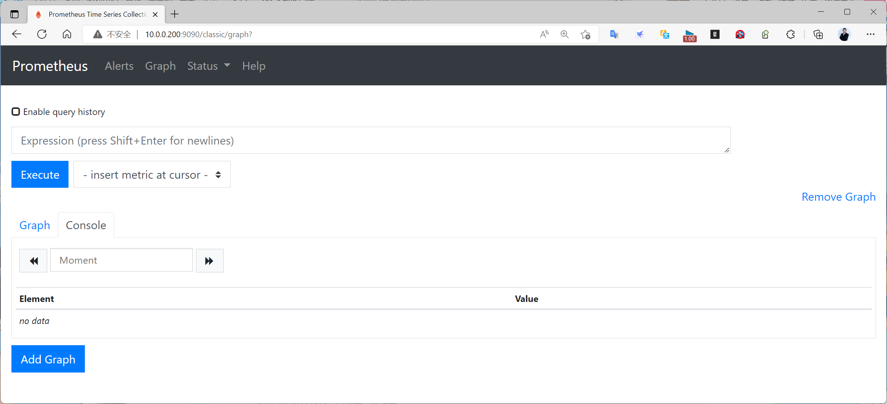

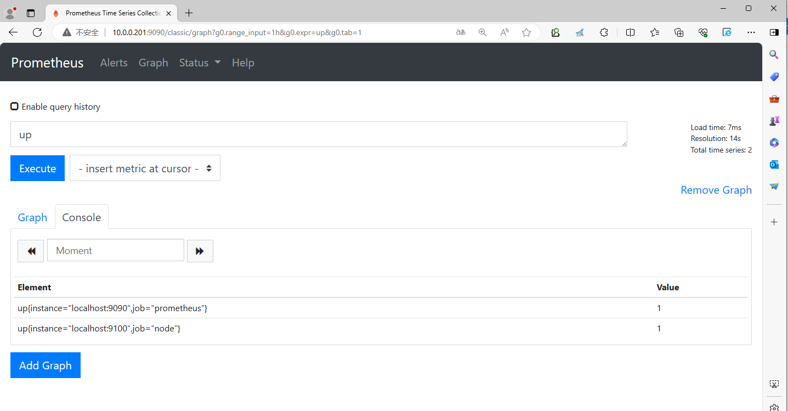

## 路径二：官方二进制与 systemd

从官方发布页下载**匹配本机系统和架构**的压缩包，并与发布方校验值核对。解压后将 `prometheus`、`promtool` 安装到固定路径；配置与 TSDB 数据分开存放。下面假设压缩包已下载并校验，版本号按真实文件名替换：

```bash
tar -xzf prometheus-3.1.0.linux-amd64.tar.gz
sudo install -m 0755 prometheus-3.1.0.linux-amd64/prometheus /usr/local/bin/prometheus
sudo install -m 0755 prometheus-3.1.0.linux-amd64/promtool /usr/local/bin/promtool
sudo useradd --system --no-create-home --shell /usr/sbin/nologin prometheus
sudo mkdir -p /etc/prometheus /var/lib/prometheus
sudo install -m 0644 prometheus-3.1.0.linux-amd64/prometheus.yml /etc/prometheus/prometheus.yml
sudo chown prometheus:prometheus /var/lib/prometheus
promtool check config /etc/prometheus/prometheus.yml
```

这个版本号只用于说明文件布局；正式部署应选当前支持、已验证的版本。确认现有服务账户和目录状态后再执行创建命令，不要覆盖已有配置或数据。

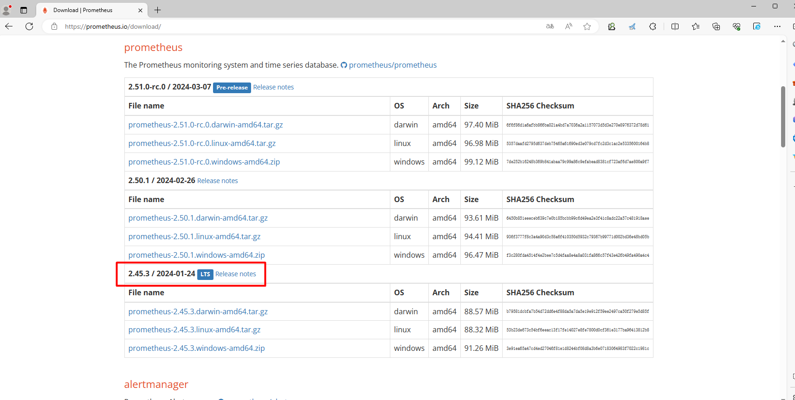

将以下内容保存为 `/etc/systemd/system/prometheus.service`。显式指定配置路径和数据目录，避免“当前工作目录不同就写到意外位置”；数据目录由 `prometheus` 用户写入。这里只启用信号方式重载，不开启可通过 HTTP 关闭服务的 lifecycle API。

```ini
[Unit]
Description=Prometheus Server
After=network-online.target
Wants=network-online.target

[Service]
User=prometheus
Group=prometheus
ExecStart=/usr/local/bin/prometheus --config.file=/etc/prometheus/prometheus.yml --storage.tsdb.path=/var/lib/prometheus --storage.tsdb.retention.time=15d
ExecReload=/bin/kill -HUP $MAINPID
Restart=on-failure

[Install]
WantedBy=multi-user.target
```

```bash
sudo systemctl daemon-reload
sudo systemctl enable --now prometheus
systemctl is-active prometheus
curl -f http://127.0.0.1:9090/-/ready
```

15 天是本例的保留期，不是适用于所有环境的固定建议。根据实际活跃序列数、抓取频率、磁盘预算和历史查询需求调整，并为数据目录预留空间。Web 默认监听端口应只允许可信网络访问，正式环境还需结合认证、TLS 或反向代理。

## 看懂 Web、API 与服务指标

浏览器访问 `http://<Prometheus 地址>:9090/`，可在表达式页面查询 `up`。**Status → Targets** 负责看抓取目标是否 UP，**Status → Configuration** 查看当前已加载配置，**Status → Rules** 查看记录与告警规则。界面菜单名称会随版本变化，下面截图是原教程对应版本的操作示意。

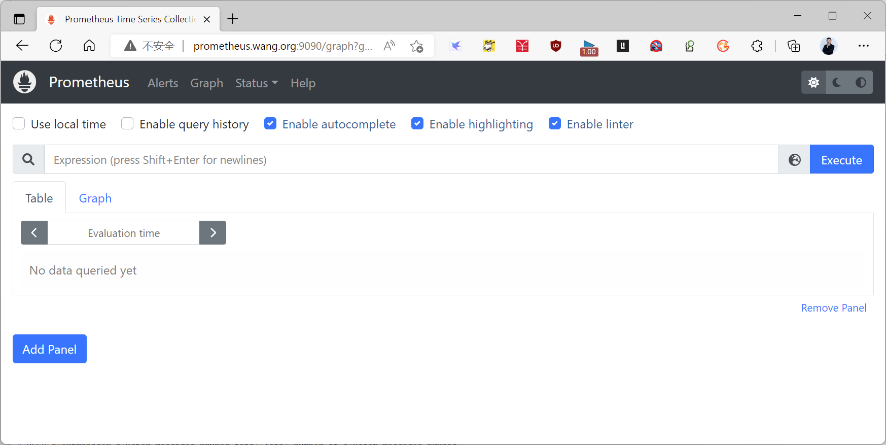

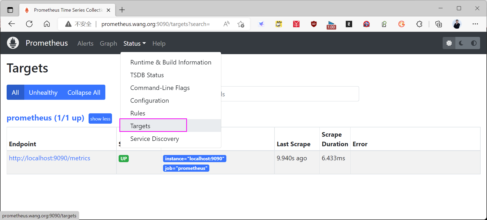

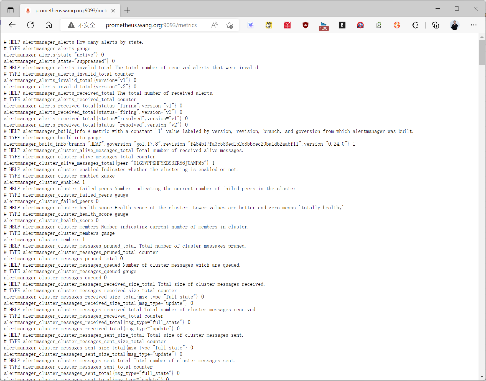

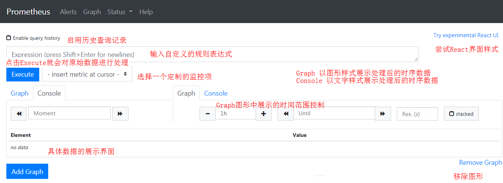

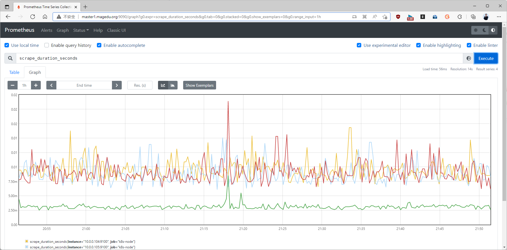

检查链路可用的几个端点各有不同含义：

```bash
curl -f http://127.0.0.1:9090/-/healthy
curl -f http://127.0.0.1:9090/-/ready
curl -G --data-urlencode 'query=up' http://127.0.0.1:9090/api/v1/query
curl -f http://127.0.0.1:9090/metrics | head
```

`/-/healthy` 说明进程在响应，`/-/ready` 说明已准备好处理请求；`/api/v1/query` 返回 PromQL 结果，`/metrics` 暴露 Prometheus 自身运行指标。它们不能互相替代。`/-/reload`、`/-/quit` 需要显式开启 lifecycle API；后者可远程关闭服务，因此本例不启用。配置改变时先用 `promtool check config`，再用 `systemctl reload prometheus`。

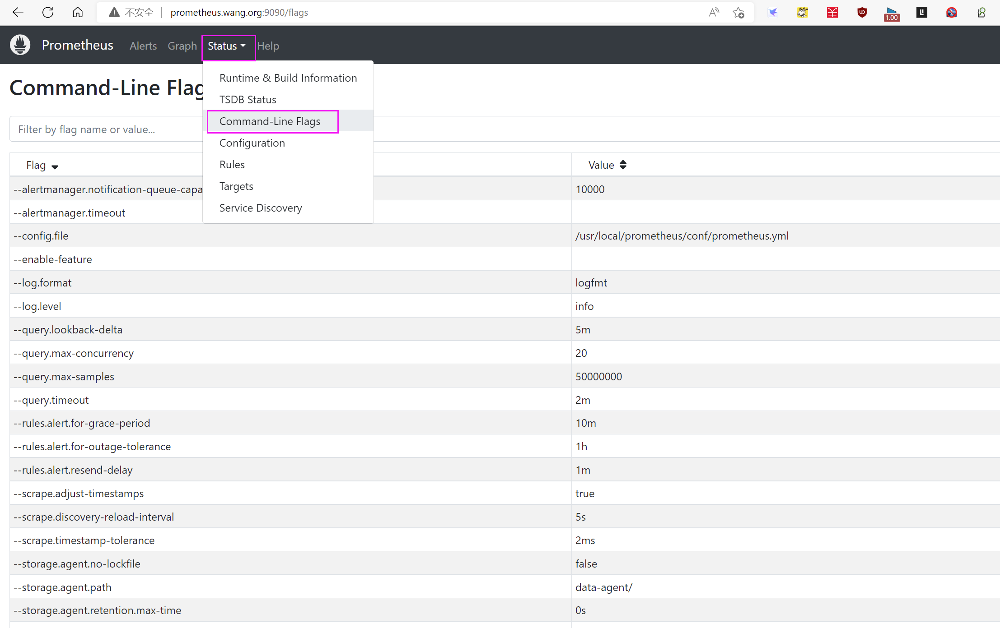

## 路径三：使用官方容器镜像

已有 Docker 环境时，先在当前目录准备 `prometheus.yml`，并确保它是**文件而非目录**；把数据写入命名卷。下面只部署 Prometheus，不拷贝旧资料里包含多年前 Grafana、cAdvisor、Pushgateway 等镜像的整套 Compose 清单。

```bash
docker volume create prometheus_data
docker run -d --name prometheus --restart unless-stopped \
  -p 9090:9090 \
  -v "$PWD/prometheus.yml:/etc/prometheus/prometheus.yml:ro" \
  -v prometheus_data:/prometheus \
  prom/prometheus:v3.1.0
docker logs prometheus --tail 50
```

若已选定其他受支持的镜像版本，应让镜像标签和配置语法对应。不要同时在同一宿主机运行包安装与容器版并占用 9090 端口。容器中的 `localhost` 是容器自身；配置其他抓取目标时要从 Prometheus 容器角度判断地址是否可达。

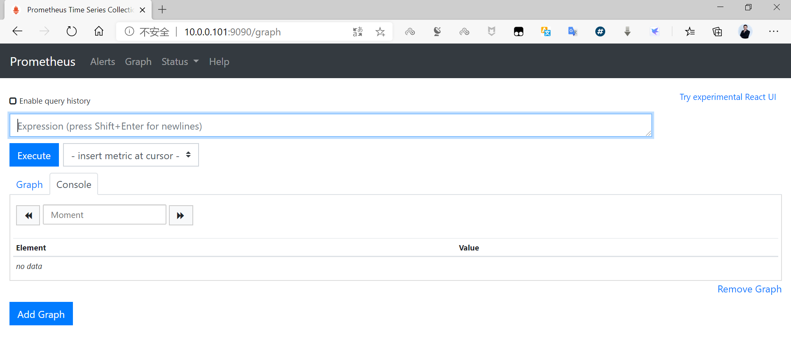

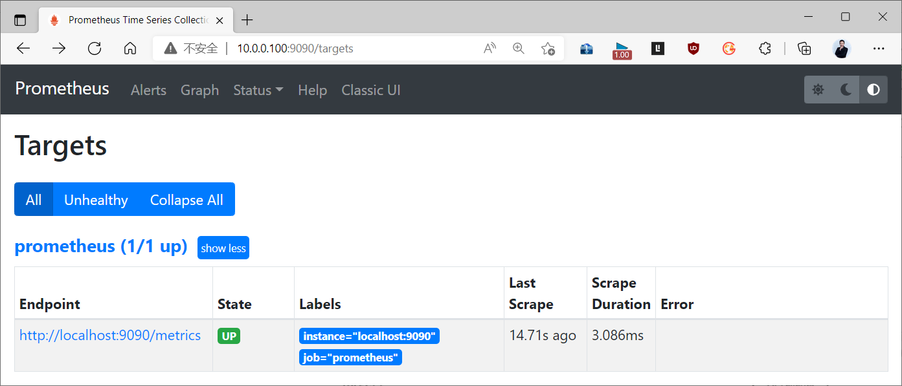

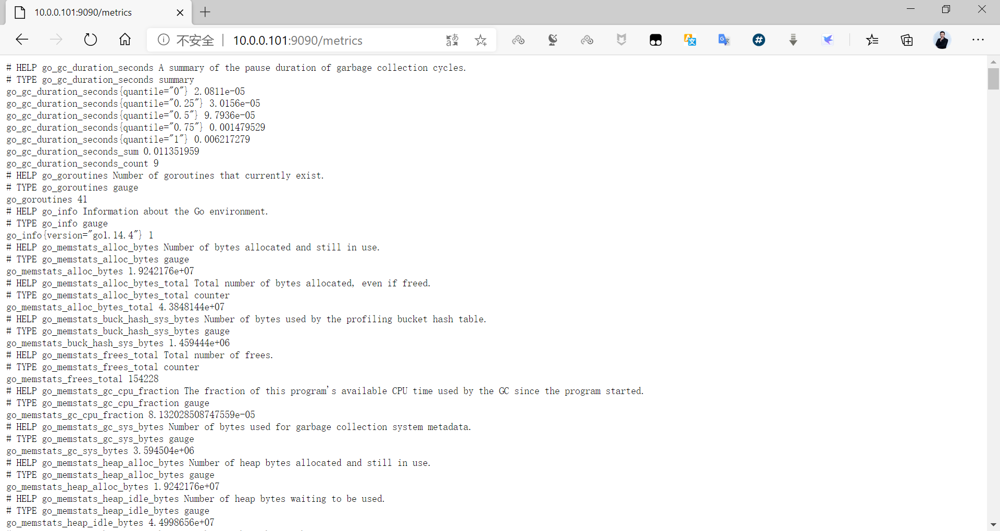

Compose 的等价配置如下，仍保持配置文件只读、TSDB 持久化：

```yaml
services:
  prometheus:
    image: prom/prometheus:v3.1.0
    restart: unless-stopped
    ports:
      - "9090:9090"
    volumes:
      - ./prometheus.yml:/etc/prometheus/prometheus.yml:ro
      - prometheus_data:/prometheus

volumes:
  prometheus_data:
```

## 最小配置文件与下一步

无论通过哪种方式部署，先用最小配置抓取 Prometheus 自身，确认完整的发现—抓取—存储—查询链路：

```yaml
global:
  scrape_interval: 15s
  evaluation_interval: 15s

scrape_configs:
  - job_name: prometheus
    static_configs:
      - targets: ['localhost:9090']
```

`global` 规定默认抓取与规则评估周期；`scrape_configs` 定义要抓的目标；`rule_files` 用于加载记录/告警规则；`alerting` 配置 Alertmanager。目标 `localhost:9090` 在当前 Prometheus 进程所在环境中解析，因此自抓取在二进制和容器模式下都成立。静态目标不是“自动发现”，后续章节会再介绍文件、Consul 与 Kubernetes 服务发现。

执行 `promtool check config <实际配置路径>` 并重载后，查询 `up{job="prometheus"}` 应得到 1。若为 0，先看 Targets 页错误；若没有序列，检查配置是否加载、是否等待了首次抓取、查询时间范围是否正确。完成这一步后，再进入 Node Exporter 的主机指标采集。



<nav class="article-end" aria-label="章节导航">
  <a href="{{ '/subjects/Prometheus/01-prometheus-introduction.html' | relative_url }}">← 上一章：监控系统与 Prometheus 入门</a>
  <a href="{{ '/subjects/Prometheus/' | relative_url }}">返回 Prometheus 目录</a>
  <a href="{{ '/subjects/Prometheus/03-node-exporter.html' | relative_url }}">下一章：部署 Node Exporter 并采集主机指标 →</a>
</nav>
