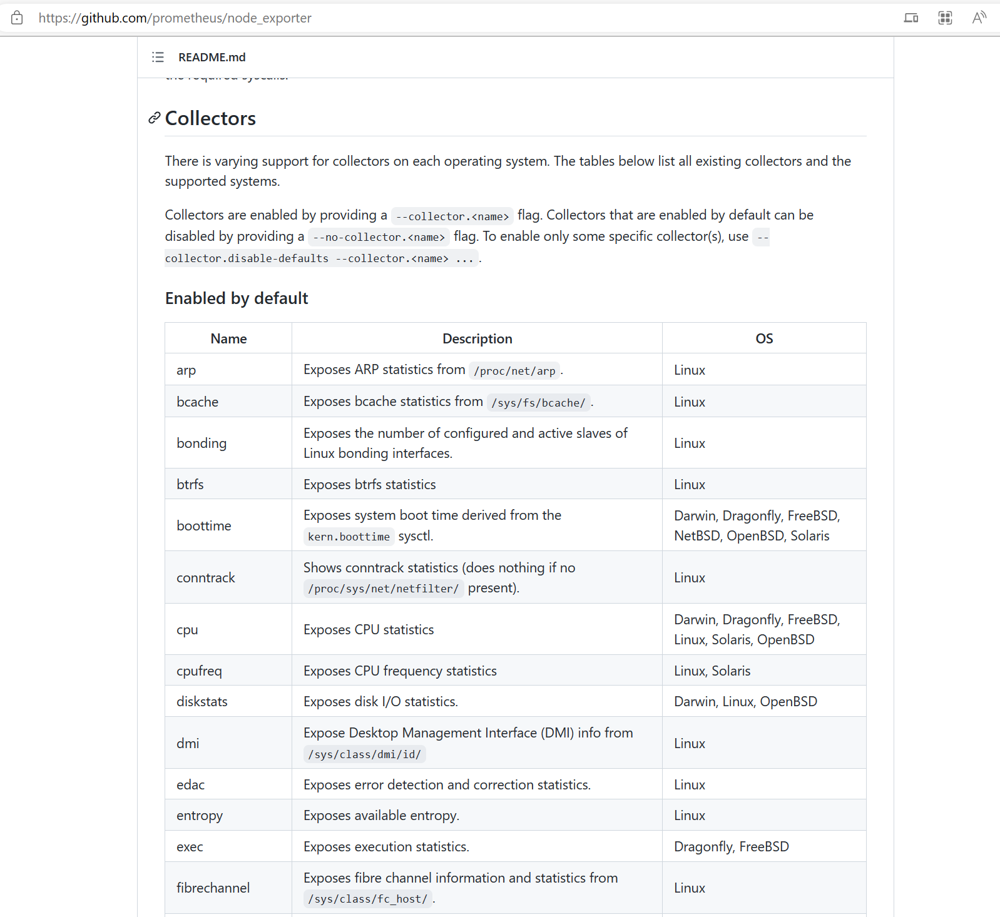
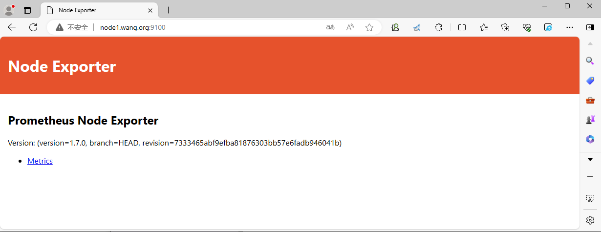
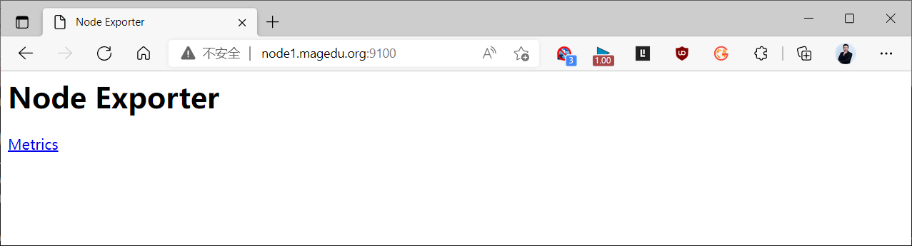
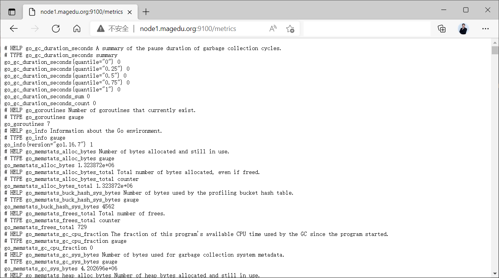
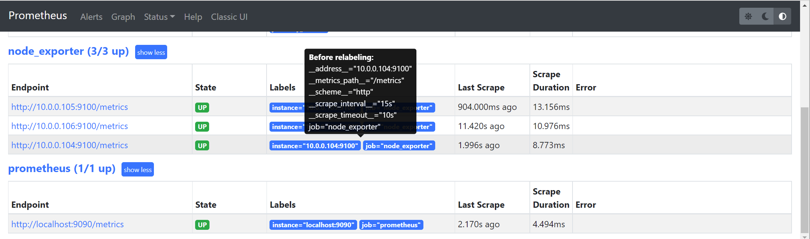
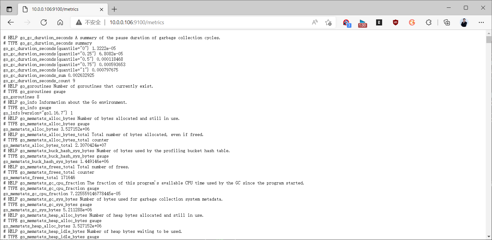
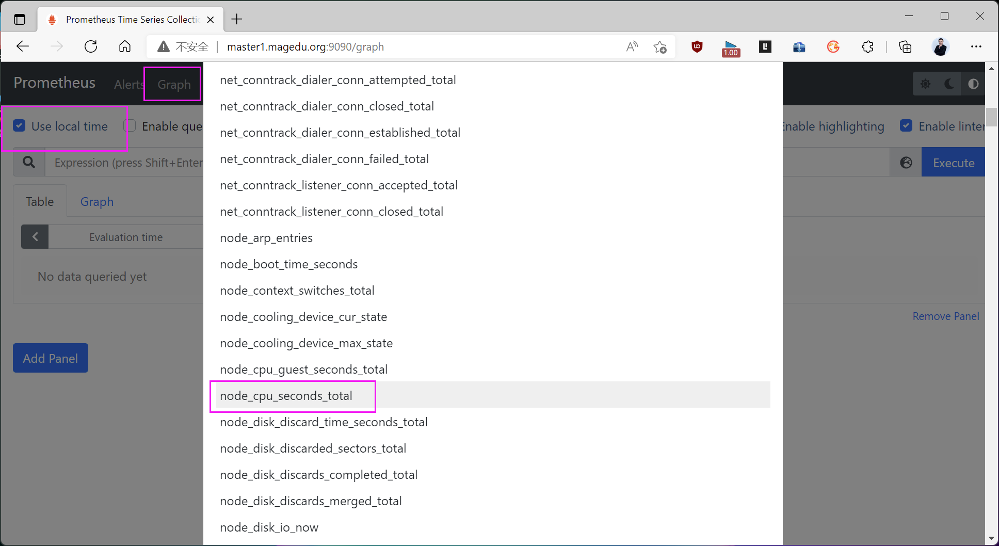
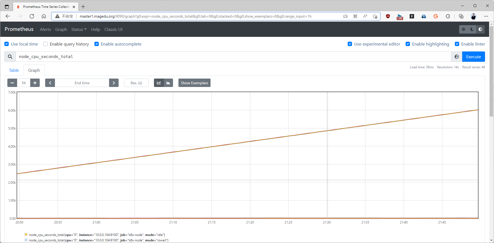

[← 返回 Prometheus 目录]({{ '/subjects/Prometheus/' | relative_url }})



# 03 部署 Node Exporter 并采集主机指标

Node Exporter 在 Linux 主机上读取内核与文件系统统计数据，通过 HTTP `/metrics` 暴露给 Prometheus，默认监听 9100 端口。它提供的是**主机指标**，不是业务应用指标；同一主机的 CPU、内存、磁盘、网络等数据由不同 collector 生成。安装完成后，还必须在 Prometheus 中添加抓取目标，数据才会进入时序库。

## 在主机上部署二进制

从 [Prometheus 下载页](https://prometheus.io/download/) 或 [Node Exporter Releases](https://github.com/prometheus/node_exporter/releases) 取得与系统架构匹配的版本，并核对发布方校验值。原资料固定的 v1.2.2 和多页 `--help` 输出属于历史快照；collector 选项随版本变化，应以当前二进制的 `node_exporter --help` 为准。

下面以已下载并校验的压缩包为例，安装二进制和专用服务账户。版本号按实际文件名替换：

```bash
tar -xzf node_exporter-1.8.2.linux-amd64.tar.gz
sudo install -m 0755 node_exporter-1.8.2.linux-amd64/node_exporter /usr/local/bin/node_exporter
sudo useradd --system --no-create-home --shell /usr/sbin/nologin node_exporter
/usr/local/bin/node_exporter --version
```

将服务单元保存为 `/etc/systemd/system/node_exporter.service`：

```ini
[Unit]
Description=Prometheus Node Exporter
After=network-online.target
Wants=network-online.target

[Service]
User=node_exporter
Group=node_exporter
ExecStart=/usr/local/bin/node_exporter --web.listen-address=:9100
Restart=on-failure

[Install]
WantedBy=multi-user.target
```

```bash
sudo systemctl daemon-reload
sudo systemctl enable --now node_exporter
systemctl is-active node_exporter
curl -f http://127.0.0.1:9100/metrics | head
```

多数系统指标不需要为服务额外加特权。9100 默认可能没有身份认证，正式环境应限制为 Prometheus 所在网络可达，或按部署要求配置 TLS/认证；不要把整个指标端点无控制地暴露到公网。









## 容器和 Kubernetes 部署的差异

若 Node Exporter 运行在容器内，不能只启动镜像就声称正在采集宿主机：容器默认看到的是它自己的命名空间。Linux Docker 环境通常挂载宿主机根目录并使用主机网络，再通过 `--path.rootfs` 指向挂载位置：

```bash
docker run -d --name node-exporter --restart unless-stopped \
  --net=host --pid=host \
  -v /:/host:ro,rslave \
  quay.io/prometheus/node-exporter:v1.8.2 \
  --path.rootfs=/host
```

这种方式扩大了容器对主机状态的可见范围，应确认只读挂载、运行权限和网络边界。选二进制、Docker、Ansible 角色或 Kubernetes DaemonSet 中适合环境的一种部署方式，不必混合多套示例。

在 Kubernetes 中通常用 DaemonSet 保证每个需要监控的节点运行一个实例。下面是展示关键字段的**完整基础示例**，比原资料中缩进错误、`--path.sys` 参数名不匹配的片段更便于检查；实际集群还要结合安全策略、节点污点和发现方式调整。

```yaml
apiVersion: apps/v1
kind: DaemonSet
metadata:
  name: node-exporter
spec:
  selector:
    matchLabels:
      app: node-exporter
  template:
    metadata:
      labels:
        app: node-exporter
    spec:
      hostNetwork: true
      hostPID: true
      containers:
        - name: node-exporter
          image: quay.io/prometheus/node-exporter:v1.8.2
          args:
            - --path.procfs=/host/proc
            - --path.sysfs=/host/sys
            - --path.rootfs=/host
          ports:
            - name: metrics
              containerPort: 9100
          volumeMounts:
            - name: proc
              mountPath: /host/proc
              readOnly: true
            - name: sys
              mountPath: /host/sys
              readOnly: true
            - name: root
              mountPath: /host
              readOnly: true
      volumes:
        - name: proc
          hostPath:
            path: /proc
        - name: sys
          hostPath:
            path: /sys
        - name: root
          hostPath:
            path: /
```

`hostNetwork: true` 会让实例在每个节点的 9100 端口监听，部署前确认端口未被占用；是否覆盖控制平面节点取决于 toleration 与集群策略。仅创建 DaemonSet 还不代表 Prometheus 已发现它，需配合静态目标、服务发现或 Prometheus Operator 配置抓取。

## 常见指标与核验方式

| 指标 | 含义 | 查询注意 |
| --- | --- | --- |
| `node_boot_time_seconds` | 主机启动时间的 Unix 时间戳 | 用 `time() - node_boot_time_seconds` 求运行时长 |
| `node_cpu_seconds_total` | 各 CPU、各模式的累计秒数 | 用 `rate(...[5m])` 求使用率 |
| `node_memory_MemAvailable_bytes` | 可用内存估计 | 与总内存配合看容量 |
| `node_filesystem_avail_bytes` | 文件系统可供普通用户使用的空间 | 按设备、挂载点和类型筛选 |
| `node_network_receive_bytes_total` | 网卡累计接收字节数 | 用速率函数求字节/秒 |

原资料写成 `node_memeory*` 和 `node_time` 的名称不能直接用于查询；实际指标以当前 `/metrics` 输出为准。并非所有 collector 在所有内核和文件系统上都返回相同序列。

## 在 Prometheus 中添加目标

将下列 job 合并进现有 `scrape_configs`，填写 Prometheus **从自身环境可访问**的主机地址。不要把系统命令和注释混进 YAML 代码块中：

```yaml
scrape_configs:
  - job_name: node
    static_configs:
      - targets:
          - node-a.example.local:9100
          - node-b.example.local:9100
```

运行 `promtool check config /path/to/prometheus.yml`，然后按服务的实际方式重载。打开 Prometheus 的 **Status → Targets**：UP 表示最近一次抓取成功，DOWN 时看页面提供的错误信息，再检查 Node Exporter 服务、端口、防火墙和地址是否正确。



接着在表达式页查询 `up{job="node"}`、`node_cpu_seconds_total{job="node"}`。前者验证抓取状态，后者验证主机指标确实进入 Prometheus；若要查看趋势，再查询 `rate(node_cpu_seconds_total{job="node",mode="idle"}[5m])`。









<nav class="article-end" aria-label="章节导航">
  <a href="{{ '/subjects/Prometheus/02-prometheus-deployment.html' | relative_url }}">← 上一章：Prometheus 部署与配置</a>
  <a href="{{ '/subjects/Prometheus/' | relative_url }}">返回 Prometheus 目录</a>
  <a href="{{ '/subjects/Prometheus/04-grafana.html' | relative_url }}">下一章：Grafana 展示与监控 →</a>
</nav>
