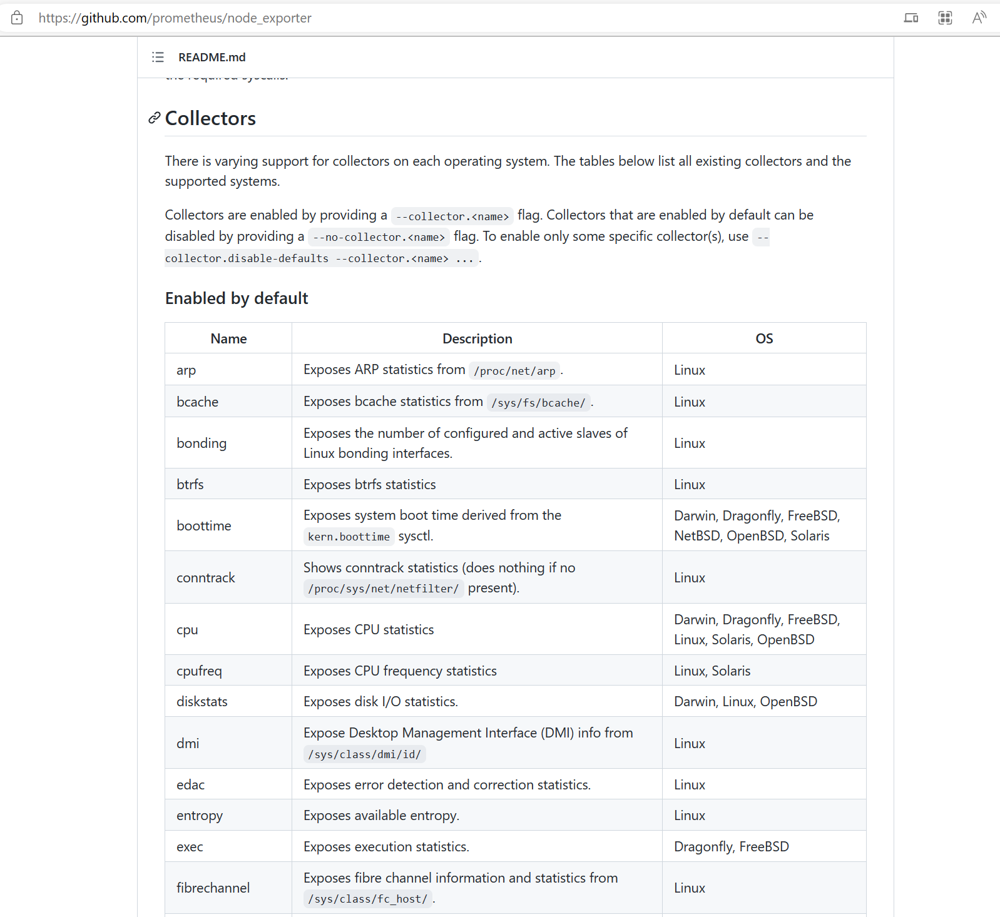
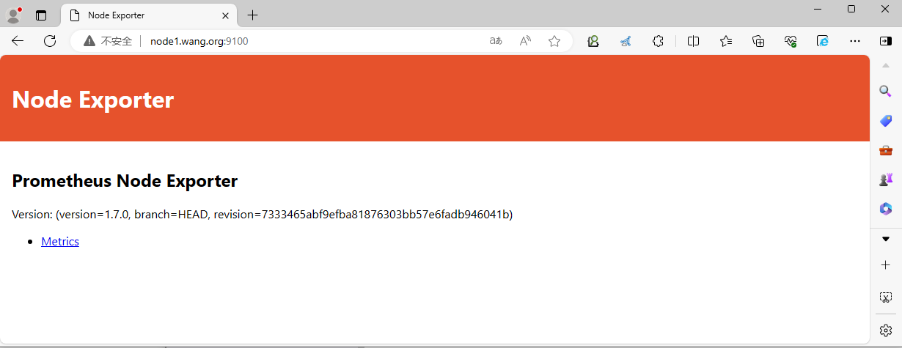
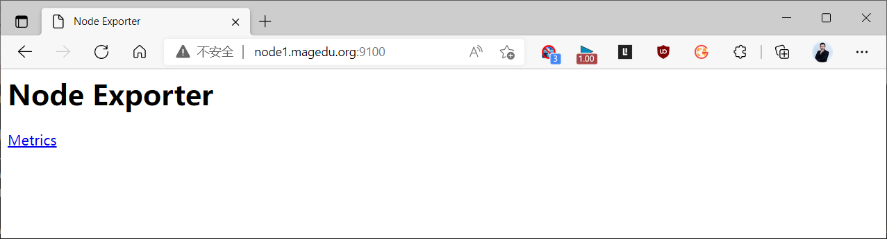
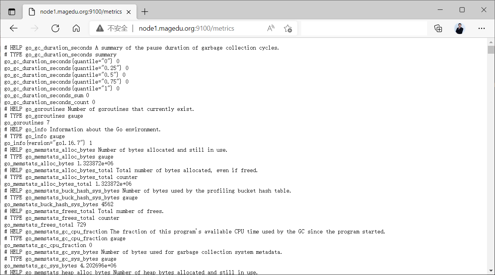
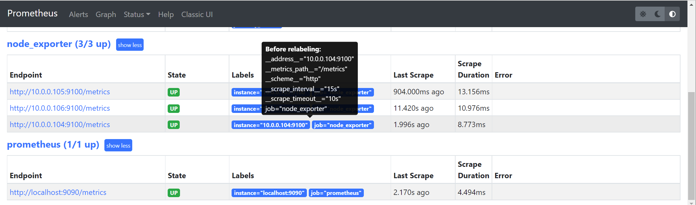
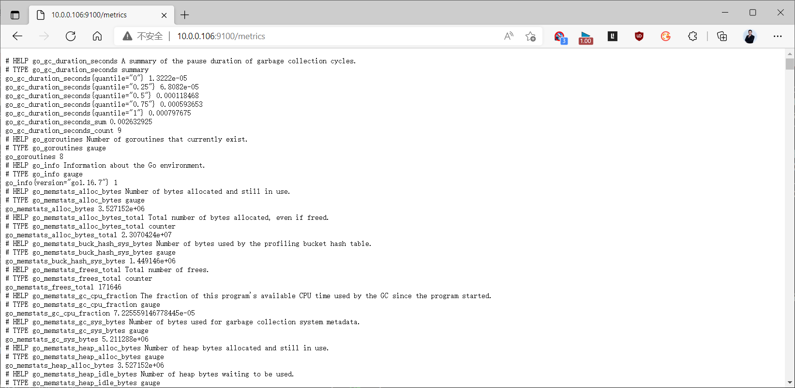
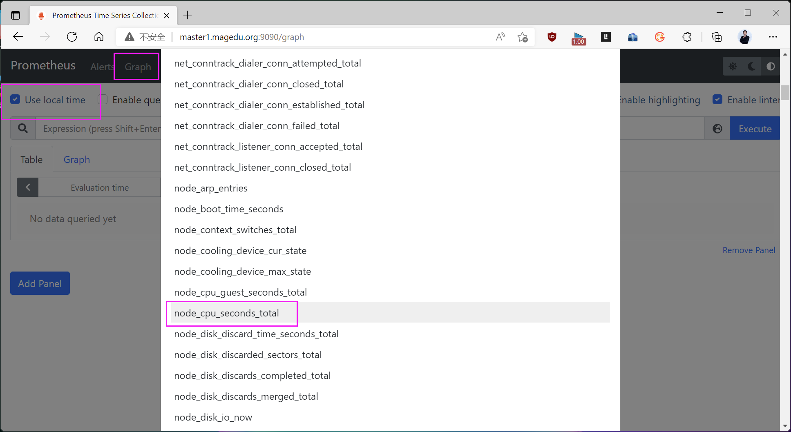
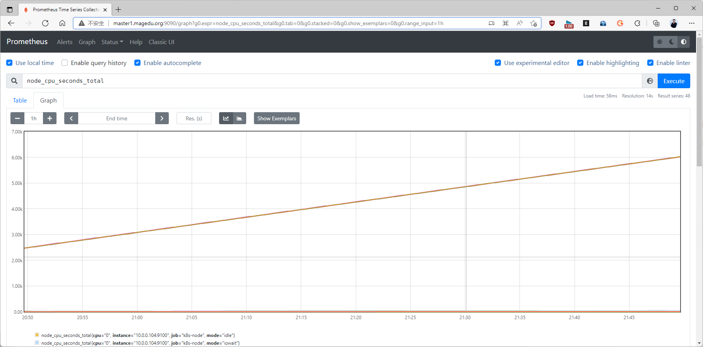

[← 返回 Prometheus 目录]({{ '/subjects/Prometheus/' | relative_url }})



# 03 Node Exporter 安装与采集

## 2.2 Node Exporter 安装

安装 Node Exporter 用于收集各 node 主机节点上的监控指标数据，监听端口为9100

github 链接
https://github.com/prometheus/node_exporter

官方下载:
https://prometheus.io/download/

### 2.2.1 下载并解压

在需要监控的所有节点主机上进行安装
```bash
[root@node1 ~]#wget -P /usr/local/
https://github.com/prometheus/node_exporter/releases/download/v1.2.2/node_exporter-1.2.2.linux-amd64.tar.gz
[root@node1 ~]#cd /usr/local
[root@node1 local]#tar xvf node_exporter-1.2.2.linux-amd64.tar.gz
[root@node1 local]#ln -s node_exporter-1.2.2.linux-amd64  node_exporter
[root@node1 local]#cd node_exporter
[root@node1 node_exporter]#mkdir bin
[root@node1 node_exporter]#mv node_exporter bin/
[root@node1 ~]#useradd -r -s /sbin/nologin prometheus
[root@node1 ~]#chown -R prometheus:prometheus /usr/local/node_exporter/
```

### 2.2.2 准备 service 文件

node_exporter 通过Collecters 采集各种系统信息，默认采集如下信息
https://github.com/prometheus/node_exporter



范例：
```ini
[root@node1 ~]#vim /lib/systemd/system/node_exporter.service
[root@node1 ~]#cat /lib/systemd/system/node_exporter.service
[Unit]
Description=Prometheus Node Exporter
After=network.target
[Service]
Type=simple
#no-collector.uname:禁止收集uname信息，会导致grafana无法显示此主机信息
#ExecStart=/usr/local/node_exporter/bin/node_exporter --no-collector.uname --
collector.cgroups
ExecStart=/usr/local/node_exporter/bin/node_exporter --collector.cgroups
ExecReload=/bin/kill -HUP $MAINPID
Restart=on-failure
User=prometheus
Group=prometheus
[Install]
WantedBy=multi-user.target
```

范例: 查看node_exporter命令选项
```bash
#启用：--collector.<name>
#禁用：--no-collector.<name>
[root@ubuntu2004 ~]#node_exporter --help
usage: node_exporter [<flags>]
Flags:
  -h, --help                     Show context-sensitive help (also try --help-long
and --help-man).
      --collector.bcache.priorityStats
                                 Expose expensive priority stats.
      --collector.cpu.guest      Enables metric node_cpu_guest_seconds_total
      --collector.cpu.info       Enables metric cpu_info
      --collector.cpu.info.flags-include=COLLECTOR.CPU.INFO.FLAGS-INCLUDE
                                 Filter the `flags` field in cpuInfo with a value
that must be a regular expression
      --collector.cpu.info.bugs-include=COLLECTOR.CPU.INFO.BUGS-INCLUDE
                                 Filter the `bugs` field in cpuInfo with a value that
must be a regular expression
      --collector.diskstats.ignored-devices="^(ram|loop|fd|(h|s|v|xv)d[a-
z]|nvme\\d+n\\d+p)\\d+$"
                                 Regexp of devices to ignore for diskstats.
      --collector.ethtool.device-include=COLLECTOR.ETHTOOL.DEVICE-INCLUDE
                                 Regexp of ethtool devices to include (mutually
exclusive to device-exclude).
      --collector.ethtool.device-exclude=COLLECTOR.ETHTOOL.DEVICE-EXCLUDE
                                 Regexp of ethtool devices to exclude (mutually
exclusive to device-include).
      --collector.ethtool.metrics-include=".*"
                                 Regexp of ethtool stats to include.
      --collector.filesystem.mount-points-
exclude="^/(dev|proc|run/credentials/.+|sys|var/lib/docker/.+)($|/)"
                                 Regexp of mount points to exclude for filesystem
collector.
      --collector.filesystem.fs-types-exclude="^(autofs|binfmt_misc|bpf|cgroup2?
|configfs|debugfs|devpts|devtmpfs|fusectl|hugetlbfs|iso9660|mqueue|nsfs|overlay|proc|
procfs|pstore|rpc_pipefs|securityfs|selinuxfs|squashfs|sysfs|tracefs)$"
                                 Regexp of filesystem types to exclude for filesystem
collector.
      --collector.ipvs.backend-
labels="local_address,local_port,remote_address,remote_port,proto,local_mark"
                                 Comma separated list for IPVS backend stats labels.
      --collector.netclass.ignored-devices="^$"
                                 Regexp of net devices to ignore for netclass
collector.
      --collector.netclass.ignore-invalid-speed
                                 Ignore devices where the speed is invalid. This will
be the default behavior in 2.x.
      --collector.netdev.device-include=COLLECTOR.NETDEV.DEVICE-INCLUDE
                                 Regexp of net devices to include (mutually exclusive
to device-exclude).
      --collector.netdev.device-exclude=COLLECTOR.NETDEV.DEVICE-EXCLUDE
                                 Regexp of net devices to exclude (mutually exclusive
to device-include).
      --collector.netdev.address-info
                                 Collect address-info for every device
      --
collector.netstat.fields="^(.*_(InErrors|InErrs)|Ip_Forwarding|Ip(6|Ext)_(InOctets|Ou
tOctets)|Icmp6?
_(InMsgs|OutMsgs)|TcpExt_(Listen.*|Syncookies.*|TCPSynRetrans|TCPTimeouts)|Tcp_(Activ
eOpens|InSegs|OutSegs|OutRsts|PassiveOpens|RetransSegs|CurrEstab)|Udp6?
_(InDatagrams|OutDatagrams|NoPorts|RcvbufErrors|SndbufErrors))$"
                                 Regexp of fields to return for netstat collector.
      --collector.ntp.server="127.0.0.1"
                                 NTP server to use for ntp collector
      --collector.ntp.protocol-version=4
                                 NTP protocol version
      --collector.ntp.server-is-local
                                 Certify that collector.ntp.server address is not a
public ntp server
      --collector.ntp.ip-ttl=1   IP TTL to use while sending NTP query
      --collector.ntp.max-distance=3.46608s
                                 Max accumulated distance to the root
      --collector.ntp.local-offset-tolerance=1ms
                                 Offset between local clock and local ntpd time to
tolerate
      --path.procfs="/proc"      procfs mountpoint.
      --path.sysfs="/sys"        sysfs mountpoint.
      --path.rootfs="/"          rootfs mountpoint.
      --collector.perf.cpus=""   List of CPUs from which perf metrics should be
collected
      --collector.perf.tracepoint=COLLECTOR.PERF.TRACEPOINT ...
                                 perf tracepoint that should be collected
      --collector.powersupply.ignored-supplies="^$"
                                 Regexp of power supplies to ignore for
powersupplyclass collector.
      --collector.qdisc.fixtures=""
                                 test fixtures to use for qdisc collector end-to-end
testing
      --collector.runit.servicedir="/etc/service"
                                 Path to runit service directory.
      --collector.supervisord.url="http://localhost:9001/RPC2"
                                 XML RPC endpoint.
      --collector.systemd.unit-include=".+"
                                 Regexp of systemd units to include. Units must both
match include and not match exclude to be
                                 included.
      --collector.systemd.unit-exclude=".+\\.(automount|device|mount|scope|slice)"
                                 Regexp of systemd units to exclude. Units must both
match include and not match exclude to be
                                 included.
      --collector.systemd.enable-task-metrics
                                 Enables service unit tasks metrics
unit_tasks_current and unit_tasks_max
      --collector.systemd.enable-restarts-metrics
                                 Enables service unit metric service_restart_total
      --collector.systemd.enable-start-time-metrics
                                 Enables service unit metric unit_start_time_seconds
      --collector.tapestats.ignored-devices="^$"
                                 Regexp of devices to ignore for tapestats.
      --collector.textfile.directory=""
                                 Directory to read text files with metrics from.
      --collector.vmstat.fields="^(oom_kill|pgpg|pswp|pg.*fault).*"
                                 Regexp of fields to return for vmstat collector.
      --collector.wifi.fixtures=""
                                 test fixtures to use for wifi collector metrics
      --collector.arp            Enable the arp collector (default: enabled).
      --collector.bcache         Enable the bcache collector (default: enabled).
      --collector.bonding        Enable the bonding collector (default: enabled).
      --collector.btrfs          Enable the btrfs collector (default: enabled).
      --collector.buddyinfo      Enable the buddyinfo collector (default: disabled).
      --collector.conntrack      Enable the conntrack collector (default: enabled).
      --collector.cpu            Enable the cpu collector (default: enabled).
      --collector.cpufreq        Enable the cpufreq collector (default: enabled).
      --collector.diskstats      Enable the diskstats collector (default: enabled).
      --collector.dmi            Enable the dmi collector (default: enabled).
      --collector.drbd           Enable the drbd collector (default: disabled).
      --collector.drm            Enable the drm collector (default: disabled).
      --collector.edac           Enable the edac collector (default: enabled).
      --collector.entropy        Enable the entropy collector (default: enabled).
      --collector.ethtool        Enable the ethtool collector (default: disabled).
      --collector.fibrechannel   Enable the fibrechannel collector (default:
enabled).
      --collector.filefd         Enable the filefd collector (default: enabled).
      --collector.filesystem     Enable the filesystem collector (default: enabled).
      --collector.hwmon          Enable the hwmon collector (default: enabled).
      --collector.infiniband     Enable the infiniband collector (default: enabled).
      --collector.interrupts     Enable the interrupts collector (default: disabled).
      --collector.ipvs           Enable the ipvs collector (default: enabled).
      --collector.ksmd           Enable the ksmd collector (default: disabled).
      --collector.lnstat         Enable the lnstat collector (default: disabled).
      --collector.loadavg        Enable the loadavg collector (default: enabled).
      --collector.logind         Enable the logind collector (default: disabled).
      --collector.mdadm          Enable the mdadm collector (default: enabled).
      --collector.meminfo        Enable the meminfo collector (default: enabled).
      --collector.meminfo_numa   Enable the meminfo_numa collector (default:
disabled).
      --collector.mountstats     Enable the mountstats collector (default: disabled).
      --collector.netclass       Enable the netclass collector (default: enabled).
      --collector.netdev         Enable the netdev collector (default: enabled).
      --collector.netstat        Enable the netstat collector (default: enabled).
      --collector.network_route  Enable the network_route collector (default:
disabled).
      --collector.nfs            Enable the nfs collector (default: enabled).
      --collector.nfsd           Enable the nfsd collector (default: enabled).
      --collector.ntp            Enable the ntp collector (default: disabled).
      --collector.nvme           Enable the nvme collector (default: enabled).
      --collector.os             Enable the os collector (default: enabled).
      --collector.perf           Enable the perf collector (default: disabled).
      --collector.powersupplyclass
                                 Enable the powersupplyclass collector (default:
enabled).
      --collector.pressure       Enable the pressure collector (default: enabled).
      --collector.processes      Enable the processes collector (default: disabled).
      --collector.qdisc          Enable the qdisc collector (default: disabled).
      --collector.rapl           Enable the rapl collector (default: enabled).
      --collector.runit          Enable the runit collector (default: disabled).
      --collector.schedstat      Enable the schedstat collector (default: enabled).
      --collector.sockstat       Enable the sockstat collector (default: enabled).
      --collector.softnet        Enable the softnet collector (default: enabled).
      --collector.stat           Enable the stat collector (default: enabled).
      --collector.supervisord    Enable the supervisord collector (default:
disabled).
      --collector.systemd        Enable the systemd collector (default: disabled).
      --collector.tapestats      Enable the tapestats collector (default: enabled).
      --collector.tcpstat        Enable the tcpstat collector (default: disabled).
      --collector.textfile       Enable the textfile collector (default: enabled).
      --collector.thermal_zone   Enable the thermal_zone collector (default:
enabled).
      --collector.time           Enable the time collector (default: enabled).
      --collector.timex          Enable the timex collector (default: enabled).
      --collector.udp_queues     Enable the udp_queues collector (default: enabled).
      --collector.uname          Enable the uname collector (default: enabled).
      --collector.vmstat         Enable the vmstat collector (default: enabled).
      --collector.wifi           Enable the wifi collector (default: disabled).
      --collector.xfs            Enable the xfs collector (default: enabled).
      --collector.zfs            Enable the zfs collector (default: enabled).
      --collector.zoneinfo       Enable the zoneinfo collector (default: disabled).
      --web.listen-address=":9100"
                                 Address on which to expose metrics and web
interface.
      --web.telemetry-path="/metrics"
                                 Path under which to expose metrics.
      --web.disable-exporter-metrics
                                 Exclude metrics about the exporter itself
(promhttp_*, process_*, go_*).
      --web.max-requests=40      Maximum number of parallel scrape requests. Use 0 to
disable.
      --collector.disable-defaults
                                 Set all collectors to disabled by default.
      --web.config=""            [EXPERIMENTAL] Path to config yaml file that can
enable TLS or authentication.
      --log.level=info           Only log messages with the given severity or above.
One of: [debug, info, warn, error]
      --log.format=logfmt        Output format of log messages. One of: [logfmt,
json]
      --version                  Show application version.
```

### 2.2.3 启动 Node Exporter 服务
```bash
[root@node1 ~]#systemctl daemon-reload
[root@node1 ~]#systemctl enable --now node_exporter.service
[root@node1 ~]#systemctl is-active  node_exporter
active
#默认监听9100/tcp端口
[root@node1 ~]#ss -ntlp|grep node_exporter
LISTEN   0  128                       *:9100                   *:*
users:(("node_exporter",pid=33761,fd=3))
```

### 2.2.4 访问 Node Exporter Web 界面

浏览器访问
http://node1.bowen.org:9100/







### 2.2.5 容器化启动 Node Exporter
https://hub.docker.com/r/prom/node-exporter
https://github.com/prometheus/node_exporter

范例：
```bash
docker run -d \
  --net="host" \
  --pid="host" \
  -v "/:/host:ro,rslave" \
  quay.io/prometheus/node-exporter:latest \
  --path.rootfs=/host
```

范例：docker compose 方式
```text
---
version: '3.8'
services:
  node_exporter:
    image: quay.io/prometheus/node-exporter:latest
    container_name: node_exporter
    command:
      - '--path.rootfs=/host'
    network_mode: host
    pid: host
    restart: unless-stopped
    volumes:
      - '/:/host:ro,rslave'
```

范例：docker compose 方式
```text
version: '3.6'
networks:
  monitoring:
    driver: bridge
services:
  node-exporter:
    image: prom/node-exporter:v1.4.0
    volumes:
      - /proc:/host/proc:ro
      - /sys:/host/sys:ro
      - /:/rootfs:ro
    command:
      - '--path.procfs=/host/proc'
      - '--path.sysfs=/host/sys'
      - '--collector.filesystem.mount-points-exclude=^/(sys|proc|dev|host|etc)($$|/)'
      - '--path.rootfs=/host'
    ports:
      - 9100:9100
    networks:
      - monitoring
    restart: always
```

### 2.2.6 Ansible 部署 Node Exporter
https://github.com/prometheus-community/ansible/tree/main/roles/node_exporter

### 2.2.7 Kubernetes 部署 Node Exporter

范例：kubernetes 集群中部署Node-exporter
```yaml
apiVersion: apps/v1
kind: DaemonSet
metadata:
  name: daemonset-demo
  namespace: default
  labels:
    app: prometheus
    component: node-exporter
spec:
  selector:
    matchLabels:
      app: prometheus
      component: node-exporter
  template:
    metadata:
      name: prometheus-node-exporter
      labels:
        app: prometheus
        component: node-exporter
    spec:
      #tolerations:
      #- key: node-role.kubernetes.io/control-plane
      #  operator: Exists
      #  effect: NoSchedule
      #- key: node-role.kubernetes.io/master
      #  operator: Exists
      #  effect: NoSchedule
      volumes:
      - name: proc
        hostPath:
          path: /proc
      - name: sys
        hostPath:
          path: /sys
      - name: rootfs
        hostPath:
          path: /
      containers:
      - image: prom/node-exporter:v1.2.2
        name: prometheus-node-exporter
        args:
         - --path.procfs=/host/proc
         - --path.sys=/host/sys
         - --path.rootfs=/host
        volumeMounts:
         - mountPath: /host/proc
          name: proc
         - mountPath: /host/sys
          name: sys
         - mountPath: /host
          name: rootfs
        ports:
         - name: prom-node-exp
          containerPort: 9100
          hostPort: 9100
        livenessProbe:
          tcpSocket:
            port: prom-node-exp
          initialDelaySeconds: 3
        readinessProbe:
          httpGet:
            path: '/metrics'
            port: prom-node-exp
            scheme: HTTP
          initialDelaySeconds: 5
      hostNetwork: true
      hostPID: true
```

范例：kubernetes 部署Node-exporter并集成 Prometheus自动发现
```yaml
[root@master1 ~]#cat yaml/node-exporter-ds.yaml
apiVersion: apps/v1
kind: DaemonSet
metadata:
  name: prometheus-node-exporter
  namespace: prom
  labels:
    app: prometheus
    component: node-exporter
spec:
  selector:
    matchLabels:
      app: prometheus
      component: node-exporter
  template:
    metadata:
      name: prometheus-node-exporter
      labels:
        app: prometheus
        component: node-exporter
    spec:
      tolerations:
      - effect: NoSchedule
        key: node-role.kubernetes.io/master
      containers:
      - image: prom/node-exporter:v1.5.0
        name: prometheus-node-exporter
        ports:
         - name: prom-node-exp
          containerPort: 9100
          hostPort: 9100
      hostNetwork: true
      hostPID: true
[root@master1 ~]#cat yaml/node-exporter-svc.yaml
apiVersion: v1
kind: Service
metadata:
  annotations:
    prometheus.io/scrape: 'true'  #配置由kubernetes自动发现加入prometheus的
target中
  name: prometheus-node-exporter
  namespace: prom
  labels:
    app: prometheus
    component: node-exporter
spec:
  clusterIP: None
  ports:
    - name: prometheus-node-exporter
      port: 9100
      protocol: TCP
  selector:
    app: prometheus
    component: node-exporter
  type: ClusterIP
```

### 2.2.8 Node Exporter 常见的指标
node_boot_time_seconds：从1970.1.1到系统自启动以后的总计时间
node_cpu*：系统CPU使用量
node_disk*：磁盘IO
node_filesystem*：系统文件系统用量
node_load1：系统CPU负载
node_memeory*：内存使用量
node_network*：网络带宽指标
node_time：当前系统时间
go_*：node exporter中go相关指标
process_*：node exporter自身进程相关运行指标

## 2.3 Prometheus 采集 Node Exporter 数据

配置 prometheus 通过 node exporter 组件采集node节点的监控指标数据

### 2.3.1 修改 Prometheus 配置文件
https://prometheus.io/docs/prometheus/latest/configuration/configuration

范例:
```yaml
[root@prometheus ~]#vim /usr/local/prometheus/conf/prometheus.yml
[root@prometheus ~]#grep -Ev '^ *#|^$' /usr/local/prometheus/conf/prometheus.yml
global:
  scrape_interval: 15s # Set the scrape interval to every 15 seconds. Default is
every 1 minute.
  evaluation_interval: 15s # Evaluate rules every 15 seconds. The default is every 1
minute.
alerting:
  alertmanagers:
    - static_configs:
         - targets:
rule_files:
scrape_configs:
  - job_name: "prometheus"
    static_configs:
      - targets: ["localhost:9090"]
  - job_name: 'node_exporter'  #添加以下行,指定监控的node exporter节点
    metrics_path: /metrics      #指定路径，此为默认值，可省略
    scheme: http                #指定协议，此为默认值，可省略
    static_configs:
    - targets: ['10.0.0.104:9100','10.0.0.105:9100','10.0.0.106:9100']  #可以支持这种格
式
      #-  '10.0.0.104:9100'  或者以这种格式也可以支持
      #-  '10.0.0.105:9100'
#属性解析：
#新增一个job_name 和 static_configs的属性
#每一个 target 即前面基本提到的实例 instance，格式就是"ip:port"
#检查语法
[root@prometheus ~]#promtool check config /usr/local/prometheus/conf/prometheus.yml
#生效
[root@prometheus ~]#systemctl reload prometheus
```

### 2.3.2 Prometheus 验证 Node 节点状态

浏览器访问如下地址
```text
http://master1.bowen.org:9090/targets
#结果显示：当我们把鼠标放到Labels部位的时候，就会将改target的属性信息标识出来，其中"__*"开头的就是
该对象的私有属性，当我们点击Endpoint的时候，就可以看到该node节点上的所有定制好的监控项。
```



### 2.3.3 Prometheus 验证 Node 节点监控数据

点上面页面的主机链接,可以直接跳转至对应节点的页面









<nav class="article-end" aria-label="章节导航">
  <a href="{{ '/subjects/Prometheus/02-prometheus-deployment.html' | relative_url }}">← 上一章：Prometheus 部署与配置</a>
  <a href="{{ '/subjects/Prometheus/' | relative_url }}">返回 Prometheus 目录</a>
  <a href="{{ '/subjects/Prometheus/04-grafana.html' | relative_url }}">下一章：Grafana 展示与监控 →</a>
</nav>
