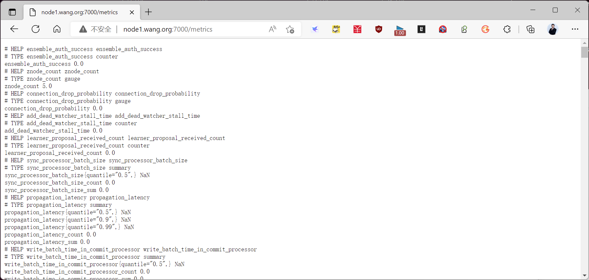
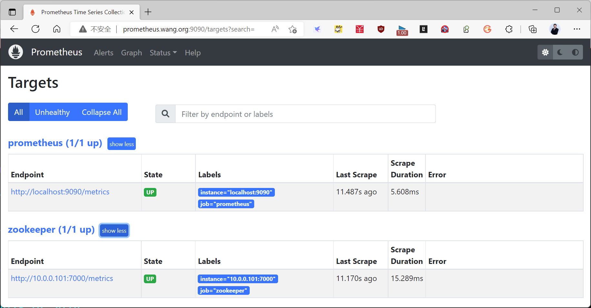
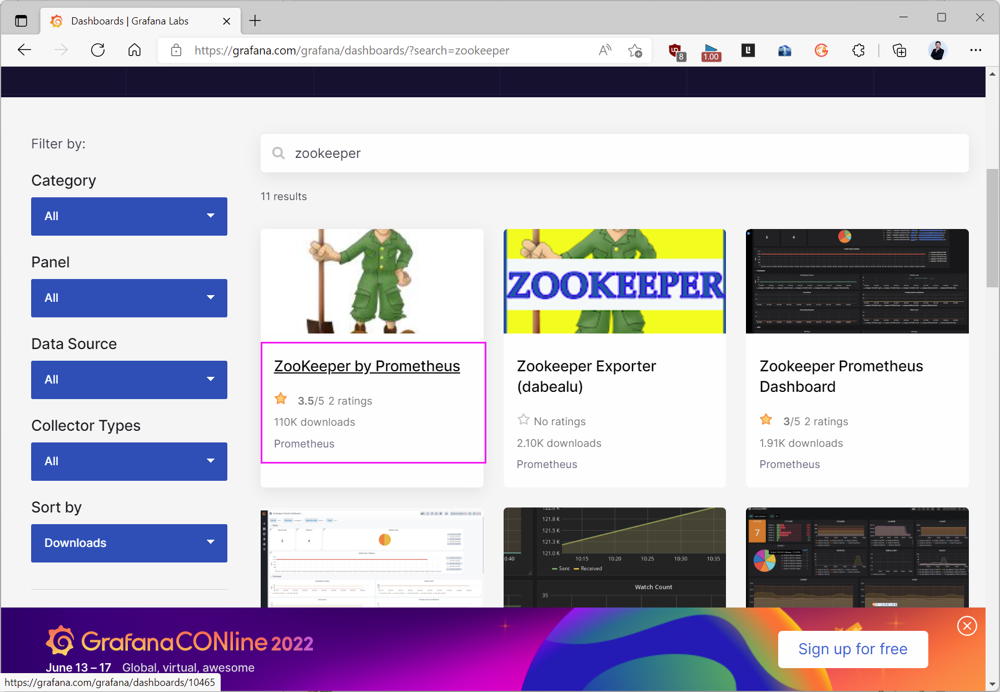
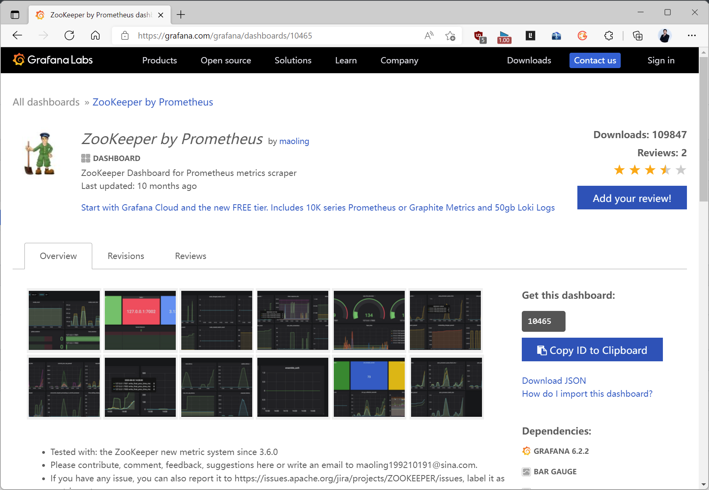
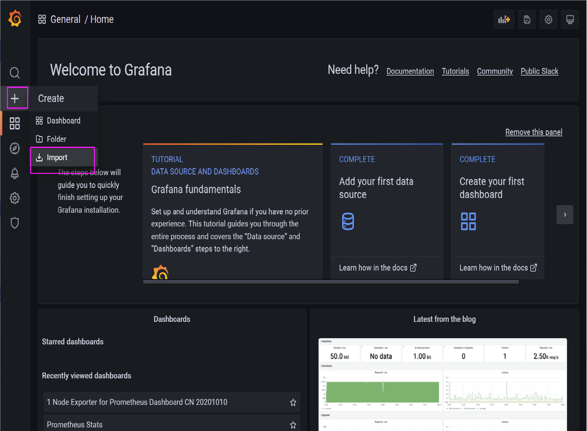
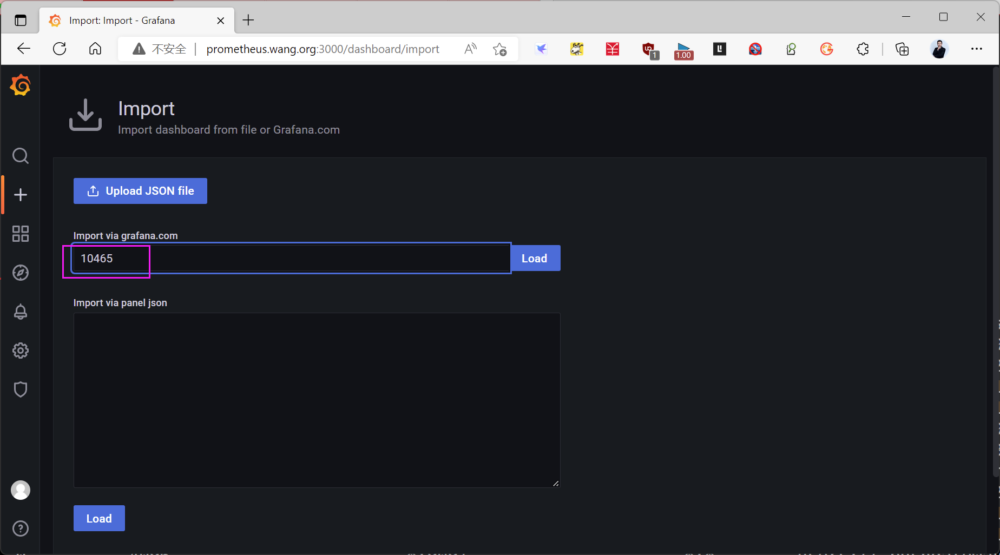
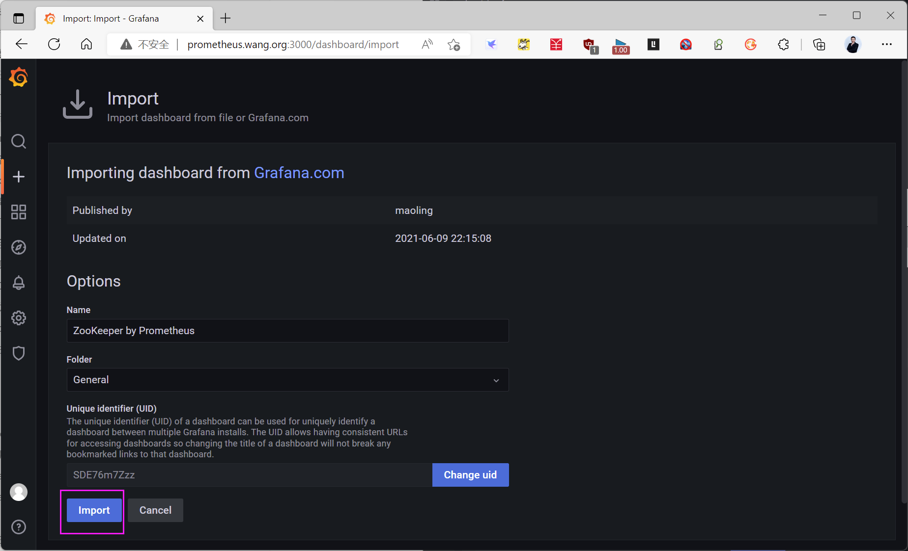
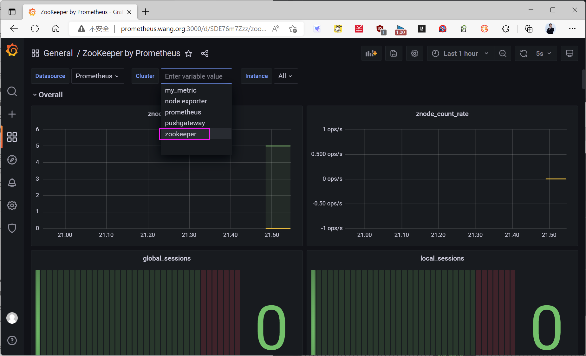
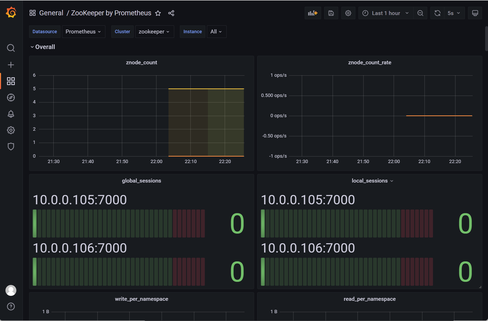
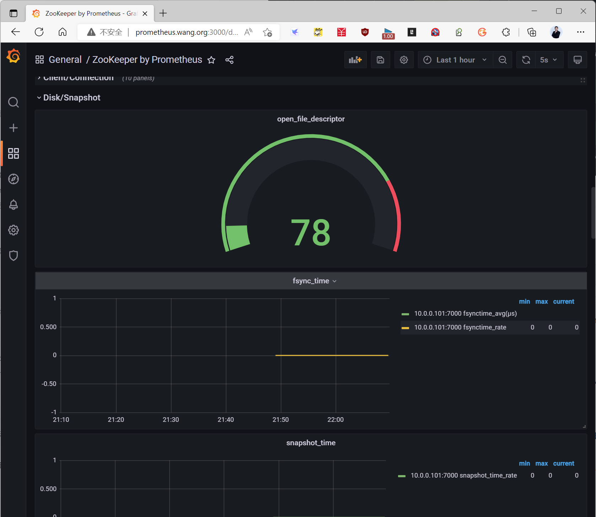

[← 返回 Prometheus 目录]({{ '/subjects/Prometheus/' | relative_url }})



# 05 Zookeeper 监控

## 2.6 监控 Zookeeper

监控的指标可以通过下面方式提供
Prometheus 内置  
Instrumentation 程序仪表: 应用内置的指标功能,比如: Grafana,Zookeeper,Gitlab等  
额外的exporter,使用第三方开发的功能  
Pushgateway 提供  
通过自行编程实现的功能代码,需要开发能力  


### 2.6.1 安装和配置 Zookeeper
```bash
#安装zookeeper
略
#zookeeper内置prometheus的配置
[root@ubuntu2204 ~]#tail  /usr/local/zookeeper/conf/zoo_sample.cfg
#autopurge.purgeInterval=1
## Metrics Providers
#
# https://prometheus.io Metrics Exporter
#metricsProvider.className=org.apache.zookeeper.metrics.prometheus.PrometheusMetricsP
rovider
#metricsProvider.httpHost=0.0.0.0
#metricsProvider.httpPort=7000
#metricsProvider.exportJvmInfo=true
#修改配置支持prometheus
[root@node3 ~]#vim /usr/local/zookeeper/conf/zoo.cfg
#在最后面加下面行,默认带有下面只需要取消注释即可
metricsProvider.className=org.apache.zookeeper.metrics.prometheus.PrometheusMetricsPr
ovider
metricsProvider.httpPort=7000
metricsProvider.exportJvmInfo=true
metricsProvider.exportJvmInfo=true #true为默认值
[root@node3 ~]#systemctl restart zookeeper.service
#浏览器访问:http://node1.bowen.org:7000/metrics
```



### 2.6.2 修改 Prometheus 配置
```yaml
[root@prometheus ~]#vim /usr/local/prometheus/conf/prometheus.yml
#在最后面加下面三行
  - job_name: 'zookeeper'
    static_configs:
    - targets: ['10.0.0.101:7000']
[root@prometheus ~]#systemctl reload prometheus.service
```

### 2.6.3 查看 Prometheus 的监控数据
```text
浏览器访问:http://prometheus.bowen.org:9090/targets
```



### 2.6.4 查看 Grafana 监控数据

访问下面地址,搜索zookeeper
https://grafana.com/grafana/dashboards/





访问grafana管理页面
http://prometheus.bowen.org:3000/



导入dashboard的ID: 10465



点击 Load



点击 import ，注意：选择正确的Cluster名称才能正常显示



选择监控的源为zookeeper,就可以看到下面界面







<nav class="article-end" aria-label="章节导航">
  <a href="{{ '/subjects/Prometheus/04-grafana.html' | relative_url }}">← 上一章：Grafana 展示与监控</a>
  <a href="{{ '/subjects/Prometheus/' | relative_url }}">返回 Prometheus 目录</a>
  <a href="{{ '/subjects/Prometheus/06-pushgateway.html' | relative_url }}">下一章：Pushgateway 自定义数据 →</a>
</nav>
