[← 返回 Prometheus 目录]({{ '/subjects/Prometheus/' | relative_url }})



# 05 Zookeeper 监控

## 2.6 监控 Zookeeper

Prometheus 通过定期抓取 HTTP 指标端点获取数据。ZooKeeper 可以使用自身的 Prometheus Metrics Provider 暴露指标；若所用版本不支持，再评估独立 Exporter。Pushgateway 主要面向短生命周期作业，不应作为长期运行的 ZooKeeper 服务的默认采集方式。

本例假设 ZooKeeper 与 Prometheus 在同一台实验机上，指标端点仅监听 `127.0.0.1:7000`。分机部署时，应改为 Prometheus 可访问的私有地址，并限制该端口的访问范围。

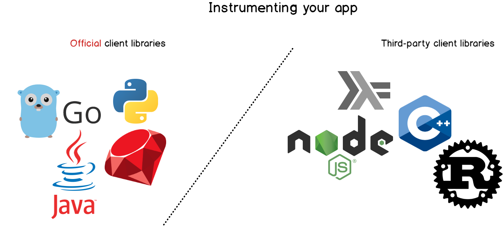

### 2.6.1 启用 ZooKeeper 指标端点

先确认所安装的 ZooKeeper 版本提供 `PrometheusMetricsProvider`，再在实际使用的 `zoo.cfg` 中加入以下完整类名。原资料把类名折断成两行，会导致配置无法加载；这里已还原为一行。

```properties
metricsProvider.className=org.apache.zookeeper.metrics.prometheus.PrometheusMetricsProvider
metricsProvider.httpHost=127.0.0.1
metricsProvider.httpPort=7000
metricsProvider.exportJvmInfo=true
```

重启 ZooKeeper 后，先直接检查端点，确认返回 Prometheus 文本格式，而不是只检查进程状态：

```bash
sudo systemctl restart zookeeper.service
curl -fsS http://127.0.0.1:7000/metrics | head
```

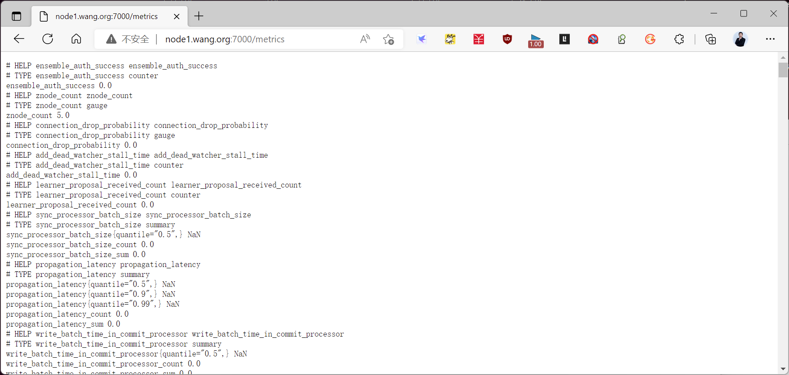

### 2.6.2 配置 Prometheus 抓取

在 `prometheus.yml` 已有的 `scrape_configs:` 列表中新增一个 job；不要再写第二个顶层 `scrape_configs`。若 Prometheus 不在同一台机器，将目标地址改为 ZooKeeper 的可达私网地址，并相应修改 ZooKeeper 的监听地址。

```yaml
scrape_configs:
  - job_name: zookeeper
    static_configs:
      - targets: ['127.0.0.1:7000']
```

保存后先验证配置，再按当前服务管理方式重载或重启 Prometheus。`promtool` 与 Prometheus 的版本应匹配。

```bash
promtool check config /usr/local/prometheus/conf/prometheus.yml
sudo systemctl reload prometheus.service
```

### 2.6.3 核对抓取状态

打开 Prometheus 的 `/targets` 页面，找到 `zookeeper` job 并确认状态为 **UP**。若为 **DOWN**，先看页面显示的最后一次错误，再依次检查 ZooKeeper 端点、监听地址、网络连通性和抓取配置。只有目标为 UP 后，仪表板没有数据的问题才值得继续排查。

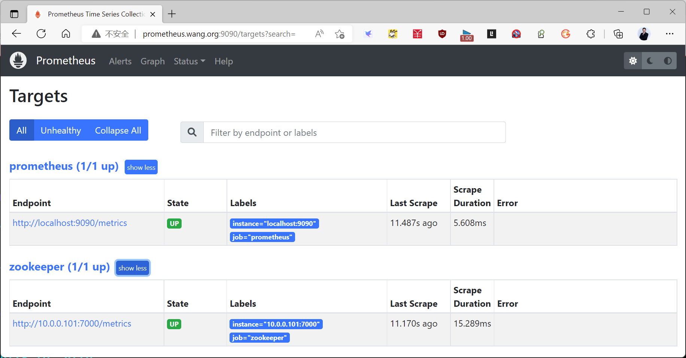

### 2.6.4 在 Grafana 中展示

可在 [Grafana 仪表板目录](https://grafana.com/grafana/dashboards/) 搜索 ZooKeeper。原资料使用的仪表板 ID 是 `10465`，但导入前应查看其适配的 ZooKeeper 指标名和版本，不匹配的面板会显示空白。

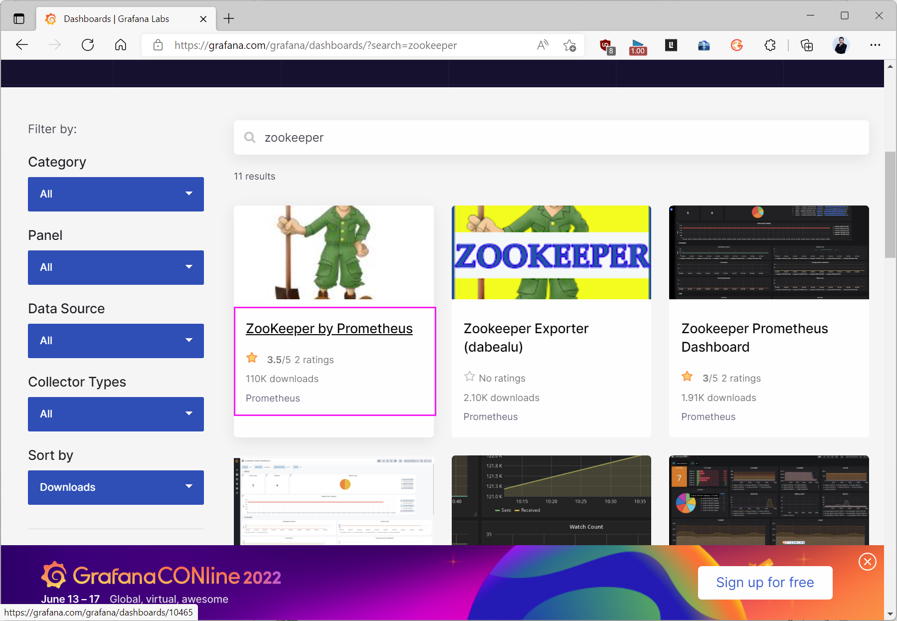

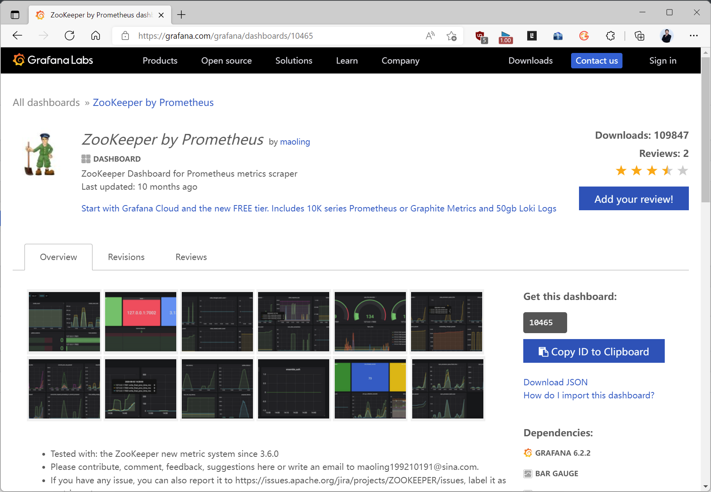

在 Grafana 中先添加 **Prometheus 数据源**，让它指向已抓取 ZooKeeper 的 Prometheus 实例，再导入仪表板。这里选择的是 Prometheus 数据源，不是名为“ZooKeeper”的独立存储源。

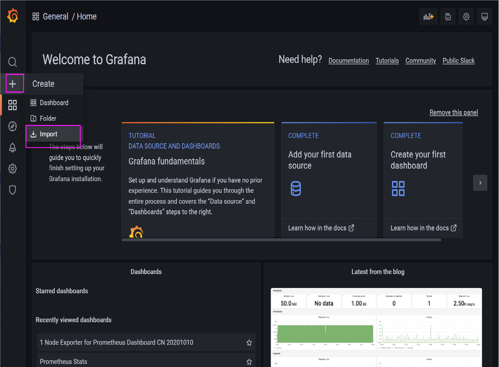

导入时可填写仪表板 ID `10465`，然后选择正确的 Prometheus 数据源。

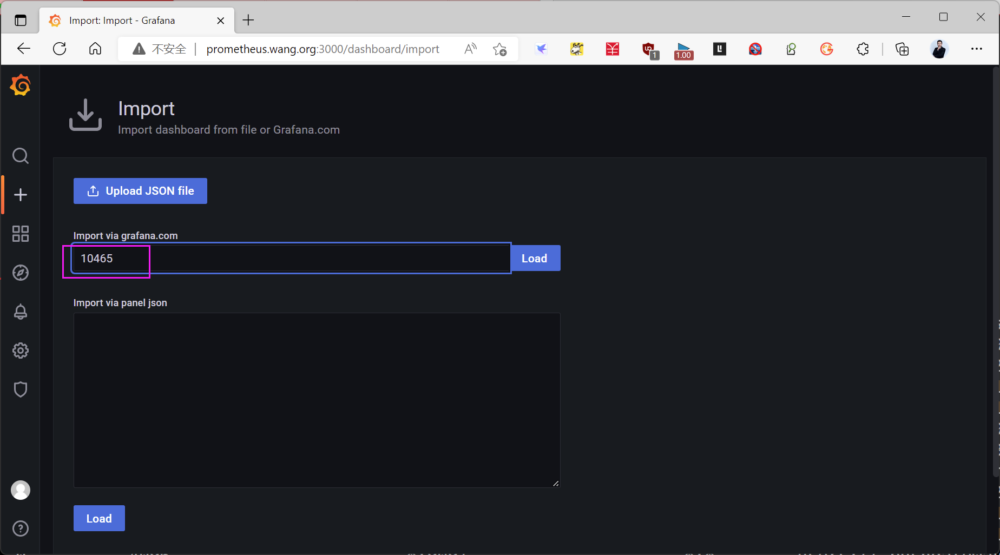

预览面板后继续导入；按钮文字会随 Grafana 版本变化。

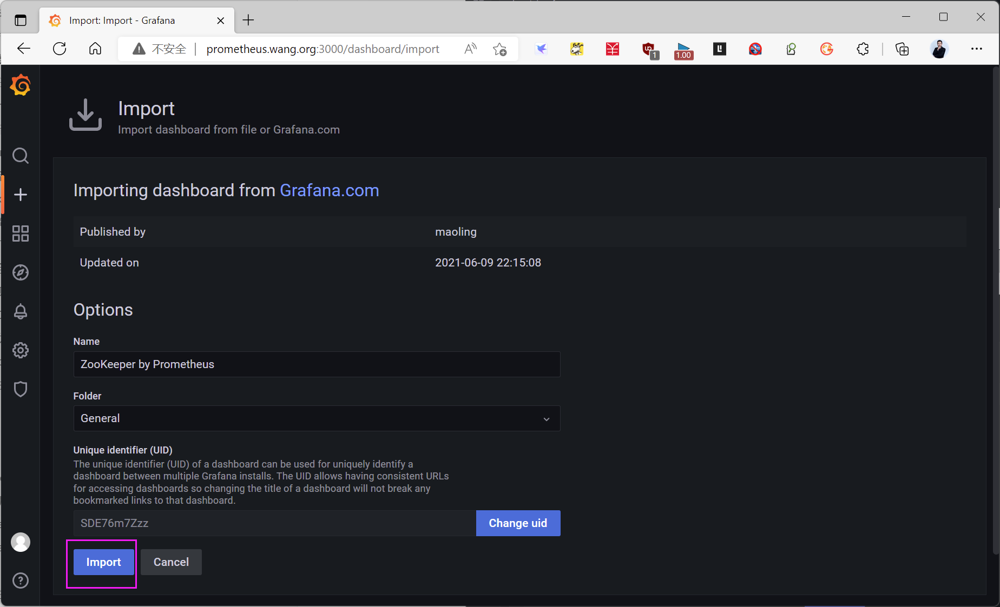

若模板提供 Cluster 下拉选项，应确认其标签值与实际指标一致；否则先检查仪表板查询使用的标签名，不要为了让面板显示而随意修改生产指标。

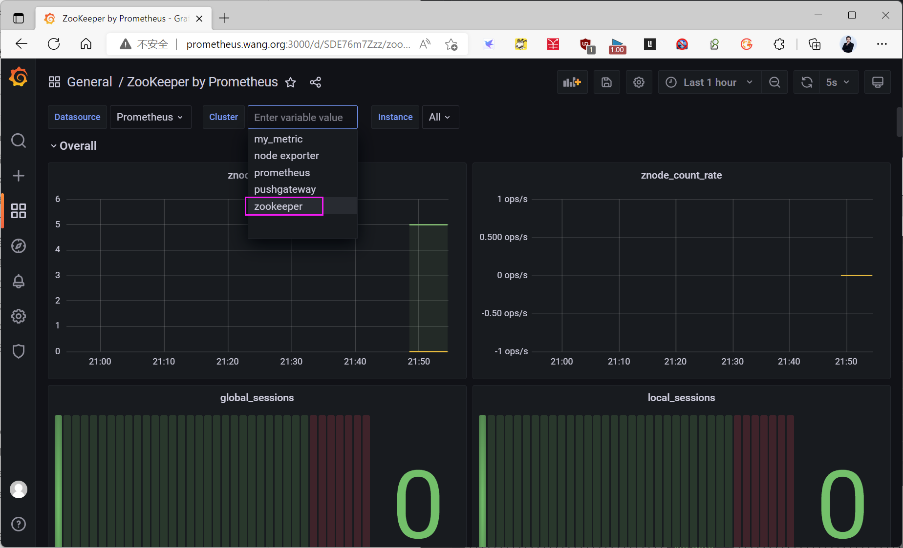

导入完成后，对照 Prometheus 中的原始指标检查面板数值与时间范围。下面是原资料中的展示效果：

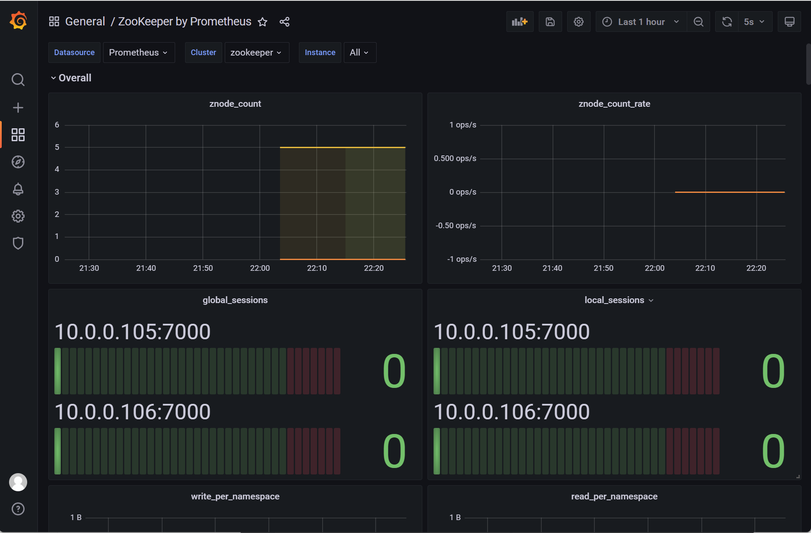

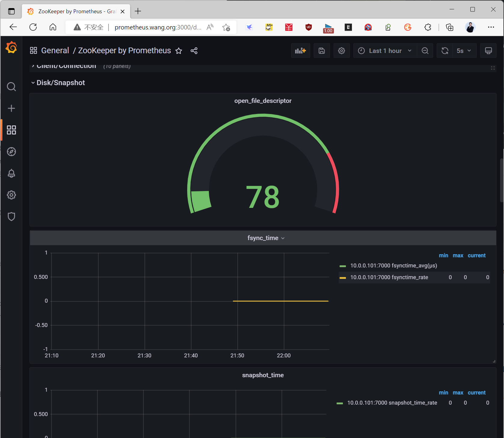



<nav class="article-end" aria-label="章节导航">
  <a href="{{ '/subjects/Prometheus/04-grafana.html' | relative_url }}">← 上一章：Grafana 展示与监控</a>
  <a href="{{ '/subjects/Prometheus/' | relative_url }}">返回 Prometheus 目录</a>
  <a href="{{ '/subjects/Prometheus/06-pushgateway.html' | relative_url }}">下一章：Pushgateway 自定义数据 →</a>
</nav>
