[← 返回 Prometheus 目录]({{ '/subjects/Prometheus/' | relative_url }})



# 06 Pushgateway 自定义数据

## 2.7 Pushgateway 采集自定义数据

### 2.7.1 Pushgateway 介绍
```text
  Ephemeral Process #1  pushes
  Ephemeral Process #2  pushes  Pushgateway  scrapes  Prometheus
  Ephemeral Process #3  pushes
```

官方连接
https://prometheus.io/docs/practices/pushing/

Pushgateway 是一项中介或代理服务，允许您从无法抓取的作业中推送指标

虽然有很多的Exporter提供了丰富的数据,但生产环境中仍需要采集用户自定义的数据,可以利用Pushgateway实现

Pushgateway 是另⼀种采⽤客户端主动推送数据的⽅式,也可以获取监控数据的prometheus 插件

Pushgateway与exporter 不同, Exporter 是被动采集数据

Pushgateway可以单独运⾏在任何节点上，并不⼀定要在被监控客户端安装

⽤户⾃定义的脚本或程序将需要监控的数据推送给 Pushgateway ,然后prometheus server再向pushgateway拉取数据

Pushgateway 缺点

Pushgateway 会形成⼀个单点瓶颈，假如好多个应用同时发送给⼀个pushgateway的进程,如果这个进
程有故障，那么监控数据也就无法获取了  
将失去 Prometheus 通过 up 指标（每次抓取时生成）的自动实例运行状况监控。  
Pushgateway 永远不会忘记推送给它的数据，并将它们永远暴露给 Prometheus，除非这些系列通过  
Pushgateway 的 API 手动删除。  
Pushgateway 并不能对发送过来的数据进⾏更智能的判断,假如脚本中间采集出问题,那么有问题的数据  
pushgateway⼀样照单全收发送给prometheus  

### 2.7.2 安装 Pushgateway

#### 2.7.2.1 二进制安装
https://prometheus.io/download/
https://github.com/prometheus/pushgateway/releases

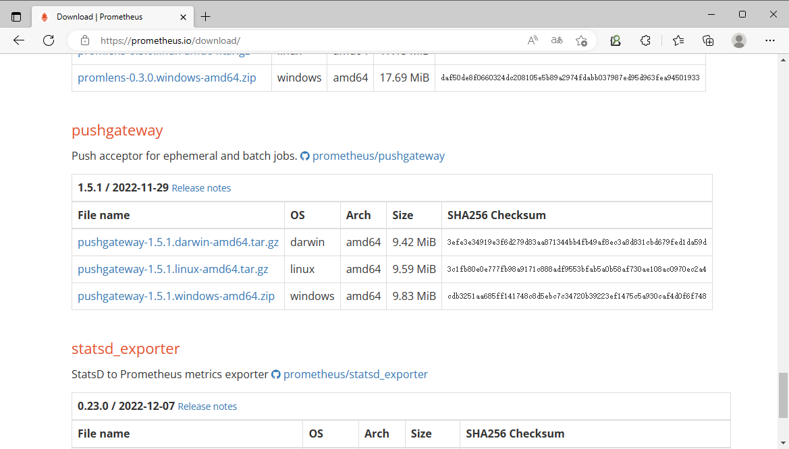

范例：二进制安装
```bash
[root@prometheus ~]#wget
https://github.com/prometheus/pushgateway/releases/download/v1.4.3/pushgateway-1.4.3.linux-amd64.tar.gz
[root@prometheus ~]#tar xf pushgateway-1.4.3.linux-amd64.tar.gz  -C /usr/local/
[root@prometheus ~]#ln -s pushgateway-1.4.3.linux-amd64/ pushgateway
[root@prometheus ~]#ls /usr/local/pushgateway
LICENSE  NOTICE pushgateway
[root@prometheus ~]#mkdir /usr/local/pushgateway/bin
[root@prometheus ~]#mv /usr/local/pushgateway/pushgateway /usr/local/pushgateway/bin
[root@prometheus ~]#id prometheus &> /dev/null ||  useradd -r -s /sbin/nologin
prometheus
[root@prometheus ~]#ldd /usr/local/pushgateway/bin/pushgateway
    不是动态可执行文件
[root@prometheus ~]#ln -s /usr/local/pushgateway/bin/pushgateway /usr/local/bin/
[root@prometheus ~]#pushgateway --help
usage: pushgateway [<flags>]
The Pushgateway
Flags:
  -h, --help                     Show context-sensitive help (also try --help-long
and --help-man).
      --web.config.file=""       [EXPERIMENTAL] Path to configuration file that can
enable TLS or authentication.
      --web.listen-address=":9091"
                                 Address to listen on for the web interface, API, and
telemetry.
      --web.telemetry-path="/metrics"
                                 Path under which to expose metrics.
      --web.external-url=        The URL under which the Pushgateway is externally
reachable.
      --web.route-prefix=""      Prefix for the internal routes of web endpoints.
Defaults to the path of --web.external-url.
      --web.enable-lifecycle     Enable shutdown via HTTP request.
      --web.enable-admin-api     Enable API endpoints for admin control actions.
      --persistence.file=""      File to persist metrics. If empty, metrics are only
kept in memory. 持久化
      --persistence.interval=5m  The minimum interval at which to write out the
persistence file持久化时间间隔
      --push.disable-consistency-check
                                 Do not check consistency of pushed metrics.
DANGEROUS.
      --log.level=info           Only log messages with the given severity or above.
One of: [debug, info, warn, error]
      --log.format=logfmt        Output format of log messages. One of: [logfmt,
json]
      --version                  Show application version.
#前台启动
[root@prometheus ~]#pushgateway
ts=2022-08-06T14:55:02.911Z caller=main.go:85 level=info msg="starting pushgateway"
version="(version=1.4.3, branch=HEAD,
revision=f9dc1c8664050edbc75916c3664be1df595a1958)"
ts=2022-08-06T14:55:02.911Z caller=main.go:86 level=info build_context="(go=go1.18.2,
user=root@75e397dd33fe, date=20220530-19:02:00)"
ts=2022-08-06T14:55:02.913Z caller=main.go:139 level=info listen_address=:9091
ts=2022-08-06T14:55:02.914Z caller=tls_config.go:195 level=info msg="TLS is
disabled." http2=false
#准备service文件
[root@prometheus ~]#cat > /lib/systemd/system/pushgateway.service <<EOF
[Unit]
Description=Prometheus Pushgateway
After=network.target
[Service]
Type=simple
ExecStart=/usr/local/pushgateway/bin/pushgateway
ExecReload=/bin/kill -HUP \$MAINPID
Restart=on-failure
User=prometheus
Group=prometheus
[Install]
WantedBy=multi-user.target
EOF
#启动服务
[root@prometheus ~]#systemctl daemon-reload
[root@prometheus ~]#systemctl enable --now pushgateway.service
#浏览器访问
http://pushgateway.bowen.org:9091/
http://pushgateway.bowen.org:9091/metrics
```

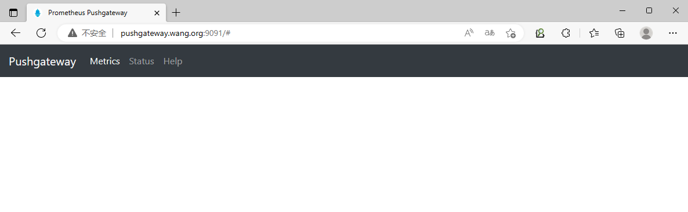

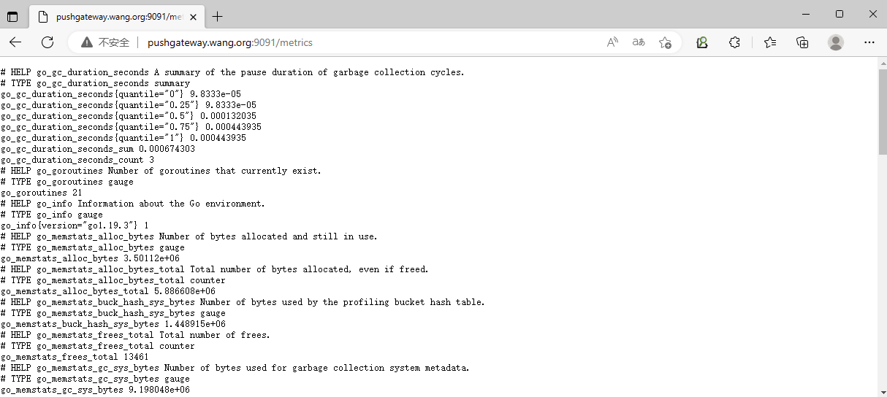

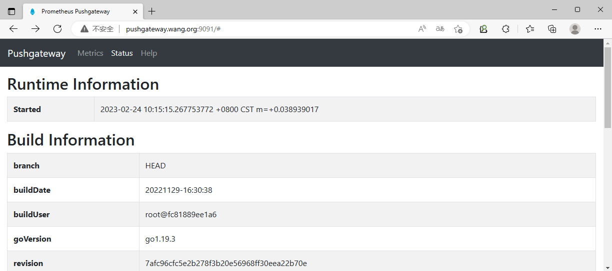

#### 2.7.2.2 Docker 安装

范例: docker 安装
```bash
docker pull prom/pushgateway
docker run -d -p 9091:9091 prom/pushgateway
```

#### 2.7.2.3 Ansible 安装
https://github.com/prometheus-community/ansible/tree/main/roles/pushgateway

### 2.7.3 配置 Prometheus 收集 Pushgateway 数据

范例：静态发现
```yaml
[root@prometheus ~]#vim /usr/local/prometheus/conf/prometheus.yml
  - job_name: "pushgateway"
    honor_labels: true  #可选项，设置为true，Prometheus将使用Pushgateway上的job和
instance标签。如果设置为false那么它将重命名这些值，在它们前面加上exported_前缀，并在服务器上为这些
标签附加新值。
    scrape_interval: 10s  #可选项
    static_configs:
     - targets: #可以写在同一行,比如:["pushgateway.bowen.org:9091"]
        - "pushgateway.bowen.org:9091"
[root@prometheus ~]#promtool check config  /usr/local/prometheus/conf/prometheus.yml
Checking /usr/local/prometheus/conf/prometheus.yml
 SUCCESS: /usr/local/prometheus/conf/prometheus.yml is valid prometheus config file
syntax
[root@prometheus ~]#curl -XPOST http://127.0.0.1:9090/-/reload
```

范例：支持文件形式的自动发现格式
```yaml
[root@prometheus ~]#vim /usr/local/prometheus/conf/prometheus.yml
  - job_name: pushgateway
    honor_labels: true
    file_sd_configs:
    - files:
      - targets/pushgateway/*.json
      refresh_interval: 5m
#pushgateway目标:
[root@prometheus ~]#vim /usr/local/prometheus/conf/targets/pushgateway/test.json
[{"targets": ["pushgateway1.bowen.org：9091"]}]
[root@prometheus ~]#curl -XPOST http://127.0.0.1:9090/-/reload
```

### 2.7.4 配置客户端发送数据给 Pushgateway
https://github.com/prometheus/pushgateway/blob/master/README.md

Examples:

Push a single sample into the group identified by   :
```bash
                        {job="some_job"}
     echo "some_metric 3.14" | curl --data-binary @-
     http://pushgateway.example.org:9091/metrics/job/some_job
```

Since no type information has been provided,    will be of type   .
```text
                        some_metric  untyped
```

Push something more complex into the group identified by
:  
```bash
   {job="some_job",instance="some_instance"}
     cat <<EOF | curl --data-binary @-
     http://pushgateway.example.org:9091/metrics/job/some_job/instance/some_instance
     # TYPE some_metric counter
     some_metric{label="val1"} 42
     # TYPE another_metric gauge
     # HELP another_metric Just an example.
     another_metric 2398.283
     EOF
```

Note how type information and help strings are provided. Those lines are optional, but strongly
encouraged for anything more complex.  
Delete all metrics in the group identified by   :  
```bash
                        {job="some_job",instance="some_instance"}
     curl -X DELETE
     http://pushgateway.example.org:9091/metrics/job/some_job/instance/some_instance
```

Delete all metrics in the group identified by    (note that this does not include
```text
                        {job="some_job"}
```

metrics in the    group from the previous example,
```text
                {job="some_job",instance="some_instance"}
```

even if those metrics have the same job label):
```bash
     curl -X DELETE http://pushgateway.example.org:9091/metrics/job/some_job
```

Delete all metrics in all groups (requires to enable the admin API via the command line flag --
```bash
             -  -  ):
   web.enableadminapi
     curl -X PUT http://pushgateway.example.org:9091/api/v1/admin/wipe
```

要推送一个度量值，需要使用以下URL路径定义向Pushgateway端点发送一个内容为"name value"HTTP请求。

推送 Metric 格式
```text
http://<pushgateway_address>:
<push_port>/metrics/job/<job_name>/[<label_name1>/<label_value1>]/[<label_nameN>/<lab
el_valueN>]
#<job_name> 在Prometheus中指标的新加标签exported_<job_name>的值，在Pushgateway中是job名称
#<label_name>/<label_value〉将成为额外的标签/值对。
```

删除 Metric 命令格式，或者通过Pushgateway 图形删除
```bash
#删除指定job_name中的所有metric
curl -X DELETE http://<pushgateway_address>:<push_port/metrics/job/<job_name>
#删除指定实例的metric
curl -X DELETE http://<pushgateway_address>:
<push_port/metrics/job/<job_name>/instance/<instance_name>
```

范例: 命令
```bash
#下面为发送一次数据,如果想周期性发送,可以通过cron或脚本循环实现
[root@ubuntu2004 ~]#echo "age 18" | curl --data-binary @-
http://pushgateway.bowen.org:9091/metrics/job/pushgateway/instance/`hostname -I`
#说明
pushgateway.bowen.org:9091  #安装为Pushgateway主机的IP和端口
pushgateway   #指定jobname,会自动添加一个新标签名称为exported_pushgateway
`hostname -I` #取当前主机的IP为instance名称
@file #表示从file中读取数据
@-    #表示从标准输入读取数据
```

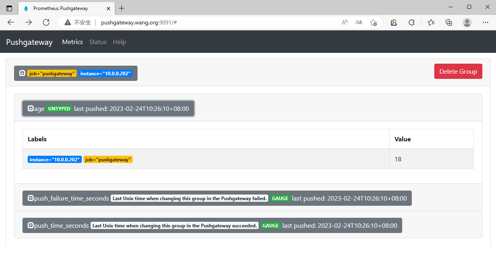

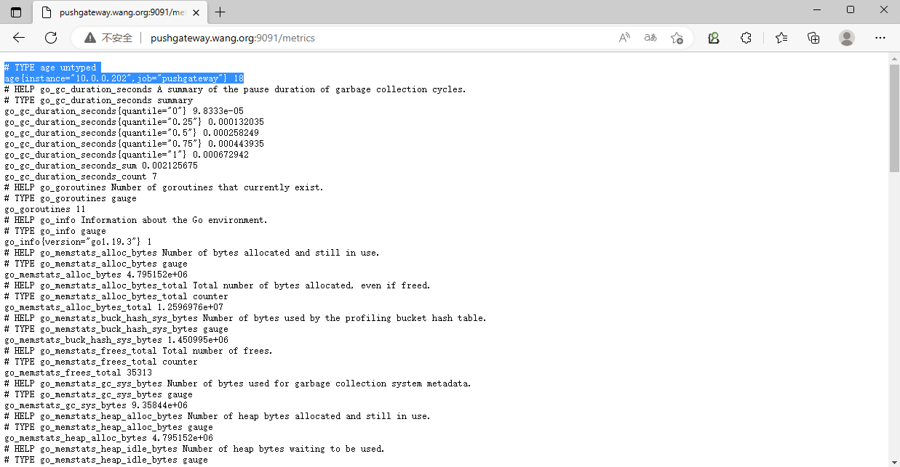

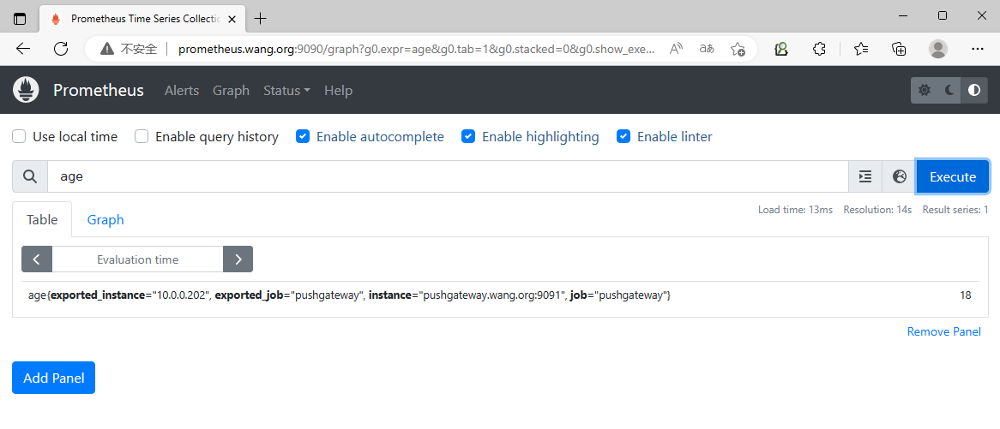

范例: 通用脚本
```bash
#编写自定义的metric的脚本
[root@ubuntu2004 ~]#vim pushgateway_metric.sh
#!/bin/bash
#
#FileName:          pushgateway_metric.sh
#Description:       The test script
METRIC_NAME=login_number
METRIC_VALUE_CMD="who | wc -l"
METRIC_TYPE=gauge
METRIC_HELP="login use number"
#METRIC_NAME=mem_free
#METRIC_VALUE_CMD="free -b  | awk 'NR==2{print \$4}'"
#METRIC_TYPE=gauge
#METRIC_HELP="free memory"
PUSHGATEWAY_HOST=pushgateway.bowen.org:9091
EXPORTED_JOB=pushgateway_job
INSTANCE=`hostname -I|awk '{print $1}'`
SLEEP_TIME=1
CURL_URL="curl --data-binary @-
http://${PUSHGATEWAY_HOST}/metrics/job/${EXPORTED_JOB}/instance/${INSTANCE}"
push_metric()  {
    while true ;do
         VALUE=`eval "$METRIC_VALUE_CMD"`
         cat  <<EOF |  $CURL_URL
# HELP ${METRIC_NAME} ${METRIC_HELP}
# TYPE ${METRIC_NAME} ${METRIC_TYPE}
${METRIC_NAME} ${VALUE}
EOF
         sleep $SLEEP_TIME
    done
}
push_metric
[root@ubuntu2004 ~]#bash pushgateway_metric.sh
```

### 2.7.5 验证数据

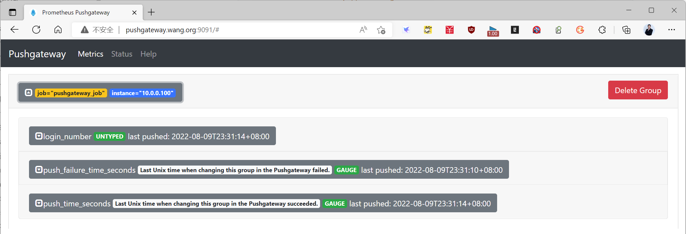

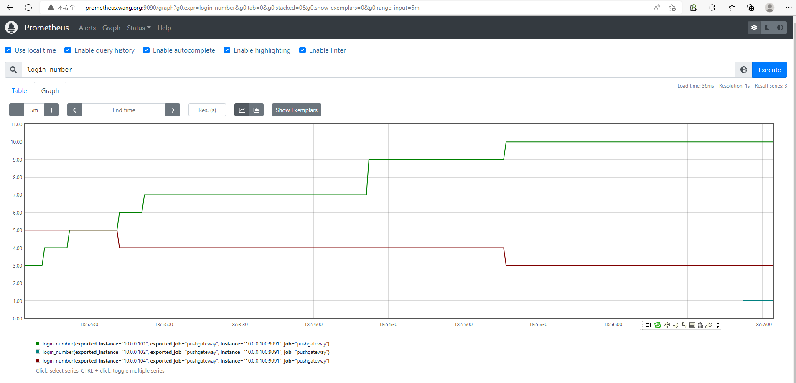

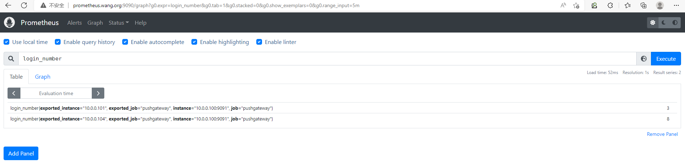

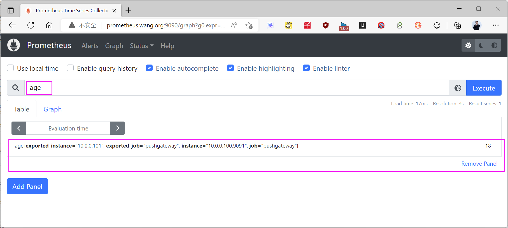

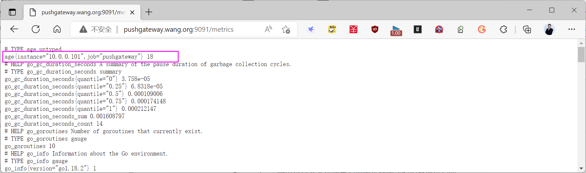



<nav class="article-end" aria-label="章节导航">
  <a href="{{ '/subjects/Prometheus/05-zookeeper-monitoring.html' | relative_url }}">← 上一章：Zookeeper 监控</a>
  <a href="{{ '/subjects/Prometheus/' | relative_url }}">返回 Prometheus 目录</a>
  <a href="{{ '/subjects/Prometheus/07-promql-foundations.html' | relative_url }}">下一章：PromQL 指标与基础 →</a>
</nav>
