[← 返回 Prometheus 目录]({{ '/subjects/Prometheus/' | relative_url }})



# 06 Pushgateway 与短时任务指标

Prometheus 通常主动抓取一直在线的目标。短时批处理任务可能在两次抓取之间启动又退出，Prometheus 来不及访问它的指标端点。Pushgateway 为此提供中转：**任务把结果推给 Pushgateway，Prometheus 再抓取 Pushgateway**。它不是让 Prometheus 改为直接接收推送，也不是所有自定义指标的默认入口；长期运行的服务更适合直接暴露 `/metrics` 或使用 Exporter。

```text
短时任务 ──推送──> Pushgateway ──被抓取──> Prometheus ──查询──> Grafana/告警
```

## 使用前先理解生命周期

Pushgateway 按分组键保存最近一次推送的指标，**任务退出后数据不会自动消失**。这使得“昨晚备份耗时”仍可被抓取，但也会让已停用任务的旧值长期留存。部署时应同时设计：谁负责推送、何时删除不再需要的分组，以及如何观察 `push_time_seconds` 是否过旧。

另一个重要限制是：Prometheus 的 `up` 只能说明**Pushgateway 抓取是否成功**，不能证明上游批处理任务刚刚成功运行。需要通过任务自己的成功指标、完成时间或推送时间判断任务状态。高频运行的应用不应每秒用脚本推送动态指标；这会增加网关负担，也不解决正常的服务发现和实例健康问题。

## 部署 Pushgateway

可从 [Prometheus 下载页](https://prometheus.io/download/) 获取与平台匹配的二进制文件；原资料中的 v1.4.3 只是历史示例，部署时应选择经过验证的版本。下面用容器演示，持久化文件可在网关重启后恢复已推送数据。9091 默认没有适合公网直接暴露的访问控制，应限制网络入口并按实际环境配置认证与 TLS。

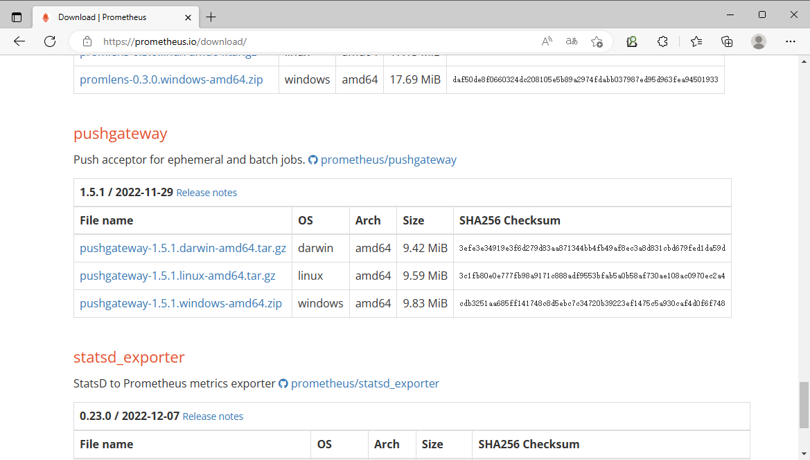

```bash
docker volume create pushgateway_data
docker run -d --name pushgateway --restart unless-stopped \
  -p 9091:9091 \
  -v pushgateway_data:/data \
  prom/pushgateway:<版本> \
  --persistence.file=/data/metrics
curl http://127.0.0.1:9091/metrics
```

如果选择 systemd 安装，则让服务以非特权用户运行，并把持久化路径放在该用户可写目录。二进制部署、容器部署和 Ansible 角色是替代方案，不需要混用。

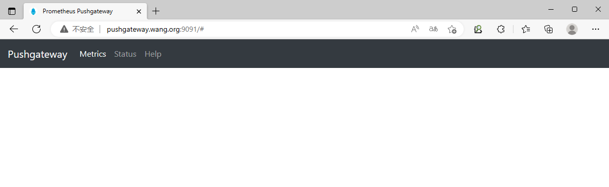

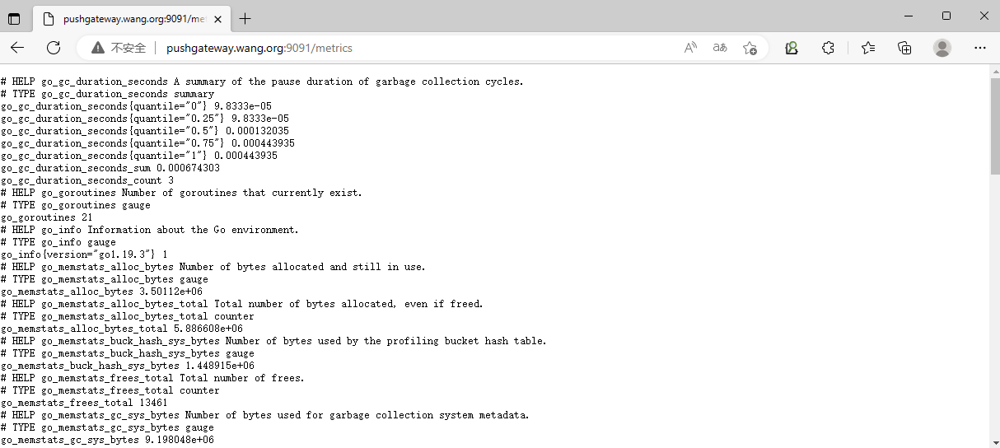

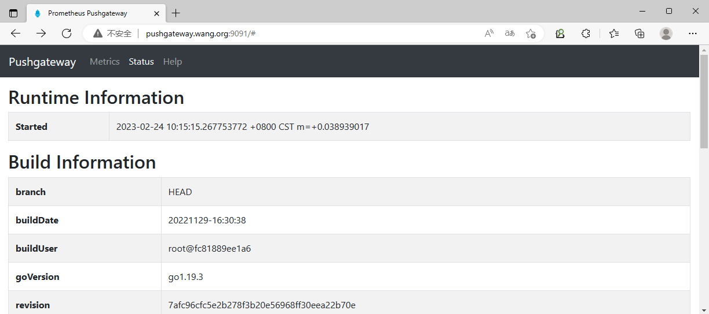

## 让 Prometheus 抓取网关

把下列 job 合并进现有 `prometheus.yml` 的 `scrape_configs`。目标地址必须从 Prometheus 所在环境可达。对 Pushgateway 通常设置 `honor_labels: true`，以保留推送时分组键里的 `job` 和 `instance`；不设置时，Prometheus 的抓取标签可能覆盖同名标签，把原值改记为 `exported_job`、`exported_instance`。

```yaml
scrape_configs:
  - job_name: pushgateway
    honor_labels: true
    static_configs:
      - targets: ['pushgateway.example.local:9091']
```

配置后先运行 `promtool check config /path/to/prometheus.yml`，再按当前 Prometheus 服务的方式重载。若采用文件服务发现，目标文件也应是合法 JSON，地址端口使用半角冒号；原资料中的全角 `：9091` 不能被当作有效目标。

## 推送一个完整的任务结果

分组键位于 URL 中，例如 `/metrics/job/nightly_backup/instance/db-1`；每一个不同的分组键对应一组独立指标。下面示例演示一次任务完成后推送耗时，而不是无限循环发送。使用 `PUT` 会替换该分组中此前保存的指标集，便于避免旧指标残留；`POST` 则用于追加或更新部分指标。

```bash
printf '# HELP batch_duration_seconds 最近一次批处理耗时\n# TYPE batch_duration_seconds gauge\nbatch_duration_seconds 12.4\n' |
  curl --fail --show-error --data-binary @- -X PUT \
    http://pushgateway.example.local:9091/metrics/job/nightly_backup/instance/db-1
```

实际脚本应在任务完成后由程序计算耗时，并根据成功/失败状态推送相应指标。不要把 `hostname -I` 的完整输出直接放进 URL：它可能包含多个地址和空格，产生意外分组。需要主机维度时，使用稳定、明确的实例名；也不要把每次运行的唯一 ID 作为标签，避免分组与序列无限增长。

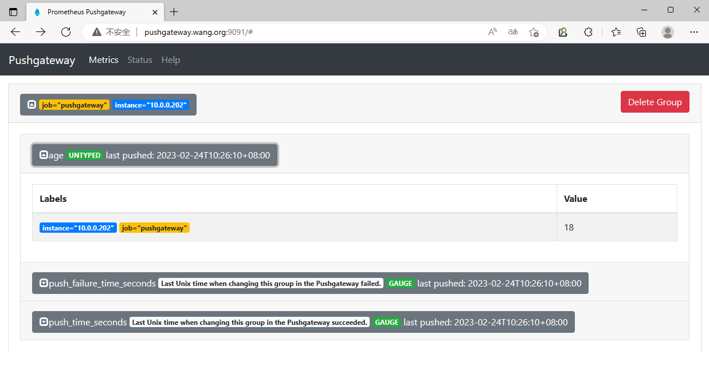

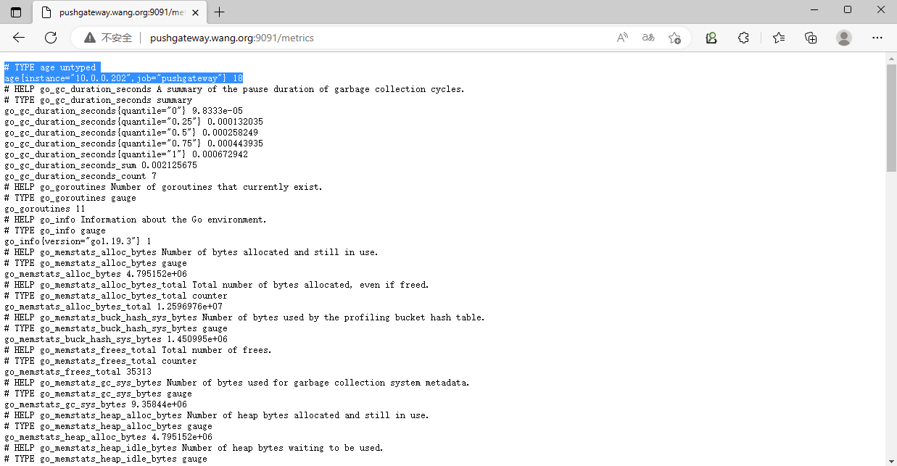

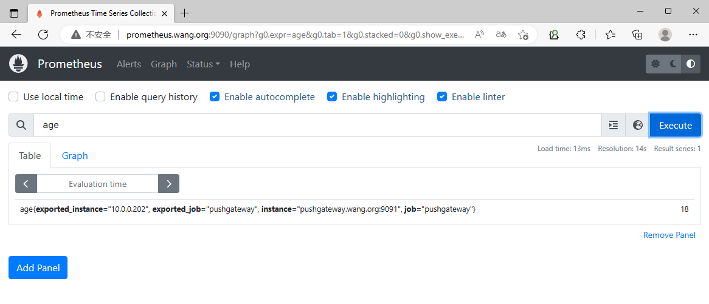

## 验证、过期判断与清理

验证分三层：先在 Pushgateway 的 `/metrics` 看 `batch_duration_seconds`，再在 Prometheus Targets 页确认网关为 UP，最后查询 `batch_duration_seconds{job="nightly_backup"}`。若任务不再推送，旧耗时仍会留在网关；查询 `time() - push_time_seconds{job="nightly_backup"}` 可判断距离上次推送过去多久，再据任务预期周期设置告警。

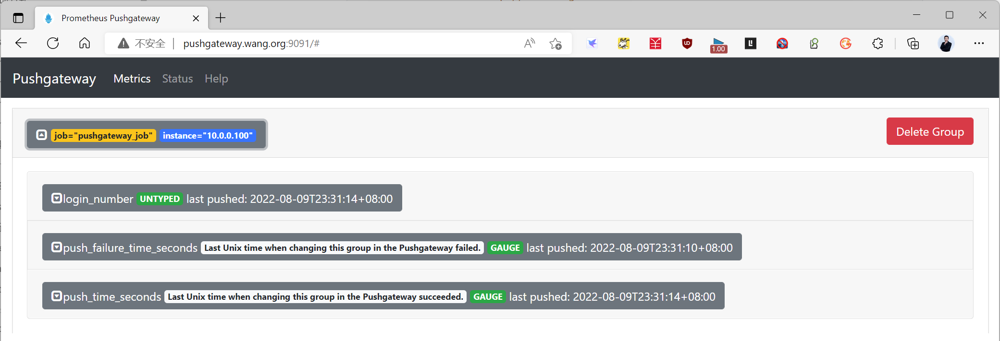

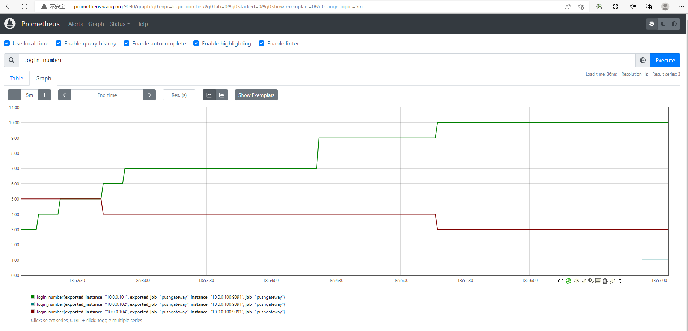

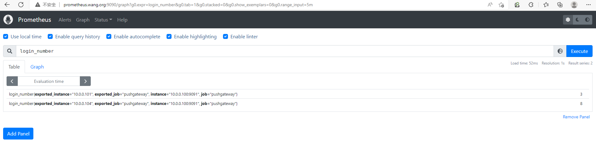

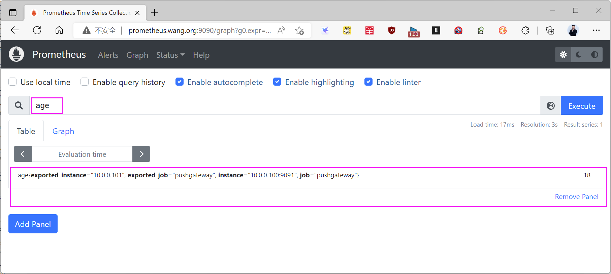

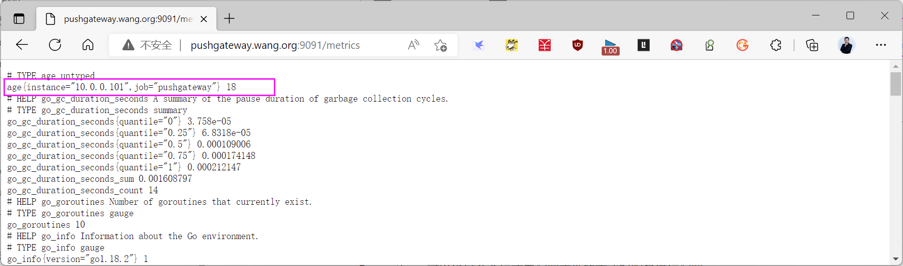

任务退役后，按**完整分组键**删除对应数据；删除 `job=nightly_backup` 不会同时删除其 `instance=db-1` 子分组。清空所有分组的管理 API 影响整个网关，不适合日常脚本调用。

```bash
curl --fail --show-error -X DELETE \
  http://pushgateway.example.local:9091/metrics/job/nightly_backup/instance/db-1
```



<nav class="article-end" aria-label="章节导航">
  <a href="{{ '/subjects/Prometheus/05-zookeeper-monitoring.html' | relative_url }}">← 上一章：ZooKeeper 监控</a>
  <a href="{{ '/subjects/Prometheus/' | relative_url }}">返回 Prometheus 目录</a>
  <a href="{{ '/subjects/Prometheus/07-promql-foundations.html' | relative_url }}">下一章：PromQL 指标与基础 →</a>
</nav>
