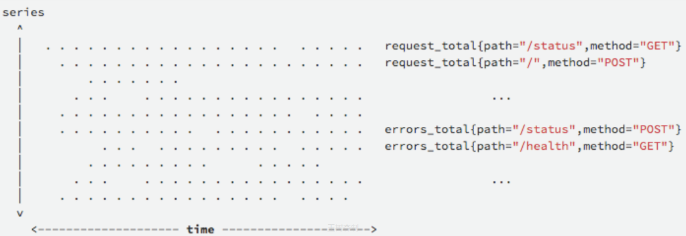
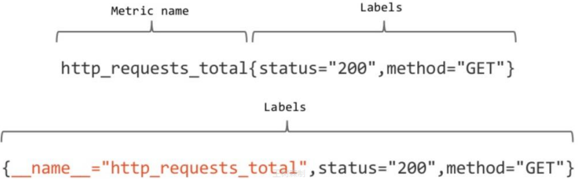
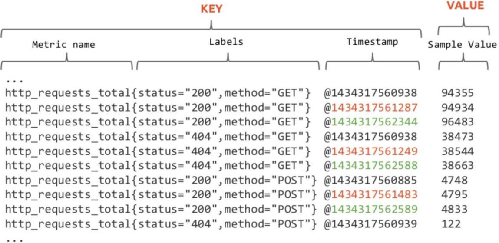
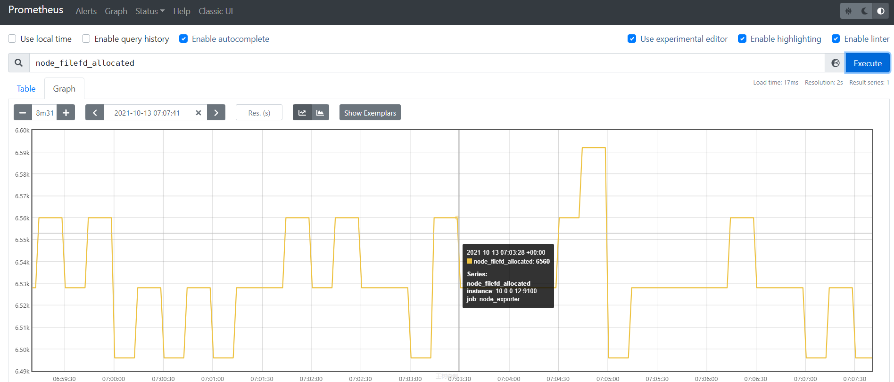
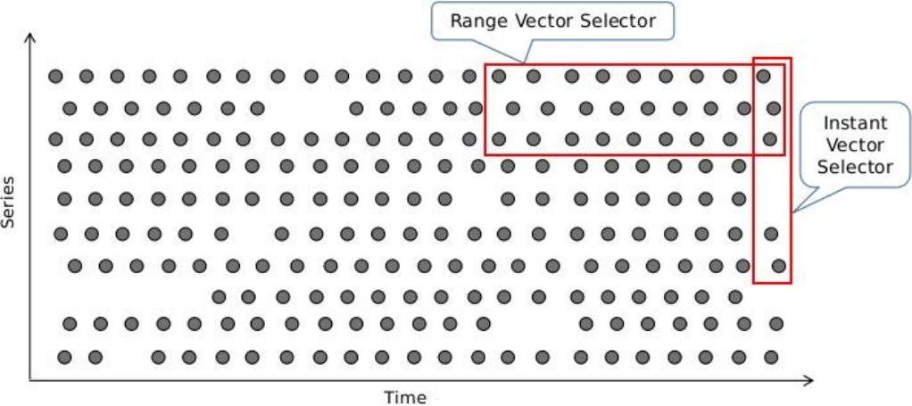
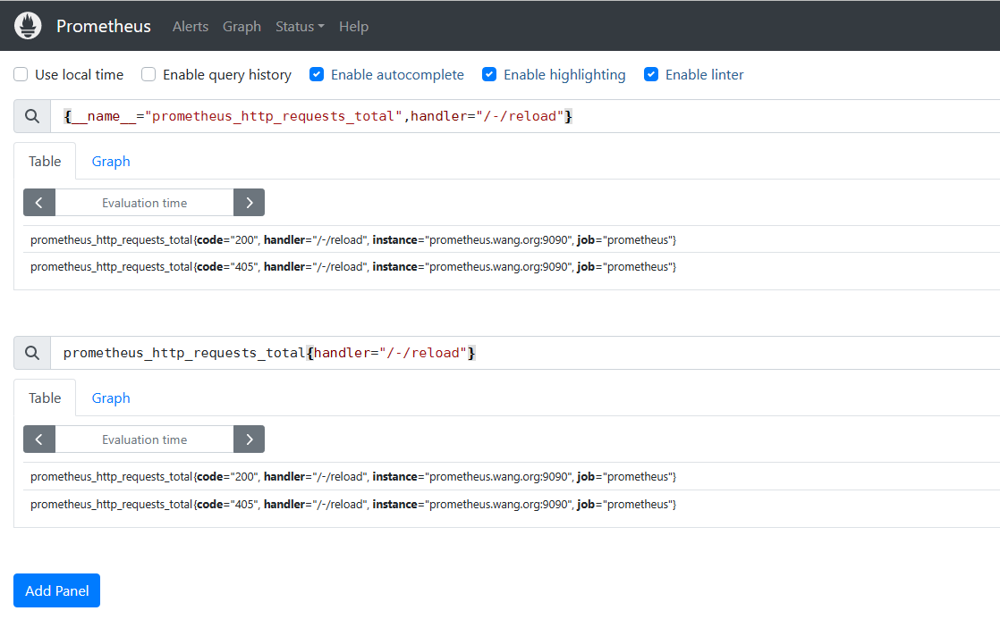
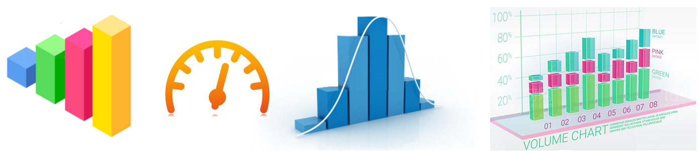
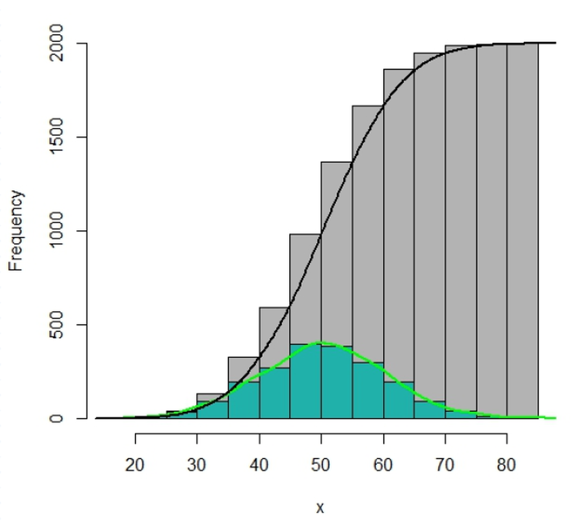

[← 返回 Prometheus 目录]({{ '/subjects/Prometheus/' | relative_url }})



# 07 PromQL 数据模型与查询基础

PromQL 用来选择时间序列，并对样本做运算。学习顺序应是：**先认清序列与样本 → 写选择器 → 区分即时向量与范围向量 → 根据指标类型选择函数**。原资料把数学中的几何向量、时间序列和 PromQL 向量混在一起，容易造成误解；PromQL 的“向量”在这里是**一组带标签的样本**，并不是有方向的箭头。

## 序列、样本与标签

一条序列由指标名和完整标签集合标识。例如 `http_requests_total{job="api",method="GET"}` 与 `http_requests_total{job="api",method="POST"}` 是两条不同序列。每次抓取会为序列增加一个带时间戳的样本；改变标签值，就会创建新序列。标签应表达可枚举、相对稳定的维度，不应放无限变化的请求 ID 或用户 ID。







Prometheus 样本包含时间戳和数值。经典场景以浮点样本为主，当前版本还支持原生直方图样本；原资料“值只能是 float64”不宜当成全部数据类型的绝对规则。指标名通常使用字母、数字、下划线与冒号，且不能以数字开头；标签名以 `__` 开头的部分留给内部使用。

## 查询结果的四种类型

PromQL 表达式结果可为即时向量、范围向量、标量或字符串：

| 类型 | 含义 | 示例 |
| --- | --- | --- |
| 即时向量 | 每条匹配序列在评估时刻的一个样本 | `up{job="api"}` |
| 范围向量 | 每条匹配序列在时间窗口内的一组样本 | `http_requests_total[5m]` |
| 标量 | 一个数值 | `5` |
| 字符串 | 一个字符串；实际查询中很少单独使用 | `"example"` |

“即时”指**查询评估时间点附近的最新有效样本**，不等于 Prometheus 恰好在这一瞬间抓取了所有目标。图表范围查询需要表达式在每个步长评估后给出即时向量或标量；`rate()` 等函数则先接收范围向量再产生可绘图的即时结果。



## 先用选择器圈定目标

```promql
up
up{job="api"}
http_requests_total{job="api",method="GET"}
{__name__=~"http_requests_.*",job="api"}
```

花括号中的标签匹配器支持 `=`、`!=`、`=~`、`!~`。正则匹配针对**整个标签值**，想找包含 `api` 的路径，应写成 `handler=~".*api.*"`。多个条件用逗号连接，表示同时满足。只写标签选择器而不写指标名时，至少需要一个不匹配空字符串的条件；`{job=~".*"}` 这样的过宽选择器无效或风险很高。

```promql
http_requests_total{method=~"GET|POST",job!="test"}
http_requests_total{handler=~".*api.*"}
```

标签不存在与标签值为空在某些匹配情形下会一起匹配，不能把 `label=""` 简单理解为“仅空字符串”。先用结果表格核对实际序列，再设计过滤条件。





## 时间窗口和 offset

在选择器后加 `[5m]` 得到最近五分钟的范围向量；`offset 1d` 把评估基点移到一天前。二者组合时，`http_requests_total[5m] offset 1d` 表示“相对于昨天此时，向前五分钟的样本”，不是“今天过去一天中的最后五分钟”。

```promql
http_requests_total{job="api"}[5m]
http_requests_total{job="api"} offset 1d
http_requests_total{job="api"}[5m] offset 1d
rate(http_requests_total{job="api"}[5m])
```

范围向量本身不适合直接作为普通折线图的最终结果，通常先交给 `rate`、`increase`、`avg_over_time` 等函数。不同目标的实际抓取时间可能不完全对齐，PromQL 会按查询语义处理，不能把多序列每个点想成物理上同一纳秒采到的值。

## 按指标类型选函数

Prometheus 常见四类指标，采集端通过 `# TYPE` 声明其语义：

| 类型 | 适合表示 | 常用处理 |
| --- | --- | --- |
| Counter | 请求总数、错误总数等累计量；进程重启可能归零 | `rate(counter[5m])`、`increase(counter[1h])` |
| Gauge | 当前内存、温度、队列长度等可升可降的值 | `avg_over_time`、`max_over_time`、聚合 |
| Histogram | 请求耗时等值的分布，按累计桶计数 | `histogram_quantile`、`_sum / _count` |
| Summary | 客户端计算的分位数及样本总和/数量 | 查询已有分位数，`_sum / _count` |



Counter 的原始总数通常不如变化速率有用；`rate` 使用整个窗口的样本，适合趋势与告警，`irate` 只看最后两个样本，适合观察短时尖峰，但不等于“更准确”。Gauge 可以直接查询当前值，也可用 `delta(gauge[2h])` 看窗口内变化，不该把 Counter 用 `delta` 当速率。

### Histogram 与 Summary 的关键区别

经典 Histogram 暴露 `<name>_bucket{le="上界"}`、`<name>_sum` 和 `<name>_count`。桶是**累积**的：`le="1"` 包含所有不超过 1 的观测值。求多个实例的 95 分位数时，应先按 `le` 汇总桶的速率，再求分位数：

```promql
histogram_quantile(
  0.95,
  sum by (le) (rate(http_request_duration_seconds_bucket[5m]))
)
```

分位数是依据桶边界估算的，精度由桶划分决定。经典 Summary 的 `quantile` 值在客户端计算，可直接查询，但**不能把各实例的分位数简单平均得到总体分位数**。两者的 `_sum`、`_count` 可用于求平均值：

```promql
sum(rate(http_request_duration_seconds_sum[5m]))
/
sum(rate(http_request_duration_seconds_count[5m]))
```



这一章先让选择器与指标类型建立对应关系；下一章再系统处理算术、比较、集合运算和向量匹配。练习时从 `up`、`node_memory_MemAvailable_bytes` 和一个 Counter 开始，在表达式页逐步加标签过滤和时间窗口，比直接复制长表达式更容易看出每一步的结果类型。



<nav class="article-end" aria-label="章节导航">
  <a href="{{ '/subjects/Prometheus/06-pushgateway.html' | relative_url }}">← 上一章：Pushgateway 与短时任务指标</a>
  <a href="{{ '/subjects/Prometheus/' | relative_url }}">返回 Prometheus 目录</a>
  <a href="{{ '/subjects/Prometheus/08-promql-operators.html' | relative_url }}">下一章：PromQL 运算符与函数 →</a>
</nav>
