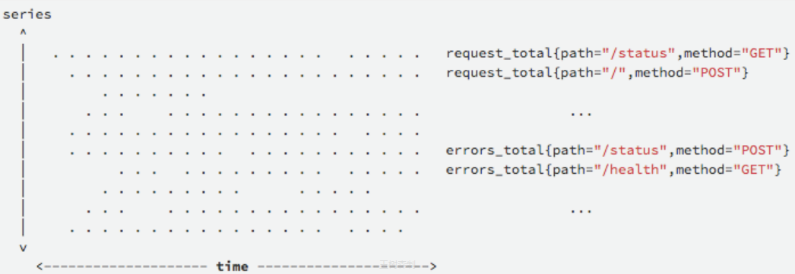
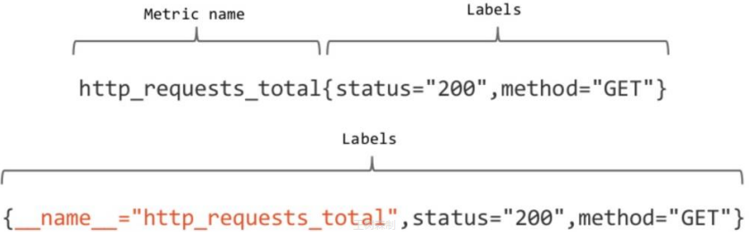
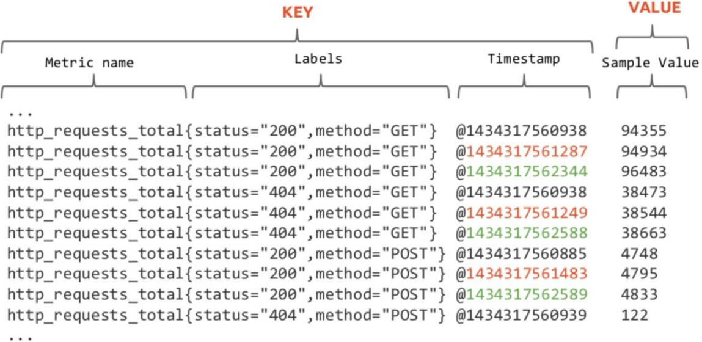
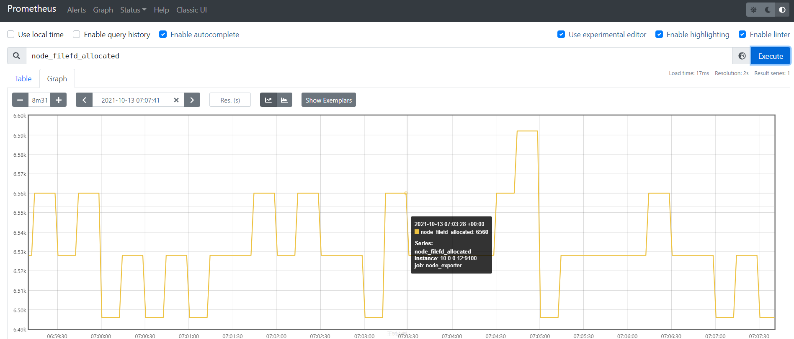
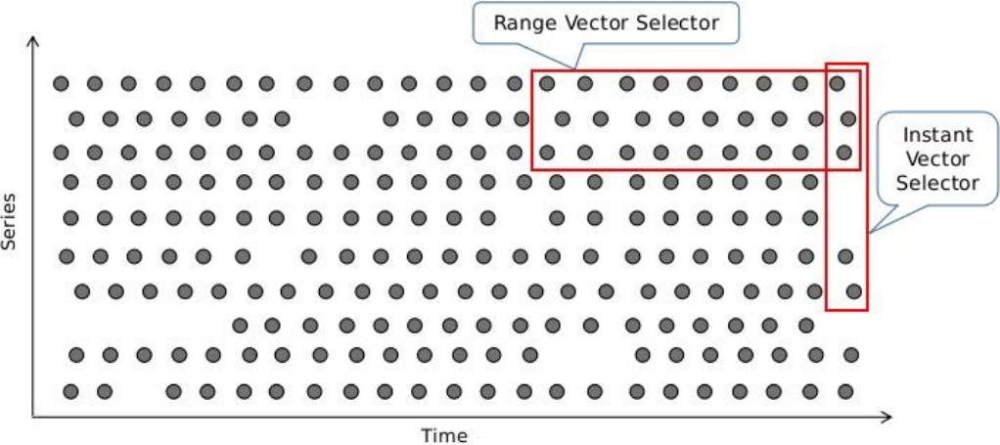
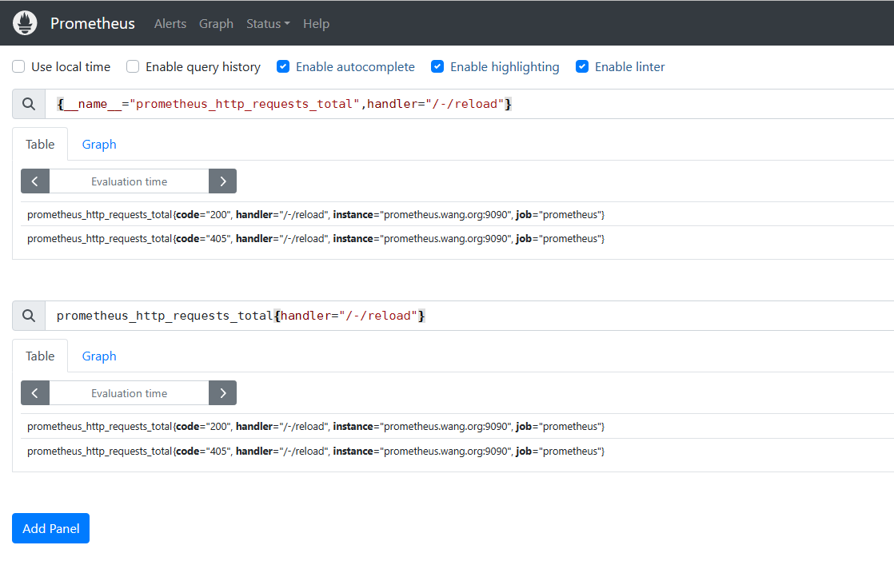
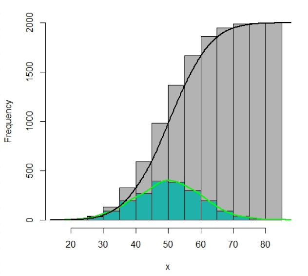

[← 返回 Prometheus 目录]({{ '/subjects/Prometheus/' | relative_url }})



# 07 PromQL 指标与基础

# 3 PromQL

## 3.1 指标数据

### 3.1.1 数据基础

时间序列数据：

按照时间顺序记录系统、设备状态变化的数据，每个数据称为一个样本
数据采集以特定的时间周期进行，随着时间将这些样本数据记录下来，将生成一个离散的样本数据序列,  
该序列也称为向量（Vector）  
将多个序列放在同一个坐标系内（以时间为横轴，以序列为纵轴），将形成一个由数据点组成的矩阵  


向量（也称为欧几里得向量、几何向量、矢量），指具有大小（magnitude）和方向的量。它可以形象化地表示为
带箭头的线段。箭头所指：代表向量的方向；线段长度：代表向量的大小。与向量对应的量叫做数量（物理学中称标
量），数量（或标量）只有大小，没有方向。

Prometheus基于指标名称（metrics name）以及附属的标签集（labelset）唯一定义一条时间序列

指标名称代表着监控目标上某类可测量属性的基本特征标识
标签则是这个基本特征上再次细分的多个可测量维度  

### 3.1.2 数据模型

Prometheus中，每个时间序列都由指标名称（Metric Name）和标签（Label）来唯一标识

Metric Name的表示方式有下面两种
```text
<metric name>{<label name>=<label value>, …}"
{__name__="metric name",<label name>=<label value>, …} #通常用于Prometheus内部
```



指标名称：
通常用于描述系统上要测定的某个特征  
支持使用字母、数字、下划线和冒号，且必须能匹配RE2规范的正则表达式  
例如：http_requests_total表示接收到的HTTP请求总数  
标签：  

键值型数据，附加在指标名称之上，从而让指标能够支持更多细化的多纬度特征；此为可选项
标签名称可使用字母、数字和下划线，且必须能匹配RE2规范的正则表达式  
注意：以两个下划线 "__" 为前缀的名称为Prometheus系统预留使用  

例如: 下面代表着两个不同的时间序列
```text
http_requests_total{method=GET}
http_requests_total{method=POST}
```

### 3.1.3 样本数据

Prometheus的每个数据样本由两部分组成

key: 包括三部分Metric 名称,Label, Timestamp(毫秒精度的时间戳)
value: float64格式的数据  



PromQL支持基于定义的指标维度进行过滤，统计和聚合

指标名称和标签的特定组合代表着一个时间序列

不同的指标名称代表着不同的时间序列
指标名称相同，但标签不同的组合分别代表着不同的时间序列  
更改任何标签值，包括添加或删除标签，都会创建一个新的时间序列  
应该尽可能地保持标签的稳定性，否则，则很可能创建新的时间序列，更甚者会生成一个动态的数据环  
境，并使得监控的数据源难以跟踪，从而导致建立在该指标之上的图形、告警及记录规则变得无效  

## 3.2 PromQL 基础

### 3.2.1 PromQL 简介

Prometheus 提供一个内置的函数式的表达式语言PromQL(Prometheus Query Language)，可以帮助用户实现实时地查找和聚合时间序列数据。

PromQL表达式计算结果可以在图表中展示，也可以在Prometheus表达式浏览器中以表格形式展示，或者作为数据源, 以HTTP API的方式提供给外部系统使用。

注意：默认情况下，是以当前时间为基准点，来进行数据的获取操作

### 3.2.2 表达式形式

官方文档
https://prometheus.io/docs/prometheus/latest/querying/basics/

每一个PromQL其实都是一个表达式，这些语句表达式或子表达式的计算结果可以为以下四种类型：

instant vector 即时向量,瞬时数据
具有相同时间戳的一组样本值的集合  
在某一时刻，抓取的所有监控项数据。这些度量指标数据放在同一个key中。  

一组时间序列，包含每个时间序列的单个样本，所有时间序列共享相同的时间戳
range vector 范围向量  
指定时间范围内的所有时间戳上的数据指标，即在一个时间段内，抓取的所有监控项数据。  
一组时间序列，其中包含每个时间序列随时间变化的一系列数据点  
scalar 标量  

一个简单的浮点类型数值
string 字符串  
一个简单字符串类型, 当前并没有使用, a simple string value; currently unused  

日常图形展示中用到的数据就是基于上面四种样式组合而成的综合表达式,效果如下



PromQL的查询操需要针对有限个时间序列上的样本数据进行，挑选出目标时间序列是构建表达式时最为关键的一步,然后根据挑选出给定指标名称下的所有时间序列或部分时间序列的即时（当前）样本值或至过去某个时间范围内的样本值。

范例: 利用API查询数据
```bash
#即时数据,指定时间点的数据
[root@ubuntu2204 ~]#date -d @1600000000
2020年 09月 13日 星期日 20:26:40 CST
#查看2020年 09月 13日的数据
[root@prometheus ~]#curl --data 'query=prometheus_http_requests_total' --data
time=1600000000 'http://10.0.0.100:9090/api/v1/query'
#范围数据,指定时间前1分钟的数据
[root@prometheus ~]#curl --data 'query=node_memory_MemFree_bytes{instance=~"10.0.0.
(101|102):9100"}[1m]' --data time=1600000000 'http://10.0.0.100:9090/api/v1/query'
#标量数据,利用scalar()函数将即时数据转换为标量
[root@prometheus ~]#curl --data
'query=scalar(sum(node_memory_MemTotal_bytes{instance=~"10.0.0.(101|102):9100"}))' --
data time=1600000000 'http://10.0.0.100:9090/api/v1/query'
```

基本语法

数值

对于数值来说，主要记住两种类型的数值：字符串和数字。

字符串
```text
#字符串可以用单引号，双引号或反引号指定为文字，如果字符串内的特殊符号想要生效，可以使用反引号。
"this is a string"
'these are unescaped: n  t'
`these are not unescaped: n ' " t`
```

数字
```text
#对于数据值的表示，可以使用我们平常时候的书写方法 "[-](digits)[.(digits)]"
2、2.43、-2.43等
```

### 3.2.3 表达式使用要点

表达式的返回值类型是即时向量、范围向量、标量或字符串4种数据类型其中之一，但是，有些使用场景要求表达式返回值必须满足特定的条件，例如

需要将返回值绘制成图形时,仅支持即时向量类型的数据
对于诸如rate一类的速率函数来说，其要求使用的却又必须是范围向量型的数据  
由于范围向量选择器的返回的是范围向量型数据，它不能用于在浏览器中表达式图形绘制功能，否则，  
表达式浏览器会返回"Error executing query: invalid expressiontype "range vector" for range query,  
must be Scalar or instant Vector"一类的错误  
范围向量选择几乎总是结合速率类的函数rate一同使用  

### 3.2.4 数据选择器

所谓的数据选择器，其实指的是获取实时数据或者历史数据的一种方法

样式：
```text
metrics_name{筛选label=值,...}[<时间范围>] offset <偏移>
```

数据选择器主要以下几种分类：



#### 3.2.4.1 即时向量选择器 Instant Vector Selector

Instant Vector Selector 获取0个，1个或多个时间序列的即时样本值

即时向量选择器由两部分组成

指标名称:用于限定特定指标下的时间序列，即负责过滤指标;可选
匹配器(Matcher) :或称为标签选择器，用于过滤时间序列上的标签;定义在{}之中;可选  
定义即时向量选择器时，以上两个部分应该至少给出一个  

根据数据的精确度，可以有以下几种使用方法：

根据监控项名称获取最新值
仅给定指标名称，或在标签名称上使用了空值的匹配器  
返回给定的指标下的所有时间序列各自的即时样本  
例如：http_requests_total和http_requests_total{}的功能相同，都是用于返回http_requests_total指标下各时间序列的即时样本
```text
     node_filefd_allocated
     prometheus_http_requests_total
```

通过  匹配多个监控项的名称
```text
       __name__
     {__name__="prometheus_http_requests_total"}
     {__name__=~"^prometheus_http_.*"}
```

仅给定匹配器
返回所有符合给定的匹配器的所有时间序列上的即时样本  
注意:这些时间序列可能会有很多的不同的指标名称  
例如：{job=".*", method="get"}  
指标名称和匹配器的组合  
通过 name{key=value,...}样式获取符合条件的数据值  
返回给定的指定下的，且符合给定的标签过滤器的所有时间序列上的即时样本  
例如： http_requests_total{method="get"}  

范例
```text
{__name__="prometheus_http_requests_total",handler="/-/reload"}
prometheus_http_requests_total{handler="/-/reload"}
```



匹配器 Matcher 使用规则

匹配器用于定义标签过滤条件，目前支持如下4种匹配操作符
```text
= #精确匹配
!= #不匹配
=~ #正则匹配,全部匹配，而非包含
!~ #正则不匹配
```

匹配到空标签值的匹配器时，所有未定义该标签的时间序列同样符合条件

例如：

http_requests_total (env="")，则该指标名称上所有未使用该标签env的时间序列或者env的值为空的都符合条件

比如时间序列http_requests_total {method ="get"}

正则表达式将执行完全锚定机制，它需要匹配指定的标签的整个值

例如：

http_requests_total {method =~"^ge"} 是错误的，应该是http_requests_total {method =~"^ge.*"}

多个条件间可以使用逗号","隔开，每个条件内部可以通过多种符号，表示不同含义

如果条件中存在多值，可以使用"|"表示或

比如：env=~"staging|testing|development"

向量选择器至少要包含一个指标名称,或者条件中至少包含一个非空标签值的选择器

例如：不能写成{job=~".*"}和{job=""}

使用__name__做为标签名称，能够对指标名称进行过滤
```text
#示例：
{__name__=~"http_requests_.*"}
#能够匹配所有以"http_requests_"为前缀的所有指标
```

示例
```text
#示例
prometheus_http_requests_total{instance="localhost:9090", job="prometheus"}
prometheus_http_requests_total{handler=~".*meta.*"}
node_memory_MemFree_bytes{instance=~"10.0.0.(101|102):9100"}
#注意：指标 prometheus_http_requests_total 默认情况下，针对的是 localhost:9090 的target，其
他无效
```

#### 3.2.4.2 范围选择器 Range Vector Selector

Range Vector Selector 工作方式与瞬时向量选择器一样，区别在于时间范围长一些

返回0个、1个或多个时间序列上在给定时间范围内的各自的一组样本值

主要是在瞬时选择器多了一个[]格式的时间范围后缀

在[]内部可以采用多个单位表示不同的时间范围，比如s(秒)、m(分)、h(时)、d(日)、w(周)、y(年)

必须使用整数时间单位，且能够将多个不同级别的单位进行串联组合，以时间单位由大到小为顺序

例如：1h30m，但不能使用1.5h
```text
prometheus_http_requests_total{job="prometheus"}[5m]
#属性解析：这表示过去5分钟内的监控数据值，这些数据一般以表格方式展示，而不是列表方式展示
```

注意：

范围向量选择器返回的是一定时间范围内的数据样本，虽然不同时间序列的数据抓取时间点相同，但它
们的时间戳并不会严格对齐  
多个Target上的数据抓取需要分散在抓取时间点前后一定的时间范围内，以均衡Prometheus Server的  
负载  
因而，Prometheus在趋势上准确，但并非绝对精准  

#### 3.2.4.3 偏移修饰符 offset

默认情况下，即时向量选择器和范围向量选择器都以当前时间为基准时间点，而偏移量修改器能够修改该基准

对于某个历史时间段中的数据，需要通过offset时间偏移的方式来进行获取

偏移量修改器的使用方法是紧跟在选择器表达式之后使用"offset"关键字指定

注意：offset与数据选择器是一个整体，不能分割，offset 偏移的是时间基点
```text
prometheus_http_requests_total offset 5m #表示获取以prometheus_http_requests_total为指
标名称的所有时间序列在过去5分钟之时的即时样本
prometheus_http_requests_total{code="200"} offset 5m
#如果既有偏移又有范围,先偏移后再取范围,如[5m] offset 3m 表示取当前时间的3分钟前的5m范围的值
http_requests_total[5m] offset 1d #表示获取距此刻1天时间之前的5分钟之内的所有样本
http_requests_total{handler="/metrics"}[5m] offset 3m
```

### 3.2.5 指标类型

Prometheus客户端库提供了四种核心度量标准类型。

官方说明
```bash
https://prometheus.io/docs/concepts/metric_types/
https://prometheus.io/docs/practices/histograms/
[root@prometheus ~]#curl  -s http://prometheus.bowen.org:9090/metrics |awk
'$2=="TYPE"{type[$NF]++}END{for(i in type){print type[i],i}}'
74 gauge
7 histogram
12 summary
93 counter
[root@prometheus ~]#curl  -s http://node01.bowen.org:9100/metrics |awk  '$2=="TYPE"
{type[$NF]++}END{for(i in type){print type[i],i}}'
47 untyped
199 gauge
1 summary
74 counter
```

说明


类型  解析

counter是一个累加的计数器，代表一个从0开始累积单调递增的计数器，其值只能在重
Counter -  
新启动时增加或重置为零。典型的应用如：用户的访问量,请求的总个数，任务的完成数  
计数器  
量或错误的总数量等。不能使用Counter来表示递减值。但可以重置为0，即重新计数  

Gauge是一种度量标准，只有一个简单的返回值，或者叫瞬时状态，可以代表可以任意
Gauge -计  metric的上下波动的数值。通常用于指定时间的测量值，例如，硬盘剩余空间,当前的内  
量器  存使用量,一个待处理队列中任务的个数等，还用于可能上升和下降的“计数”，例如, 并发  
请求数。  

Histogram统计数据的分布情况。比如最小值，最大值，中间值，还有中位数，75百分
位,90百分位, 95百分位.98百分位,99百分位,和9.9百分位的值(percenties ,代表着近似的  
百分比估算数值  
比如: 每天1000万请中,统计http_response_time不同响应时间的分布情况,响应时间在0-  
0.05s有多少,0.05s到2s有多少,10s以上有多少  
Histogram  
每个存储桶都以"_BucketFuncName{...}" 样式来命名.例如 hist_sum、hist_count等  
- 直方图  
可以基于histogram_quantile()函数对直方图甚至是直方图的聚合来进行各种分析计算。  
比如: 统计考试成绩在0-60分之间有多少,60-80之间有多少个,80-100分之间有多少个  
示例:prometheus_tsdb_compaction_chunk_range_seconds_bucket  
histogram中位数由服务端计算完成，对于分位数的计算而言，Histogram则会消耗更多  
的资源  

和Histogram类似，用于表示一段时间内的数据采样结果,典型的应用如：请求持续时
间，响应大小。它直接存储了分位数(将一个随机变量的概率分布范围分为几个等份的数  
值点，常用的有中位数即二分位数、四分位数、百分位数等)，而不是通过区间来计算。  
类似于直方图，摘要会基于阶段性的采样观察结果进行信息描述。它还提供了观测值的  
Summary  
累计计算、百分位计算等功能，每个摘要的命名与Histogram 类似，例如：  
- 摘要  
summary_sum、summary_count等  
示例: go_gc_duration_seconds  
Sumamry的分位数则是直接在客户端计算完成，对于分位数的计算而言，Summary在  
通过PromQL进行查询时有更好的性能表现  

Counter和Gauge

通常情况不会直接使用Counter总数，而是需要借助于rate、topk、incrcase和irate等函数来生成样本数据的变化状况(增长率)
topk(3, http_requests_total)， #获取该指标下http请求总数排名前3的时间序列
rate(http_requests_total[2h])，#获取2小时内，各时间序列上的http总请求数的增长速率，此为平均值，
无法反映近期的精确情况
irate(http_requests_total[2h]) #高灵敏度函数，用于计算指标的瞬时速率，基于样本范围内的最后两个样
本进行计算，相较于rate函数来说，irate更适用于精准反映出短期时间范围内的变化速率

Gauge用于存储其值可增可减的指标的样本数据，常用于进行求和、取平均值、最小值、最大值等聚合计算

也会经常结合PromQL的predict_linear和delta函数使用

predict_linear(v range-vector, t, scalar)函数可以预测时间序列v在t秒后的值，它通过线性回归的方式来预测样本数据的Gauge变化趋势

delta(v range-vector)函数计算范围向量中每个时间序列元素的第一个值与最后一个值之差，从而展示不同时间点上的样本值的差值
```text
delta(cpu_temp_celsius {host="prometheus.bowen.org"[2h) #返回该服务器上的CPU温度与2小时之前
的差异
```

Histogram

Histogram是一种对数据分布情况的图形表示，由一系列高度不等的长条图(bar)或线段表示,用于展示单个测度的值的分布

它一般用横轴表示某个指标维度的数据取值区间，用纵轴表示样本统计的频率或频数,从而能够以二维图的形式展现数值的分布状况

为了构建Histogram，首先需要将值的范围进行分段，即将所有值的整个可用范围分成一系列连续、相邻（相邻处可以是等同值)但不重叠的间隔，而后统计每个间隔中有多少值

从统计学的角度看,分位数不能被聚合,也不能进行算术运算

Histogram会在一段时间范围内对数据进行采样(通常是请求持续时长或响应大小等)，并将其计入可配置的bucket（存储桶)中

Histogram事先将特定测度可能的取值范围分隔为多个样本空间，并通过对落入bucket内的观测值进行计数以及求和操作

与常规方式略有不同的是，Prometheus取值间隔的划分采用的是累积(Cumulative)区间间隔机制，即每个bucket中的样本均包含了其前面所有bucket中的样本，因而也称为累积直方图

可降低Histogram的维护成本
支持粗略计算样本值的分位数  
单独提供了sum和count指标，从而支持计算平均值  



Histogram类型的每个指标有一个基础指标名称，它会提供多个时间序列:
```text
<basename>_bucket{le="<upper inclusive bound>"} #观测桶的上边界（upper inclusivebound)，
即样本统计区间，最大区间(包含所有样本)的名称为 basename_bucket{le="+Inf}
<basename>_sum   #所有样本观测值的总和
<basename>_count #总的采样观测的次数，即样本数，它自身本质上是一个Counter类型的指标
```

累积间隔机制生成的样本数据需要额外使用内置的histogram_quantile()函数即可根据Histogram指标来计算相应的分位数(quantile)，即某个bucket的样本数在所有样本数中占据的比例

histogram_quantile()函数在计算分位数时会假定每个区间内的样本满足线性分布状态，因而它的结果仅是一个预估值,并不完全准确

预估的准确度取决于bucket区间划分的粒度;粒度越大,准确度越低;

Summary

Summary指标类型是客户端库的特性，而Histogram在客户端仅是简单的桶划分和分桶计数，分位数计算由Prometheus Server基于样本数据进行估算，因而其结果未必准确,甚至不合理的bucket划分会导致较大的误差

Summary是一种类似于Histogram的指标类型,但它在客户端于一段时间内（默认为10分钟）的每个采样点进行统计，计算并存储了分位数数值，Server端直接抓取相应值即可

但Summary不支持sum或avg一类的聚合运算,而且其分位数由客户端计算并生成,Server端无法获取客户端未定义的分位数，而Histogram可通过PromQL任意定义，有着较好的灵活性

对于每个指标，Summary以指标名称为前缀,生成如下几个个指标序列
```text
<basename>{quantile="<x>"} #其中x是分位点,其取值范围是(0≤x≤1);计数器类型指标
#如下是几种典型的常用分位点
0、0.25、0.5、0.75、1
0.5、0.9、0.99
0.01、0.05、0.5、0.9和0.99
<basename>_sum   #抓取到的所有样本值之和
<basename>_count #抓取到的所有样本的总数
```

范例: counter
```text
# HELP node_cpu_seconds_total Seconds the CPUs spent in each mode.
# TYPE node_cpu_seconds_total counter
node_cpu_seconds_total{cpu="0",mode="idle"} 28375.49
node_cpu_seconds_total{cpu="0",mode="iowait"} 4.82
node_cpu_seconds_total{cpu="0",mode="irq"} 0
node_cpu_seconds_total{cpu="0",mode="nice"} 0
node_cpu_seconds_total{cpu="0",mode="softirq"} 0.09
node_cpu_seconds_total{cpu="0",mode="steal"} 0
node_cpu_seconds_total{cpu="0",mode="system"} 4.43
node_cpu_seconds_total{cpu="0",mode="user"} 0.36
node_cpu_seconds_total{cpu="1",mode="idle"} 28404.03
node_cpu_seconds_total{cpu="1",mode="iowait"} 0.19
node_cpu_seconds_total{cpu="1",mode="irq"} 0
node_cpu_seconds_total{cpu="1",mode="nice"} 0
node_cpu_seconds_total{cpu="1",mode="softirq"} 0.16
node_cpu_seconds_total{cpu="1",mode="steal"} 0
node_cpu_seconds_total{cpu="1",mode="system"} 5.8
node_cpu_seconds_total{cpu="1",mode="user"} 0.54
```

范例: gauge
```text
# HELP go_info Information about the Go environment.
# TYPE go_info gauge
go_info{version="go1.19.1"} 1
# HELP go_memstats_alloc_bytes Number of bytes allocated and still in use.
# TYPE go_memstats_alloc_bytes gauge
go_memstats_alloc_bytes 2.017896e+06
# HELP node_load1 1m load average.
# TYPE node_load1 gauge
node_load1 0
# HELP node_load15 15m load average.
# TYPE node_load15 gauge
node_load15 0
# HELP node_load5 5m load average.
# TYPE node_load5 gauge
node_load5 0
```

范例:  histogram
```text
# HELP prometheus_tsdb_compaction_chunk_range_seconds Final time range of chunks on
their first compaction
# TYPE prometheus_tsdb_compaction_chunk_range_seconds histogram
prometheus_tsdb_compaction_chunk_range_seconds_bucket{le="100"} 0
prometheus_tsdb_compaction_chunk_range_seconds_bucket{le="400"} 0
prometheus_tsdb_compaction_chunk_range_seconds_bucket{le="1600"} 0
prometheus_tsdb_compaction_chunk_range_seconds_bucket{le="6400"} 0
prometheus_tsdb_compaction_chunk_range_seconds_bucket{le="25600"} 0
prometheus_tsdb_compaction_chunk_range_seconds_bucket{le="102400"} 0
prometheus_tsdb_compaction_chunk_range_seconds_bucket{le="409600"} 0
prometheus_tsdb_compaction_chunk_range_seconds_bucket{le="1.6384e+06"} 0
prometheus_tsdb_compaction_chunk_range_seconds_bucket{le="6.5536e+06"} 6028
prometheus_tsdb_compaction_chunk_range_seconds_bucket{le="2.62144e+07"} 6028
prometheus_tsdb_compaction_chunk_range_seconds_bucket{le="+Inf"} 6028
prometheus_tsdb_compaction_chunk_range_seconds_sum 1.0734846288e+10
prometheus_tsdb_compaction_chunk_range_seconds_count 6028
```

范例: summary
```text
# HELP go_gc_duration_seconds A summary of the pause duration of garbage collection
cycles.
# TYPE go_gc_duration_seconds summary
go_gc_duration_seconds{quantile="0"} 3.4414e-05
go_gc_duration_seconds{quantile="0.25"} 5.0434e-05
go_gc_duration_seconds{quantile="0.5"} 6.5102e-05
go_gc_duration_seconds{quantile="0.75"} 9.2624e-05
go_gc_duration_seconds{quantile="1"} 0.001090964
go_gc_duration_seconds_sum 0.02311494
go_gc_duration_seconds_count 229
# HELP prometheus_target_interval_length_seconds Actual intervals between scrapes.
# TYPE prometheus_target_interval_length_seconds summary
prometheus_target_interval_length_seconds{interval="15s",quantile="0.01"} 14.99677956
prometheus_target_interval_length_seconds{interval="15s",quantile="0.05"} 14.99762873
prometheus_target_interval_length_seconds{interval="15s",quantile="0.5"} 15.000295208
prometheus_target_interval_length_seconds{interval="15s",quantile="0.9"} 15.001409021
prometheus_target_interval_length_seconds{interval="15s",quantile="0.99"}
15.002508223
prometheus_target_interval_length_seconds_sum{interval="15s"} 26565.019555037994
prometheus_target_interval_length_seconds_count{interval="15s"} 1771
```



<nav class="article-end" aria-label="章节导航">
  <a href="{{ '/subjects/Prometheus/06-pushgateway.html' | relative_url }}">← 上一章：Pushgateway 自定义数据</a>
  <a href="{{ '/subjects/Prometheus/' | relative_url }}">返回 Prometheus 目录</a>
  <a href="{{ '/subjects/Prometheus/08-promql-operators.html' | relative_url }}">下一章：PromQL 运算 →</a>
</nav>
