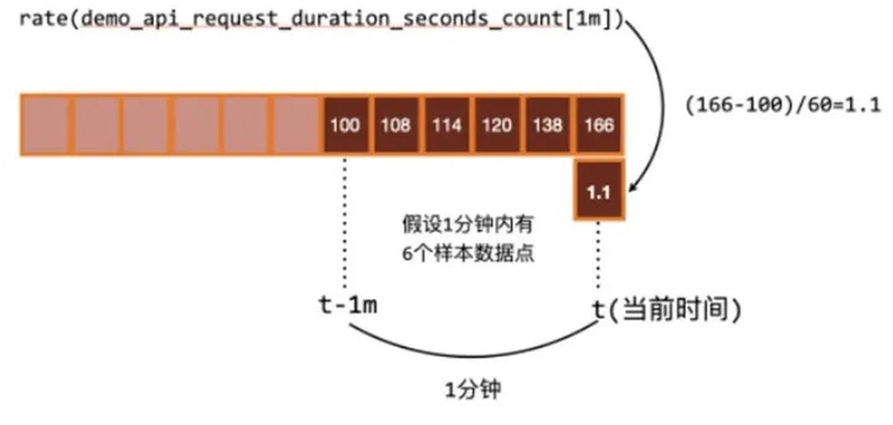
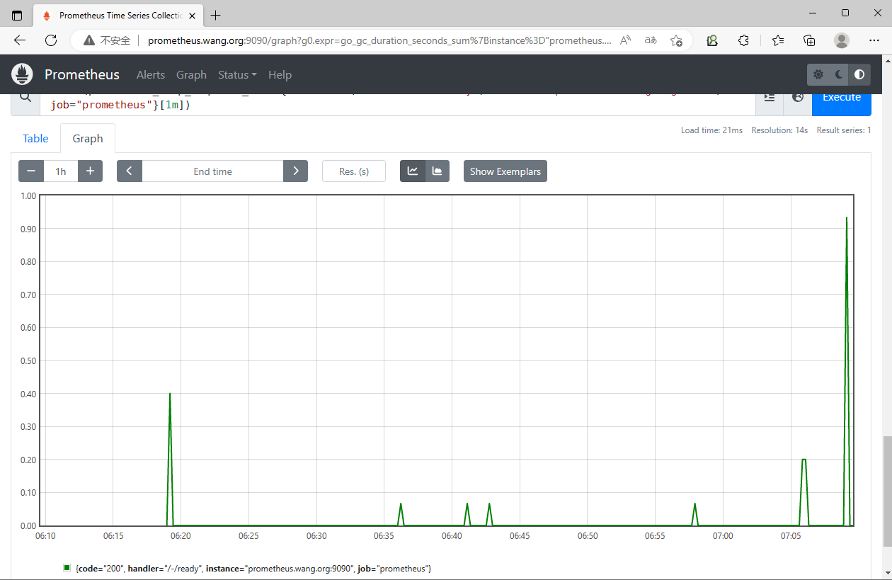

[← 返回 Prometheus 目录]({{ '/subjects/Prometheus/' | relative_url }})



# 08 PromQL 运算符、聚合与函数

上一章会选出时间序列；这一章把查询结果转成可用的比例、速率和统计值。关键不是记住所有函数名，而是先看**表达式两侧是什么类型、标签能否匹配、结果应按哪个维度聚合**。原资料大量长命令被 PDF 换行拆开，而且把 Counter 的 `rate` 简化为“首末差除时间”，会遗漏重置与边界外推；下面按实际查询过程重新组织。

## 算术与比较：先确认标签维度

常见算术运算符为 `+ - * / % ^`。向量与标量运算会把计算作用到向量的各个样本；向量与向量运算只对**匹配的序列**计算。比较运算符 `== != > < >= <=` 默认过滤不满足条件的样本；加 `bool` 后返回 0 或 1，适合明确需要布尔数值的场景。

```promql
node_memory_MemAvailable_bytes / 1024 / 1024
1 - node_memory_MemAvailable_bytes / node_memory_MemTotal_bytes
(1 - node_memory_MemAvailable_bytes / node_memory_MemTotal_bytes) > 0.8
(1 - node_memory_MemAvailable_bytes / node_memory_MemTotal_bytes) > bool 0.8
```

这里分子分母来自同一 `instance`，标签通常可以一对一匹配。内存使用率用 `MemAvailable` 比只用 `MemFree` 更符合“系统可回收内存”的直觉。结果是 0～1 的比率；若面板要显示百分数，可乘 100 或设置百分比单位。括号能避免复杂表达式中的优先级误读。

### 向量匹配与分组修饰符

`on(label)` 表示只按列出的标签匹配，`ignoring(label)` 表示匹配时忽略这些标签。若一侧按 `method,code` 细分，另一侧只有 `method`，就构成多对一匹配，需要 `group_left` 或先聚合，使匹配关系明确。

```promql
method_code:http_errors:rate5m
/
ignoring(code) group_left
method:http_requests:rate5m
```

结果保留左侧的 `method,code`，计算各状态码错误速率占该方法全部请求速率的比例。原资料的具体数值例子中，`GET 500` 为 `24/600=0.04`，`POST 404` 为 `21/120=0.175`；若某个 `method` 在右侧不存在，就不会输出该方法的结果。多对多匹配通常是不明确的，应检查标签或先聚合，而不是盲目添加修饰符。

比较、算术中的向量匹配规则也适用于求错误率。最容易理解的写法是让分子分母**先聚合到同样的标签维度**：

```promql
sum by (job) (rate(http_requests_total{code=~"5.."}[5m]))
/
sum by (job) (rate(http_requests_total[5m]))
```

这比拿一个带 `code` 标签的单序列直接去除以一个只带 `job` 的聚合序列更稳定。

## 集合运算与聚合

`and`、`or`、`unless` 操作的是即时向量的**序列集合**，不是把样本值做布尔运算。它们分别表示交集、并集和左侧排除右侧；需要时也可配合 `on` / `ignoring` 指定匹配标签。例如：

```promql
up{job="node"} unless on(instance) node_memory_MemAvailable_bytes
```

它返回存在 `up` 但没有匹配内存序列的实例，具体含义还需结合抓取状态判断。

聚合运算符包括 `sum`、`avg`、`min`、`max`、`count`、`topk`、`bottomk`、`quantile` 等。`by` 指定保留哪些标签作为分组键，`without` 指定丢弃哪些标签；原有标签维度通常会减少，若随后要做向量除法，需重新核对两侧维度。

```promql
count by (job) (up)
count by (instance) (node_cpu_seconds_total{mode="idle"})
sum by (job) (rate(http_requests_total[5m]))
topk(5, sum by (instance) (rate(http_requests_total[5m])))
```

第一条按 job 数目标序列，第二条按实例数 CPU 核心序列，第三条按 job 求每秒请求量，第四条找请求速率最高的五个实例。`topk` 返回前 K 个序列及其值，不是把它们相加。对于 Counter，通常**先对各原始序列求 `rate`，再聚合**，这样能分别处理各实例的计数器重置。

## 常用函数按问题选择

| 问题 | 表达式形态 | 解释 |
| --- | --- | --- |
| 最近五分钟每秒增加多少？ | `rate(counter[5m])` | 利用窗口样本估计平均速率，考虑计数器重置 |
| 最近一小时增加了多少？ | `increase(counter[1h])` | 估计窗口内总增量 |
| 最近变化尖峰如何？ | `irate(counter[5m])` | 只看窗口内最后两个样本，更敏感但更抖 |
| 当前值是否缺失？ | `absent(metric{...})` | 没有匹配序列时返回结果 |
| 某 Gauge 在窗口内平均多少？ | `avg_over_time(gauge[5m])` | 对窗口内已有样本求平均 |
| 距离上次时间戳多久？ | `time() - timestamp(metric)` | 常用于检查数据是否陈旧 |

`rate` 不是机械的“最后值减第一个值再除以固定 300 秒”；Prometheus 会处理窗口边缘与 Counter 重置。`irate` 用最后两个样本，适合观察短时变化，却容易在告警中产生抖动，告警通常更偏向 `rate`。原资料列出的 `holt_winters` 等函数名称随版本可能发生变化，使用具体函数前应查看所部署版本的 [PromQL 函数文档](https://prometheus.io/docs/prometheus/latest/querying/functions/)。






## 直方图分位数与实用查询

经典 Histogram 的桶是累计计数器，先对每个桶求速率，再保留 `le` 标签汇总，最后估算分位数：

```promql
histogram_quantile(
  0.95,
  sum by (le) (rate(http_request_duration_seconds_bucket[5m]))
)
```

若要分 job 计算，则写成 `sum by (job, le)`，结果才会保留 job。对于 CPU 使用率，可以根据空闲时间计数器计算：

```promql
100 * (1 - avg by (instance) (rate(node_cpu_seconds_total{mode="idle"}[5m])))
```

从这些短查询开始，在 Prometheus 表达式页检查每一步的标签与数值，再逐步组合成面板和告警，比直接复制几百字符、又被换行打断的表达式更可靠。



<nav class="article-end" aria-label="章节导航">
  <a href="{{ '/subjects/Prometheus/07-promql-foundations.html' | relative_url }}">← 上一章：PromQL 数据模型与查询基础</a>
  <a href="{{ '/subjects/Prometheus/' | relative_url }}">返回 Prometheus 目录</a>
  <a href="{{ '/subjects/Prometheus/09-exporter-development-grafana.html' | relative_url }}">下一章：Exporter 开发与 PromQL 可视化 →</a>
</nav>
