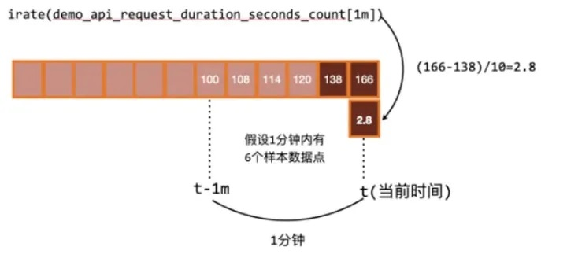
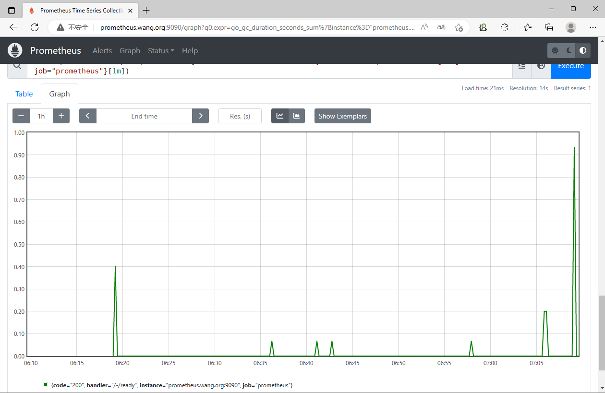

[← 返回 Prometheus 目录]({{ '/subjects/Prometheus/' | relative_url }})



# 08 PromQL 运算

## 3.3 PromQL 运算

对于PromQL来说，它的操作符号主要有以下两类：

二元运算符
聚合运算  

### 3.3.1 二元运算符
https://prometheus.io/docs/prometheus/latest/querying/operators/

二元运算符是prometheus进行数据可视化或者数据分析操作的时候，应用非常多的一种功能

对于二元运算符来说，它主要包含三类：算术、比较、逻辑
```text
#算术运算符：
+ (addition)
- (subtraction)
* (multiplication)
/ (division)
% (modulo)
^ (power/exponentiation)
#比较运算符：
== (equal)
!= (not-equal)
> (greater-than)
< (less-than)
>= (greater-or-equal)
<= (less-or-equal)
#逻辑运算符：
and、or、unless
#目前该运算符仅允许在两个即时向量之间进行操作，不支持标量(标量只有一个数字，没有时序)参与运算
#运算符从高到低的优先级
1 ^
2 *, /, %
3 +, -
4 ==, !=, <=, <, >=, >
5 and, unless
6 or
#注意：
#具有相同优先级的运算符满足结合律（左结合)，但幂运算除外，因为它是右结合机制
#可以使用括号()改变运算次序
```

范例：取GC平均值
```text
go_gc_duration_seconds_sum{instance="prometheus.bowen.org:9090",
job="prometheus"}/go_gc_duration_seconds_count{instance="prometheus.bowen.org:9090",
job="prometheus"}
```

范例：
```text
#正则表达式
node_memory_MemAvailable_bytes{instance =~ "10.0.0.20.:9100"}
node_memory_MemAvailable_bytes{instance =~ "10.0.0.20[12]:9100"}
node_memory_MemAvailable_bytes{instance =~ "10.0.0.20[1-3]:9100"}
node_memory_MemAvailable_bytes{instance =~ "10.0.0.20.*:9100"}
node_memory_MemAvailable_bytes{instance =~ "10.0.0.20[0-9]:9100"}
node_memory_MemAvailable_bytes{instance =~ "10.0.0.20[^01]:9100"}
node_memory_MemAvailable_bytes{instance !~ "10.0.0.20[12]:9100"}
#单位换算
node_memory_MemFree_bytes / (1024 * 1024)
#可用内存占用率
node_memory_MemAvailable_bytes/node_memory_MemTotal_bytes * 100
#内存使用率
(node_memory_MemTotal_bytes - node_memory_MemFree_bytes) / node_memory_MemTotal_bytes
* 100
#磁盘使用率
(node_filesystem_size_bytes{mountpoint="/"} -
node_filesystem_free_bytes{mountpoint="/"})
/node_filesystem_size_bytes{mountpoint="/"} * 100
#阈值判断
(node_memory_MemTotal_bytes - node_memory_MemFree_bytes) / node_memory_MemTotal_bytes
> 0.95
#内存利用率是否超过80
( 1 - node_memory_MemAvailable_bytes/node_memory_MemTotal_bytes ) * 100  > bool 80
#布尔值,当超过1000为1,否则为0
prometheus_http_requests_total > bool 1000
#注意：
对于比较运算符来说，条件成立有结果输出，否则没有结果输出
使用bool运算符后，布尔运算不会对时间序列进行过滤，而是直接依次瞬时向量中的各个样本数据与标量的比较结
果0或者1。从而形成一条新的时间序列。
```

集合处理
```text
#并集 or
node_memory_MemTotal_bytes{instance="10.0.0.104:9100"} or
node_memory_MemFree_bytes{instance="10.0.0.105:9100" }
node_memory_MemTotal_bytes{instance=~"10.0.0.(103|104):9100"}
#交集 and
node_memory_MemTotal_bytes{instance="10.0.0.101:9100"} and
node_memory_MemFree_bytes{instance="10.0.0.104:9100" }
#补集 unless：排除
node_memory_MemTotal_bytes{job="k8s-node"} unless
node_memory_MemTotal_bytes{instance="10.0.0.104:9100"}
#注意：
and、or、unless 主要是针对获取的数据值进行条件选集合用的
and、or、unless 针对的对象是一个完整的表达式
```

向量匹配关健字
```text
#https://prometheus.io/docs/prometheus/latest/querying/operators/#one-to-one-vector-matches
ignoring #定义匹配检测时要忽略的标签
on  #定义匹配检测时只使用的标签
```

组修饰符
```text
#https://prometheus.io/docs/prometheus/latest/querying/operators/#group-modifiers
group_left  #多对一
group_right #一对多
#left和right表示哪一侧为多
```

一对一向量匹配
```text
#https://prometheus.io/docs/prometheus/latest/querying/operators/#one-to-one-vector-matches
<vector expr> <bin-op> ignoring(<label list>) <vector expr>
<vector expr> <bin-op> on(<label list>) <vector expr>
```

多对一和一对多向量匹配
```text
#https://prometheus.io/docs/prometheus/latest/querying/operators/#one-to-one-vector-matches
<vector expr> <bin-op> ignoring(<label list>) group_left(<label list>) <vector expr>
<vector expr> <bin-op> ignoring(<label list>) group_right(<label list>) <vector expr>
<vector expr> <bin-op> on(<label list>) group_left(<label list>) <vector expr>
<vector expr> <bin-op> on(<label list>) group_right(<label list>) <vector expr>
```

范例
```text
#https://prometheus.io/docs/prometheus/latest/querying/operators/#one-to-one-vector-matches
#Example input:
method_code:http_errors:rate5m{method="get", code="500"}  24
method_code:http_errors:rate5m{method="get", code="404"}  30
method_code:http_errors:rate5m{method="put", code="501"}  3
method_code:http_errors:rate5m{method="post", code="500"} 6
method_code:http_errors:rate5m{method="post", code="404"} 21
method:http_requests:rate5m{method="get"}  600
method:http_requests:rate5m{method="del"}  34
method:http_requests:rate5m{method="post"} 120
#一对一
method_code:http_errors:rate5m{code="500"} / ignoring(code)
method:http_requests:rate5m
#这将返回一个结果向量，其中包含每个方法状态代码为 500 的 HTTP 请求的比例（在过去 5 分钟内测量）。
如果没有“ignoring(code) ”不共享同一组标签的指标则不会有匹配，使用“put”和“del”方法的条目没有匹配
项，不会显示在结果中：
{method="get"}  0.04            //  24 / 600
{method="post"} 0.05            //   6 / 120
#一对多
method_code:http_errors:rate5m / ignoring(code) group_left
method:http_requests:rate5m
#在这种情况下，左侧向量包含每个方法标签值多个条目。 因此，我们使用group_left表示。 现在，右侧的元素
与左侧具有相同方法标签的多个元素匹配：
{method="get", code="500"}  0.04            //  24 / 600
{method="get", code="404"}  0.05            //  30 / 600
{method="post", code="500"} 0.05            //   6 / 120
{method="post", code="404"} 0.175           //  21 / 120
```

### 3.3.2 聚合操作

官方文档
https://prometheus.io/docs/prometheus/latest/querying/operators/

一般说来，单个指标的价值不大，监控场景中往往需要联合并可视化一组指标，这种联合机制是指"聚合"操作，例如，将计数、求和、平均值、分位数、标准差及方差等统计函数应用于时间序列的样本之上生成具有统计学意义的结果等

对查询结果事先按照某种分类机制进行分组(groupby）并将查询结果按组进行聚合计算也是较为常见的需求，例如分组统计、分组求平均值、分组求和等

聚合操作由聚合函数也称为聚合操作符针对一组值进行计算并返回单个值或少量值作为结果

聚合操作符aggregation operators虽然是一个个的功能，但是并不属于功能函数，仅仅代表对数据进行简单的功能处理。

常见的11种聚合操作：
sum、min、max、avg、count、count_values(值计数)
stddev(标准差)、stdvar(标准差异)、bottomk(最小取样)、topk(最大取样，即取前几个)、quantile(分布
统计)
sum() #对样本值求和
avg() #对样本值求平均值，这是进行指标数据分析的标准方法
count()#对分组内的时间序列进行数量统计
min()#求取样本值中的最小者
max()#求取样本值中的最大者
topk()#逆序返回分组内的样本值最大的前k个时间序列及其值
bottomk()#顺序返回分组内的样本值最小的前k个时间序列及其值
quantile()#分位数用于评估数据的分布状态，该函数会返回分组内指定的分位数的值，即数值落在小于等于指定
的分位区间的比例
count_values()#对分组内的时间序列的样本值进行数量统计
stddev() #对样本值求标准差，以帮助用户了解数据的波动大小(或称之为波动程度)
stdvar() #对样本值求方差，它是求取标准差过程中的中间状态

格式：
聚合操作符(metric表达式)         sum、min、max、avg、count等
聚合操作符(描述信息，metric)      count_values、bottomk、topk等

可以借助于without和by功能获取数据集中的一部分进行分组统计
```text
#without 表示显示信息的时候，排除此处指定的标签列表，对以外的标签进行分组统计，即：使用除此标签之外
的其它标签进行分组统计
#by表示显示信息的时候，仅显示指定的标签的分组统计，即针对哪些标签分组统计
```

without和by 格式如下
```text
#两种格式：先从所有数据中利用数据选择表达式过滤出部分数据，进行分组后，再进行聚合运算，最终得出来结果
#格式1
聚合操作符(数据选择表达式) without|by (<label list>)
<aggr-op>([parameter,] <vector expression>) [without|by (<label list>)]
#格式2
聚合操作符 without|by (<label list>) (数据选择表达式)
<aggr-op> [without|by (<label list>)] ([parameter,] <vector expression>)
```

示例
```text
#显示系统版本
node_os_version
node_os_version{id="ubuntu", id_like="debian", instance="10.0.0.200:9100",
job="node_exporter", name="Ubuntu"}
22.04
node_os_version{id="ubuntu", id_like="debian", instance="10.0.0.201:9100",
job="node_exporter", name="Ubuntu"}
22.04
node_os_version{id="ubuntu", id_like="debian", instance="10.0.0.202:9100",
job="node_exporter", name="Ubuntu"}
22.04
node_os_version{id="ubuntu", id_like="debian", instance="10.0.0.203:9100",
job="node_exporter", name="Ubuntu"}
22.04
#统计Ubuntu系统主机数
count(node_os_version{id="ubuntu"})
#分别统计不同OS的数量
#按node_os_version返回值value分组统计个数,将不同value加个新标签为os_version
count_values("os_version",node_os_version)
{os_version="22.04"}  4
{os_version="20.04"}  2
#内存总量
sum(node_memory_MemTotal_bytes)
#按instance分组统计内存总量
sum(node_memory_MemTotal_bytes) by (instance)
#确认所有主机的CPU的总个数
count(node_cpu_seconds_total{mode='system'})
#确认每个主机的CPU的总个数
count(node_cpu_seconds_total{mode="system"}) by (instance)
#获取最大的值
max(prometheus_http_requests_total)
#按handler,instance分组统计
max(prometheus_http_requests_total) by (handler,instance)
#分组统计计数
count_values("counts",node_filesystem_size_bytes)
#获取前5个最大值
topk(5, prometheus_http_requests_total)
#获取前5个最小值
bottomk(5, prometheus_http_requests_total)
#对除了instance和job以外的标签分组求和
sum(prometheus_http_requests_total) without (instance,job)
#仅对mode标签进行分组求和
sum(node_cpu_seconds_total) by (mode)
#多个分组统计
count(prometheus_http_requests_total) by (code,instance,job)
#查询handler为/metrics占所有handler的百分比
sum(prometheus_http_requests_total{ handler="/metrics",
instance="localhost:9090"})/sum
(prometheus_http_requests_total{instance="localhost:9090"})
#查出200响应码占全部的百分比
sum(prometheus_http_requests_total{code="200", handler="/-/ready",
instance="localhost:9090"}) / sum (prometheus_http_requests_total{handler="/-/ready",
instance="localhost:9090"})
#下面语句有问题：
/ 前后两部分并不匹配：左侧的查询表达式 prometheus_http_requests_total{code="200",
handler="/-/ready", instance="localhost:9090"} 是一个带有特定标签过滤条件的时间序列。右侧的
表达式 sum (prometheus_http_requests_total{handler="/-/ready",
instance="localhost:9090"}) by (handler,instance) 是一个汇总操作返回的时间序列矩阵（聚合后的
多条时间序列）。
在 PromQL 中，/（除法）操作要求左右两侧的时间序列结构必须兼容，比如必须是相同的标签维度，且数值类型
必须相同。由于左侧是带有过滤条件的单一时间序列，而右侧是按标签聚合的多个时间序列矩阵，这样会导致除法运
算无法匹配。
prometheus_http_requests_total{code="200", handler="/-/ready",
instance="localhost:9090"} / sum (prometheus_http_requests_total{handler="/-/ready",
instance="localhost:9090"}) by (handler,instance)
#查出200响应码占全部的百分比
sum(nginx_http_requests_total{path="/api",method="GET",code="200"})/
sum(nginx_http_requests_total{path="/api",method="GET"})
#以下语句同样有以上问题
nginx_http_requests_total{path="/api",method="GET",code="200"}/ sum
nginx_http_requests_total{path="/api",method="GET"} by (path,method)
```

### 3.3.3 功能函数

官方文档
https://prometheus.io/docs/prometheus/latest/querying/functions/

默认prometheus官方提供功能函数有40个,主要有以下几类

计算相关
绝对值abs()、导数deriv()、指数exp()、对数ln()、二进制对数log2()、10进制对数log10()、平方根
sqrt()
向上取整ceil()、向下取整floor()、四舍五入round()
样本差idelta()、差值delta()、递增值increase()、重置次数resets()
递增率irate()、变化率rate()、平滑值holt_winters()、直方百分位histogram_quantile()
预测值predict_linear()、参数vector()
范围最小值min_over_time()、范围最大值max_over_time()、范围平均值avg_over_time()、范围求和值
sum_over_time()、范围计数值count_over_time()、范围分位数quantile_over_time()、范围标准差
stddev_over_time()、范围标准方差stdvar_over_time()

取样相关
获取样本absent()、升序sort()、降序sort_desc()、变化数changes()
即时数据转换为标量scalar()、判断大clamp_max()、判断小clamp_min()
范围采样值absent_over_time()，

时间相关
```text
day_of_month()、day_of_week()、days_in_month()、hour()、minute()、month()、time()、
timestamp()、year()
```

标签相关
```text
标签合并label_join()、标签替换labelreplace()
```

示例：
```text
ceil()：向上取整
floor():向下取整
round():四舍五入
#示例
ceil(node_load15 * 10)
floor(node_load15 * 10)
round(node_load15 * 10)
increase(): 增长量,即last值-last前一个值
#示例:最近1分钟内CPU处于空闲状态时间
increase(node_cpu_seconds_total{cpu="0",mode="idle"}[1m])
#示例:CPU利用率
(1 - sum(increase(node_cpu_seconds_total{mode="idle"}[1m])) by (instance) /
sum(increase(node_cpu_seconds_total[1m])) by (instance)) * 100
rate():
#平均变化率,计算在指定时间范围内计数器每秒增加量的平均值,即(last值-first值)/时间差的秒数，常用于
counter的数据
#示例:过去一分钟每次磁盘读的变化率
rate(node_disk_read_bytes_total[1m])
#示例:一分钟内网卡传输的字节数(MB)
rate(node_network_transmit_bytes_total{device="eth0"}[1m]) /1024 /1024
#判断在过去5分钟内HTTP请求状态码以"5"开头的请求的速率是否大于所有HTTP请求速率的10%。
rate(http_requests_total{status_code=~"5.*"}[5m]) > rate(http_requests_total[5m])*0.1
#每台主机CPU在5分钟内的平均使用率
(1- avg(irate(node_cpu_seconds_total{mode='idle'}[5m])) by (instance))*100
irate()：查看瞬时变化率,即:(last值-last前一个采样的值)/时间戳差值
#高灵敏度函数，用于计算指标的瞬时速率，常用于counter的数据
#示例:过去一分钟每次磁盘读的瞬时变化率
irate(node_disk_read_bytes_total[1m])
#示例:查看CPU最近5m内最多的增长率
irate(node_cpu_seconds_total{instance="10.0.0.101:9100",mode="idle"}[5m])
#irate和rate都会用于计算某个指标在一定时间间隔内的变化速率。但是它们的计算方法有所不同：irate取的是
在指定时间范围内的最近两个数据点来算速率，而rate会取指定时间范围内所有数据点，算出一组速率，然后取平
均值作为结果。所以官网文档说：irate适合快速变化的计数器（counter），而rate适合缓慢变化的计数器
（counter）。对于快速变化的计数器，如果使用rate，因为使用了平均值，很容易把峰值削平。除非我们把时间
间隔设置得足够小，就能够减弱这种效应。
time(): 获取当前时间值
#示例:计算当前每个主机的运行时间
(time() - node_boot_time_seconds) / 3600
#示例:计算所有主机的总运行时间
sum(time() - node_boot_time_seconds) / 3600
histogram_quantile(): 百分取样值
#示例:计算过去10m内请求持续时间的第90个百分位数
histogram_quantile(0.9, rate(prometheus_http_request_duration_seconds_bucket[10m]))
#absent 有值返回空,无值返回1,可用于告警判断
absent(node_memory_SwapTotal_bytes)
absent(node_memory_SwapTotal_byte)
```

rate 和 irate 函数

都表示变化速率，但有所不同。

rate函数可以用来求指标的平均变化速率
```text
rate函数=时间区间前后两个点的差 / 时间范围
```

一般rate函数可以用来求某个时间区间内的请求速率，也就是我们常说的QPS


但是rate函数只是算出来了某个时间区间内的平均速率，没办法反映突发变化，假设在一分钟的时间区间里，前50秒的请求量都是0到10左右，但是最后10秒的请求量暴增到100以上，这时候算出来的值可能无法很好的反映这个峰值变化。这个问题可以通过irate函数解决

irate函数求出来的就是瞬时变化率
```text
irate函数=时间区间内最后两个样本点的差 / 最后两个样本点的时间差
```



一般情况下，irate函数的图像峰值变化大，rate函数变化较为平缓。

范例：
```text
irate(prometheus_http_requests_total{code="200", handler="/-/ready",
instance="prometheus.bowen.org:9090", job="prometheus"}[1m])
```





<nav class="article-end" aria-label="章节导航">
  <a href="{{ '/subjects/Prometheus/07-promql-foundations.html' | relative_url }}">← 上一章：PromQL 指标与基础</a>
  <a href="{{ '/subjects/Prometheus/' | relative_url }}">返回 Prometheus 目录</a>
  <a href="{{ '/subjects/Prometheus/09-exporter-development-grafana.html' | relative_url }}">下一章：Exporter 开发与 PromQL 可视化 →</a>
</nav>
