[← 返回 Prometheus 目录]({{ '/subjects/Prometheus/' | relative_url }})



# 09 Exporter 开发与 PromQL 可视化

## 3.4 定制开发 Exporter

### 3.4.1 定制 Exporter 说明

Prometheus 监控的指标可以通过下面方式提供

Prometheus 内置
instrumentation 程序仪表: 应用内置的指标功能,比如: Zookeeper,Gitlab,Grafana等  
额外的exporter,使用第三方开发的功能  
Pushgateway 提供  

通过自行编程实现的功能代码,需要开发能力

Prometheus对于监控功能的核心要素就是metric的监控项是否正常工作

Metric 本质就是对应的服务启动后自动生成的一个基于http协议URL地址，通过该地址可以获取想要的监控项。

实际生产环境中，想要监控好多指标，但是prometheus 可能并没有提供相应的metric监控项条目，比如: 某业务指标、转化率等，所以就需要实现自定义的metric条目。

开发应用服务的时候，就需要根据metric的数据格式，定制标准的/metric接口。

各种语言帮助手册：
https://github.com/prometheus/client_golang
https://github.com/prometheus/client_python
https://github.com/prometheus/client_java
https://github.com/prometheus/client_rust

以python项目，可以借助于prometheus_client模块在python类型的web项目中定制metric接口。
```python
https://prometheus.github.io/client_python/instrumenting/exemplars/
Three Step Demo
One: Install the client:
pip install prometheus-client
Two: Paste the following into a Python interpreter:
from prometheus_client import start_http_server, Summary
import random
import time
# Create a metric to track time spent and requests made.
REQUEST_TIME = Summary('request_processing_seconds', 'Time spent processing request')
# Decorate function with metric.
@REQUEST_TIME.time()
def process_request(t):
    """A dummy function that takes some time."""
    time.sleep(t)
if __name__ == '__main__':
    # Start up the server to expose the metrics.
    start_http_server(8000)
    # Generate some requests.
    while True:
         process_request(random.random())
Three: Visit http://localhost:8000/ to view the metrics.
```

### 3.4.2 定制 Exporter 案例: Python 实现

#### 3.4.2.1 准备 Python 开发 Web 环境
```bash
#apt安装 python3
~# apt update && apt install -y python3
#安装Python包管理器，默认没有安装
~# apt update && apt install -y python3-pip
#############################如何不安装虚拟环境下面不需要执行
#################################
#安装虚拟环境软件
~# pip3 install pbr virtualenv
~# pip3 install --no-deps stevedore virtualenvwrapper
#创建用户
~# useradd -m -s /bin/bash python
#准备目录
~# mkdir -p /data/venv
~# chown  python.python /data/venv
#修改配置文件(可选)
~# su - python
~# vim .bashrc
force_color_prompt=yes #取消此行注释,清加颜色显示
#配置加速
~# mkdir ~/.pip
~# vim .pip/pip.conf
[global]
index-url = https://pypi.tuna.tsinghua.edu.cn/simple
[install]
trusted-host=pypi.douban.com
#配置虚拟软件
echo 'export WORKON_HOME=/data/venv' >> .bashrc
echo 'export VIRTUALENVWRAPPER_PYTHON=/usr/bin/python3' >> .bashrc
echo 'export VIRTUALENVWRAPPER_VIRTUALENV=/usr/local/bin/virtualenv' >> .bashrc
echo 'source /usr/local/bin/virtualenvwrapper.sh' >> .bashrc
source .bashrc
#注意：virtualenv 和 virtualenvwrapper.sh 的路径位置
#创建新的虚拟环境并自动进入
~# mkvirtualenv -p python3 flask_env
#进入已创建的虚拟环境
~# su - python
~# workon flask_env
#虚拟环境中安装相关模块库
~# pip install flask prometheus_client
~# pip list
#################################如何不安装虚拟环境上面不需要执行
##########################
#Ubuntu24.04安装
[root@ubuntu2404 ~]#apt install -y python3-flask python3-prometheus-client
#实际环境中安装相关模块库
~# pip3 config set global.index-url https://pypi.tuna.tsinghua.edu.cn/simple
~# cat /root/.config/pip/pip.conf
[global]
index-url = https://pypi.tuna.tsinghua.edu.cn/simple
#Ubuntu22.04之前版本安装
~# pip3 install flask prometheus_client
~# pip3 list
#创建代码目录
~# mkdir -p /data/code
```

#### 3.4.2.2 项目代码

代码说明
```python
from prometheus_client import Counter, Gauge, Summary
from prometheus_client.core import CollectorRegistry
class Monitor:
    def __init__(self):
    # 注册收集器
    self.collector_registry = CollectorRegistry(auto_describe=False)
    # summary类型监控项设计
    self.summary_metric_name = Summary(name="summary_metric_name",
                        documentation="summary_metric_desc",
                        labelnames=("label1", "label2", "label3"),
                        registry=self.collector_registry)
    # gauge类型监控项设计
    self.gauge_metric_name = Gauge(name="gauge_metric_name",
                        documentation="summary_gauge_desc",
                        labelnames=("method", "code", "uri"),
                        registry=self.collector_registry)
    # counter类型监控项设计
    self.counter_metric_name = Counter(name="counter_metric_name",
                        documentation="summary_counter_desc",
                        labelnames=("method", "code", "uri"),
                        registry=self.collector_registry)
#属性解析：上面是几个常用的标准metric数据格式设计，
```

范例: 定制 flask web 项目
```python
]# su - python
]# workon flask_env
]# cat ~/code/flask_metric.py
#!/usr/bin/python3
from prometheus_client import start_http_server,Counter, Summary
from flask import Flask, jsonify
from wsgiref.simple_server import make_server
import time
app = Flask(__name__)
# Create a metric to track time spent and requests made
REQUEST_TIME = Summary('request_processing_seconds', 'Time spent processing request')
COUNTER_TIME  = Counter("request_count", "Total request count of the host")
@app.route("/metrics")
@REQUEST_TIME.time()
def requests_count():
    COUNTER_TIME.inc()
    return jsonify({"return": "success OK!"})
if __name__ == "__main__":
    start_http_server(8000)
    httpd = make_server( '0.0.0.0', 8001, app )
    httpd.serve_forever()
#代码解析：
.inc() 表示递增值为 1
start_http_server(8000)             #用于提供数据收集的端口 Prometheus可以通过此端口8000
的/metrics 收集指标
make_server( '0.0.0.0', 8001, app ) #表示另开启一个web服务的/metrics 链接专门用于接收访问请
求并生成对应的指标数据
#启动项目:
]# python flask_meric.py
#浏览器访问 10.0.0.101:8000/metrics 可以看到大量的监控项，下面的几项就是自己定制的
...
# HELP request_processing_seconds Time spent processing request
# TYPE request_processing_seconds summary
request_processing_seconds_count 0.0
request_processing_seconds_sum 0.0
# TYPE request_processing_seconds_created gauge
request_processing_seconds_created 1.5851566329768722e+09
# HELP request_count_total Total request count of the host
# TYPE request_count_total counter
request_count_total 0.0
# TYPE request_count_created gauge
request_count_created 1.5851566329769313e+09
```

当每访问一次链接http://10.0.0.101:8001/metrics时，10.0.0.101:8000/metrics的request_count_toal值就会增加1
```bash
#如果希望持续性的进行接口访问的话，我们可以编写一个脚本来实现：
#方法1
# cat curl_metrics.sh
#!/bin/bash
# 获取随机数
while true;do
  sleep_num=$(($RANDOM%3+1))
  curl_num=$(($RANDOM%50+1))
  for c_num in `seq $curl_num`
  do
    curl -s http://10.0.0.100:8001/metrics >>/dev/null 2>&1
  done
  sleep $sleep_num
done
#方法2
[root@ubuntu2204 ~]#while true;do curl 10.0.0.100:8001/metrics;sleep
0.$[RANDOM%10];done
```

#### 3.4.2.3 Prometheus 集成

修改prometheus配置, 增加job任务
```yaml
]# vim /usr/local/prometheus/conf/prometheus.yml
...
  - job_name: 'my_metric'
    static_configs:
    - targets:
        - "10.0.0.101:8000"
        - "10.0.0.102:8000"
      labels: {app: "flask_web"}
#属性解析：我们增加了一个自定义的metric的job目标
#检查语法
]#promtool check config /usr/local/prometheus/conf/prometheus.yml
#重启prometheus服务
]# systemctl reload prometheus.service
```

浏览器访问prometheus的target界面

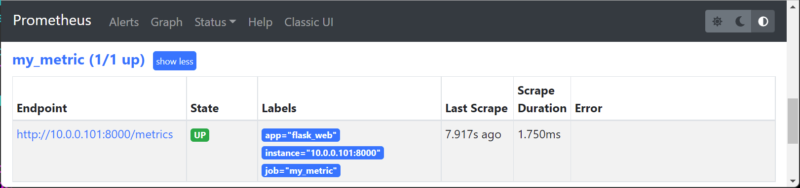

进入到graph界面查看数据效果
```text
request_count_total
```

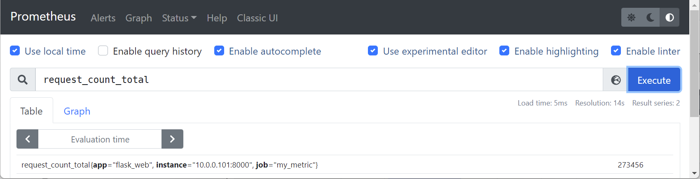

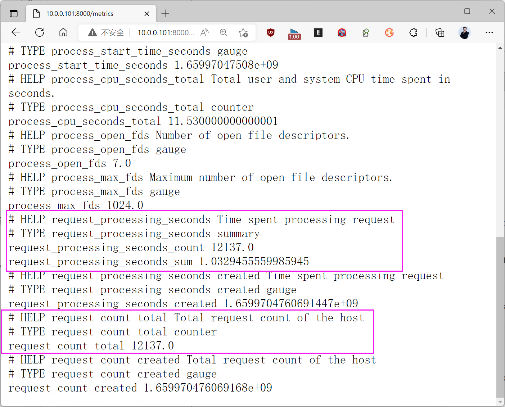

结果显示：在prometheus上面可以看到正常的数据收集
```text
rate(request_count_total{instance="127.0.0.1:8000", job="my_metric"}[5m])
```

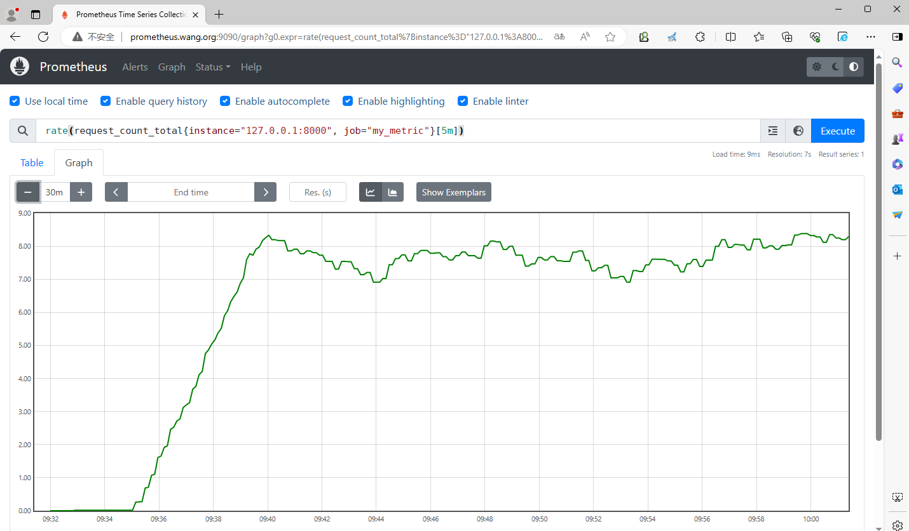
```text
irate(request_count_total{instance="127.0.0.1:8000", job="my_metric"}[5m])
```

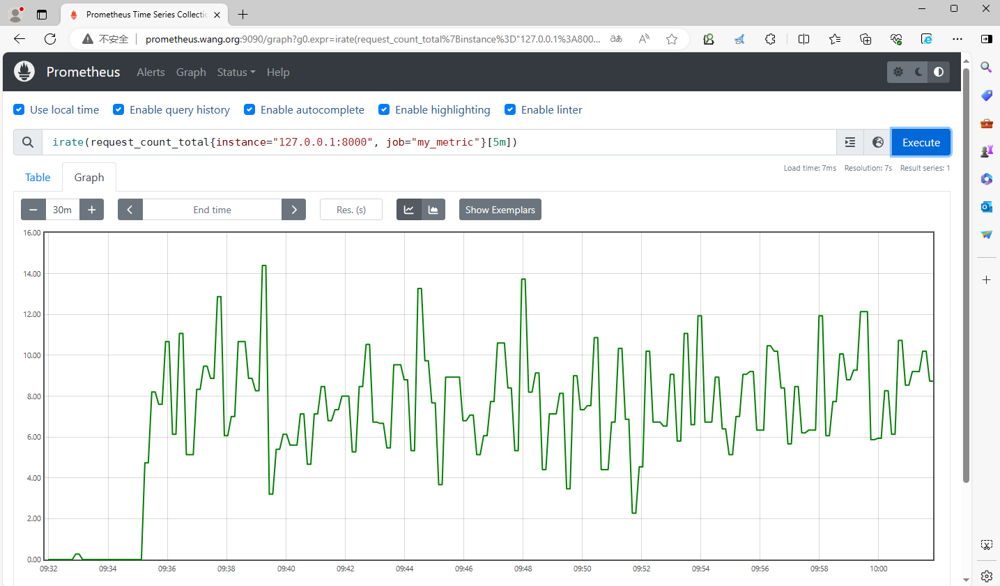

### 3.4.3 定制 Exporter 案例: Golang 实现

基于Golang实现
```go
#先安装go环境
go version go1.18.1 linux/amd64
[root@ubuntu2204 ~]#apt update && apt -y install golang
[root@ubuntu2204 ~]#go version
#准备代码，利用SDK实现
[root@ubuntu2204 ~]#cat code/main.go
package main
import (
 "net/http"
 "github.com/prometheus/client_golang/prometheus/promhttp"
)
func main() {
    // Serve the default Prometheus metrics registry over HTTP on /metrics.
    http.Handle("/metrics", promhttp.Handler())
    http.ListenAndServe(":9527", nil)
}
#设置环境变量，Windows使用SET命令设置
[root@prometheus code]#export  CGO_ENABLED=0
[root@prometheus code]#export  GOARCH=amd64
[root@prometheus code]#export  GOOS=linux
[root@prometheus code]#go mod init my_metric
go: creating new go.mod: module my_metric
go: to add module requirements and sums:
    go mod tidy
[root@prometheus code]#ls
go.mod  main.go
[root@prometheus code]#cat go.mod
module my_metric
go 1.18
#加速
[root@prometheus code]#go env -w GOPROXY=https://goproxy.cn,direct
#安装依赖
[root@prometheus code]#go get github.com/prometheus/client_golang/prometheus/promhttp
#编译
[root@prometheus code]#go build -o exporter_demo
[root@prometheus code]#ldd exporter_go_demo
    不是动态可执行文件
#运行
[root@prometheus code]#./exporter_demo
[root@ubuntu2204 ~]##curl http://127.0.0.1:9527/metrics
# HELP go_gc_cycles_automatic_gc_cycles_total Count of completed GC cycles generated
by the Go runtime.
# TYPE go_gc_cycles_automatic_gc_cycles_total counter
go_gc_cycles_automatic_gc_cycles_total 0
# HELP go_gc_cycles_forced_gc_cycles_total Count of completed GC cycles forced by the
application.
# TYPE go_gc_cycles_forced_gc_cycles_total counter
go_gc_cycles_forced_gc_cycles_total 0
# HELP go_gc_cycles_total_gc_cycles_total Count of all completed GC cycles.
# TYPE go_gc_cycles_total_gc_cycles_total counter
go_gc_cycles_total_gc_cycles_total 0
# HELP go_gc_duration_seconds A summary of the pause duration of garbage collection
cycles.
```

## 3.5 基于 PromQL 实现 Grafana 展示

### 3.5.1 Grafana 基础

Grafana是一款基于go语言开发的通用可视化工具，支持从多种不同的数据源加载并展示数据，

可作为其数据源的部分存储系统,如下所示

TSDB: Prometheus、 InfluxDB、 OpenTSDB和Graphit
日志和文档存储: Loki和ElasitchSearch  
分布式请求跟踪: Zipkin、 Jaeger和SkyWalking等  
SQL DB: MySQL、PostgreSQL和Microsoft SQL Server  

Grafana基础

默认监听于TCP协议的3000端口，支持集成其他认证服务，且能够通过/metrics输出内建指标
数据源(Data Source) :提供用于展示的数据的存储系统  
仪表盘(Dashboard) :组织和管理数据的可视化面板 (Panel)  
团队和用户:提供了面向企业组织层级的管理能力  

Grafana是一个可视化的集成套件，可以借助于现成的dashboard模板进行通用的界面展示，但是对于一些特殊的监控项的展示来说，我们还是需要实现独有的界面展示，而这就需要借助于Grafana的图形类型来实现特定的展示效果，对于绘图时候用到的可视化功能主要有两种方式：默认可视化方式和可视化插件

默认可视化方式

默认的可视化方式，我们可以点击左侧边栏的"+"，然后选择"Dashboard",再选择"Choose virtualization"就可以看到默认的可视化样式，效果如下：

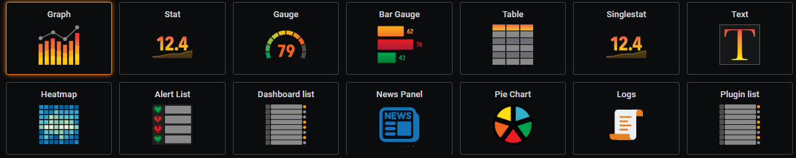

可视化插件

对于可视化插件来说，我们就需要借助于grafana-cli plugins命令从https://grafana.com/plugins/页面下载我们想要的可视化插件，每种插件中都集成了一些特定的可视化样式，我们可以点击左侧变量的"齿轮"，点击"Plugins"，就可以看到我们所安装的插件样式集，效果如下

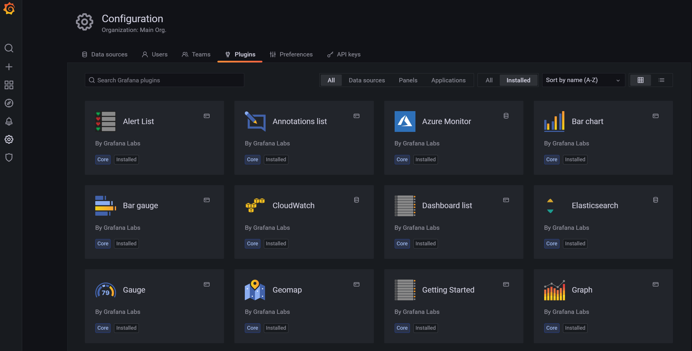
```text
注意：通过插件来操作graph的方式本质上就是通过可视化样式来进行操作。
```

图形展示

接下来我们通过现有的模板页面来学习一下Grafana中图形的展示方式以及制作流程。点击我们之前加载好的prometheus的模板页面，效果如下

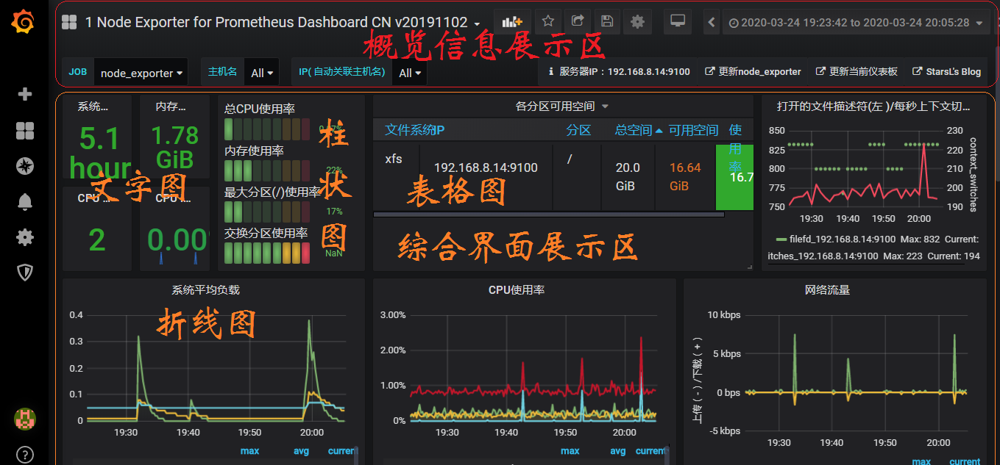
可以看到，这张图里面有各种信息展示的界面，在概览信息展示区，除了一些基本信息的展示外，在首行的右上角区
域还有图形展示数据的时间选择区域范围，因为我们曾经说过prometheus是基于时间序列的数据就那些监控的，所
以时间维度的选择，对图形的展示限制非常大。

以折线图为例，当把鼠标放在图形的标题位置，就会出现一个"△"，然后点击该三角就会出现图形的操作信息，效果如下

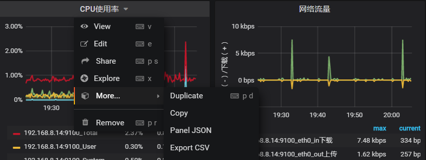

操作属性：
View     #当前Graph的综合展示
Edit     #Graph的属性编辑
Share    #表示当前Graph对外分享时候的一些配置属性
explore  #类似于view,综合展示更详细的信息
More     #这部分包含了对当前图形的一些扩展信息，比如切割、复制、json数据展示、数据导出、触发器

点击View或者键盘输入缩写"x",进入到图形综合展示界面，效果如下

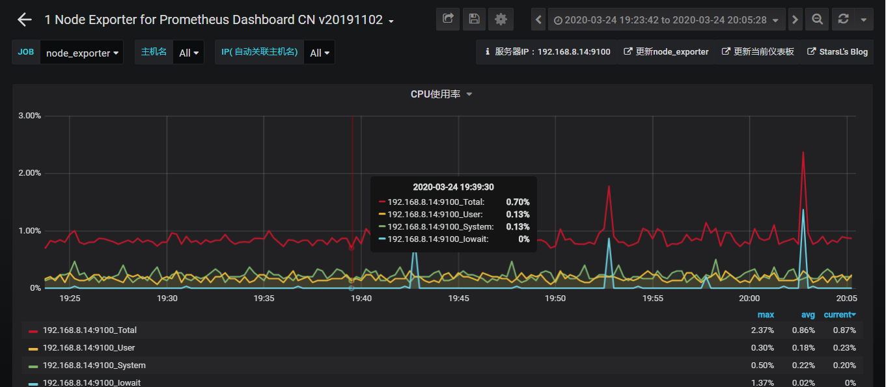

点击Explore或者键盘输入缩写"v",进入到图形详情展示界面

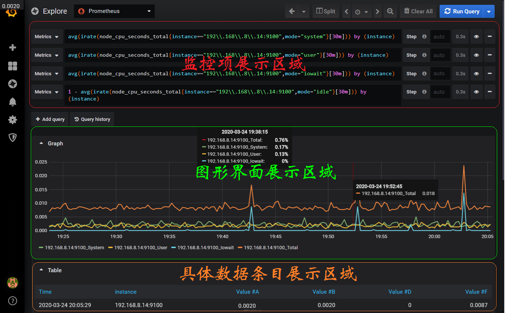

点击Edit或者键盘输入缩写"e",进入到图形编辑界面

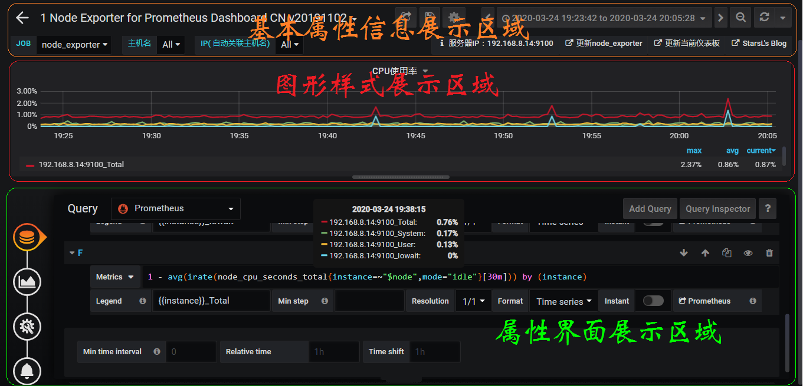

配置解析

在Edit的界面最下面有该图形的配置方式，左侧有四个图标，分别表示：
Query          #图形中展示的具体数据的查询表达式，每类数据一个查询语句
Virtualization #图形的可视化样式配置
General        #可选配置
Alert          #触发器、告警配置

数据查询语句界面

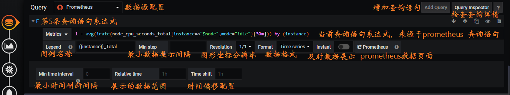

图形可视化配置属性

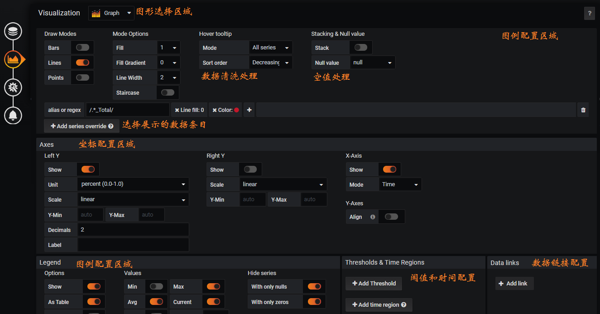

图形可选信息配置

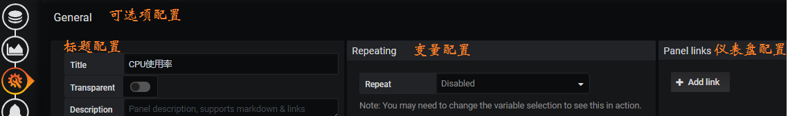

关于Alert的告警和触发器配置，我们后续讲到告警配置的时候再说

实践流程

如果要制作一个Graph，需要按照如下步骤进行操作：

了解业务，分析指标
创建 Dashboard  
创建 Graph  
完善 Graph  
其他信息,比如告警等  

### 3.5.2 绘图案例

#### 3.5.2.1 案例说明

在上一节，我们通过自定义的metric的方式，做好了一个监控项，那么接下来我们就需要完成以下绘图要求

绘制每分钟请求数量的曲线 QPS
绘制每分钟请求量变化率曲线  
绘制每分钟请求处理平均耗时  

需求分析如下
```text
#上面的三个需求基本上都是曲线图，所以我们在Graph中选择折线图就可以了，而在绘图的时候，第一步需要做的
就是获取数据，所以我们现在需要做的就是在prometheus上，将这三个需求的PromQL写出来，效果如下
#绘制每分钟请求数量的曲线 QPS
increase(request_count_total{job="my_metric"}[1m])
increase(request_count_total{instance="10.0.0.101:8000",job="my_metric"}[1m])
#绘制每分钟请求量变化率曲线
irate(request_count_total{job="my_metric"}[1m])
irate(request_count_total{instance="10.0.0.101:8000",job="my_metric"}[1m])
#绘制每分钟请求处理平均耗时
request_processing_seconds_sum{job="my_metric"} /
request_processing_seconds_count{job="my_metric"}
request_processing_seconds_sum{instance="10.0.0.101:8000",job="my_metric"} /
request_processing_seconds_count{instance="10.0.0.101:8000",job="my_metric"}
```

在10.0.0.106上也运行python程序,实现自定义的metrics功能

#### 3.5.2.2 绘图实现

创建图形

点击graph右侧的"+",点击"Dashboard",选择"Query",就可以进入到图形制作的界面，效果如下

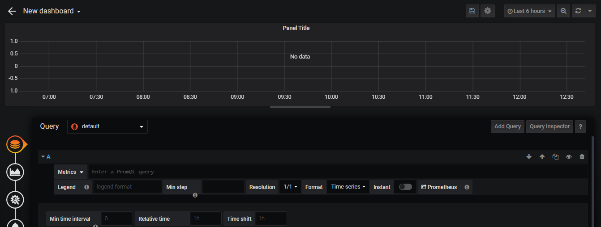

设置语句 : 首选选择数据源，选择我们之前定制的"prometheus"，效果如下


接下来开始配置查询语句，按照我们之前定制好的PromQL，然后复制到Metrics右侧的输入框中，配置好图例名称，然后点击右侧的"小眼睛"，就可以看具体的效果，我们以"绘制每分钟请求数量的曲线 QPS"为例，效果如下，

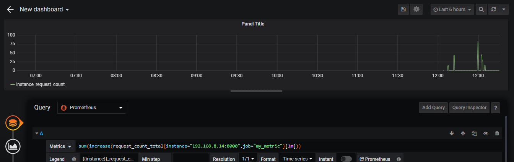
```text
#注意：
如果不写Legend的话，图例的名称是metrics的语句，我们这里的图例名称是"
{{instance}}_request_count"
如果想要instance变量生效的话，需要点击右侧的 Instant ，让该变量生效
```

设置图形

点击左侧的"virtualization"，进入到图形化配置界面，在第一部分是对图的总体配置

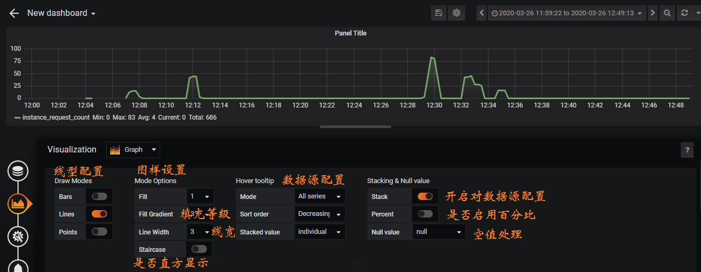

结果显示：默认情况下，图形是折线图

第二部分是对坐标进行控制，这部分没有什么太重要的配置，无非就是显示不显示，样式等

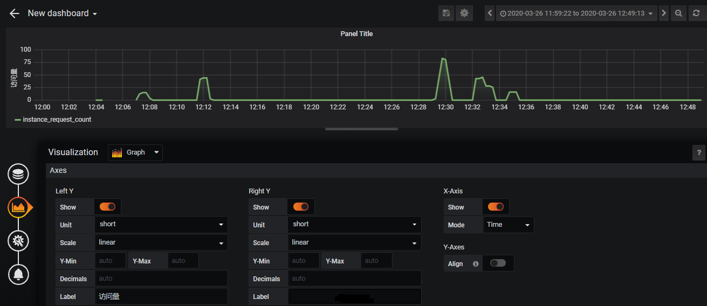
```text
#注意：X-Axis的Mode部分可以根据下拉项对x轴的图形样式进行配置，默认是基于时间进行排序
```

第三部分是对图形的图例进行设置

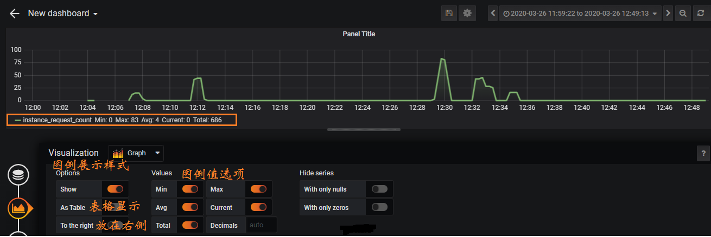

可选项配置

点击左侧的"General"，进入到可选性配置界面

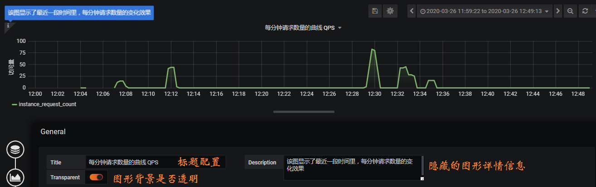

这个时候就完成了第一个图形的设置，点击右上角的"保存"，然后进行一些配置，效果如下


点击"Save"，查看最终效果

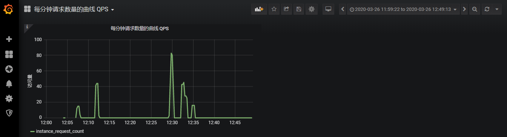

点击当前dashboard的顶格中间"add panel"，就会在当前dashboard上增加可视化图形，接下来我们按照同样的方法，将其它两个图形也做出来，最终效果如下：

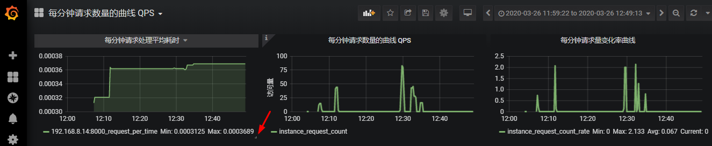

当将鼠标放到图形的位置时候，右下角会出现小三角，拖动它可以调整图形的大小，鼠标点击标题位置，就可以拖动图形的位置。

第一张图配置

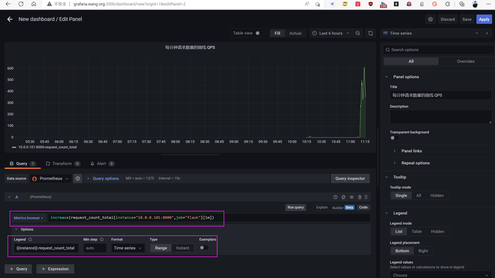

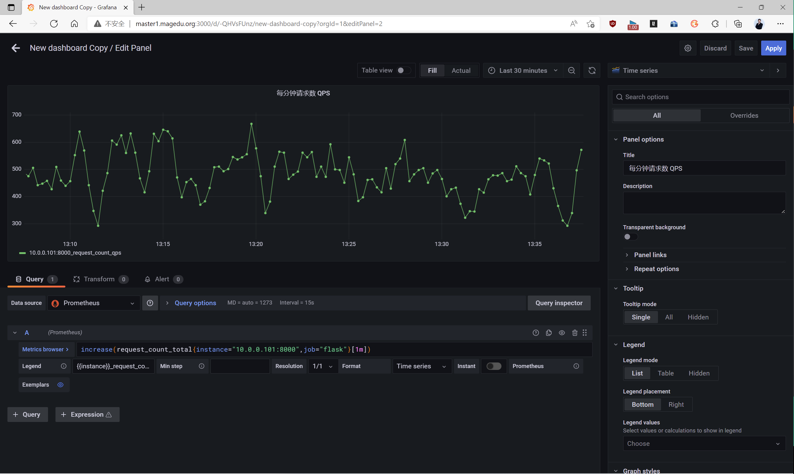

第二张图配置

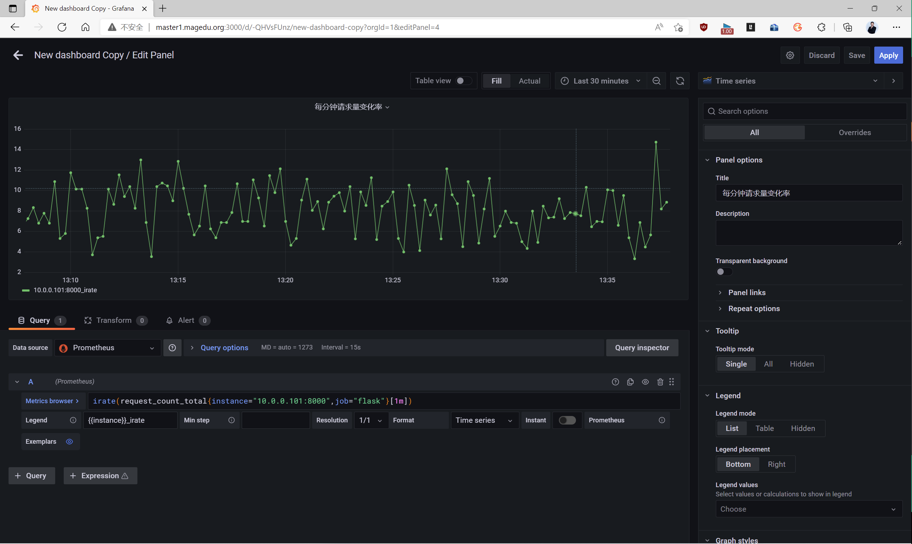

第三张图配置

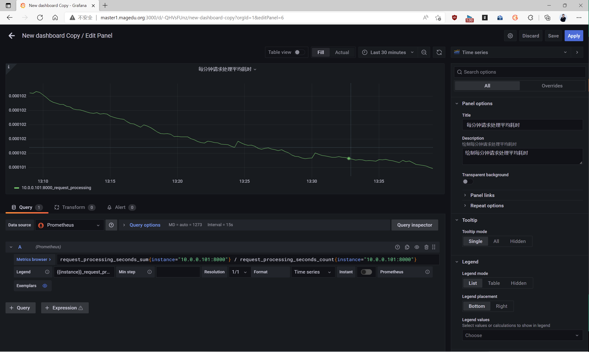

第四张图配置

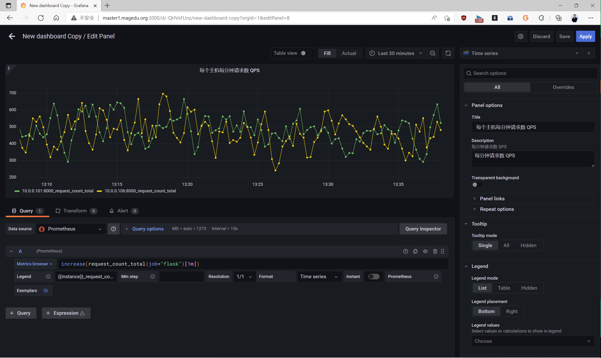

最终结果如下

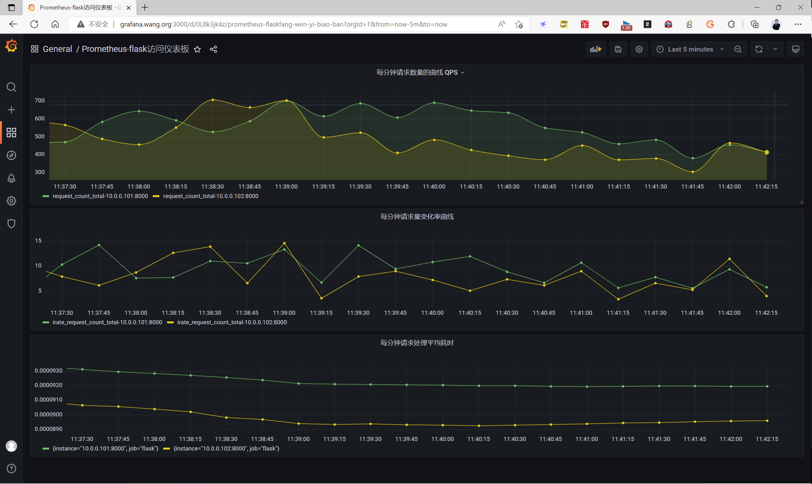

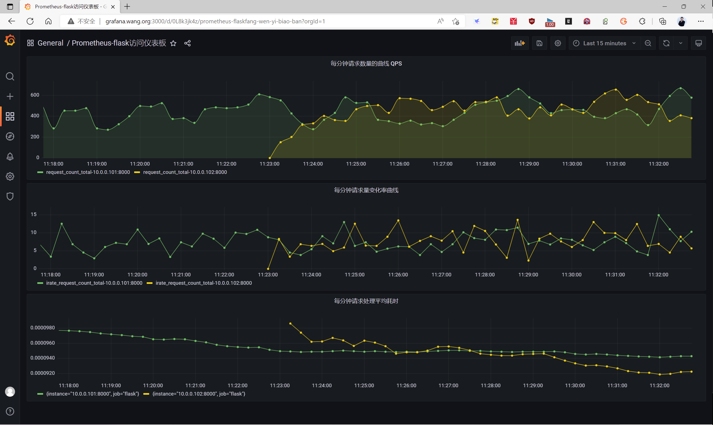

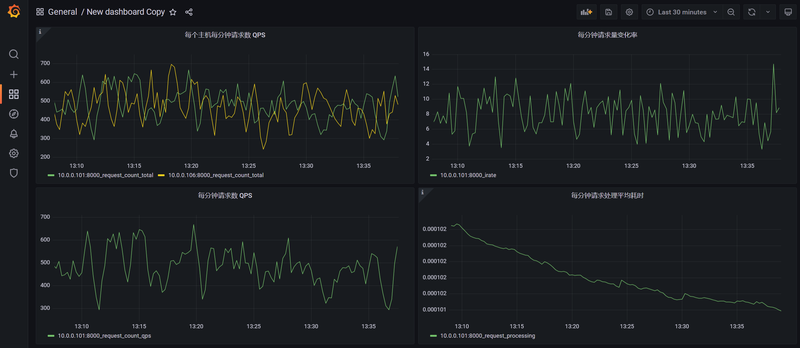



<nav class="article-end" aria-label="章节导航">
  <a href="{{ '/subjects/Prometheus/08-promql-operators.html' | relative_url }}">← 上一章：PromQL 运算</a>
  <a href="{{ '/subjects/Prometheus/' | relative_url }}">返回 Prometheus 目录</a>
  <a href="{{ '/subjects/Prometheus/10-label-management.html' | relative_url }}">下一章：标签管理 →</a>
</nav>
