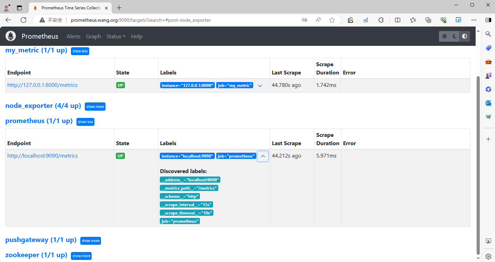
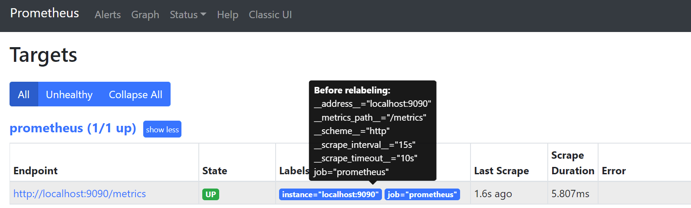
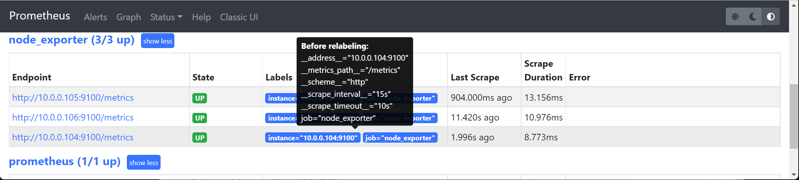
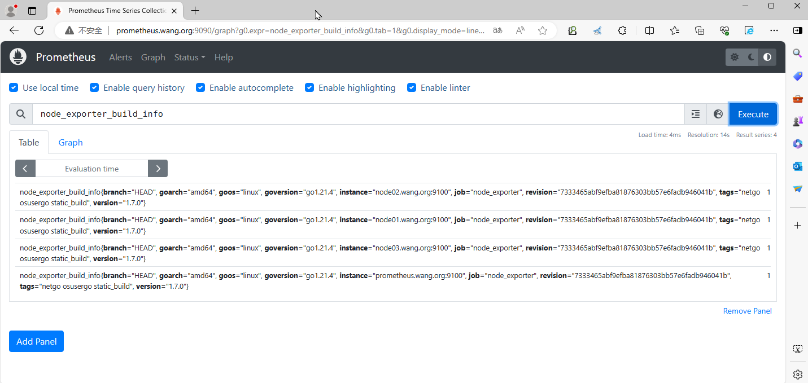
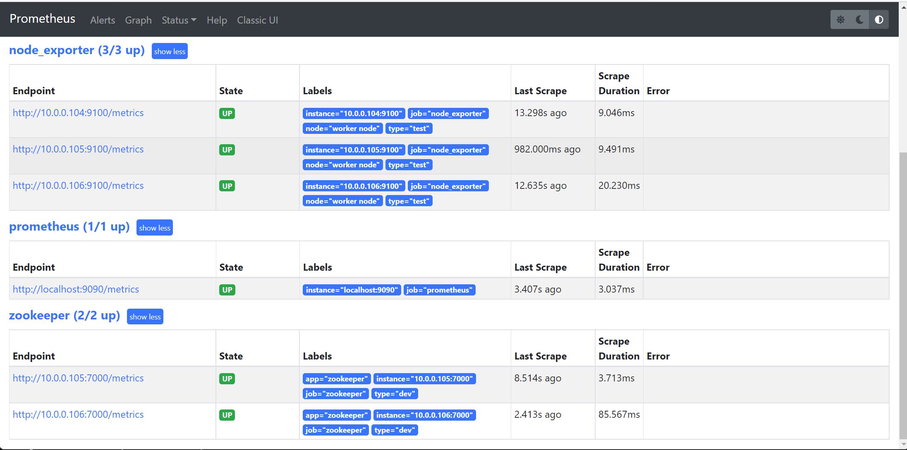
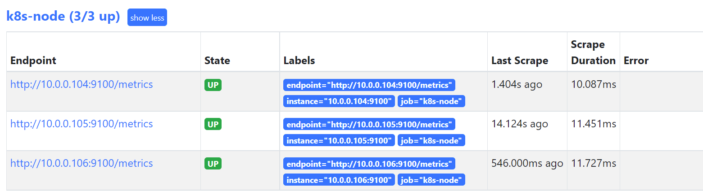
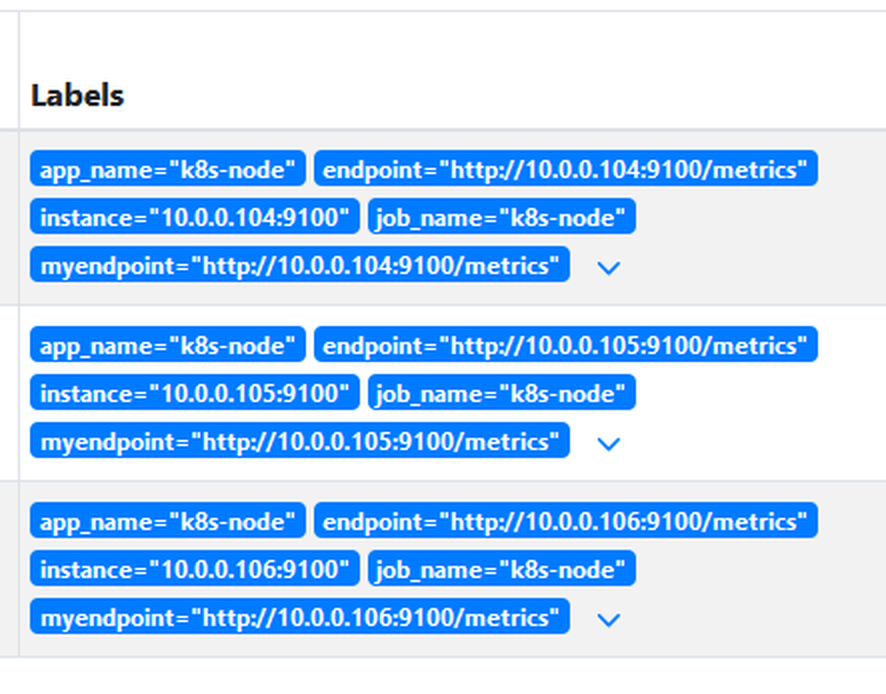
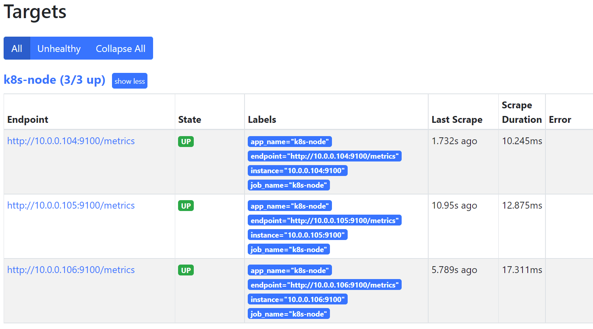
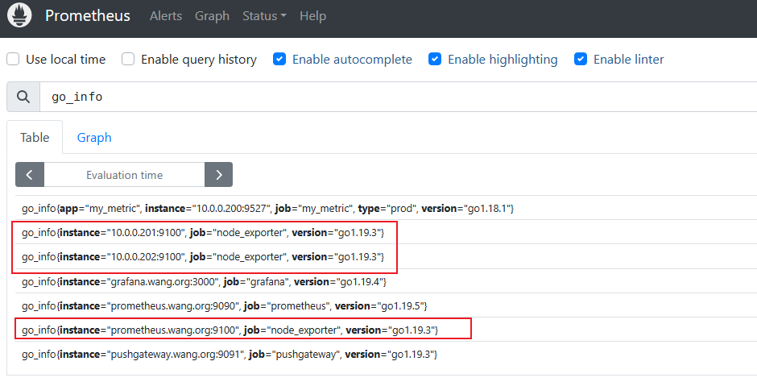
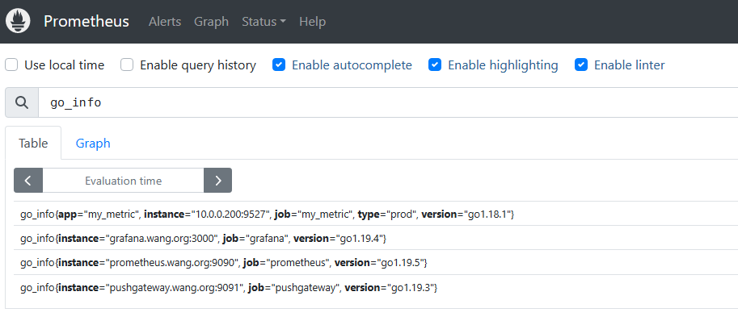

[← 返回 Prometheus 目录]({{ '/subjects/Prometheus/' | relative_url }})



# 10 标签与重标记

指标名说明“测量什么”，标签说明“来自哪里、属于哪一类”。`http_requests_total{job="api",instance="api-1:8080",code="500"}` 中，任一标签值改变都会形成新的时间序列。因此标签既是 PromQL 过滤和聚合的基础，也是决定时序库规模的重要因素。本篇从目标发现到样本入库，分别说明在哪里能改标签、在哪里应过滤目标或指标。





## 抓取链路中的三种标签

Prometheus 配置的 `job_name` 通常成为 `job` 标签；`instance` 通常来自目标地址，也可在重标记时修改。静态目标还能指定稳定的业务标签：

```yaml
scrape_configs:
  - job_name: node
    static_configs:
      - targets: ['node-a.example.local:9100', 'node-b.example.local:9100']
        labels:
          environment: production
          team: platform
```

`labels` 的 YAML 缩进必须与 `targets` 同级；原资料的一个示例把 `type` 缩错了层级，不能直接作为配置使用。不要把用户 ID、请求 ID 等无限变化的值加入标签，以免序列数量失控。







目标发现时，还会产生 `__address__`、`__scheme__`、`__metrics_path__` 等内部标签，以及各服务发现机制带来的 `__meta_...` 元数据。它们在**目标重标记阶段**可用，最终通常不会作为普通指标标签保存。若要保留某项发现元数据，必须在该阶段复制到普通标签名。临时用的 `__tmp...` 标签也只用于处理过程。


## 两个重标记阶段不能混淆

| 配置字段 | 执行时机 | 处理对象 | 常见用途 |
| --- | --- | --- | --- |
| `relabel_configs` | 抓取**之前** | 目标地址及目标标签 | 选择/丢弃目标、改抓取路径、把服务发现元数据转为标签 |
| `metric_relabel_configs` | 抓取**之后、入库之前** | 返回的每个样本 | 删除不需要的指标或标签、降低基数 |

如果某个目标不该被抓取，应在 `relabel_configs` 中 `drop`，而不是先抓取所有样本再用 `metric_relabel_configs` 丢掉，那会白白消耗网络与解析资源。后者也不作用于 Prometheus 自动生成的部分抓取健康指标，例如 `up`。

重标记规则按配置顺序执行。常见字段是 `source_labels`、`separator`、`regex`、`target_label`、`replacement` 和 `action`；原资料把 `separator` 拼成 `separater`，会导致配置检查失败。正则默认对整个拼接值匹配，写 `go.*` 才能匹配所有以 `go` 开头的指标名。

## 示例一：从服务发现元数据生成普通标签

以 Consul 服务发现为例，`__meta_consul_service` 在目标重标记阶段可用。下面只保留关键链路：丢弃不提供业务指标的 `consul` 服务，并把服务名复制到普通的 `service` 标签。实际使用时先确认 Consul 地址、服务发现元标签以及抓取端口，服务发现章节还有完整配置。

```yaml
scrape_configs:
  - job_name: consul-services
    consul_sd_configs:
      - server: consul.example.local:8500
    relabel_configs:
      - source_labels: [__meta_consul_service]
        regex: consul
        action: drop
      - source_labels: [__meta_consul_service]
        target_label: service
```

如果希望通过 Kubernetes Service 注解决定是否抓取，也是相同原理：服务发现产生 `__meta_kubernetes_service_annotation_...`，`keep` 先筛目标，再按需改 `__scheme__`、`__metrics_path__`、`__address__`。相关元标签会随发现角色和 Prometheus 版本变化，应以当前 Targets/Service Discovery 页面核对，不宜盲贴历史版本的几十行配置。



## 示例二：通过地址添加可读的端点标签

有时面板需要一个带协议的目标地址，可在抓取前基于内部标签构造普通标签。下例使用默认分号分隔符，把协议与地址组合；`replacement` 中的 `$1`、`$2` 引用正则捕获组。

```yaml
scrape_configs:
  - job_name: node
    static_configs:
      - targets: ['node-a.example.local:9100']
    relabel_configs:
      - source_labels: [__scheme__, __address__]
        separator: '://'
        target_label: endpoint
```

这里拼接结果已经是 `http://node-a.example.local:9100`，无需再用复杂正则重复拆装。若业务不需要这个标签，也不必因为“标签越多越好”而额外添加。

`labelmap` 可按**标签名**批量复制标签，`labeldrop` 会删除标签。原资料演示把 `job`、`app` 复制为新名称再删除旧名称，但 `job` 是重要的排障维度，删除它可能让多个序列合并、造成重复标签集或难以查询。只有充分确认新旧标签与序列唯一性时才应这样做。





## 示例三：入库前过滤不需要的指标

若某个 job 不需要 Exporter 自带的 Go 运行时指标，可在样本级重标记时按 `__name__` 删除；**Exporter 仍会暴露它们，Prometheus 也已完成抓取，只是不再把匹配样本写入本地 TSDB**。不要在仍需这些运行时指标的 job 上照搬。

```yaml
scrape_configs:
  - job_name: node
    static_configs:
      - targets: ['node-a.example.local:9100']
    metric_relabel_configs:
      - source_labels: [__name__]
        regex: 'go_.*'
        action: drop
```

先运行 `promtool check config /path/to/prometheus.yml` 再重载；在 Targets 页检查目标仍为 UP，并查询 `go_info` 是否不再产生**新样本**。历史数据会在保留期内继续存在，配置改变不会立即删除既有时间序列。





最后，`global.external_labels` 主要用于发往外部系统的序列与告警标识，例如区分 Prometheus 副本，并非给本地每一条查询结果都添加普通标签。标签设计应围绕明确的查询与告警需求，保持稳定、低基数和可解释。



<nav class="article-end" aria-label="章节导航">
  <a href="{{ '/subjects/Prometheus/09-exporter-development-grafana.html' | relative_url }}">← 上一章：Exporter 开发与 PromQL 可视化</a>
  <a href="{{ '/subjects/Prometheus/' | relative_url }}">返回 Prometheus 目录</a>
  <a href="{{ '/subjects/Prometheus/11-recording-rules.html' | relative_url }}">下一章：记录规则 →</a>
</nav>
