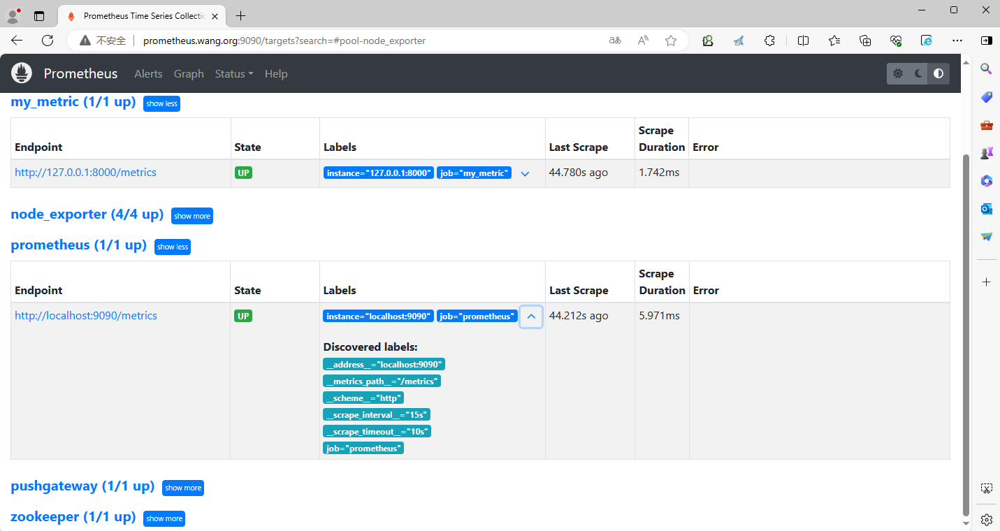
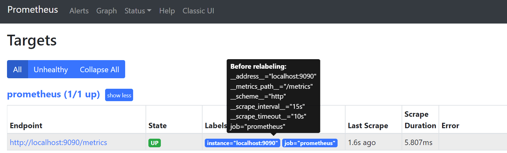
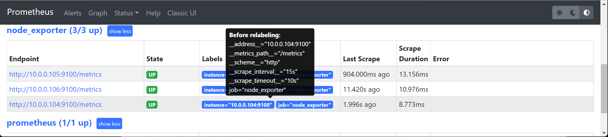
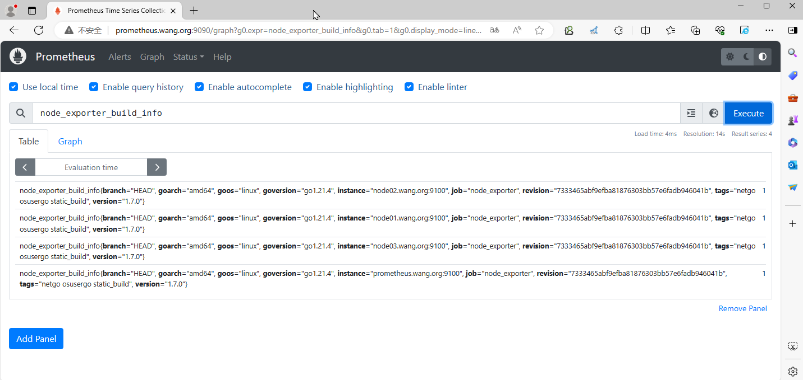
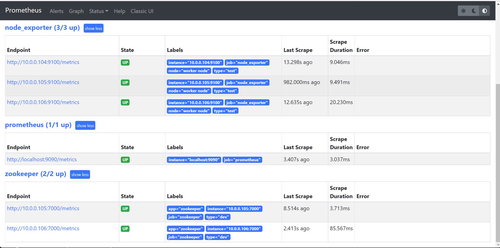
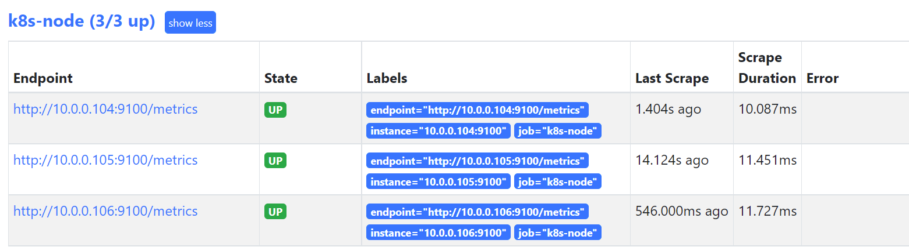
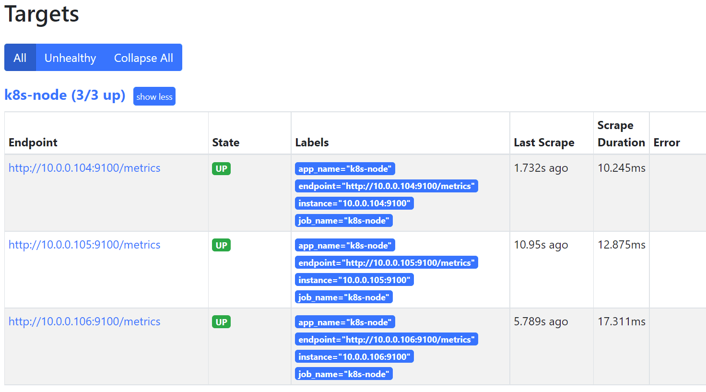
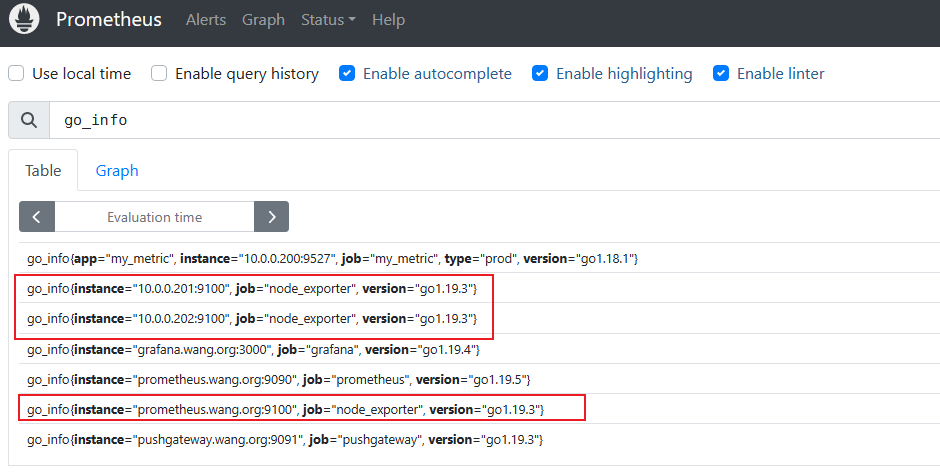
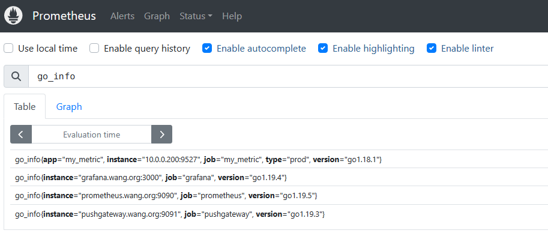

[← 返回 Prometheus 目录]({{ '/subjects/Prometheus/' | relative_url }})



# 10 标签管理

# 4 Prometheus 标签管理

## 4.1 标签简介





标签功能:  用于对数据分组和分类,利用标签可以将数据进行过滤筛选

标签管理的常见场景:

删除不必要的指标
从指标中删除敏感或不需要的标签  
添加、编辑或修改指标的标签值或标签格式  

标签分类：

默认标签: Prometheus 自身内置
形式:  
```text
        __keyname__
```

应用标签: 应用本身内置
形式:  
```text
        keyname
```

自定义标签: 用户定义
形式:  
```text
         keyname
```

范例: 添加主机节点查看默认标签
```yaml
#编辑prometheus.yml配置文件
scrape_configs:
  ...
  - job_name: "prometheus"
    static_configs:
    - targets: ['10.0.0.101:9100']
  - job_name: 'node_exporter'
    static_configs:
    - targets: ['10.0.0.104:9100','10.0.0.105:9100','10.0.0.106:9100']
      #- '10.0.0.104:9100'  #或者下面格式
      #- '10.0.0.105:9100'
      #- '10.0.0.106:9100'
#配置解析：static_configs 用于手工定制要监控的target
#重启服务
systemctl reload prometheus.service
#查看效果,可以看到如下的内置的标签
```



应用默认的标签如下形式



范例: 添加主机标签
```yaml
#编辑prometheus.yml配置文件
[root@prometheus ~]#vim /usr/local/prometheus/conf/prometheus.yml
  - job_name: 'node_exporter'
    static_configs:
    - targets: ['10.0.0.104:9100','10.0.0.105:9100','10.0.0.106:9100']
      labels:
         node: "worker node"
        type: "test"
  - job_name: 'zookeeper'
    static_configs:
    - targets: ['10.0.0.105:7000','10.0.0.106:7000']
      labels: {app: 'zookeeper', type: 'dev'}
         #app: 'zookeeper'  #或者这种格式也支持
         #type: 'dev'
#配置解析：labels: 的编写方法，在此处遵循 yaml的字典格式
#重启服务
[root@prometheus ~]#systemctl reload prometheus.service
#浏览器访问确认
```



## 4.2 指标的生命周期

标签主要有两种表现形式：

私有标签
     私有标签以"__*"样式存在，用于获取监控目标的默认元数据属性，比如__address__用于获取目标的地址，
     __scheme__用户获取目标的请求协议方法，__metrics_path__获取请求的url地址等

普通标签
```text
     对个监控主机节点上的监控指标进行各种灵活的管理操作，常见的操作有，删除不必要|敏感指标，添加、编辑
     或者修改指标的标签值或者标签格式。
```

在prometheus的配置选项中，有两个与监控指标密切相关的配置，relabel_config、metric_relabel_configs，它们的作用就是监控目标上面的监控项进行标签管理和设置，便于在prometheus上设置更灵活的时序数据。

Prometheus对数据的处理流程：


在每个scrape_interval期间，Prometheus都会检查执行的作业 Job
这些作业首先会根据Job上指定的发现配置生成target列表，此即服务发现过程  
服务发现会返回一个Target列表，其中包含一组称为元数据的标签，这些标签都以  为前缀__  
```text
                        "__meta_"
```

服务发现还会根据目标配置来设置其它标签，这些标签带有  前缀和后缀，包括如下：
```text
                        "__"
     "__scheme__" #协议http或https，默认为http
     "__address__" #target的地址
     "__metrics_path__" #target指标的URI路径（默认为/metrics）
     #若URI路径中存在任何参数，则它们的前缀会设置为 "__param__"
```

这些目标列表和标签会返回给Prometheus，其中的一些标签也可以配置为被覆盖或替换为其它标签

配置标签会在抓取的生命周期中被利用以生成其他标签
例如：指标上的instance标签的默认值就来自于  标签的值  
```text
                        __address__
```

对于发现的各个目标，Prometheus提供了可以重新标记(relabel_config) 目标的机会
它定义在 Job 配置段的relabel_config配置中，常用于实现如下功能  
将来自服务发现的元数据标签中的信息附加到指标的标签上  
过滤目标  
数据抓取、以及指标返回的过程  
抓取而来的指标在保存之前，还允许用户对指标重新打标并过滤的方式  
它定义在job配置段的metric_relabel_configs配置中，常用于实现如下功能  
删除不必要的指标  
从指标中删除敏感或不需要的标签  
添加、编辑或修改指标的标签值或标签格式  

## 4.3 relabel_configs 和 metric_relabel_configs

relabel_config、metric_relabel_configs这两个配置虽然在作用上类似，但是还是有本质上的区别的，这些区别体现在两个方面：执行顺序和数据处理上。

区别  解析

relabel_configs用与scrape目标上metric前的标签设置，也就是说在scrape_configs前生
执行  效，针对的是target对象本身  
顺序  metric_relabel_configs 作用于scrape_configs 生效后，即针对target对象上的metric监控数  
据  

metric_relabel_configs 是 prometheus 在保存数据前的最后一步标签重新编辑，针对的是
数据  
metric对象  
处理  
默认情况下，它将监控不需要的数据，直接丢掉，不在prometheus 中保存  

对target重新打标

对target重新打标是在数据抓取之前动态重写target标签的强大工具

在每个数据抓取配置中，可以定义多个relabel步骤，它们将按照定义的顺序依次执行

对于发现的每个target，Prometheus默认会执行如下操作
```text
job的标签设定为配置文件中其所属的job_name的值
__address__标签的值为该target的套接字地址"<host>:<port>"
instance标签的值为__address__的值
__scheme__标签的值为抓取该target上指标时使用的协议(http或https)
__metrics_path__标签的值为抓取该target上的指标时使用URI路径，默认为/metrics
__param_<name>标签的值为传递的URL参数中第一个名称为<name>的参数的值，此项依赖于URL中是否存在参数
```

重新标记期间，还可以使用该target上以  开头的元标签,各服务发现机制为其target添加的元标签
```text
                        "__meta_"
```

会有所不同

重新标记完成后，该target上以  开头的所有标签都会被移除,若在relabel的过程中需要临时存储标签
```text
                        "__"
```

值，则要使用  标签名称为前缀进行保存，以避免同Prometheus的内建标签冲突
```text
          __tmp
```

对抓取到的metric重新打标

对metric重新打标是在数据抓取之后动态重写metric标签的工具，在每个数据抓取配置中，可以定义多个metric relabel的步骤

对metric重新打标的配置格式与target重新打标的格式相同，但前者要定义在专用的metric_relabel_configs字段中

它们将按照定义的顺序依次执行

删除不必要的指标
从指标中删除敏感或不需要的标签  
添加、编辑或修改指标的标签值或标签格式  

要注意的是，更改或添加标签会创建新的时间序列

应该明确地使用各个标签，并尽可能保持不变，以避免创建出一个动态的数据环境
标签是时间序列的唯一性约束，删除标签并导致时间序列重复时，可能会导致系统出现问题  

## 4.4 标签管理

对于一些全局性的标签，可以在global部分通过属性来设置，格式如下：
```yaml
global:
  ...
  # 与外部系统通信时添加到任何时间序列或警报的标签
  external_labels:
    [ <labelname>: <labelvalue> ... ]
```

官方文档
https://prometheus.io/docs/prometheus/latest/configuration/configuration/#relabel_config
https://prometheus.io/docs/prometheus/latest/configuration/configuration/#metric_relabel_configs

relabel_config、metric_relabel_configs 的使用格式基本上一致

常见配置如下
```yaml
#配置示例如下：
scrape_configs:
  - job_name: 'prometheus'
    relabel_configs|metric_relabel_configs:
    - source_labels: [<labelname> [, ...]]
      separater: '<string> | default = ;'
      regex: '<regex> | default = (.*)'
      replacement: '<string> | default = $1'
      target_label: '<labelname>'
      action: '<relabel_action> | default = replace'
#属性解析：
action              #对标签或指标进行管理，常见的动作有
replace|keep|drop|labelmap|labeldrop等,默认为replace
source_labels       #指定正则表达式匹配成功的Label进行标签管理,此为列表
target_label        #在进行标签替换的时候，可以将原来的source_labels替换为指定修改后的目标
label
separator           #指定用于联接多个source_labels为一个字符串的分隔符,默认为分号
regex               #表示source_labels对应Label的名称或者值(和action有关)进行匹配此处指定的
正则表达式
replacement         #替换标签时,将 target_label对应的值进行修改成此处的值
#action说明：
#1）替换标签的值:
replace   #此为默认值，首先将source labels中指定的各标签的值使用separator指定的字符进行串连,如
果串连后的值和regex匹配，则使用replacement指定正则表达式模式或值对target_label字段进行赋值，如果
target_label不存在，也可以用于创建新的标签名为target_label
hashmod  #将target_label的值设置为一个hash值，该hash是由modules字段指定的hash模块算法对
source_labels上各标签的串连值进行hash计算生成
#2）保留或删除指标: 该处的每个指标名称对应一个target或metric
keep   #如果获取指标的source_labels的各标签的值串连后的值与regex匹配时,则保留该指标,反之则删除该
指标
drop   #如果获取指标的source_labels的各标签的值串连后的值与regex匹配时,则删除该指标,反之则保留该
指标，即与keep相反
#3）创建或删除标签
labeldrop  #如果source labels中指定的标签名称和regex相匹配,则删除此标签,相当于标签黑名单
labelkeep  #如果source labels中指定的标签名称和regex相匹配,则保留,不匹配则删除此标签,相当于标签
白名单
labelmap   #一般用于生成新标签，将regex对source labels中指定的标签名称进行匹配，而后将匹配到的标
签的值赋值给replacement字段指定的标签；通常用于取出匹配的标签名的一部分生成新标签,旧的标签仍会存在
#4）大小写转换
lowercase #将串联的 source_labels 映射为其对应的小写字母
uppercase #将串联的 source_labels 映射到其对应的大写字母
```

范例:
```yaml
#示例:删除指标名node_network_receive开头的标签
metric_relabel_configs:
- source_labels: [__name__]
  regex: 'node_network_receive.*'
  action: drop
#示例:替换
metric_relabel_configs:
- source_labels:
  regex: '/.*'
  replacement: '123456'
  target_label: replace_id
```

## 4.5 案例

范例：基于source_labels的值赋值给新的标签名
```yaml
scrape_configs:
  ...
  - job_name: 'consul'
    honor_labels: true #如果抓取的原有标签和Prometheus配置的标签冲突，保留原有标签,避免标签覆
盖
    consul_sd_configs:
      - server: 'consul-node1.bowen.org:8500'
        services: []  #指定需要发现的service名称,默认为所有service，或者如下面两行指定只从
consul中加载特定的service
         #tags:        #可以过滤具有指定的tag的service
         #- "service"
         #refresh_interval: 2m #刷新时间间隔，默认30s
      - server: 'consul-node2.bowen.org:8500' #添加其它两个节点实现冗余
      - server: 'consul-node3.bowen.org:8500' #添加其它两个节点实现冗余
    relabel_configs:
    - source_labels: ['__meta_consul_service']  #基于source_labels的值赋值给新的标签
consul_service
      target_label: 'consul_service'
    - source_labels: ['__meta_consul_dc']       #基于source_labels的值赋值给新的标签
datacenter
      target_label: 'datacenter'
    - source_labels: ['__meta_consul_tags']     #基于source_labels的值赋值给新的标签app
      target_label: 'app'
    - source_labels: ['__meta_consul_service']  #删除consul的service,此service是consul
内置,但并不提供metrics数据
      regex: "consul"
      action: drop
```

范例: 将Target的默认标签修改为定制的新标签
```yaml
#编辑prometheus.yml配置文件
[root@prometheus ~]#vim /usr/local/prometheus/conf/prometheus.yml
scrape_configs:
  ...
  - job_name: 'k8s-node'
    static_configs:
    - targets: ['10.0.0.104:9100','10.0.0.105:9100','10.0.0.106:9100']
    relabel_configs:
    - source_labels:
      - __scheme__
      - __address__
      - __metrics_path__
      regex: "(http|https)(.*)"
      separator: ""  #将source_labels指定的label连接在一起成为一个字符串,每个label间没有分
隔符
      target_label: "endpoint"  #将原来的source_labels替换为指定修改后的目标label
      replacement: "${1}://${2}"  #指定target_label的值
      action: replace
replace   #此为默认值，首先将source labels中指定的各标签的值使用separator指定的字符进行串连,如
果串连后的值和regex匹配，则使用replacement指定正则表达式模式或值对target_label字段进行赋值，如果
target_label不存在，也可以用于创建新的标签名为target_label
#配置解析：separator 是设定拼接的时候用到的分隔符，此处不用设置任何符号
#重启服务
[root@prometheus ~]#systemctl reload prometheus.service
#浏览器查看效果
#结果显示：基于默认的属性重写了一个新的标签。
```



范例: 基于Target上已存在的标签名称进行匹配生成新标签，然后进行删除旧标签
```yaml
#编辑prometheus.yml配置文件
[root@prometheus ~]#vim /usr/local/prometheus/conf/prometheus.yml
scrape_configs:
  ...
    static_configs:
      - targets: ["localhost:9090"]
  - job_name: 'k8s-node'
    static_configs:
    - targets: ['10.0.0.104:9100','10.0.0.105:9100','10.0.0.106:9100']
      labels: {app: 'k8s-node'}
    relabel_configs:
    - source_labels:
      - __scheme__
      - __address__
      - __metrics_path__
      regex: "(http|https)(.*)"
      separator: ""
      target_label: "endpoint"
      replacement: "${1}://${2}"
      action: replace
    - regex: "(job|app)"  #加下面三行,所有名称为job或app的标签修改其标签名称加后缀
_name,但旧的标签还存在
      replacement: ${1}_name
      action: labelmap
labelmap   #一般用于生成新标签，将regex对source labels中指定的标签名称进行匹配，而后将匹配到的标
签的值赋值给replacement字段指定的标签；通常用于取出匹配的标签名的一部分生成新标签,旧的标签仍会存在
    - regex: "(job|app)"  #加下面两行,则删除所有名称为job或app的旧标签,注意上面修改和
此删除的前后顺序
      action: labeldrop
labeldrop  #如果source labels中指定的标签名称和regex相匹配,则删除此标签,相当于标签黑名单
    - source_labels: [endpoint]
      target_label:  myendpoint
#配置解析：第一条规则基于现有的匹配内容重写标签名称，第二条规则，删除旧标签的名称
#重启服务
[root@prometheus ~]#systemctl reload prometheus.service
#查看效果
#如下结果显示：第二条规则中，匹配到的标签就移除掉了
```




范例: 用于在相应的job上，删除发现的各target之上面以"go"为前名称前缀的指标
```yaml
#默认有很多go开头的指标，下面删除此类指标，注意：只针对新生成的数据有效
[root@prometheus ~]#vim /usr/local/prometheus/conf/prometheus.yml
.....
  - job_name: "node_exporter"
    static_configs:
      - targets:
         - "prometheus.bowen.org:9100" #添加三行新的target
         - "10.0.0.201:9100"
         - "10.0.0.202:9100"
    metric_relabel_configs:
    - source_labels:
      - __name__
      regex: 'go.*'
      action: drop
.....
[root@prometheus ~]#curl -X POST http://prometheus.bowen.org:9090/-/reload
#再访问以go开头的指标，不会再生成新的采集数据
```

删除标签前，查询 go_info



删除标签后，查询 go_info



范例：kubernetes 发现 endpoint  重新打签
```yaml
#https://github.com/prometheus/prometheus/blob/main/documentation/examples/prometheus-kubernetes.yml
# Scrape config for service endpoints.
#
# The relabeling allows the actual service scrape endpoint to be configured
# via the following annotations:
#
# * `prometheus.io/scrape`: Only scrape services that have a value of `true`
# * `prometheus.io/scheme`: If the metrics endpoint is secured then you will need
# to set this to `https` & most likely set the `tls_config` of the scrape config.
# * `prometheus.io/path`: If the metrics path is not `/metrics` override this.
# * `prometheus.io/port`: If the metrics are exposed on a different port to the
# service then set this appropriately.
- job_name: 'kubernetes-service-endpoints'
  kubernetes_sd_configs:
  - role: endpoints
  relabel_configs:
  - source_labels: [__meta_kubernetes_service_annotation_prometheus_io_scrape]
    action: keep
    regex: true
  - source_labels: [__meta_kubernetes_service_annotation_prometheus_io_scheme]
    action: replace
    target_label: __scheme__
    regex: (https?)
  - source_labels: [__meta_kubernetes_service_annotation_prometheus_io_path]
    action: replace
    target_label: __metrics_path__
    regex: (.+)
  - source_labels: [__address__,
__meta_kubernetes_service_annotation_prometheus_io_port]
    action: replace
    target_label: __address__
    regex: ([^:]+)(?::\d+)?;(\d+)
    replacement: $1:$2
  - action: labelmap
    regex: __meta_kubernetes_service_label_(.+)       #replacement 默认值为$1
  - source_labels: [__meta_kubernetes_namespace]
    action: replace
    target_label: kubernetes_namespace
  - source_labels: [__meta_kubernetes_service_name]
    action: replace
    target_label: kubernetes_name
```



<nav class="article-end" aria-label="章节导航">
  <a href="{{ '/subjects/Prometheus/09-exporter-development-grafana.html' | relative_url }}">← 上一章：Exporter 开发与 PromQL 可视化</a>
  <a href="{{ '/subjects/Prometheus/' | relative_url }}">返回 Prometheus 目录</a>
  <a href="{{ '/subjects/Prometheus/11-recording-rules.html' | relative_url }}">下一章：记录规则 →</a>
</nav>
