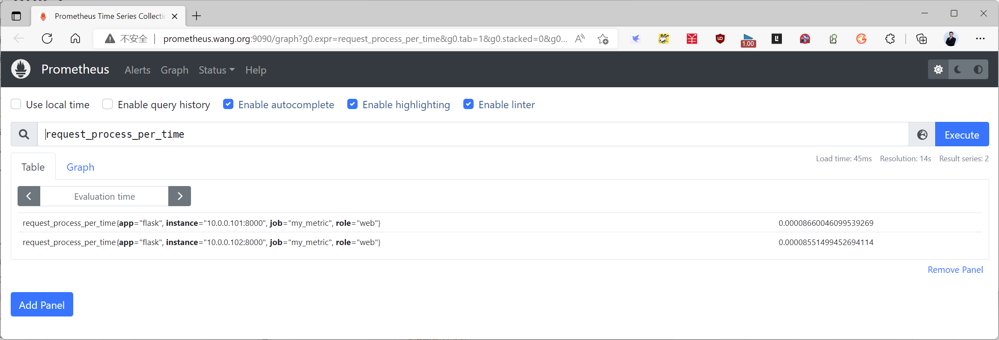
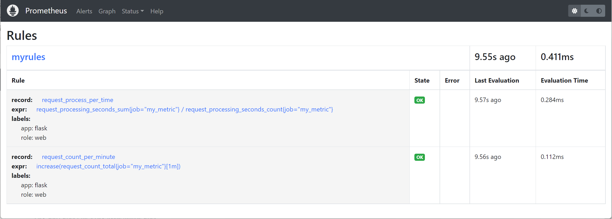
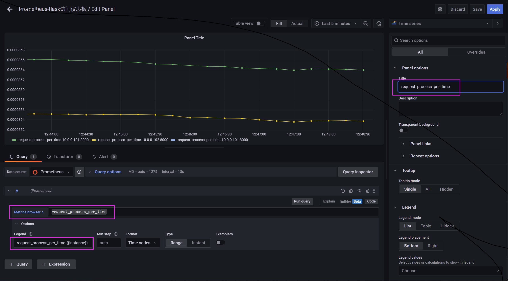
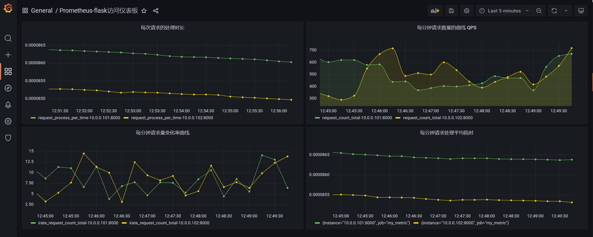
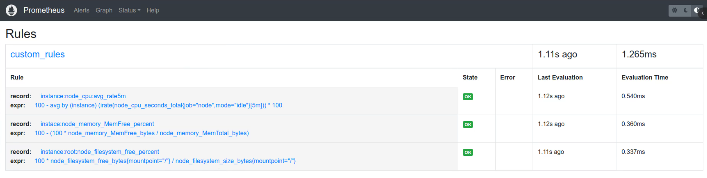
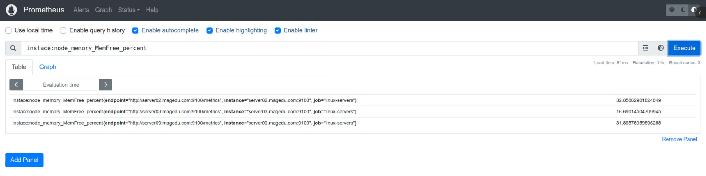

[← 返回 Prometheus 目录]({{ '/subjects/Prometheus/' | relative_url }})



# 11 记录规则与预计算指标

Prometheus 的规则分为**记录规则**和**告警规则**。前者定期执行 PromQL，把结果写回为新的时间序列，供仪表盘和告警重复使用；后者定期判断条件并产生告警。本篇只讨论记录规则，下一篇再进入告警。记录规则不是给查询“起别名”那么简单：它会新增样本、占用存储，并按规则评估周期刷新，因此应优先用于高频、昂贵或需要统一口径的表达式。


## 从查询到记录规则

假设应用暴露累计处理时长 `request_processing_seconds_sum` 和累计请求数 `request_processing_seconds_count`。两者直接相除得到的是**进程启动以来**的平均时长；若想看最近五分钟，应该先对两个单调递增计数器分别求 `rate(...[5m])`，再相除。这样既明确时间窗口，也能正确处理计数器重置。

```promql
sum by (instance) (rate(request_processing_seconds_sum{job="my_metric"}[5m]))
/
sum by (instance) (rate(request_processing_seconds_count{job="my_metric"}[5m]))
```

一个仪表盘的多个面板和告警规则反复计算这段表达式时，可以把它保存为记录规则。下面是独立的 `/usr/local/prometheus/rules/app.yml` 文件：

```yaml
groups:
  - name: app-recording
    interval: 30s
    rules:
      - record: instance:request_processing_seconds:mean_rate5m
        expr: >-
          sum by (instance) (rate(request_processing_seconds_sum{job="my_metric"}[5m]))
          /
          sum by (instance) (rate(request_processing_seconds_count{job="my_metric"}[5m]))
      - record: instance:request_count:rate5m
        expr: >-
          sum by (instance) (rate(request_count_total{job="my_metric"}[5m]))
```

`record` 是新指标名，`expr` 是待评估的 PromQL。`groups[].interval` 可覆盖全局 `evaluation_interval`；不写时使用全局值。组内规则顺序有意义：若后面的规则引用前面的记录结果，应确保依赖顺序清楚。规则评估会产生新序列，不应为每个高基数标签组合都随意建规则。

原资料的 YAML 把 PromQL 折成了没有正确缩进的多行，且查询处把 `request_processing` 拼成 `request_prcess`。上面的 `>-` YAML 折叠块使表达式仍是一个字符串，并统一了可查询的新指标名。

## 加载与验证

在现有 `prometheus.yml` 中加入规则文件路径。下面使用绝对路径，避免不同启动工作目录下的相对路径歧义；其他 `scrape_configs` 与全局配置应原样保留。

```yaml
rule_files:
  - /usr/local/prometheus/rules/*.yml
```

先检查规则和主配置，再按本机服务的实际方式重载。HTTP `/-/reload` 端点只有在 Prometheus 启用相应生命周期参数时可用；否则可由服务管理器发送重载信号。**选择一种适用方式即可，不必把重启、systemd reload 和 HTTP reload 连续执行。**

```bash
promtool check rules /usr/local/prometheus/rules/app.yml
promtool check config /usr/local/prometheus/conf/prometheus.yml
sudo systemctl reload prometheus
```

重载后在 Prometheus 的 **Status → Rules** 查看规则组状态，再在表达式页面查询 `instance:request_processing_seconds:mean_rate5m`。规则正常加载却没有结果时，应先确认原始指标存在，且最近五分钟有足够样本；`rate` 需要至少两个样本。下图对应原教程从规则状态到 Grafana 面板的验证过程。









## 系统指标的记录规则

Node Exporter 的 CPU 空闲时间是累计计数器，先求每秒速率，再转为使用率；内存“可用”更适合用 `MemAvailable` 而非只看 `MemFree`；根分区关注可供普通进程使用的 `avail_bytes`。下面三个记录指标都以 **0～1 比率**表示，仪表盘若要百分比再乘 100 或设置百分比单位，不要名称叫 percent 却保存 0～1 的值。

```yaml
groups:
  - name: node-recording
    interval: 30s
    rules:
      - record: instance:node_cpu_usage:ratio5m
        expr: >-
          1 - avg by (instance) (rate(node_cpu_seconds_total{mode="idle"}[5m]))
      - record: instance:node_memory_usage:ratio
        expr: >-
          1 - node_memory_MemAvailable_bytes / node_memory_MemTotal_bytes
      - record: instance:root_filesystem_available:ratio
        expr: >-
          node_filesystem_avail_bytes{mountpoint="/"}
          /
          node_filesystem_size_bytes{mountpoint="/"}
```

这些表达式依赖实际目标是否暴露相应指标及标签。若某台机器有多个根挂载序列，还需按 `device`、`fstype` 过滤后再聚合；先在 Prometheus 表达式页查看原始序列，再决定是否改写记录规则。





## MySQL 指标为什么要先核对版本

原资料用复制延迟、心跳延迟与事务速率演示 MySQL 记录规则。但 Exporter 版本、MySQL 主从术语以及指标名称会变化，例如旧资料的 `mysql_slave_status_seconds_behind_master` 在新环境未必存在。正确顺序是：先打开当前 mysqld_exporter 的 `/metrics` 或在 Prometheus 查询实际指标 → 确认标签及单位 → 再写对应记录规则。对于事务速率，也应核对当前暴露的是哪一类计数器，使用 `rate(...[5m])` 后按目标维度汇总。**记录规则不会把不存在的原始指标变出来。**

记录规则应让后续查询更稳定、更易理解；若表达式只在一个面板偶尔使用、计算开销很低，就不必额外占用规则评估与存储资源。



<nav class="article-end" aria-label="章节导航">
  <a href="{{ '/subjects/Prometheus/10-label-management.html' | relative_url }}">← 上一章：标签管理</a>
  <a href="{{ '/subjects/Prometheus/' | relative_url }}">返回 Prometheus 目录</a>
  <a href="{{ '/subjects/Prometheus/12-alertmanager-rules.html' | relative_url }}">下一章：Alertmanager 部署与告警规则 →</a>
</nav>
