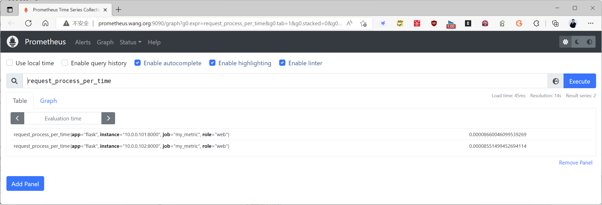
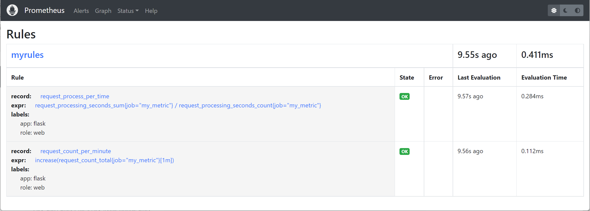
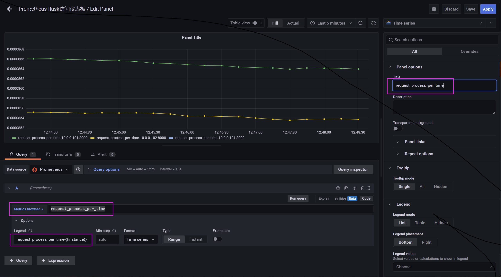
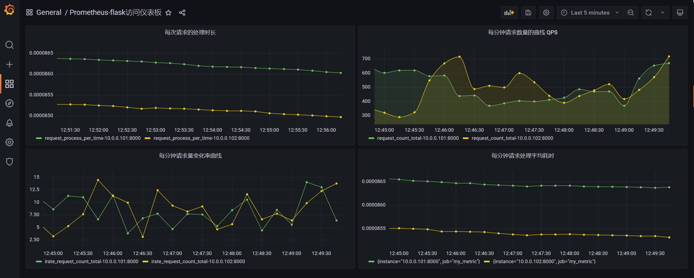
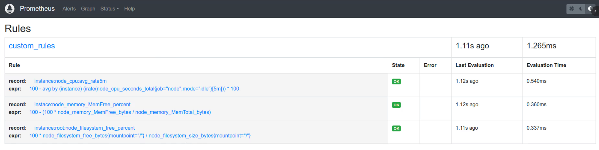
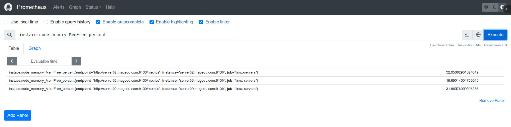

[← 返回 Prometheus 目录]({{ '/subjects/Prometheus/' | relative_url }})



# 11 记录规则

# 5 记录和告警规则


## 5.1 记录规则

### 5.1.1 规则简介

Prometheus 支持两种类型的规则：

记录规则
警报规则  

它们可以进行配置，然后定期进行评估。要将规则包含在Prometheus中，需要先创建一个包含必要规则语句的文件，并让Prometheus通过Prometheus配置中的rule_fies字段加载该文件。默认情况下，prometheus的规则文件使用YAML格式

规则的使用流程：

首先创建一个满足规则标准的规则语句，然后发送SIGHUP给Prometheus进程
prometheus在运行时重新加载规则文件，从而让规则在prometheus运行环境中生效  

规则语法检查：
```text
#promtool check rules prometheus_rues_file.yml
#说明：
当该文件在语法上有效时，检查器将已解析规则的文本表示形式打印到标准输出，然后以0返回状态退出。
如果有任何语法错误或无效的输入参数，它将打印一条错误消息为标准错误，并以1返回状态退出。
```

可以在prometheus.yaml配置文件中通过rule_fies属性进行导入即可，格式如下
```yaml
rule_files:
  - "first_rules.yml"
  - "second_rules.yml"
  - "../rules/*.yml"
#注意: 如果用相对路径是指相对于prometheus.yml配置文件的路径
```

### 5.1.2 记录规则说明
https://prometheus.io/docs/prometheus/latest/configuration/recording_rules/

在Prometheus的表达式浏览器进行的查询会生成的新的数据序列，但其结果仅会临时保存于Prometheus Server上

在样本数据量较大、工作较为繁忙的Prometheus Server上，对于那些查询频率较高且运算较为复杂的查询来说，实时查询可能会存在一定程度的响应延迟

记录规则的作用其实将之前的监控命令采用配置文件的方式进行编写，从而大大减轻工作量

记录规则(Recording rule）能够预先运行频繁用到或计算消耗较大的表达式，并将其结果保存为一组新的时间序列

记录规则是定义在Prometheus配置文件中的查询语句，由Server加载后以类似批处理任务的方式在后台周期性(evaluation_interval)的执行并记录查询结果

客户端只需要查询由记录规则生成的结果序列上的样本数据即可，速度远快于实时查询;常用于跨多个时间序列生成聚合数据，或者计算消耗较大的查询等场景中

多见于同可视化工具结合使用的需求中，也可用于生成可产生告警信息的时间序列

记录规则常用的场景：

将预先计算经常需要或计算量大的复杂的PromQL语句指定为一个独立的metric监控项，这样在查询的
时候就非常方便，而且查询预计算结果通常比每次需要原始表达式都要快得多，尤其是对于仪表板特别  
有用，仪表板每次刷新时都需要重复查询相同的表达式。  
此外在告警规则中也可以引用记录规则  
记录规则效果与shell中的别名相似  
```yaml
#规则文件的语法为：
groups:
  [ - <rule_group> ]
#简单的规则文件示例
groups:
  - name: example
    interval: 10s
    limit: <init> | default=0
    rules:
    - record: job:http_inprogress_requests:sum
      expr: sum(http_inprogress_requests) by (job)
      labels:
        [ <labelname>: <labelvalue> ]
   - name: example2
   ......
```

属性解析：
name        #规则组名，必须是唯一的
interval    #定制规则执行的间隔时间,默认值为prometheus.yml配置文件中的
global.evaluation_interval
limit:      #限制条件，对于记录规则用于限制其最多可生成序列数量，对于告警规则用于限制最多可生成的告
警数量
rules       #设定规则具体信息
record      #定制指标的名称
expr        #执行成功的PromQL
labels      #为该规则设定标签

### 5.1.3 记录规则案例

#### 5.1.3.1 案例说明
```text
#在Prometheus查询部分指标时需要通过将现有的规则组合成一个复杂的表达式，才能查询到对应的指标结果，比
如在查询"自定义的指标请求处理时间"，参考如下
request_processing_seconds_sum{instance="10.0.0.101:8000",job="my_metric"} /
request_processing_seconds_count{instance="10.0.0.101:8000",job="my_metric"}
#以上的查询语句写起来非常长，在我们graph绘图的时候，每次输入命令都是非常繁琐,很容易出现问题。
```

### 5.1.3 2 记录规则实现

范例：
```yaml
#创建规则记录文件
]# mkdir /usr/local/prometheus/rules
]# vim /usr/local/prometheus/rules/prometheus_record_rules.yml
groups:
- name: myrules
  rules:
  - record: "request_process_per_time"
    expr: request_processing_seconds_sum{job="my_metric"} /
request_processing_seconds_count{job="my_metric"}
    labels:
      app: "flask"
      role: "web"
  - record: "request_count_per_minute"
    expr: increase(request_count_total{job="my_metric"}[1m])
    labels:
      app: "flask"
      role: "web"
#检查规则文件有效性
]# promtool check config /usr/local/prometheus/conf/prometheus.yml
Checking /usr/local/prometheus-2.50.1.linux-amd64/conf/prometheus.yml
  SUCCESS: 1 rule files found
 SUCCESS: /usr/local/prometheus-2.50.1.linux-amd64/conf/prometheus.yml is valid
prometheus config file syntax
Checking /usr/local/prometheus-2.50.1.linux-amd64/rules/prometheus_record_rules.yml
  SUCCESS: 2 rules found
#只检查规则文件
]# promtool check rules /usr/local/prometheus/rules/prometheus_record_rules.yml
Checking /usr/local/prometheus/rules/prometheus_record_rules.yml
  SUCCESS: 2 rules found
#编辑prometheus配置文件
]# vim /usr/local/prometheus/conf/prometheus.yml
...
rule_files:
  - "../rules/*.yml"  #加此一行,如果是相对路径，是相对于prometheus.yml的路径
  # - "first_rules.yml"
...
#重启服务，加载prometheus配置
]#curl -X POST http://prometheus.bowen.org:9090/-/reload
]#systemctl reload prometheus.service
#访问测试
[root@ubuntu2404 ~]#while true ;do curl 127.0.0.1:8001/metrics;sleep
0.$[RANDOM%10];done
#登录到prometheus的web界面，可以通过request_prcess_per_time指标查询我们想要的数据，效果如下：
```



点击Status下面的Rules，查看效果



在 Grafana 图形使用记录规则





范例：系统相关指标的记录规则
```yaml
vim /usr/local/prometheus/rules/prometheus_record_rules.yml
groups:
- name: custom_rules
  interval: 5s
  rules:
  - record: instance:node_cpu:avg_rate5m
    expr: 100 - avg(irate(node_cpu_seconds_total{job="node_exporter", mode="idle"}
[5m])) by (instance) * 100
  - record: instace:node_memory_MemFree_percent
    expr: 100 - (100 * node_memory_MemFree_bytes / node_memory_MemTotal_bytes)
  - record: instance:root:node_filesystem_free_percent
    expr: 100 * node_filesystem_free_bytes{mountpoint="/"} /
node_filesystem_size_bytes{mountpoint="/"}
vim /usr/local/prometheus/conf/prometheus.yml
...
rule_files:
  - "../rules/*.yml"  #加此一行,如果是相对路径，是相对于prometheus.yml的路径
```





范例：MySQL 记录规则
```yaml
vim /usr/local/prometheus/rules/mysql_record_rules.yml
groups:
- name: mysqld_rules
  rules:
  # Record slave lag seconds for pre-computed timeseries that takes
  # `mysql_slave_status_sql_delay` into account
  - record: instance:mysql_slave_lag_seconds
    expr: mysql_slave_status_seconds_behind_master - mysql_slave_status_sql_delay
  # Record slave lag via heartbeat method
  - record: instance:mysql_heartbeat_lag_seconds
    expr: mysql_heartbeat_now_timestamp_seconds -
mysql_heartbeat_stored_timestamp_seconds
  - record: job:mysql_transactions:rate5m
    expr: sum without (command) (rate(mysql_global_status_commands_total{command=~"
(commit|rollback)"}[5m]))
```



<nav class="article-end" aria-label="章节导航">
  <a href="{{ '/subjects/Prometheus/10-label-management.html' | relative_url }}">← 上一章：标签管理</a>
  <a href="{{ '/subjects/Prometheus/' | relative_url }}">返回 Prometheus 目录</a>
  <a href="{{ '/subjects/Prometheus/12-alertmanager-rules.html' | relative_url }}">下一章：Alertmanager 部署与告警规则 →</a>
</nav>
