[← 返回 Prometheus 目录]({{ '/subjects/Prometheus/' | relative_url }})



# 12 Alertmanager 部署与告警规则

本章把“发现异常”和“通知值班人员”连成一条链路：Prometheus 执行规则并判断告警状态；Alertmanager 接收告警，负责分组、去重、路由与通知。先理解两者的分工，再部署、接入并做一次端到端验证。

## 5.2 告警说明和 Alertmanager 部署

### 5.2.1 告警介绍

监控图表适合观察趋势，但值班人员不可能一直盯着屏幕。告警规则将指标变化转换为异常信号，通知系统再把信号送到合适的人。Prometheus 负责采集、存储和规则求值；Alertmanager 负责接收、处理和发送告警。即使 Prometheus 的 Alerts 页面已有 `firing` 告警，若 Alertmanager 或接收者配置错误，邮件仍不会到达。参阅 [官方告警概览](https://prometheus.io/docs/alerting/latest/overview/)。

### 5.2.2 告警组件

告警规则在 Prometheus 中定义并周期性求值。表达式刚满足时进入 `pending`；持续达到规则中的 `for` 时间后进入 `firing`，由 Prometheus 发送给 Alertmanager。Alertmanager 不负责计算 PromQL，而是按标签对收到的告警去重、分组、路由，再通过邮件或 Webhook 等接收方式通知。静默与抑制可以减少维护期间或级联故障中的干扰。

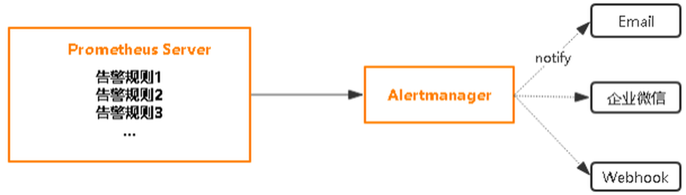

### 5.2.3 告警特性

详见 [Alertmanager 官方说明](https://prometheus.io/docs/alerting/latest/alertmanager/)。

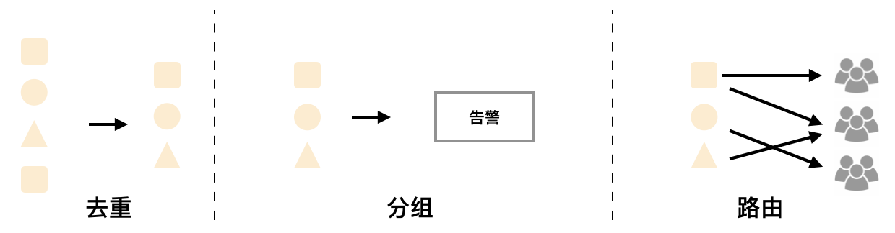

- **去重**：同一告警由多个 Prometheus 副本发送时，避免重复通知。
- **分组**：将共享指定标签的告警合并为一条通知。例如集群故障导致数百台机器失联时，可先等待 `group_wait` 时间，把相关告警一起发送。
- **抑制（inhibition）**：已有上游故障告警时，不再通知由它引发的下游告警。原始告警依然存在，只是通知被抑制。
- **静默（silence）**：按标签和时间范围暂时停止通知，适合计划维护；可在 Alertmanager Web 页面设置。
- **路由**：按标签将不同告警送到不同接收人或渠道，例如严重故障发给值班组。

分组时间、重复通知间隔和接收渠道均在 Alertmanager 配置文件中设定。静默与抑制的目的都是减少噪声，但前者由维护窗口和匹配器决定，后者由同时生效的告警之间的关系决定。

### 5.2.4 Alertmanager 部署

本节给出二进制和容器两种安装方式；按实际环境选择一种即可。Ansible 部署可参考对应社区 role。示例沿用原实验版本，部署时应从官方发布页选取与系统架构匹配的版本。

#### 5.2.4.1 二进制部署

Alertmanager [官方下载页](https://github.com/prometheus/alertmanager/releases)。

软件安装配置
```bash
wget https://github.com/prometheus/alertmanager/releases/download/v0.23.0/alertmanager-0.23.0.linux-amd64.tar.gz
tar xf alertmanager-0.23.0.linux-amd64.tar.gz -C /usr/local/
ln -s /usr/local/alertmanager-0.23.0.linux-amd64 /usr/local/alertmanager
useradd -r -s /sbin/nologin prometheus
cd /usr/local/alertmanager
mkdir -p bin conf data
mv alertmanager amtool bin/
mv alertmanager.yml conf/
chown -R prometheus:prometheus /usr/local/alertmanager-0.23.0.linux-amd64
```

创建 `/etc/systemd/system/alertmanager.service`。`ExecStart` 是一行命令；不要把原 PDF 的自动换行复制进服务文件。
```ini
[Unit]
Description=Prometheus Alertmanager
After=network-online.target
Wants=network-online.target

[Service]
Type=simple
User=prometheus
Group=prometheus
ExecStart=/usr/local/alertmanager/bin/alertmanager --config.file=/usr/local/alertmanager/conf/alertmanager.yml --storage.path=/usr/local/alertmanager/data --web.listen-address=0.0.0.0:9093
Restart=on-failure

[Install]
WantedBy=multi-user.target
```

启动后检查服务、就绪端点和指标：

```bash
systemctl daemon-reload
systemctl enable --now alertmanager.service
systemctl status alertmanager.service
curl -fsS http://127.0.0.1:9093/-/ready
curl -fsS http://127.0.0.1:9093/metrics | head
```

`9093` 是 Web/API 与指标端口；`9094` 用于 Alertmanager 集群通信。可访问 `http://<Alertmanager 主机>:9093/` 查看 Web 界面。若未启动，先看 `journalctl -u alertmanager -e` 和配置检查结果。

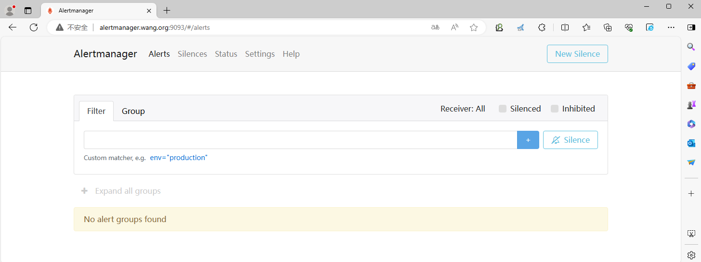

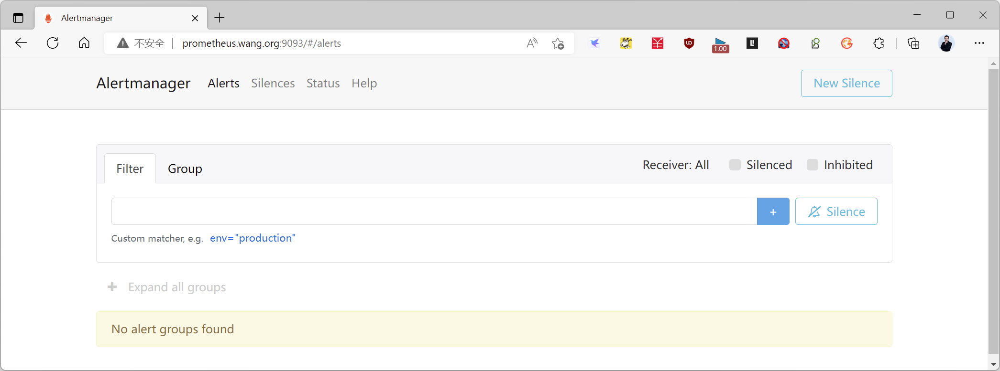

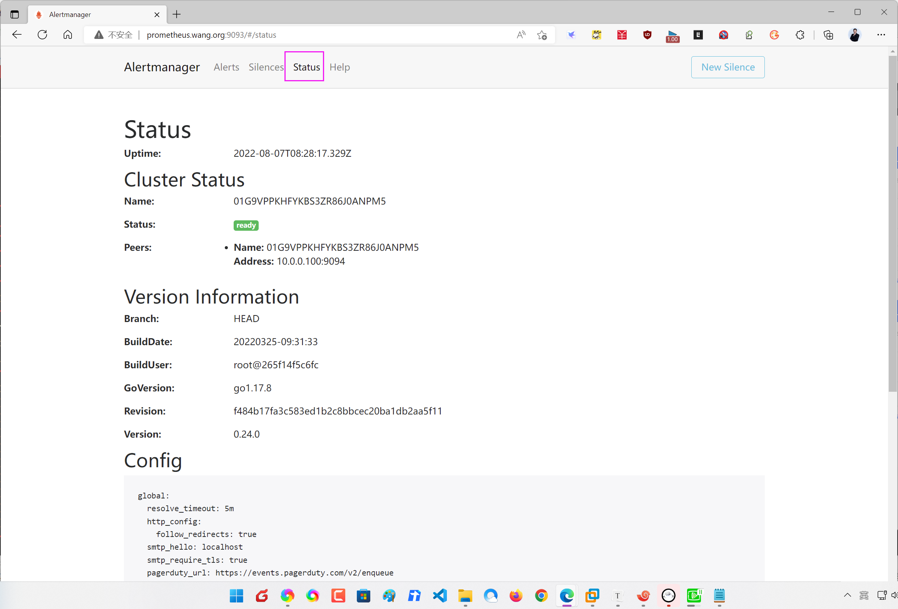

Alertmanager 通过9093端口暴露指标

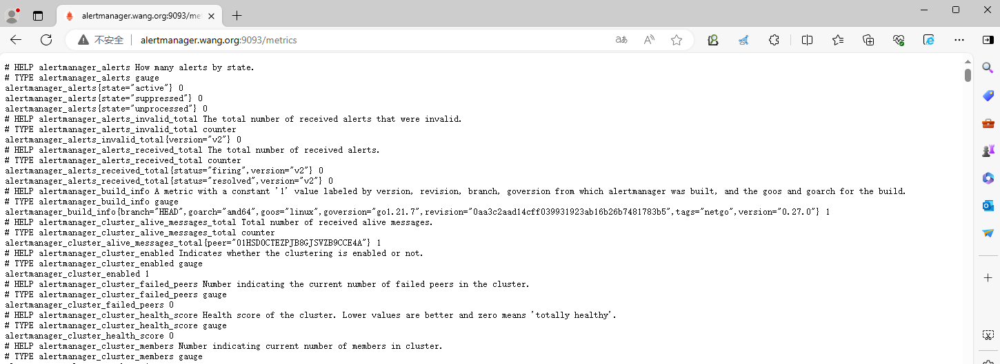

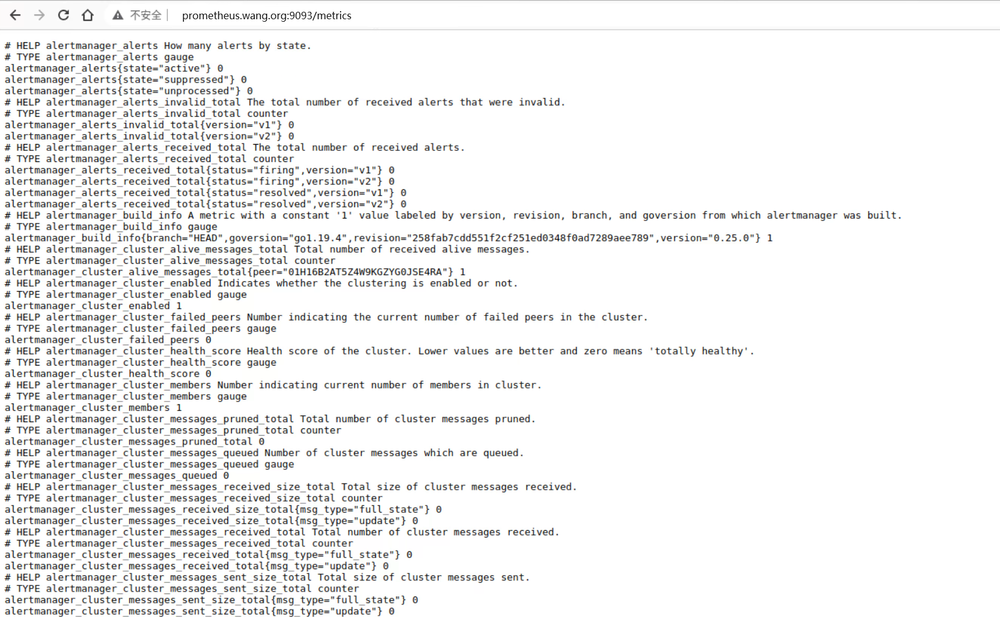

#### 5.2.4.2 Ansible 方式部署

批量主机可使用 [prometheus-community 的 Alertmanager role](https://github.com/prometheus-community/ansible/tree/main/roles/alertmanager)，但配置项和服务文件仍应与所选版本保持一致。

#### 5.2.4.3 容器方式部署

以下示例把本地配置文件和运行数据分别挂载到容器内。配置文件路径必须与 `--config.file` 完全一致；不要同时启动前面的二进制实例占用 `9093`。

```yaml
services:
  alertmanager:
    image: prom/alertmanager:v0.24.0
    volumes:
      - ./alertmanager.yml:/etc/alertmanager/alertmanager.yml:ro
      - alertmanager_data:/alertmanager
    restart: unless-stopped
    ports:
      - "9093:9093"
    command:
      - --config.file=/etc/alertmanager/alertmanager.yml
      - --storage.path=/alertmanager

volumes:
  alertmanager_data:
```

### 5.2.5 Prometheus 集成

先在 `prometheus.yml` 中指定发送告警的目标。下面是静态目标示例；若已有其他配置，把这些键合并到原文件中，不要复制出第二个顶层 `scrape_configs`。

```yaml
alerting:
  alertmanagers:
    - static_configs:
        - targets: ["10.0.0.100:9093"]

scrape_configs:
  - job_name: alertmanager
    static_configs:
      - targets: ["10.0.0.100:9093"]
```

`alerting` 用于**发送**告警，`scrape_configs` 只是**采集** Alertmanager 自身的指标，两者不可互相替代。目标较多时可选文件发现，但要按 `file_sd_configs` 的格式单独建立目标文件。检查并加载配置：

```bash
promtool check config /usr/local/prometheus/conf/prometheus.yml
systemctl reload prometheus.service
```

在 Prometheus 的 Runtime 页面确认配置加载，在 Targets 页面确认 Alertmanager 自身指标可以采集。

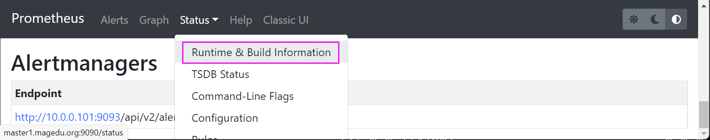

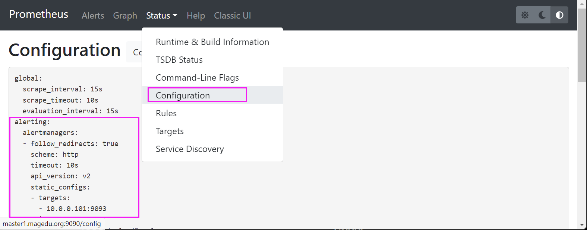

### 5.2.6 Alertmanager 配置文件

#### 5.2.6.1 配置文件的结构

配置说明以 [官方文档](https://prometheus.io/docs/alerting/latest/configuration/) 为准。最小可用配置需有顶层路由和与之同名的接收者；`global` 提供共用设置，`templates` 和 `inhibit_rules` 按需添加。下面用占位地址展示结构，不能直接把示例凭据用于实际环境。

```yaml
global:
  resolve_timeout: 5m
  smtp_smarthost: 'smtp.example.com:587'
  smtp_from: 'alerts@example.com'
  smtp_auth_username: 'alerts@example.com'
  smtp_auth_password: 'SMTP_APP_PASSWORD'
  smtp_require_tls: true

route:
  receiver: email
  group_by: ['alertname', 'cluster']
  group_wait: 30s
  group_interval: 5m
  repeat_interval: 4h

receivers:
  - name: email
    email_configs:
      - to: 'oncall@example.com'
        send_resolved: true
```

路由是一棵按标签匹配的树。所有告警从顶层 `route` 进入，再由子路由决定更具体的接收者；示例只有顶层路由，因此全部送往 `email`。原资料将 `route.receiver` 写为 `bowen`，却仅定义名为 `admin` 的接收者，配置检查会失败。这里将两处名称统一。

三个时间参数含义不同：

- `group_wait`：新告警组首次通知前，等待同组其他告警进入的时间。
- `group_interval`：已有告警组发生变化后，再次发送该组通知的最短间隔。
- `repeat_interval`：告警持续未恢复、且没有新变化时，重复提醒的间隔。

可通过 `amtool check-config /usr/local/alertmanager/conf/alertmanager.yml` 检查语法与接收者引用，再重启服务并查看日志。注意将 SMTP 授权码放到妥善保护的本地配置中，不要提交真实凭据。
#### 5.2.6.2 启用邮件告警

邮件通知需要可用的 SMTP 账户及应用授权码。不同服务商对 25、465、587 端口和 TLS 模式的要求不同，应按当前服务商文档配置；原资料中的 `smtp.qq.com:25或465` 只是备注，不能作为实际地址。QQ、网易等邮箱的设置界面可参考下图，具体入口可能随服务商更新。


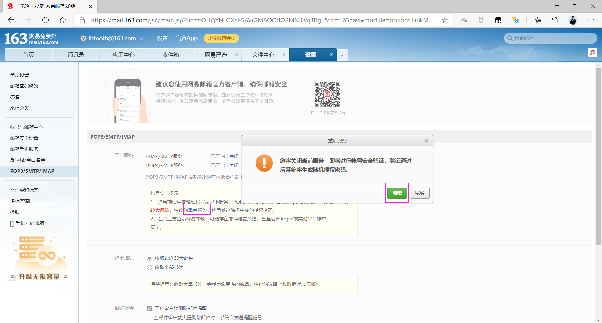

上一节的 YAML 已包含邮件路由。把其中的主机、发件地址、收件地址和授权码换成当前环境的值，并保证 `route.receiver` 与 `receivers[].name` 相同。发件凭据要避免出现在公开仓库中；示例里用 `SMTP_APP_PASSWORD` 标记需要填写的值。

```bash
amtool check-config /usr/local/alertmanager/conf/alertmanager.yml
systemctl restart alertmanager.service
journalctl -u alertmanager -n 50 --no-pager
```

配置检查只能确认结构，不能证明邮件服务商接受认证。后面触发测试告警后，如果 Alertmanager 页面已有告警却收不到邮件，再检查 SMTP 端口、认证、TLS 和日志。原资料给出的 `repeat_interval: 10s` 会在故障持续时频繁发信，可能触发邮件服务商限流；前例使用较长间隔。

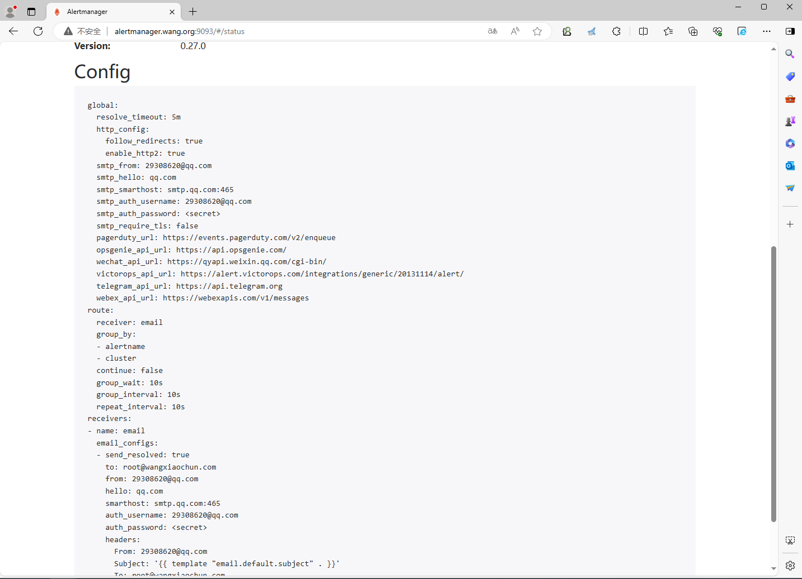
## 5.3 告警规则

### 5.3.1 告警规则说明

告警规则写在 Prometheus 的规则文件中，由 `rule_files` 加载。表达式 `expr` 返回的每条时间序列都可能形成一个告警实例。表达式开始成立时进入 `pending`；连续满足 `for` 后进入 `firing`；不再满足时恢复。持续时间应与抓取及规则评估间隔配合，避免单次抖动引发通知。

下面先给出一条完整规则。这里的 `up` 表示“已配置的目标是否采集成功”，不是业务接口是否返回正常内容。

```yaml
groups:
  - name: service-availability
    rules:
      - alert: InstanceDown
        expr: up{job="my_metric"} == 0
        for: 1m
        labels:
          severity: critical
        annotations:
          summary: "{{ $labels.instance }} 无法采集"
          description: "job={{ $labels.job }} 的目标已连续 1 分钟无法采集。"
```

`alert` 是告警名称；`labels` 可用于分组和路由；`annotations` 是给人看的说明。模板中的 `{{ $labels.instance }}` 引用触发序列的标签，`{{ $value }}` 可引用表达式结果。需要特别注意：若目标从服务发现中消失，`up` 序列也可能消失，单纯的 `up == 0` 不会凭空生成告警；这类场景还需监测服务发现或预期目标数量。

规则文件保存为 `/usr/local/prometheus/rules/service.yml` 后，在 `prometheus.yml` 顶层加入：

```yaml
rule_files:
  - /usr/local/prometheus/rules/*.yml
```

再检查规则、主配置并重载：

```bash
promtool check rules /usr/local/prometheus/rules/service.yml
promtool check config /usr/local/prometheus/conf/prometheus.yml
systemctl reload prometheus.service
```

复杂表达式可先用记录规则预计算，再在告警表达式中引用；同时要核对记录规则的评估周期和标签。更多示例见 [官方告警规则文档](https://prometheus.io/docs/prometheus/latest/configuration/alerting_rules/) 与 [社区规则合集](https://samber.github.io/awesome-prometheus-alerts/)。社区规则不能直接整包复制：Exporter 版本、指标名、业务阈值和 `for` 时间都要依据实际数据确认。

例如内存剩余率、CPU 忙碌率与 Blackbox 探测结果分别可以这样判断：

```yaml
groups:
  - name: host-and-probe
    rules:
      - alert: HostLowAvailableMemory
        expr: node_memory_MemAvailable_bytes / node_memory_MemTotal_bytes < 0.1
        for: 2m
        labels:
          severity: warning
        annotations:
          summary: "{{ $labels.instance }} 可用内存不足 10%"
      - alert: HostHighCpuUsage
        expr: 1 - avg by (instance) (rate(node_cpu_seconds_total{mode="idle"}[5m])) > 0.8
        for: 5m
        labels:
          severity: warning
        annotations:
          summary: "{{ $labels.instance }} CPU 使用率超过 80%"
      - alert: BlackboxProbeFailed
        expr: probe_success == 0
        for: 1m
        labels:
          severity: critical
        annotations:
          summary: "{{ $labels.instance }} 探测失败"
```

内存规则使用可回收缓存后的 `MemAvailable`，而不是简单的 `MemFree`；CPU 规则先按实例平均空闲核，再从 1 减去空闲比例。Blackbox 规则要求先配置相应探测任务。MySQL、网络与磁盘规则同理，应先在 Prometheus 表达式浏览器确认指标存在且标签匹配，再决定阈值。原资料中长篇社区示例含 PDF 折行，直接复制会导致 YAML 或 PromQL 失效，这里保留可检查的代表性规则并解释判断依据。

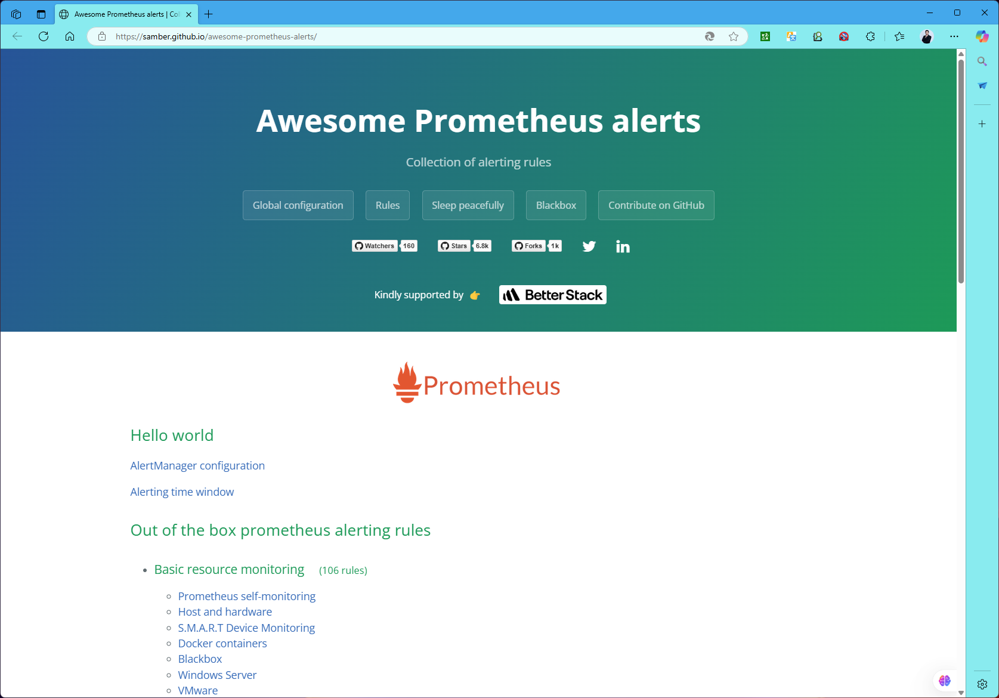
### 5.3.2 告警规则案例：邮件通知

#### 5.3.2.1 验证思路

先在 Prometheus 表达式浏览器查询 `up{job="my_metric"}`，确认目标正常时值为 `1`。本例停止相应的 Flask 指标服务，使下一次抓取失败并得到 `0`。如果规则已按上一节加载，告警会先变成 `pending`，持续满 1 分钟后变成 `firing`。随后还需等待 Alertmanager 的 `group_wait`，邮件才会发送。

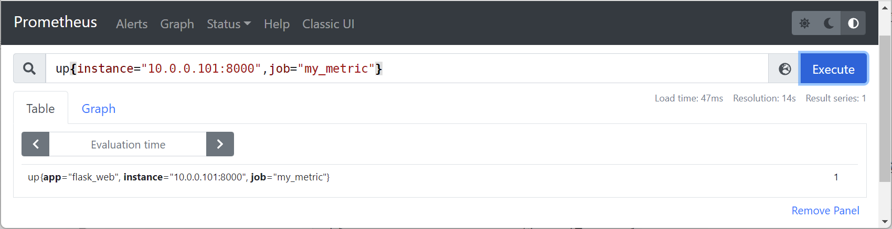

#### 5.3.2.2 检查告警状态

在 Prometheus 的 **Status → Targets** 中确认目标为 `DOWN`；在 **Alerts** 页面确认 `InstanceDown` 规则先后经历以下状态：

- `inactive`：表达式不成立，目标正常。
- `pending`：表达式成立，但尚未达到 `for: 1m`。
- `firing`：表达式持续成立，Prometheus 正向 Alertmanager 发送告警。

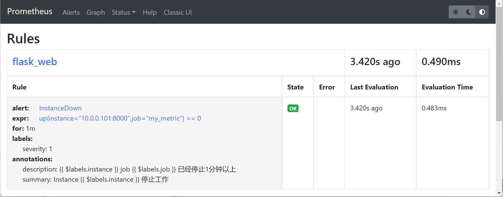

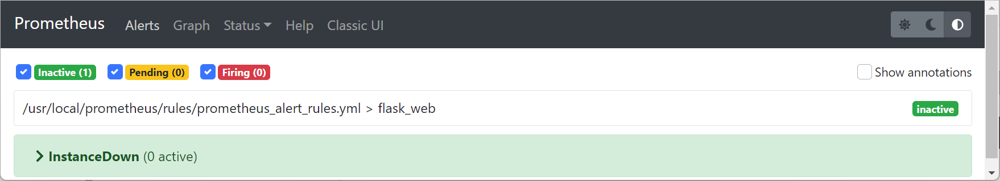

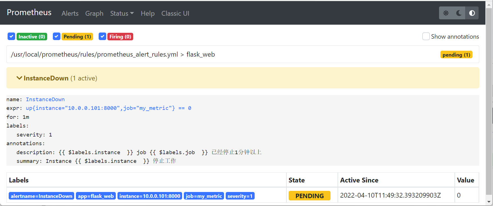

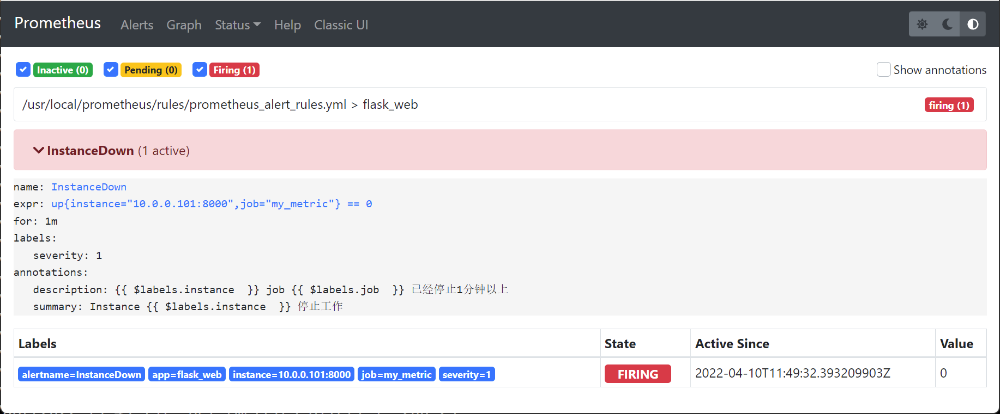

#### 5.3.2.3 核对 Alertmanager 与邮件

在 Alertmanager Web 页面确认告警及其分组，再核对邮箱。恢复 Flask 服务后，若邮件接收者配置了 `send_resolved: true`，还应收到恢复通知。

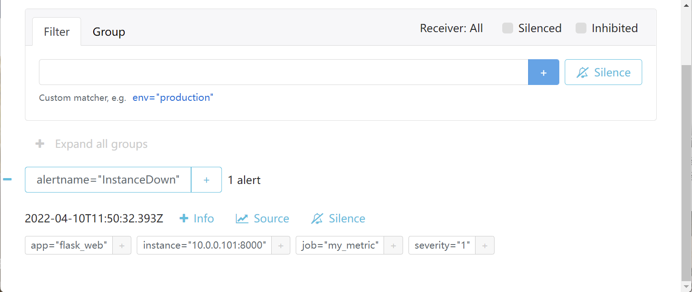

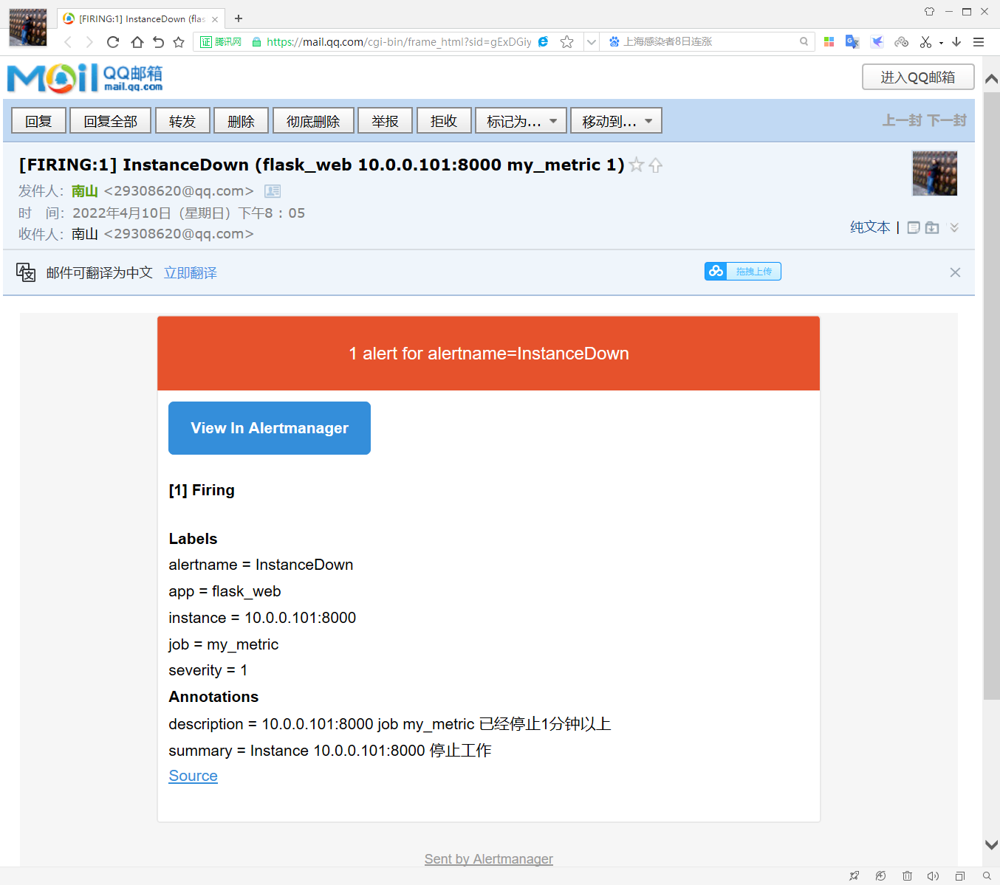

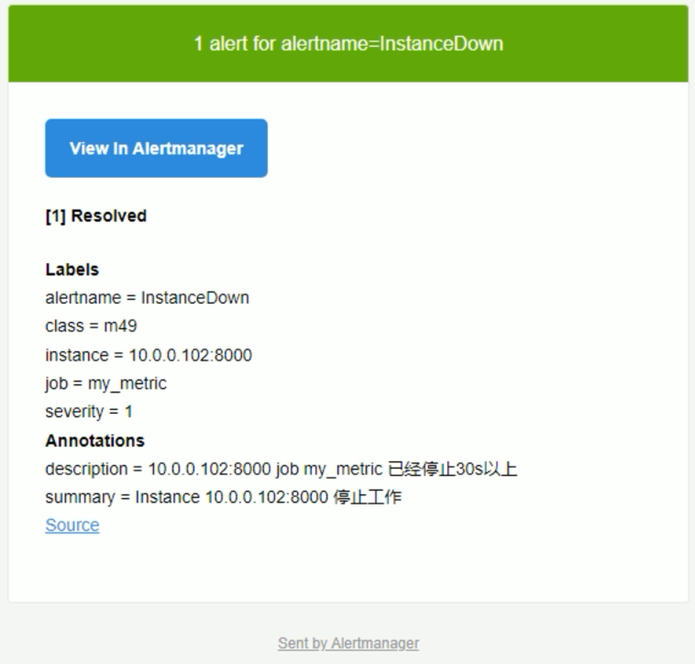

排查时按链路向后检查：目标已 `DOWN` 却没有 `pending`，看规则文件是否加载、`job` 标签是否匹配；已 `firing` 却未到 Alertmanager，看 `alerting.alertmanagers`、网络和日志；Alertmanager 已收到但邮箱无信，看路由接收者、SMTP 认证、端口及 TLS。只看邮件无法区分这三类故障。

#### 5.3.2.4 维护期间的静默

在 Alertmanager 的 **Silences** 页面按 `alertname`、`instance` 等标签创建有起止时间的静默。静默只暂停匹配告警的**通知**，不会停止采集或规则评估。维护完成后应提前结束静默，并确认目标已恢复。

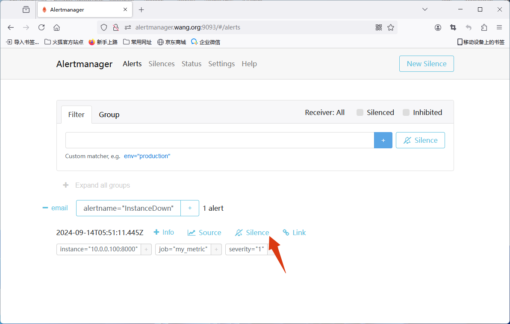

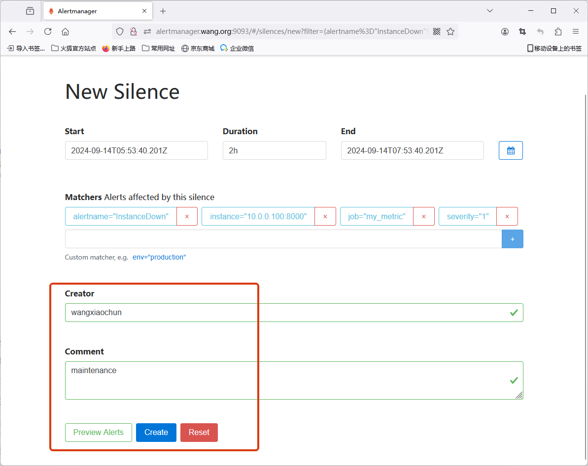

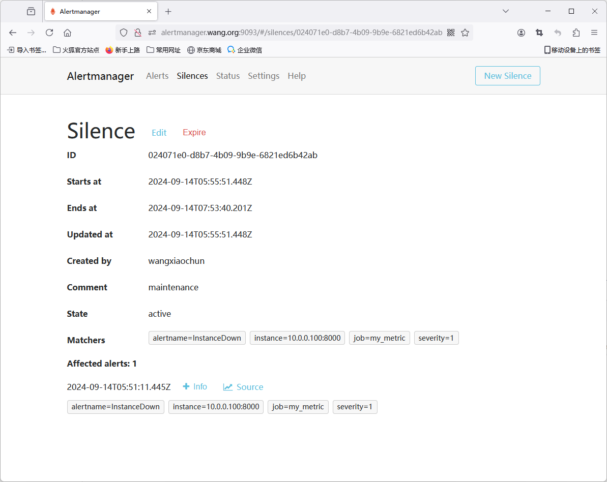

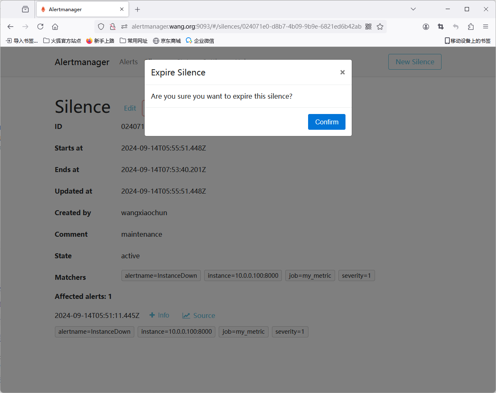

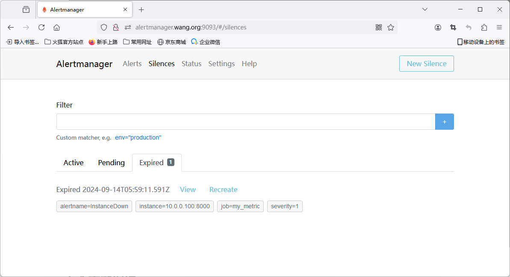

下一章进一步讨论通知模板、标签路由与抑制规则，它们分别决定通知的内容、去向以及级联告警的收敛方式。


<nav class="article-end" aria-label="章节导航">
  <a href="{{ '/subjects/Prometheus/11-recording-rules.html' | relative_url }}">← 上一章：记录规则</a>
  <a href="{{ '/subjects/Prometheus/' | relative_url }}">返回 Prometheus 目录</a>
  <a href="{{ '/subjects/Prometheus/13-alert-templates-routing.html' | relative_url }}">下一章：告警模板、路由与抑制 →</a>
</nav>
