[← 返回 Prometheus 目录]({{ '/subjects/Prometheus/' | relative_url }})



# 12 Alertmanager 部署与告警规则

## 5.2 告警说明和 Alertmanager 部署

### 5.2.1 告警介绍

官方文档
https://prometheus.io/docs/alerting/latest/overview/

Prometheus作为一个大数据量场景下的监控平台来说，数据收集是核心功能，虽然监控数据可视化了，也非常容易观察到运行状态。但是最能产生价值的地方就是对数据分析后的告警处理措施，因为我们很难做到时刻盯着监控并及时做出正确的决策，所以程序来帮巡检并自动告警，是保障业务稳定性的决定性措施。可以说任何一个监控平台如果没有告警平台，那么他就逊色不少甚至都不能称之为平台。

Prometheus报警功能主要是利用Alertmanager这个组件来实现功能的。Alertmanager作为一个独立的组件，负责接收并处理来自Prometheus Server(也可以是其它的客户端程序)的告警信息。Alertmanager可以对这些告警信息进行进一步的处理，比如当接收到大量重复告警时能够消除重复的告警信息，同时对告警信息进行分组并且路由到正确的通知方，Prometheus内置了对邮件，Slack等多种通知方式的支持，同时还支持与Webhook的集成，以支持更多定制化的场景。

### 5.2.2 告警组件

告警能力在Prometheus的架构中被划分成两个独立的部分。

通过在Prometheus中定义AlertRule(告警规则)，Prometheus会周期性的对告警规则进行计算，如果满
足告警触发条件就会向Alertmanager发送告警信息。  
然后，Alertmanager管理这些告警，包括进行重复数据删除，分组和路由，以及告警的静默和抑制  

当Alertmanager接收到 Prometheus 或者其它应用发送过来的 Alerts 时，Alertmanager 会对 Alerts 进行去重复，分组，按标签内容发送不同报警组，包括：邮件，微信，Webhook。AlertManager还提供了静默和告警抑制机制来对告警通知行为进行优化。


### 5.2.3 告警特性
https://prometheus.io/docs/alerting/latest/alertmanager/

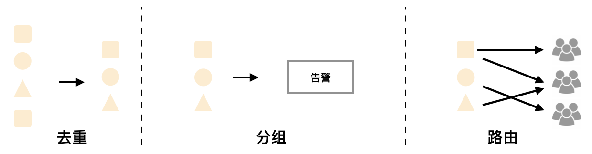

去重
将多个相同的告警,去掉重复的告警,只保留不同的告警  
分组 Grouping  

分组机制可以将相似的告警信息合并成一个通知。
在某些情况下，比如由于系统宕机导致大量的告警被同时触发，在这种情况下分组机制可以将这些被触  
发的告警合并为一个告警通知，避免一次性接受大量的告警通知，而无法对问题进行快速定位。  

告警分组，告警时间，以及告警的接受方式可以通过Alertmanager的配置文件进行配置。
抑制 Inhibition  
系统中某个组件或服务故障，那些依赖于该组件或服务的其它组件或服务可能也会因此而触发告警，抑  
制便是避免类似的级联告警的一种特性，从而让用户能将精力集中于真正的故障所在  
抑制可以避免当某种问题告警产生之后用户接收到大量由此问题导致的一系列的其它告警通知  
抑制的关键作用在于，同时存在的两组告警条件中，其中一组告警如果生效，能使得另一组告警失效  
同样通过Alertmanager的配置文件进行设置  
静默 Silent  
静默提供了一个简单的机制可以快速根据标签在一定的时间对告警进行静默处理。  

如果接收到的告警符合静默的配置，Alertmanager则不会发送告警通知。

比如：通常在系统例行维护期间，需要激活告警系统的静默特性
静默设置可以在Alertmanager的Web页面上进行设置。  
路由 Route  

将不同的告警定制策略路由发送至不同的目标，比如：不同的接收人或接收媒介

### 5.2.4 Alertmanager 部署

二进制安装
Ansible部署  
容器部署  

#### 5.2.4.1 二进制部署

Alertmanager 下载链接
https://github.com/prometheus/alertmanager/releases

软件安装配置
```text
#获取软件
]# wget
https://github.com/prometheus/alertmanager/releases/download/v0.23.0/alertmanager-0.23.0.linux-amd64.tar.gz
#解压软件
]# tar xf alertmanager-0.23.0.linux-amd64.tar.gz -C /usr/local/
]# ln -s /usr/local/alertmanager-0.23.0.linux-amd64 /usr/local/alertmanager
#准备工作
]# cd /usr/local/alertmanager
]# mkdir {bin,conf,data}
]# mv alertmanager amtool bin/
]# cp alertmanager.yml conf/
]# useradd -r -s /sbin/nologin prometheus
]# chown -R prometheus:prometheus /usr/local/alertmanager/
```

服务文件
```ini
]# cat /lib/systemd/system/alertmanager.service
[Unit]
Description=alertmanager project
After=network.target
[Service]
Type=simple
ExecStart=/usr/local/alertmanager/bin/alertmanager --
config.file=/usr/local/alertmanager/conf/alertmanager.yml --
storage.path=/usr/local/alertmanager/data --web.listen-address=0.0.0.0:9093
ExecReload=/bin/kill -HUP $MAINPID
Restart=on-failure
User=prometheus
Group=prometheus
[Install]
WantedBy=multi-user.target
#属性解析：最好配置 --web.listen-address ，因为默认的配置是:9093,有可能在启动时候报错
#启动服务
]# systemctl daemon-reload
]# systemctl enable --now alertmanager.service
]# systemctl status alertmanager.service
#端口检查
[root@prometheus ~]#ss -ntlp|grep alertmanager
LISTEN 0  4096               *:9093            *:*    users:
(("alertmanager",pid=145545,fd=8))
LISTEN 0  4096               *:9094            *:*    users:
(("alertmanager",pid=145545,fd=3))
]# netstat -tnulp | egrep 'Pro|ale'
Proto Recv-Q Send-Q Local Address           Foreign Address         State
PID/Program name
tcp        0  0 10.0.0.101:9093       0.0.0.0:*               LISTEN
 25490/alertmanager
tcp6       0  0 :::9094                 :::*                    LISTEN
 25490/alertmanager
udp6       0  0 :::9094                 :::*
 25490/alertmanager
#结果显示：当前主机上出现了两个端口9093(与prometheus交互端口)和9094(Alertmanager集群HA mode使
用)
#查看AlertManager也会暴露指标
]# curl http://127.0.0.1:9093/metrics/
```

可以通过访问  来看 alertmanager 提供的 Web 界面
http://alertmanager_server:9093/

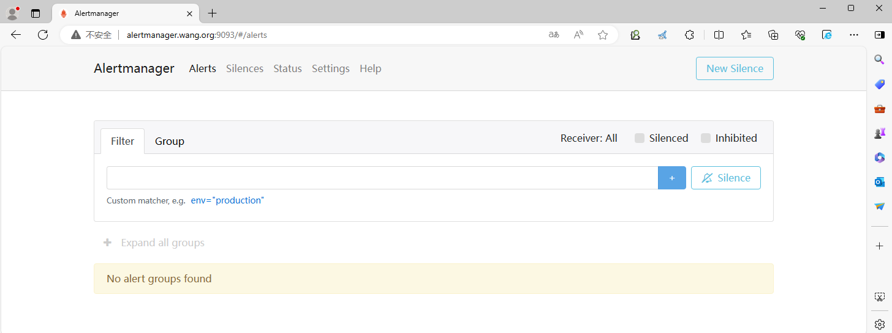

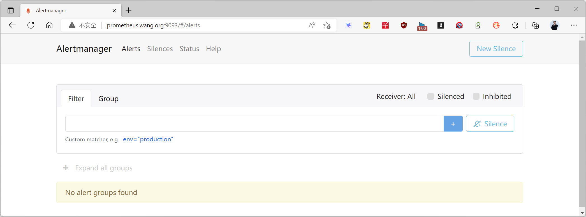

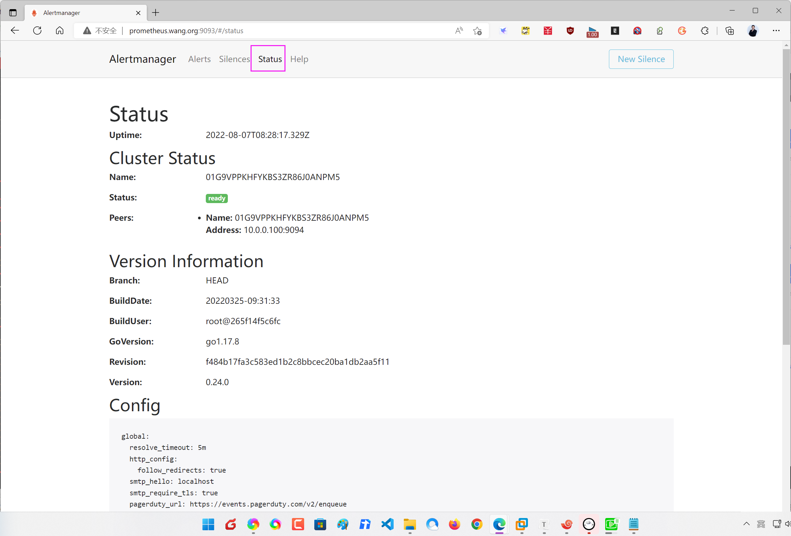

Alertmanager 通过9093端口暴露指标

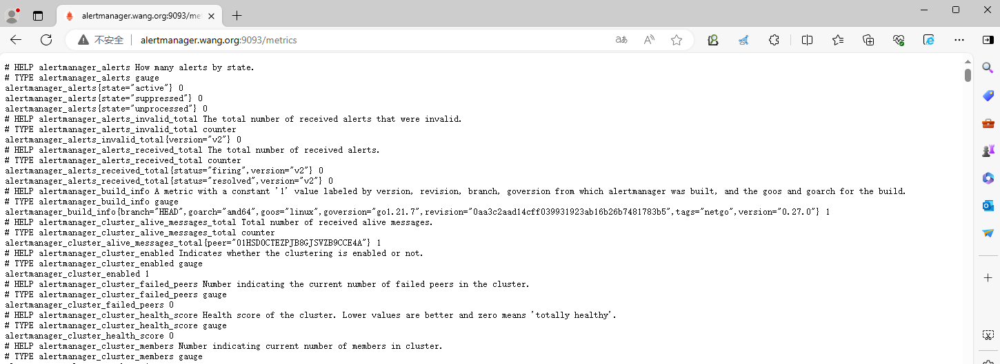

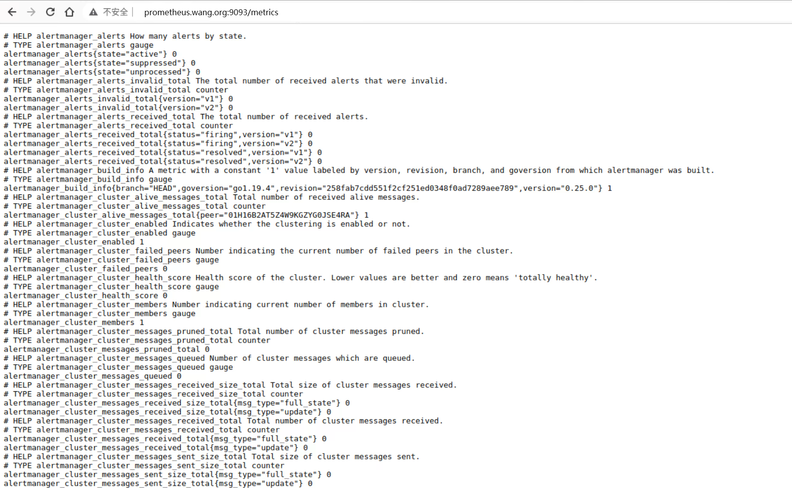

#### 5.2.4.2 Ansible 方式部署
https://github.com/prometheus-community/ansible/tree/main/roles/alertmanager

#### 5.2.4.3 容器方式部署

范例：基于 docker compose 方式部署
```text
version: '3.6'
#volumes:
#  alertmanger_data: {}
networks:
  monitoring:
    driver: bridge
    ipam:
      config:
         - subnet: 172.31.0.0/24
services:
  alertmanager:
    image: prom/alertmanager:v0.24.0
    volumes:
      - ./alertmanager/:/etc/alertmanager/
      #-  alertmanger_data:/alertmanager
    networks:
      - monitoring
    restart: always
    ports:
      - 9093:9093
    command:
      - '--config.file=/etc/alertmanager/config.yml'
      - '--storage.path=/alertmanager'
      - '--log.level=debug'
```

### 5.2.5 Prometheus 集成

配置修改
```yaml
#修改配置文件，加载alertmanager配置属性
#方式1：静态配置
]# vim /usr/local/prometheus/conf/prometheus.yml
...
alerting:
  alertmanagers:
  - static_configs:
    - targets: ["10.0.0.100:9093"]
...
#注意：alertmanager服务启动时候的监控开放主机地址必须保证正确，否则服务无法启动
#方式2: 文件发现
]# vim /usr/local/prometheus/conf/prometheus.yml
...
alerting:
  alertmanagers:
  - file_sd_configs:
    - "targets/alertmanager*.yaml"
]# vim /usr/local/prometheus/conf/targets/alertmanager.yaml
- targets:
  - alert.bowen.org:9093
  labels:
    app: alertmanager
    job: alertmanager
#检查语法
]# promtool check config /usr/local/prometheus/conf/prometheus.yml
#重启服务，加载配置
]# systemctl reload prometheus.service
#建议配置alertmanager自身也被Prometheus监控
#方式1:静态配置
]# vim /usr/local/prometheus/conf/prometheus.yml
scrape_configs:
  - job_name: "alertmanager"
    static_configs:
      - targets: ["alertmanager.bowen.org:9093"]
#方式2:文件发现
]# vim /usr/local/prometheus/conf/prometheus.yml
scrape_configs:
  - job_name: "alertmanager"
    file_sd_configs:
    - files:
      - targets/alertmanager.yaml
]# vim /usr/local/prometheus/conf/targets/alertmanager.yaml
- targets:
  - alert.bowen.org:9093
  labels:
    app: alertmanager
    job: alertmanager
```

浏览器访问prometheus的web界面查看Runtime信息，查看效果

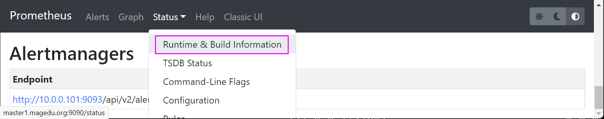

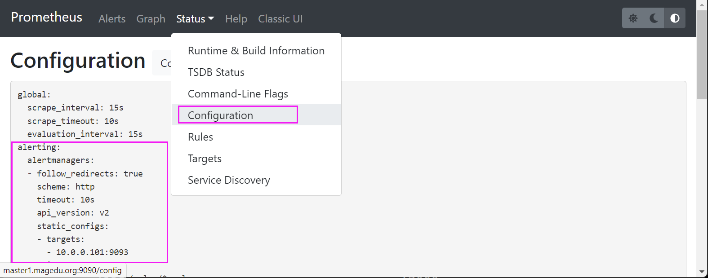

### 5.2.6 Alertmanager 配置文件

#### 5.2.6.1 Alertmanager 配置文件说明

官文文档
https://prometheus.io/docs/alerting/latest/configuration/

Alertmanager 通过yml格式的配置文件

Alertmanager 配置文件格式说明
```yaml
#配置文件总共定义了五个模块，global、templates、route，receivers，inhibit_rules
global:
  resolve_timeout: 1m
  smtp_smarthost: 'localhost:25'
  smtp_from: 'ops@example.com'
  smtp_require_tls: false
templates:
- '/etc/alertmanager/template/*.tmpl'
route:
  receiver: 'bowen'
  group_by: ['alertname']
  group_wait: 20s
  group_interval: 10m
  repeat_interval: 3h
receivers:
- name: 'admin'
  email_configs:
  - to: 'admin@example.com'
#说明
global
#用于定义Alertmanager的全局配置。
#相关配置参数
resolve_timeout #定义持续多长时间未接收到告警标记后，就将告警状态标记为resolved
smtp_smarthost  #指定SMTP服务器地址和端口
smtp_from #定义了邮件发件的的地址
smtp_require_tls #配置禁用TLS的传输方式
templates
#用于指定告警通知的信息模板，如邮件模板等。由于Alertmanager的信息可以发送到多种接收介质，如邮件、微
信等，通常需要能够自定义警报所包含的信息，这个就可以通过模板来实现。
route
#用于定义Alertmanager接收警报的处理方式，根据规则进行匹配并采取相应的操作。
路由是一个基于标签匹配规则的树状结构，所有的告警信息都会从配置中的顶级路由(route)进入路由树。从顶级路
由开始，根据标签匹配规则进入到不同的子路由，并且根据子路由设置的接收者发送告警。在示例配置中只定义了顶
级路由，并且配置的接收者为bowen，因此，所有的告警都会发送给到admin的接收者。
#相关参数
group_by        #用于定义分组规则，使用告警名称做为规则，满足规则的告警将会被合并到一个通知中
group_wait      #当 Alertmanager 收到一个告警组时，它会在 group_wait 时间内等待是否还有其他属
于同一组的告警。如果在这个时间内没有收到其他属于同一组的告警，Alertmanager 将认为该组的告警已经完
整，并开始进行通知操作。这样做可以在一定程度上避免频繁发送不完整的告警通知，而是等待一段时间后再一起发
送
group_interval #用于控制在一段时间内收集这些相同告警规则的实例，并将它们组合成一个告警组。在这个时
间间隔内，如果相同的告警规则再次触发，它们将被添加到同一个告警组中。这样做可以避免过于频繁地发送重复的
告警通知，从而避免对接收者造成困扰。配置分组等待的时间间隔，在这个时间内收到的告警，会根据前面的规则做
合并
repeat_interval #参数定义了重复发送告警通知的时间间隔。如果告警状态在 repeat_interval 时间内持
续存在（即告警没有被解决），Alertmanager 会定期重复发送相同的告警通知。这样做可以确保接收者持续得到
告警的提醒，直到告警状态得到解决为止。
receivers
#用于定义相关接收者的地址信息
#告警的方式支持如下
email_configs  #配置相关的邮件地址信息
wechat_configs  #指定微信配置
webhook_configs #指定webhook配置,比如:dingtalk
```

alertmanager配置文件语法检查命令
```text
amtool check-config /usr/local/alertmanager/conf/alertmanager.yml
```

范例;
```bash
[root@prometheus ~]#amtool check-config /usr/local/alertmanager/conf/alertmanager.yml
Checking '/usr/local/alertmanager/conf/alertmanager.yml'  SUCCESS
Found:
 - global config
 - route
 - 1 inhibit rules
 - 1 receivers
 - 0 templates
```

#### 5.2.6.2 Alertmanager 启用邮件告警
https://prometheus.io/docs/alerting/latest/configuration/#email_config

5.2.6.2.1 启用邮箱

邮箱服务器开启smtp的授权码，每个邮箱开启授权码操作不同

QQ邮箱开启邮件通知功能


网易邮箱开启邮件通知功能


5.2.6.2.2 Alertmanager 实现邮件告警

范例：163实现邮件告警的配置文件
```yaml
#当前QQ邮箱有异常，建议使用163的非加密形式
[root@ubuntu2404 ~]#cat /usr/local/alertmanager/conf/alertmanager.yml
global:
  resolve_timeout: 5m
  smtp_smarthost: 'smtp.163.com:25'  #基于全局块指定发件人信息,此处设为25，如果465
还需要添加tls相关配置
  smtp_from: 'lbtooth@163.com'
  smtp_auth_username: 'lbtooth@163.com'
  smtp_auth_password: 'xxxxxxxxxxxxxxxxxxxxxxxxx'
  smtp_hello: '163.com'
  smtp_require_tls: false  #启用tls安全,默认true,此处设为false
# 路由配置
route:
  group_by: ['alertname', 'cluster']
  group_wait: 10s
  group_interval: 10s
  repeat_interval: 10s  #此值不要过低，否则短期内会收到大量告警通知
  receiver: 'email'  #指定接收者名称
# 收信人员
receivers:
- name: 'email'
  email_configs:
  - to: 'root@bowen.com'
    send_resolved: true  #问题解决后也会发送恢复通知
```

范例:  实现邮件告警的配置文件
```yaml
#当前QQ邮箱有异常，建议使用163的非加密形式
]# vim /usr/local/alertmanager/conf/alertmanager.yml
# 全局配置
global:
  resolve_timeout: 5m
  smtp_smarthost: 'smtp.qq.com:25或465'  #基于全局块指定发件人信息,此处设为25，如
果465还需要添加tls相关配置
  smtp_from: '29308620@qq.com'
  smtp_auth_username: '29308620@qq.com'
  smtp_auth_password: 'xxxxxxxxxxxxx'
  smtp_hello: 'qq.com'
  smtp_require_tls: false  #启用tls安全,默认true,此处设为false
# 路由配置
route:
  group_by: ['alertname', 'cluster']
  group_wait: 10s
  group_interval: 10s
  repeat_interval: 10s  #此值不要过低，否则短期内会收到大量告警通知
  receiver: 'email'  #指定接收者名称
# 收信人员
receivers:
- name: 'email'
  email_configs:
  - to: 'root@bowen.com'
    send_resolved: true  #问题解决后也会发送恢复通知
    #from: '29308620@qq.com'      #除了前面的基于全局块实现发件人信息，也支持在此处配置发件人信
息
    #smarthost: 'smtp.qq.com:25或465'
    #auth_username: '29308620@qq.com'
    #auth_password: 'xxxxxxxxxxxxx'
    #require_tls: false          #启用tls安全,默认true
    #headers:                    #定制邮件格式，可选
    #  subject: "{{ .Status | toUpper }} {{ .CommonLabels.env }}:{{
.CommonLabels.cluster }} {{ .CommonLabels.alertname }}"
    #html: '{{ template "email.html" . }}'
###################以下可选####################
# 抑制规则，此为可选
inhibit_rules:
  - source_match:
      severity: 'critical'
    target_match:
      severity: 'warning'
    equal: ['alertname', 'dev', 'instance']
#属性解析：repeat_interval配置项，用于降低告警收敛，减少报警，发送关键报警，对于email来说，此项不
可以设置过低，否则将会由于邮件发送太多频繁，被smtp服务器拒绝
#语法检查
amtool  check-config /usr/local/alertmanager/conf/alertmanager.yml
#重启服务
systemctl restart alertmanager.service
```

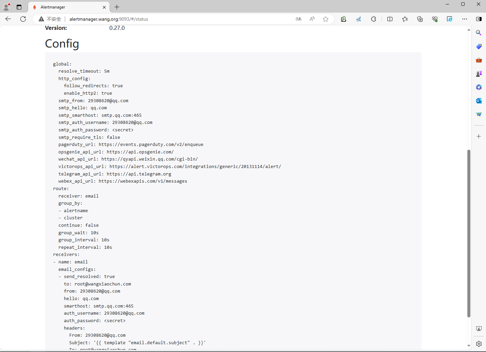

## 5.3 告警规则

### 5.3.1 告警规则说明
https://prometheus.io/docs/prometheus/latest/configuration/alerting_rules/

警报规则可以实现基于Prometheus表达式语言定义警报条件，并将有关触发警报的通知发送到外部服务。只要警报表达式在给定的时间点生成一个或多个动作元素，警报就被视为这些元素的标签集处于活动状态。

告警规则中使用的查询语句较为复杂时，可将其保存为记录规则，而后通过查询该记录规则生成的时间序列来参与比较，从而避免实时查询导致的较长时间延迟

警报规则在Prometheus中的基本配置方式与记录规则基本一致。

在Prometheus中一条告警规则主要由以下几部分组成：

告警名称：用户需要为告警规则命名，当然对于命名而言，需要能够直接表达出该告警的主要内容
告警规则：告警规则实际上主要由PromQL进行定义，其实际意义是当表达式（PromQL）查询结果持  
续多长时间（During）后出发告警  

在Prometheus中，还可以通过Group（告警组）对一组相关的告警进行统一定义。这些定义都是通过YAML文件来统一管理的

告警规则文件示例
```yaml
groups:
- name: example
  rules:
  - alert: HighRequestLatency
    #expr: up == 0
    expr: job:request_latency_seconds:mean5m{job="myjob"} > 0.5
    for: 10m
    labels:
      severity: warning
      project: myproject
    annotations:
      summary: "Instance {{ $labels.instance }} down"
      description: "{{ $labels.instance }} of job {{ $labels.job }} has been down for
more than 1 minutes."
#属性解析：
alert       #定制告警的动作名称
expr        #是一个布尔型的条件表达式，一般表示满足此条件时即为需要告警的异常状态
for  #条件表达式被触发后，一直持续满足该条件长达此处时长后才会告警，即发现满足expr表达式后，
在告警前的等待时长，默认为0，此时间前为pending状态，之后为firing，此值应该大于抓取间隔时长，避免偶
然性的故障
labels      #指定告警规则的标签，若已添加，则每次告警都会覆盖前一次的标签值
labels.severity #自定义的告警级别的标签
annotations     #自定义注释信息，注释信息中的变量需要从模板中或者系统中读取，最终体现在告警通知的信
息中
```

Prometheus 告警规则
https://samber.github.io/awesome-prometheus-alerts/


范例: Node  Exporter的告警规则
```yaml
#https://samber.github.io/awesome-prometheus-alerts/rules#host-and-hardware
groups:
- name: node-exporter
  rules:
  # Host out of memory
  - alert: HostOutOfMemory
    expr: node_memory_MemAvailable_bytes / node_memory_MemTotal_bytes * 100 < 10
    for: 2m
    labels:
      severity: warning
    annotations:
      summary: Host out of memory (instance {{ $labels.instance }})
      description: "Node memory is filling up (< 10% left)\n  VALUE = {{ $value }}\n
LABELS = {{ $labels }}"
  # Host unusual network throughput in
  - alert: HostUnusualNetworkThroughputIn
    expr: sum by (instance) (rate(node_network_receive_bytes_total[2m])) / 1024 /
1024 > 100
    for: 5m
    labels:
      severity: warning
    annotations:
      summary: Host unusual network throughput in (instance {{ $labels.instance }})
      description: "Host network interfaces are probably receiving too much data (>
100 MB/s)\n  VALUE = {{ $value }}\n  LABELS = {{ $labels }}"
  # Host unusual network throughput out
  - alert: HostUnusualNetworkThroughputOut
    expr: sum by (instance) (rate(node_network_transmit_bytes_total[2m])) / 1024 /
1024 > 100
    for: 5m
    labels:
      severity: warning
    annotations:
      summary: Host unusual network throughput out (instance {{ $labels.instance }})
      description: "Host network interfaces are probably sending too much data (> 100
MB/s)\n  VALUE = {{ $value }}\n  LABELS = {{ $labels }}"
  # Host out of disk space
  # Please add ignored mountpoints in node_exporter parameters like
  # "--collector.filesystem.ignored-mount-points=^/(sys|proc|dev|run)($|/)".
  # Same rule using "node_filesystem_free_bytes" will fire when disk fills for non-
root users.
  - alert: HostOutOfDiskSpace
    expr: (node_filesystem_avail_bytes * 100) / node_filesystem_size_bytes < 10 and
ON (instance, device, mountpoint) node_filesystem_readonly == 0
    for: 2m
    labels:
      severity: warning
    annotations:
      summary: Host out of disk space (instance {{ $labels.instance }})
      description: "Disk is almost full (< 10% left)\n  VALUE = {{ $value }}\n
LABELS = {{ $labels }}"
  # Host high CPU load
  - alert: HostHighCpuLoad
    expr: 100 - (avg by(instance) (rate(node_cpu_seconds_total{mode="idle"}[2m])) *
100) > 80
    for: 0m
    labels:
      severity: warning
    annotations:
      summary: Host high CPU load (instance {{ $labels.instance }})
      description: "CPU load is > 80%\n  VALUE = {{ $value }}\n  LABELS = {{ $labels
}}"
  # Host CPU high iowait
  - alert: HostCpuHighIowait
    expr: avg by (instance) (rate(node_cpu_seconds_total{mode="iowait"}[5m])) * 100 >
5
    for: 0m
    labels:
      severity: warning
    annotations:
      summary: Host CPU high iowait (instance {{ $labels.instance }})
      description: "CPU iowait > 5%. A high iowait means that you are disk or network
bound.\n  VALUE = {{ $value }}\n  LABELS = {{ $labels }}"
  # Host Network Interface Saturated
  - alert: HostNetworkInterfaceSaturated
    expr:
(rate(node_network_receive_bytes_total{device!~"^tap.*|^vnet.*|^veth.*|^tun.*"}[1m])
+ rate(node_network_transmit_bytes_total{device!~"^tap.*|^vnet.*|^veth.*|^tun.*"}
[1m])) / node_network_speed_bytes{device!~"^tap.*|^vnet.*|^veth.*|^tun.*"} > 0.8 <
10000
    for: 1m
    labels:
      severity: warning
    annotations:
      summary: Host Network Interface Saturated (instance {{ $labels.instance }})
      description: "The network interface \"{{ $labels.device }}\" on \"{{
$labels.instance }}\" is getting overloaded.\n  VALUE = {{ $value }}\n  LABELS = {{
$labels }}"
  # Host conntrack limit
  - alert: HostConntrackLimit
    expr: node_nf_conntrack_entries / node_nf_conntrack_entries_limit > 0.8
    for: 5m
    labels:
      severity: warning
    annotations:
      summary: Host conntrack limit (instance {{ $labels.instance }})
      description: "The number of conntrack is approaching limit\n  VALUE = {{ $value
}}\n  LABELS = {{ $labels }}"
```

范例：MySQL的告警规则
```yaml
groups:
- name: mysqld
  rules:
  # MySQL instance is down on {{ $labels.instance }}
  - alert: MysqlDown
    expr: mysql_up == 0
    for: 0m
    labels:
      severity: critical
    annotations:
      summary: MySQL down (instance {{ $labels.instance }})
      description: "MySQL instance is down on {{ $labels.instance }}\n  VALUE = {{
$value }}\n  LABELS = {{ $labels }}"
  # MySQL too many connections (> 80%)
  - alert: MysqlTooManyConnections(>80%)
    expr: max_over_time(mysql_global_status_threads_connected[1m]) /
mysql_global_variables_max_connections * 100 > 80
    for: 2m
    labels:
      severity: warning
    annotations:
      summary: MySQL too many connections (> 80%) (instance {{ $labels.instance }})
      description: "More than 80% of MySQL connections are in use on {{
$labels.instance }}\n  VALUE = {{ $value }}\n  LABELS = {{ $labels }}"
  # MySQL Slave IO thread not running
  - alert: MysqlSlaveIoThreadNotRunning
    expr: mysql_slave_status_master_server_id > 0 and ON (instance)
mysql_slave_status_slave_io_running == 0
    for: 0m
    labels:
      severity: critical
    annotations:
      summary: MySQL Slave IO thread not running (instance {{ $labels.instance }})
      description: "MySQL Slave IO thread not running on {{ $labels.instance }}\n
VALUE = {{ $value }}\n  LABELS = {{ $labels }}"
  # MySQL Slave SQL thread not running
  - alert: MysqlSlaveSqlThreadNotRunning
    expr: mysql_slave_status_master_server_id > 0 and ON (instance)
mysql_slave_status_slave_sql_running == 0
    for: 0m
    labels:
      severity: critical
    annotations:
      summary: MySQL Slave SQL thread not running (instance {{ $labels.instance }})
      description: "MySQL Slave SQL thread not running on {{ $labels.instance }}\n
VALUE = {{ $value }}\n  LABELS = {{ $labels }}"
  #  MySQL slow queries
  - alert: MysqlSlowQueries
    expr: increase(mysql_global_status_slow_queries[1m]) > 0
    for: 2m
    labels:
      severity: warning
    annotations:
      summary: MySQL slow queries (instance {{ $labels.instance }})
      description: "MySQL server mysql has some new slow query.\n  VALUE = {{ $value
}}\n  LABELS = {{ $labels }}"
```

范例：blackbox 的告警规则
```yaml
groups:
- name: blackbox
  rules:
  # Blackbox probe failed
  - alert: BlackboxProbeFailed
    expr: probe_success == 0
    for: 0m
    labels:
      severity: critical
    annotations:
      summary: Blackbox probe failed (instance {{ $labels.instance }})
      description: "Probe failed\n  VALUE = {{ $value }}\n  LABELS = {{ $labels }}"
  # Blackbox slow probe
  - alert: BlackboxSlowProbe
    expr: avg_over_time(probe_duration_seconds[1m]) > 1
    for: 1m
    labels:
      severity: warning
    annotations:
      summary: Blackbox slow probe (instance {{ $labels.instance }})
      description: "Blackbox probe took more than 1s to complete\n  VALUE = {{ $value
}}\n  LABELS = {{ $labels }}"
  # Blackbox probe HTTP failure
  - alert: BlackboxProbeHttpFailure
    expr: probe_http_status_code <= 199 OR probe_http_status_code >= 400
    for: 0m
    labels:
      severity: critical
    annotations:
      summary: Blackbox probe HTTP failure (instance {{ $labels.instance }})
      description: "HTTP status code is not 200-399\n  VALUE = {{ $value }}\n  LABELS
= {{ $labels }}"
  # Blackbox probe slow HTTP
  - alert: BlackboxProbeSlowHttp
    expr: avg_over_time(probe_http_duration_seconds[1m]) > 1
    for: 1m
    labels:
      severity: warning
    annotations:
      summary: Blackbox probe slow HTTP (instance {{ $labels.instance }})
      description: "HTTP request took more than 1s\n  VALUE = {{ $value }}\n  LABELS
= {{ $labels }}"
  # Blackbox probe slow ping
  - alert: BlackboxProbeSlowPing
    expr: avg_over_time(probe_icmp_duration_seconds[1m]) > 1
    for: 1m
    labels:
      severity: warning
    annotations:
      summary: Blackbox probe slow ping (instance {{ $labels.instance }})
      description: "Blackbox ping took more than 1s\n  VALUE = {{ $value }}\n  LABELS
= {{ $labels }}"
```

### 5.3.2 告警规则案例: 邮件告警

#### 5.3.2.1 案例说明

编写一个检查自定义metrics的接口的告警规则，在prometheus中我们可以借助于up指标来获取对应的状态效果，查询语句如下：
```text
up{job="my_metric"}
#注意：如果结果是1表示服务正常，否则表示该接口的服务出现了问题。
```

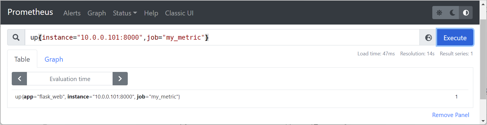

#### 5.3.2.2 配置告警规则

编写规则定义文件
```yaml
#确认包含rules目录中的yml文件
cat /usr/local/prometheus/conf/prometheus.yml
rule_files:
  - "../rules/*.yml"
#准备告警rule文件
vim /usr/local/prometheus/rules/prometheus_alert_rules.yml
groups:
- name: flask_web
  rules:
  - alert: InstanceDown
    expr: up{job="my_metric"} == 0
    #expr: up == 0     #所有targets
    for: 1m
    labels:
      severity: 1
    annotations:
      #title: Instance Down
      summary: "Instance {{ $labels.instance  }} 停止工作"
      description: "{{ $labels.instance  }} job {{ $labels.job  }} 已经停止1m以上"
#属性解析：
- name: flask_web  #指定分组名称,在一个组中可以有多个 alert ,只要其中一个alert条件满足,就会触发
告警
{{ $labels.<labelname> }}   要插入触发元素的标签值
{{ $value }} 要插入触发元素的数值表达式值
#这里的$name 都是来源于模板文件中的定制内容，如果不需要定制的变动信息，可以直接写普通的字符串
#检查语法
promtool check rules prometheus_alert_rules.yml
#重启prometheus服务
systemctl reload prometheus.service
```

浏览器查看prometheus的rules的页面查看效果

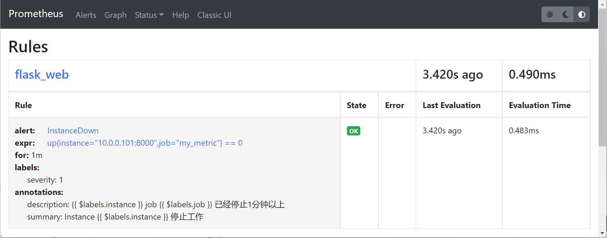

查看告警界面效果

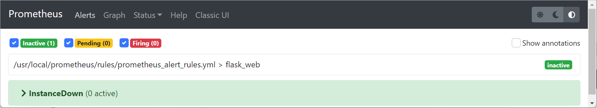

告警状态

Inactive：正常效果
Pending：已触发阈值，但未满足告警持续时间（即rule中的for字段）  
Firing：已触发阈值且满足告警持续时间。  

#### 5.3.2.3 验证结果

停止自定义的flask服务，稍等1分钟后，查看告警效果。

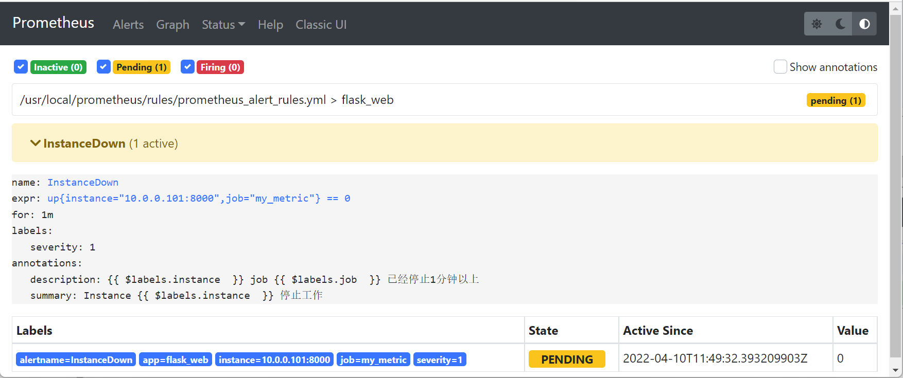

等待时间超过for持续的标准后，就会改变告警的状态，效果如下

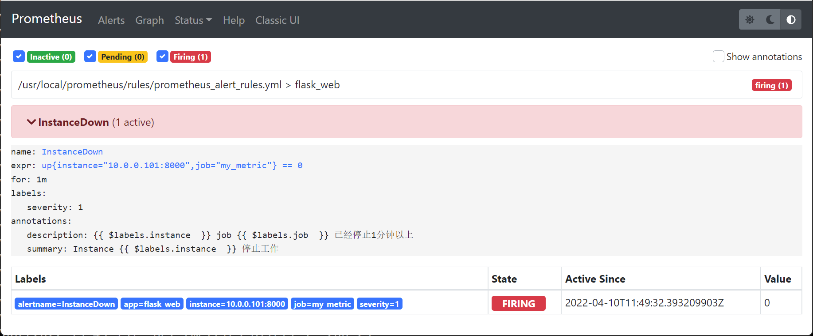

查看alertmanager的web效果

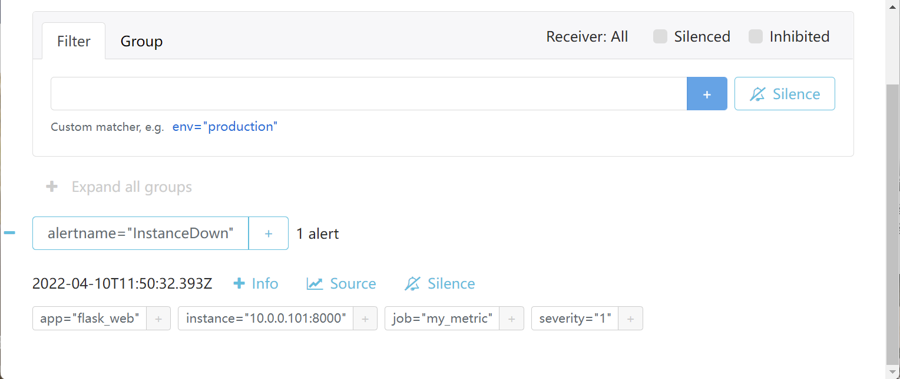

邮件告警效果

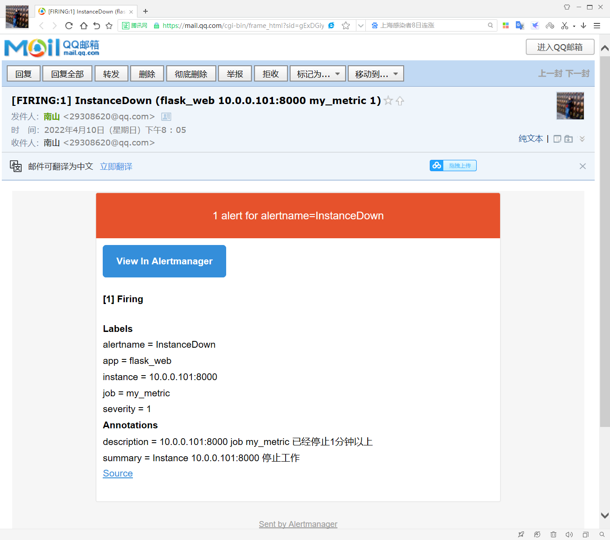

恢复正常后，也会收到恢复通知邮件，如下界面


#### 5.3.2.4 静默 silence

如果想停止告警，可以用静默功能

在AlertManger上指定告警的silence

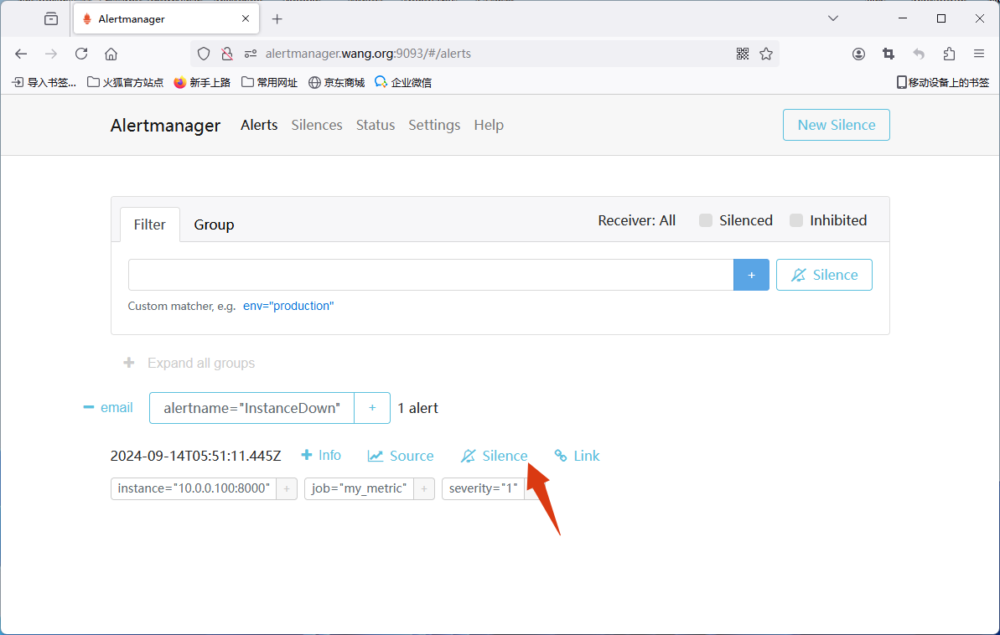

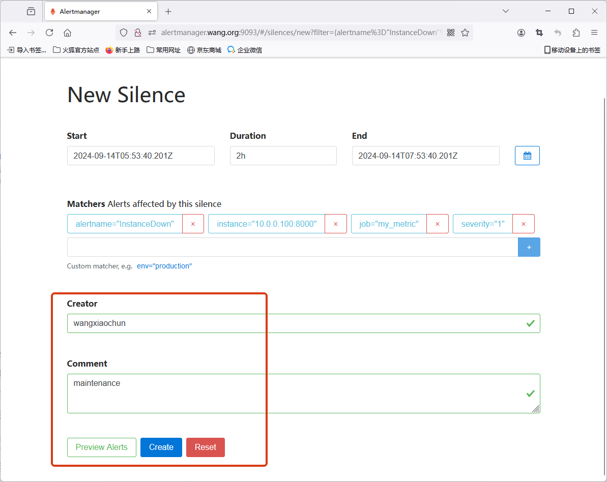

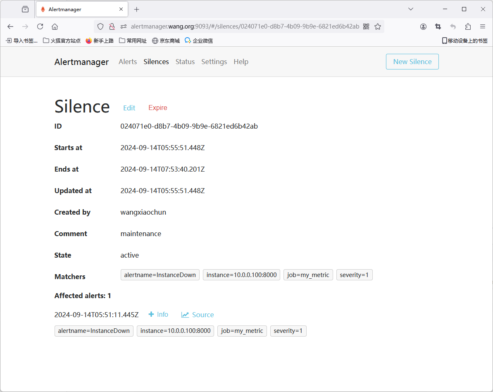

取消静默

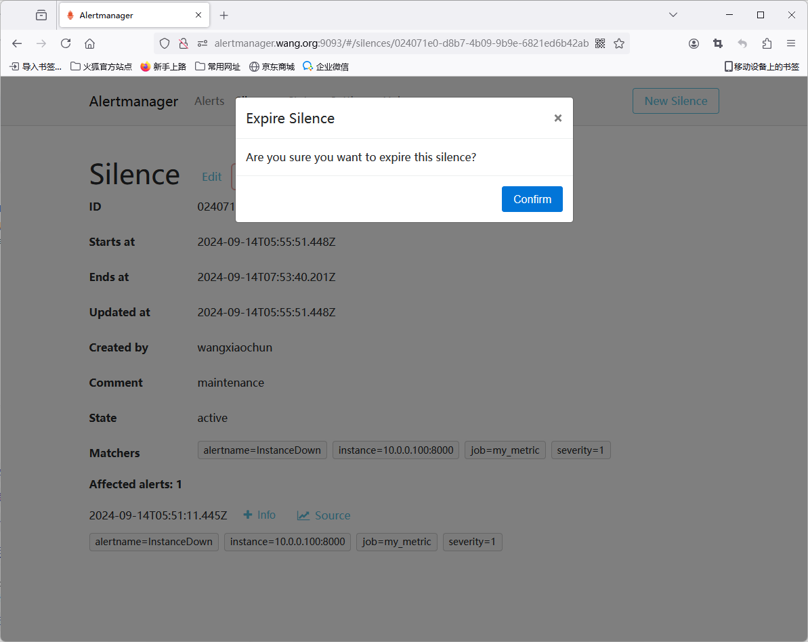

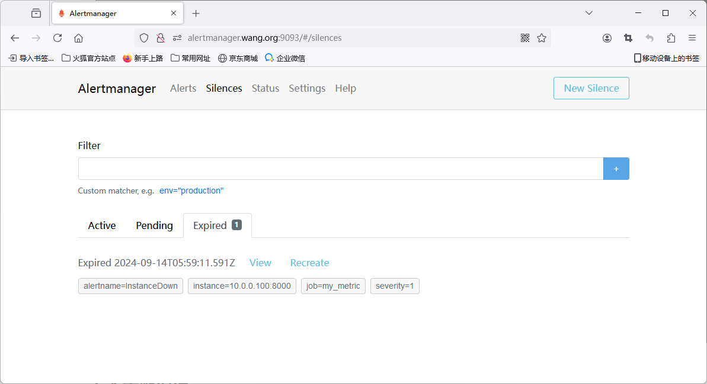



<nav class="article-end" aria-label="章节导航">
  <a href="{{ '/subjects/Prometheus/11-recording-rules.html' | relative_url }}">← 上一章：记录规则</a>
  <a href="{{ '/subjects/Prometheus/' | relative_url }}">返回 Prometheus 目录</a>
  <a href="{{ '/subjects/Prometheus/13-alert-templates-routing.html' | relative_url }}">下一章：告警模板、路由与抑制 →</a>
</nav>
