[← 返回 Prometheus 目录]({{ '/subjects/Prometheus/' | relative_url }})



# 13 告警模板、路由与抑制

## 5.4 告警模板

### 5.4.1 告警模板说明
https://prometheus.io/docs/alerting/latest/notifications/

默认的告警信息界面有些简单，可以借助于告警的模板信息，对告警信息进行丰富。需要借助于alertmanager的模板功能来实现。

使用流程：

分析关键信息
定制模板内容  
alertmanager 加载模板文件  
告警信息使用模板内容属性  

5.4.2. 定制模板案例

#### 5.4.2.1 定制模板

模板文件使用标准的Go语法，并暴露一些包含时间标签和值的变量
```text
标签引用： {{ $labels.<label_name> }}
指标样本值引用： {{ $value }}
#示例：若要在description注解中引用触发告警的时间序列上的instance和iob标签的值，可分别使用
{{$label.instance}}和{{$label.job}}
```

为了更好的显示效果,需要了解html相关技术,参考链接
https://www.w3school.com.cn/html/html_tables.asp

范例:  邮件告警通知模板
```bash
#在alertmanqer节点上建立邮件模板文件
mkdir /usr/local/alertmanager/tmpl
#基于go的模板内容
vim /usr/local/alertmanager/tmpl/email.tmpl
{{ define "test.html" }}
<table border="1">
        <tr>
                <th>报警项</th>
                <th>实例</th>
                <th>报警阀值</th>
                <th>开始时间</th>
        </tr>
        {{ range $i, $alert := .Alerts }}
                <tr>
                        <td>{{ index $alert.Labels "alertname" }}</td>
                        <td>{{ index $alert.Labels "instance" }}</td>
                        <td>{{ index $alert.Annotations "value" }}</td>
                        <td>{{ $alert.StartsAt }}</td>
                </tr>
        {{ end }}
</table>
{{ end }}
#属性解析
{{ define "test.html" }} 表示定义了一个 test.html 模板文件，通过该名称在配置文件中应用
上边模板文件就是使用了大量的jinja2模板语言。
$alert.xxx 其实是从默认的告警信息中提取出来的重要信息
```

范例：邮件模板2
```text
vim /usr/local/alertmanager/tmpl/email_template.tmpl
{{ define "email.html" }}
{{- if gt (len .Alerts.Firing) 0 -}}
{{ range .Alerts }}
=========start==========<br>
告警程序: prometheus_alert <br>
告警级别: {{ .Labels.severity }} <br>
告警类型: {{ .Labels.alertname }} <br>
告警主机: {{ .Labels.instance }} <br>
告警主题: {{ .Annotations.summary }}  <br>
告警详情: {{ .Annotations.description }} <br>
触发时间: {{ .StartsAt.Format "2006-01-02 15:04:05" }} <br>
=========end==========<br>
{{ end }}{{ end -}}
{{- if gt (len .Alerts.Resolved) 0 -}}
{{ range .Alerts }}
=========start==========<br>
告警程序: prometheus_alert <br>
告警级别: {{ .Labels.severity }} <br>
告警类型: {{ .Labels.alertname }} <br>
告警主机: {{ .Labels.instance }} <br>
告警主题: {{ .Annotations.summary }} <br>
告警详情: {{ .Annotations.description }} <br>
触发时间: {{ .StartsAt.Format "2006-01-02 15:04:05" }} <br>
恢复时间: {{ .EndsAt.Format "2006-01-02 15:04:05" }} <br>
=========end==========<br>
{{ end }}{{ end -}}
{{- end }}
#说明
"2006-01-02 15:04:05"是一个特殊的日期时间格式化模式，在Golang中，日期和时间的格式化是通过指定特定
的模式来实现的。它用于表示日期和时间的具体格式
#模板效果如下
```

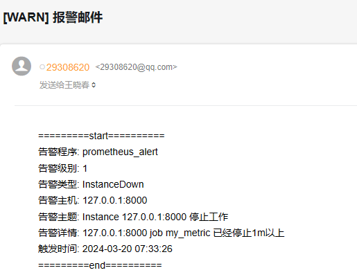

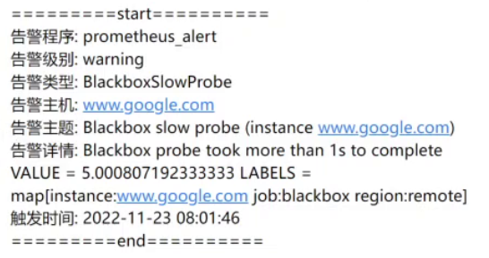

#### 5.4.2.2 应用模板
```yaml
#更改配置文件
]# vim /usr/local/alertmanager/conf/alertmanager.yml
global:
...
templates:            #加下面两行加载模板文件
  - '../tmpl/*.tmpl' #相对路径是相对于altermanager.yml文件的路径
route:
...
# 收信人员
receivers:
- name: 'email'
  email_configs:
  - to: 'root@bowen.com'
    send_resolved: true
    headers: { Subject: "[WARN] 报警邮件"}   #添加此行,定制邮件标题
    html: '{{ template "test.html" . }}'  #添加此行,调用模板显示邮件正文
    #html: '{{ template "email.html" . }}'    #添加此行,调用模板显示邮件正文
...
#属性解析：
{{}} 属性用于加载其它信息，所以应该使用单引号括住
{} 不需要使用单引号，否则服务启动不成功
#重启服务
]# systemctl restart alertmanager.service
#或者重新加载配置
]# curl -XPOST  localhost:9093/-/reload
#收到的告警信息中告警阈值是空的
```

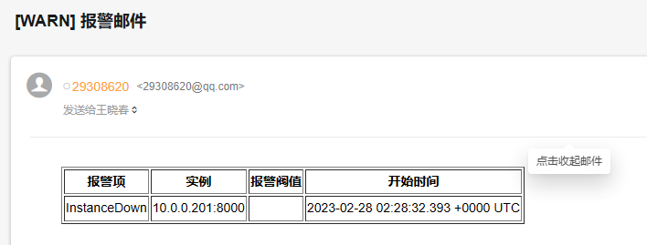

#### 5.4.2.3 更改规则

上面我们定制的邮件内容中包含阈值的部分，而我们在规则中并没有指定，所以需要修改一下规则文件，效果如下
```yaml
]# vim /usr/local/prometheus/rules/prometheus_alert_tmpl.yml
groups:
- name: flask_web
  rules:
  - alert: InstanceDown
    expr: up{job="my_metric"} == 0
    for: 1m
    labels:
      severity: 1
    annotations:
      summary: "Instance {{ $labels.instance  }} 停止工作"
      description: "{{ $labels.instance  }} job {{ $labels.job  }} 已经停止1分钟以上"
      value: "{{$value}}"  #只加此一行，其它行不变
#属性解析：这里在注释部分增加了一个value的属性信息，会从prometheus的默认信息中获取阈值
#annotations这部分内容不再显示邮件中,而按模板形式显示
#语法检查
promtool check rules /usr/local/prometheus/rules/prometheus_alert_tmpl.yml
promtool check config /usr/local/prometheus/conf/prometheus.yml
#重启prometheus服务生效
systemctl reload prometheus.service
```

#### 5.4.2.4 测试结果

关停flask服务

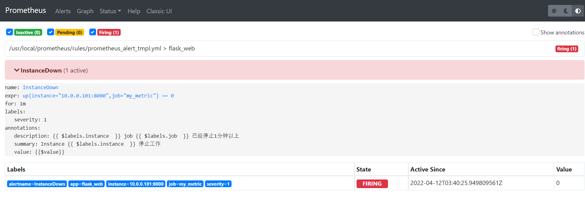

查看邮件效果

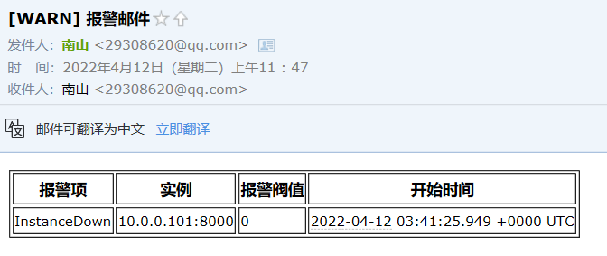

## 5.5 告警路由

### 5.5.1 告警路由说明

Alertmanager的route配置段支持定义"树"状路由表，入口位置称为根节点，每个子节点可以基于匹配条件定义出一个独立的路由分支

所有告警都将进入路由根节点，而后进行子节点遍历
若路由上的continue字段的值为false，则遇到第一个匹配的路由分支后即终止；否则，将继续匹配后续  
的子节点  

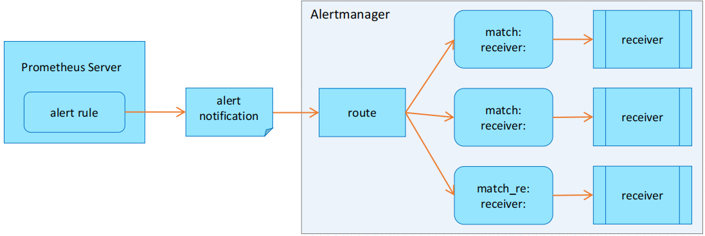

上图所示：Alertmanager中的第一个Route是根节点，每一个match 都是子节点。

比如，我们之前定义的告警策略中，只有一个route，这意味着所有由Prometheus产生的告警在发送到Alertmanager之后都会通过名为email的receiver接收。

注意: 新版中使用指令matchers替换了match和match_re指令
https://prometheus.io/docs/alerting/latest/configuration/#route
https://prometheus.io/docs/alerting/latest/configuration/#matcher

范例:  路由示例
```yaml
route:
  group_by: ['alertname', 'cluster']
  group_wait: 10s
  group_interval: 10s
  repeat_interval: 10s
  receiver: 'email'
```

通过在Prometheus中给不同的告警规则添加不同的label,再在Alertmanager中添加针对不同的lable使用不同的路由至不同的receiver,即可以实现路由的分组功能

Alertmanager 的相关配置参数
```text
# 默认信息的接收者，这一项是必须选项，否则程序启动不成功
[ receiver: <string> ]
# 分组时使用的标签，默认情况下，所有的告警都组织在一起，而一旦指定分组标签，则Alertmanager将按这些
标签进行分组
[ group_by: '[' <labelname>, ... ']' ]
# 在匹配成功的前提下，是否继续进行深层次的告警规则匹配
[ continue: <boolean> | default = false ]
# 基于字符串验证，判断当前告警中是否存在标签labelname并且其值等于label value，满足则进行内部的后续
处理。
#新版使用指令matchers替换match和match_re
matchers:
  - alertname = Watchdog
  - severity =~ "warning|critical"
#One of =, !=, =~, or !~. = means equals, != means that the strings are not equal, =~
is used for equality of regex expressions and !~ is used for un-equality of regex
expressions. They have the same meaning as known from PromQL selectors.
#旧版用法
match:
  [ <labelname>: <labelvalue>, ... ]
# 基于正则表达式验证，判断当前告警标签的值是否满足正则表达式的内容，满足则进行内部的后续处理
match_re:
  [ <labelname>: <regex>, ... ]
# 发出一组告警通知的初始等待时长；允许等待一个抑制告警到达或收集属于同一组的更多初始告警，通常是0到数
分钟
[ group_wait: <duration> | default = 30s ]
# 发送关于新告警的消息之前，需要等待多久；新告警将被添加到已经发送了初始通知的告警组中；一般在5分钟或
以上
[ group_interval: <duration> | default = 5m ]
# 成功发送了告警后再次发送告警信息需要等待的时长，一般至少为3个小时
[ repeat_interval: <duration> | default = 4h ]
# 子路由配置
routes:
  [ - <route> ... ]
#注意：每一个告警都会从配置文件中顶级的route进入路由树，需要注意的是顶级的route必须匹配所有告警, 不
能有 match 和 match_re
```

旧语法配置示例
```yaml
#1) 在prometheus上定制告警规则
groups:
- name: example
  ...
- name: nodes_alerts
  rules:
  - alert: DiskWillFillIn12Hours
    expr: predict_linear(node_filesystem_free_bytes{mountpoint="/"}[1h], 12*3600)
    for: 1m
    labels:
      severity: critital
    annotations:
      discription: Disk on {{ $label.instance }} will fill in approximately 12 hours.
#12小时内根分区会填满
- name: prometheus_alerts
  rules:
  - alert: PrometheusConfigReloadFailed
    expr: prometheus_config_last_reload_successful == 0
    for: 3m
    labels:
      serverity: warning
      #project: myproject
    annotations:
      description: Reloading Prometheus configuration has failed on {{
$labels.instance }}.
#2) 在alertmanager 定制路由
global:
  ...
templates:
  ...
route:
  group_by: ['instance']
  ...
  receiver: email-receiver #默认路由
  routes:                  #子路由
  - match:
      severity: critical
    receiver: leader-team
  - match_re:
      severity: ^(warning)$
      #project: myproject
    receiver: ops-team
receivers:
  - name: 'leader-team'
    email_configs:
    - to: '29308620@qq.com', 'admin@qq.com'
  - name: 'ops-team'
    email_configs:
    - to: 'root@bowen.com', 'bowen@163.com'
```

### 5.5.2 告警路由案例

定制的 metric 要求如下

如果是每分钟的QPS超过 500 的时候，将告警发给运维团队
如果是服务终止的话，发给管理团队  

#### 5.5.2.1 定制告警规则
```yaml
#准备prometheus配置文件
grep -Ev '^$|^ *#' /usr/local/prometheus/conf/prometheus.yml
global:
  scrape_interval: 15s # Set the scrape interval to every 15 seconds. Default is
every 1 minute.
  evaluation_interval: 15s # Evaluate rules every 15 seconds. The default is every 1
minute.
alerting:
  alertmanagers:
    - static_configs:
         - targets:
             - 10.0.0.100:9093  #指定alertmaanager地址
rule_files:
  - "../rules/*.yml"  #指定规则文件路径
scrape_configs:
  - job_name: "prometheus"
    static_configs:
      - targets: ["localhost:9090"]
  - job_name: 'node_exporter'
    static_configs:
    - targets: ['10.0.0.101:9100','10.0.0.102:9100','10.0.0.103:9100']
      labels: {app: 'k8s-node'}
  - job_name: 'my_metric'
    static_configs:
    - targets: ['10.0.0.101:8000']
      labels: {app: 'flask_web'}
#配置告警规则
vim /usr/local/prometheus/rules/prometheus_alert_route.yml
groups:
- name: flask_web
  rules:
  - alert: InstanceDown
    expr: up{job="my_metric"} == 0
    for: 1m
    labels:
      severity: critical
    annotations:
      summary: "Instance {{ $labels.instance  }} 停止工作"
      description: "{{ $labels.instance  }} job {{ $labels.job  }} 已经停止1分钟以上"
      value: "{{$value}}"
- name: flask_QPS
  rules:
  - alert: InstanceQPSIsHight
    expr: increase(request_count_total{job="my_metric"}[1m]) > 500
    for: 1m
    labels:
      severity: warning
    annotations:
      summary: "Instance {{ $labels.instance  }} QPS 持续过高"
      description: "{{ $labels.instance  }} job {{ $labels.job  }} QPS 持续过高"
      value: "{{$value}}"
#指定flask_web规则的labels为  severity: critical
#指定flask_QPS规则的labels为  severity: warning
#重启prometheus服务
systemctl reload prometheus.service
#查看prometheus上的路由规则效果
```

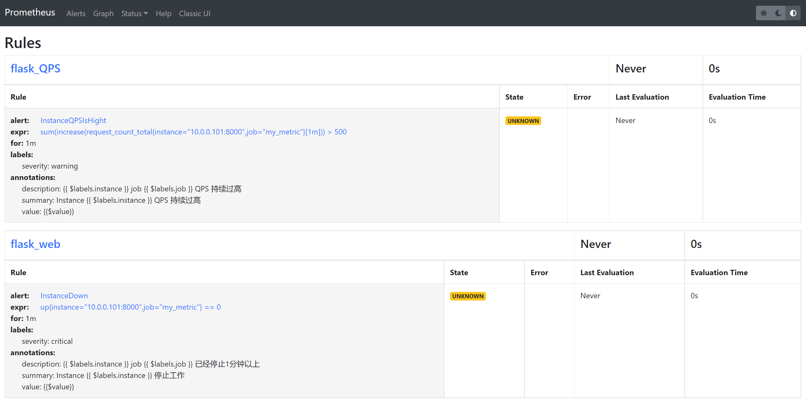

#### 5.5.2.2 定制路由分组
```yaml
#指定路由分组
vim /usr/local/alertmanager/conf/alertmanager.yml
# 全局配置
global:
  resolve_timeout: 5m
  smtp_smarthost: 'smtp.qq.com:25'
  smtp_from: '29308620@qq.com'
  smtp_auth_username: '29308620@qq.com'
  smtp_auth_password: 'abefxqzcnxhqaebieb'
  smtp_hello: 'qq.com'
  smtp_require_tls: false
# 模板配置
templates:
  - '../tmpl/*.tmpl'
# 路由配置
#新版：使用指令matchers替换match和match_re,如下示例
route:
  group_by: ['instance', 'cluster']
  group_wait: 10s
  group_interval: 10s
  repeat_interval: 10s
  receiver: 'email'
  routes:
  - receiver: 'leader-team'
    matchers:
    - severity = "critical"
  - receiver: 'ops-team'
    matchers:
    - severity =~ "^(warning)$"
  #子路由
  #- matchers
  #  - severity = "critical"
  #  - job =~ "mysql|java"
  #  receiver: 'leader-team'
  #  routes:  #支持routes嵌套和分级
  #  - matchers:
  #    - job =~ "mysql"
  #    receiver: 'dba-team'
  #- matchers
  #  - severity =~ "warning"
  #  - job = "node_exporter"
  #  receiver: 'ops-team'
#旧版：使用match和match_re
route:
  group_by: ['instance', 'cluster']
  group_wait: 10s
  group_interval: 10s
  repeat_interval: 10s
  receiver: 'email'
  routes:
  - match:
      severity: critical
    receiver: 'leader-team'
  - match_re:
      severity: ^(warning)$
    receiver: 'ops-team'
# 收信人员
receivers:
- name: 'email'
  email_configs:
  - to: 'root@bowen.com'
    send_resolved: true
    html: '{{ template "test.html" . }}'
    headers: { Subject: "[WARN] 报警邮件"}
- name: 'leader-team'
  email_configs:
  - to: 'root@bowen.com'
    html: '{{ template "test.html" . }}'
    headers: { Subject: "[CRITICAL] 应用服务报警邮件"}
    send_resolved: true #
- name: 'ops-team'
  email_configs:
  - to: 'root@bowen.com'
    html: '{{ template "test.html" . }}'
    headers: { Subject: "[WARNNING] QPS负载报警邮件"}
    send_resolved: true
#检查语法
amtool  check-config /usr/local/alertmanager/conf/alertmanager.yml
#定义邮件模板文件
vim /usr/local/alertmanager/tmpl/email.tmpl
{{ define "test.html" }}
<table border="1">
        <tr>
                <th>报警项</th>
                <th>实例</th>
                <th>报警阀值</th>
                <th>开始时间</th>
        </tr>
        {{ range $i, $alert := .Alerts }}
                <tr>
                        <td>{{ index $alert.Labels "alertname" }}</td>
                        <td>{{ index $alert.Labels "instance" }}</td>
                        <td>{{ index $alert.Annotations "value" }}</td>
                        <td>{{ $alert.StartsAt }}</td>
                </tr>
        {{ end }}
</table>
{{ end }}
#服务生效
systemctl reload alertmanager.service
#查看prometheus上的alert的效果
```

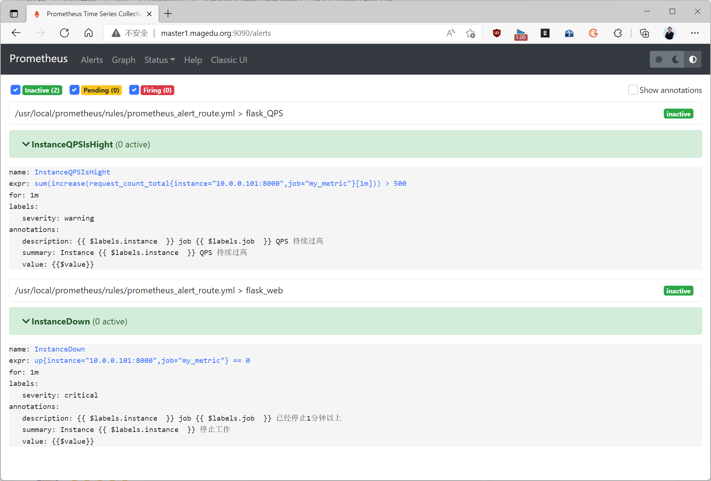

#### 5.5.2.3 测试效果

执行curl metric的脚本文件，调整循环访问的次数，让访问数量高于500。

查看prometheus告警效果和邮件效果

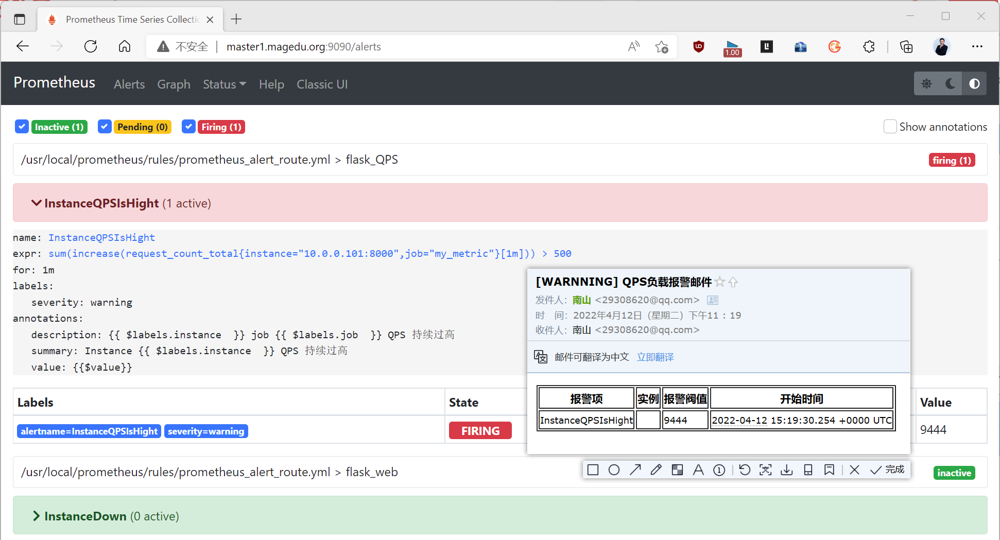

关闭python的web服务，查看prometheus告警效果和邮件效果

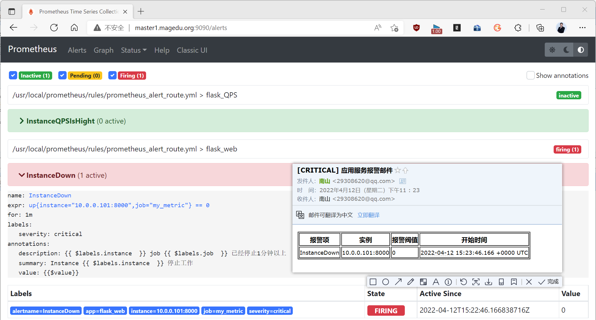
```yaml
#更改告警规则的标签信息
vim /usr/local/prometheus/rules/prometheus_alert_route.yml
groups:
  - name: flask_web
    rules:
    - alert: InstanceDown
      ...
      labels:
      severity: criticaL # 将符合要求的 critical改为criticaL，导致告警无法匹配admin-team
#重启服务
#systemctl reload prometheus.service
#查看prometheus 默认的告警效果和邮件效果
#结果显示：将 severity的标签改为 crititaL 导致所有的子路由没有匹配，则默认的route生效
```

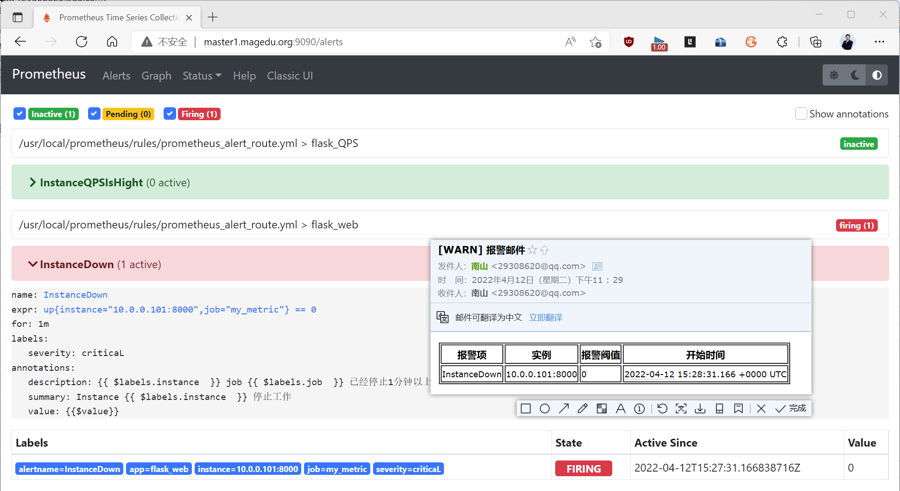

## 5.6 告警抑制

### 5.6.1 告警抑制说明

对于一种业务场景，有相互依赖的两种服务：A服务和B服务，一旦A服务异常，依赖A服务的B服务也会异常,从而导致本来没有问题的B服务也不断的发出告警。


Alertmanager的抑制机制可以避免当某种问题告警产生之后用户接收到大量由此问题导致的一系列的其它告警通知。例如当集群不可用时，用户可能只希望接收到一条告警，告知用户这时候集群出现了问题，而不是大量的如集群中的应用异常、中间件服务异常的告警通知。

当已经发送的告警通知匹配到target_match和target_match_re规则，当有新的告警规则如果满足source_match或者定义的匹配规则，并且已发送的告警与新产生的告警中equal定义的标签完全相同，则启动抑制机制，新的告警不会发送。

通过上面的配置，可以在alertname/operations/instance相同的情况下，high的报警会抑制warning级别的报警信息。

抑制是当出现其它告警的时候压制当前告警的通知，可以有效的防止告警风暴。比如当机房出现网络故障时，所有服务都将不可用而产生大量服务不可用告警，但这些警告并不能反映真实问题在哪，真正需要发出的应该是网络故障告警。当出现网络故障告警的时候，应当抑制服务不可用告警的通知。

配置解析
```text
#源告警信息匹配 -- 报警的来源
source_match:
  [ <labelname>: <labelvalue>, ... ]
source_match_re:
  [ <labelname>: <regex>, ... ]
#目标告警信息匹配 - 触发的其他告警
target_match:
  [ <labelname>: <labelvalue>, ... ]
target_match_re:
  [ <labelname>: <regex>, ... ]
#目标告警是否是被触发的 - 要保证业务是同一处来源
[ equal: '[' <labelname>, ... ']' ]
#同时告警目标上的标签与之前的告警标签一样，那么就不再告警
```

配置示例
```text
#例如：
集群中的A主机节点异常导致NodeDown告警被触发，该告警会触发一个severity=critical的告警级别。
由于A主机异常导致该主机上相关的服务，会因为不可用而触发关联告警。
根据抑制规则的定义：
如果有新的告警级别为severity=critical，且告警中标签的node值与NodeDown告警的相同
则说明新的告警是由NodeDown导致的，则启动抑制机制,从而停止向接收器发送通知。
inhibit_rules:              # 抑制规则
- source_match:             # 源标签警报触发时会抑制含有目标标签的警报，被依赖服务A
    alertname: NodeDown     # 可以针对某一个特定的告警动作规则
    severity: critical      # 限定源告警规则的等级
  target_match:             # 定制要被抑制的告警规则的所处位置，依赖服务B
    severity: normal        # 触发告警目标标签值的正则匹配规则，可以是正则表达式如:
".*MySQL.*"
  equal:                    # 因为源告警和触发告警必须处于同一业务环境下，确保他们在同一个业务中
    - instance              # 源告警和触发告警存在于相同的 instance 时，触发告警才会被抑制。
                        # 格式二 equal: ['alertname','operations', 'instance']
#表达式
    up{node="node01.bowen.org",...} == 0
        severity: critical
#触发告警
    ALERT{node="node01.bowen.org",...,severity=critical}
```

### 5.6.2 告警抑制案例

#### 5.6.2.1 案例说明

对于当前的flask应用的监控来说，上面做了两个监控指标：

告警级别为 critical 的服务异常终止
告警级别为 warning 的 QPS访问量突然降低为0，这里以服务状态来模拟  

当python服务异常终止的时候，不要触发同节点上的 QPS 过低告警动作。

#### 5.6.2.2 告警规则
```yaml
#准备告警规则
vim /usr/local/prometheus/rules/prometheus_alert_inhibit.yml
groups:
- name: flask_web
  rules:
  - alert: InstanceDown
    expr: up{job="my_metric"} == 0
    for: 1m
    labels:
      severity: critical
    annotations:
      summary: "Instance {{ $labels.instance  }} 停止工作"
      description: "{{ $labels.instance  }} job {{ $labels.job  }} 已经停止1分钟以上"
      value: "{{$value}}"
- name: flask_QPS
  rules:
  - alert: InstanceQPSIsHight
    expr: increase(request_count_total{job="my_metric"}[1m]) > 500
    for: 1m
    labels:
      severity: warning
    annotations:
      summary: "Instance {{ $labels.instance  }} QPS 持续过高"
      description: "{{ $labels.instance  }} job {{ $labels.job  }} QPS 持续过高"
      value: "{{$value}}"
  - alert: InstanceQPSIsLow                  #判断是否QPS访问为0
    expr: up{job="my_metric"} == 0  #用此条件模拟访问量为0
    for: 1m
    labels:
      severity: warning
    annotations:
      summary: "Instance {{ $labels.instance  }} QPS 异常为零"
      description: "{{ $labels.instance  }} job {{ $labels.job  }} QPS 异常为0"
      value: "{{$value}}"
#定制告警对象
vim /usr/local/alertmanager/conf/alertmanager.yml
# 全局配置
global:
  resolve_timeout: 5m
  smtp_smarthost: 'smtp.qq.com:25'
  smtp_from: '29308620@qq.com'
  smtp_auth_username: '29308620@qq.com'
  smtp_auth_password: 'efxqzcnxhqaebieb'
  smtp_hello: 'qq.com'
  smtp_require_tls: false
# 模板配置
templates:
  - '../tmpl/*.tmpl'
# 路由配置
route:
  group_by: ['instance', 'cluster']
  group_wait: 10s
  group_interval: 10s
  repeat_interval: 10s
  receiver: 'email'
  routes:
  - match:
      severity: critical
    receiver: 'leader-team'
  - match_re:
      severity: ^(warning)$
    receiver: 'ops-team'
# 收信人员
receivers:
- name: 'email'
  email_configs:
  - to: 'root@bowen.com'
    send_resolved: true
    html: '{{ template "test.html" . }}'
    headers: { Subject: "[WARN] 报警邮件"}
- name: 'leader-team'
  email_configs:
  - to: 'root@bowen.com'
    html: '{{ template "test.html" . }}'
    headers: { Subject: "[CRITICAL] 应用服务报警邮件"}
    send_resolved: true
- name: 'ops-team'
  email_configs:
  - to: 'root@bowen.com'
    html: '{{ template "test.html" . }}'
    headers: { Subject: "[WARNNING] QPS负载报警邮件"}
    send_resolved: true
#重启服务
systemctl reload prometheus.service  alertmanager.service
#关停flask服务后，查看效果,显示有多个重复告警
```

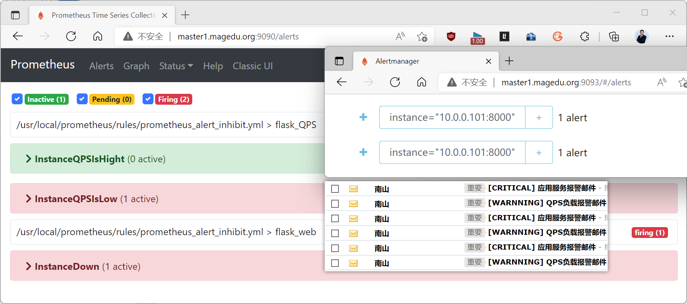

#### 5.6.2.3 启动抑制机制
```yaml
#定制抑制
vim  /usr/local/alertmanager/conf/alertmanager.yml
# 全局配置
global:
  resolve_timeout: 5m
  smtp_smarthost: 'smtp.qq.com:25'
  smtp_from: '29308620@qq.com'
  smtp_auth_username: '29308620@qq.com'
  smtp_auth_password: 'dgezyimkdswwbhe'
  smtp_hello: 'qq.com'
  smtp_require_tls: false
# 模板配置
templates:
  - '../tmpl/*.tmpl'
# 路由配置
route:
  group_by: ['instance', 'cluster']
  group_wait: 10s
  group_interval: 10s
  repeat_interval: 10s
  receiver: 'email'
  routes:
  - match:
      severity: critical
    receiver: 'admin-team'
  - match_re:
      severity: ^(warning)$
    receiver: 'supper-team'
# 收信人员
receivers:
- name: 'email'
  email_configs:
  - to: '29308620@qq.com'
    send_resolved: true
    html: '{{ template "test.html" . }}'
    headers: { Subject: "[WARN] 报警邮件"}
- name: 'admin-team'
  email_configs:
  - to: '29308620@qq.com'
    html: '{{ template "test.html" . }}'
    headers: { Subject: "[CRITICAL] 应用服务报警邮件"}
    send_resolved: true
- name: 'supper-team'
  email_configs:
  - to: '29308620@qq.com'
    html: '{{ template "test.html" . }}'
    headers: { Subject: "[WARNNING] QPS负载报警邮件"}
    send_resolved: true
# 抑制措施                           #上面不变,添加下面告警抑制配置
inhibit_rules:
- source_match:
    severity: critical     #被依赖的告警服务
  target_match:
    severity: warning      #依赖的告警服务
  equal:
    - instance
#重启alertmanager服务
systemctl reload alertmanager.service
```

#### 5.6.2.4 验证结果
```text
#关停服务后，查看效果
#结果显示：开启告警抑制之后，因为 critical导致的warning事件就不再告警了，从而减少了告警风暴现象。
```

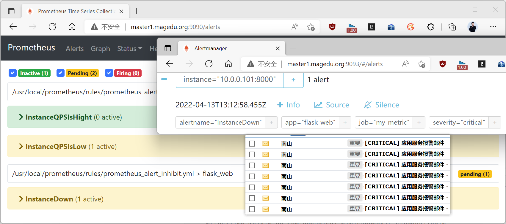



<nav class="article-end" aria-label="章节导航">
  <a href="{{ '/subjects/Prometheus/12-alertmanager-rules.html' | relative_url }}">← 上一章：Alertmanager 部署与告警规则</a>
  <a href="{{ '/subjects/Prometheus/' | relative_url }}">返回 Prometheus 目录</a>
  <a href="{{ '/subjects/Prometheus/14-wechat-alerting.html' | relative_url }}">下一章：微信告警 →</a>
</nav>
