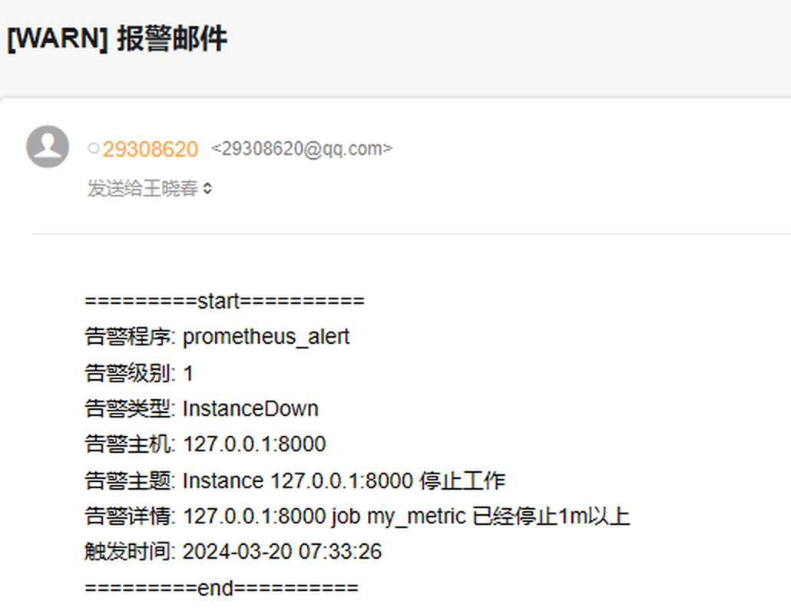
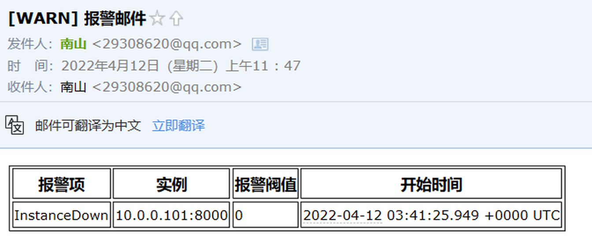
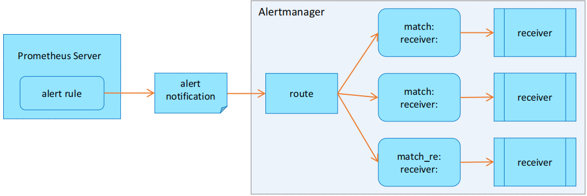
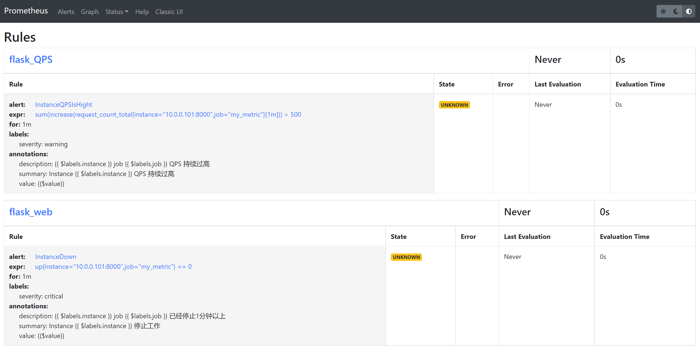
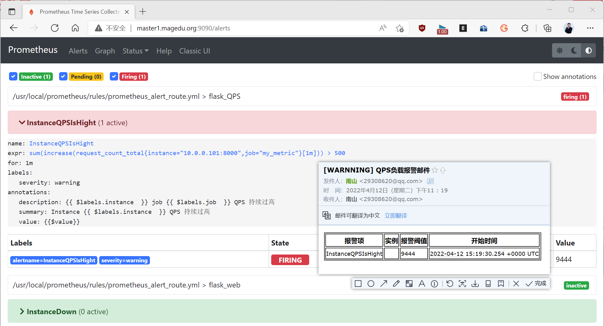
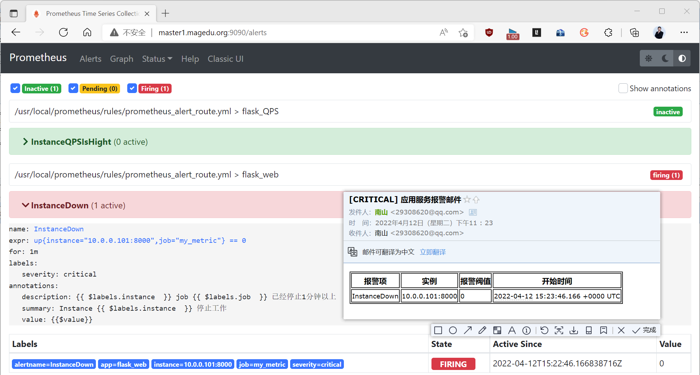
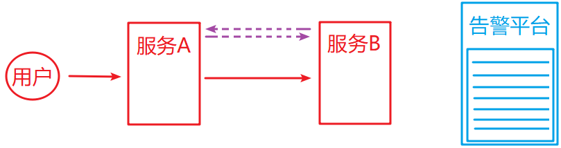
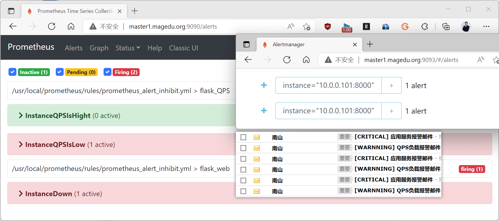
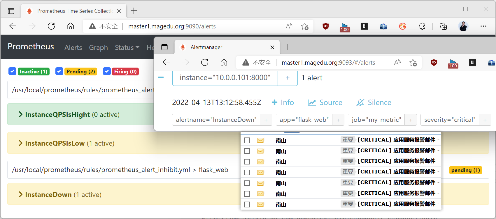

[← 返回 Prometheus 目录]({{ '/subjects/Prometheus/' | relative_url }})



# 13 告警模板、路由与抑制

上一章已经验证 Prometheus 能把 `firing` 告警交给 Alertmanager。本章继续解决三个不同问题：**模板**决定通知里呈现什么，**路由**决定通知发给谁，**抑制**决定已有上游故障时哪些下游通知应暂缓。三者都在 Alertmanager 中配置，但告警的指标判断仍由 Prometheus 规则完成。

## 5.4 告警模板

### 5.4.1 区分规则注解与通知模板

在 Prometheus 规则中，`annotations` 可以使用 `{{ $labels.instance }}`、`{{ $value }}` 描述**单个**告警实例；Alertmanager 的通知模板则使用 Go 模板语法，从 `.Alerts`、`.CommonLabels` 等字段呈现**一组**告警。两种模板的执行位置和可用变量不同，不能直接互换。参阅 [官方通知模板文档](https://prometheus.io/docs/alerting/latest/notifications/)。

先建立 `/usr/local/alertmanager/tmpl/email.tmpl`。下例按告警实例列出状态、实例、摘要和发生时间；`range .Alerts` 能兼容同一通知中的多条告警，不需要假定邮件只对应一个目标。

```gotemplate
{{ define "email.html" }}
<table border="1" cellpadding="6" cellspacing="0">
  <thead>
    <tr><th>状态</th><th>告警</th><th>实例</th><th>摘要</th><th>开始时间</th></tr>
  </thead>
  <tbody>
  {{ range .Alerts }}
    <tr>
      <td>{{ .Status }}</td>
      <td>{{ .Labels.alertname }}</td>
      <td>{{ .Labels.instance }}</td>
      <td>{{ .Annotations.summary }}</td>
      <td>{{ .StartsAt.Format "2006-01-02 15:04:05" }}</td>
    </tr>
  {{ end }}
  </tbody>
</table>
{{ end }}
```

这里的 `2006-01-02 15:04:05` 是 Go 的时间格式参考值，不是固定显示的日期。若还要展示恢复时间，可针对 `.Alerts.Resolved` 单独循环并读取 `.EndsAt`。原资料把 Go 模板误称为 Jinja2，且模板里取 `Annotations.value`，但原规则并未提供该注解，因此邮件中“阈值”一栏为空。若确实需要表达式当前值，应在 Prometheus 规则的 `annotations` 中明确写入，例如 `value: "{{ $value }}"`；对于 `up == 0`，这个值为 0，而不是告警阈值。



在 Alertmanager 配置中加载模板，并在邮件接收者中引用。下面只列出与模板相关的配置；`route` 与 SMTP 设置仍需按上一章完整配置。

```yaml
templates:
  - /usr/local/alertmanager/tmpl/*.tmpl

receivers:
  - name: email
    email_configs:
      - to: 'oncall@example.com'
        send_resolved: true
        headers:
          Subject: '[告警] Prometheus 通知'
        html: '{{ template "email.html" . }}'
```

使用绝对路径避免相对路径基准不明。修改模板后先运行 `amtool check-config /usr/local/alertmanager/conf/alertmanager.yml`，再重启 Alertmanager 并触发测试告警，确认通知内容，而不只确认配置解析成功。



## 5.5 告警路由

### 5.5.1 根路由与子路由

所有告警先进入顶层 `route`，再按标签匹配子路由。顶层路由必须有默认接收者，不应加匹配条件，以便没有命中子路由的告警也能送达。一个子路由命中后，默认不会继续检查后面的兄弟路由；只有需要发送到多个渠道时，才在该子路由上设置 `continue: true`。新版配置宜使用 `matchers`，而不是旧示例中的 `match` 和 `match_re`。详见 [官方路由配置](https://prometheus.io/docs/alerting/latest/configuration/#route)。



路由靠**告警标签**决策，而不是检查邮件正文。例如 Prometheus 告警规则给服务宕机设置 `severity: critical`，给高负载设置 `severity: warning`，Alertmanager 才能分别送往两个团队。

### 5.5.2 将服务宕机与高 QPS 分流

下面两条规则假定 `my_metric` 工作任务能采集到 `request_count_total` 计数器。第 1 条判断采集目标是否失联；第 2 条用一分钟内的 `rate` 估算每秒请求量，即 QPS。原资料用 `increase(...[1m]) > 500`，它表示**一分钟内超过 500 次请求**，并非 QPS 超过 500；这里把语义与表达式统一。

```yaml
groups:
  - name: flask-web
    rules:
      - alert: InstanceDown
        expr: up{job="my_metric"} == 0
        for: 1m
        labels:
          severity: critical
        annotations:
          summary: "{{ $labels.instance }} 指标服务失联"
      - alert: InstanceQPSHigh
        expr: rate(request_count_total{job="my_metric"}[1m]) > 500
        for: 1m
        labels:
          severity: warning
        annotations:
          summary: "{{ $labels.instance }} QPS 持续超过 500"
          value: "{{ $value }}"
```

将其保存到 Prometheus 已加载的规则目录，先执行 `promtool check rules <规则文件>`，再重载 Prometheus。测试高 QPS 时要确认计数器的增长速度真的超过每秒 500；“一分钟发 500 次请求”不足以触发本例。

在已有 SMTP 全局配置的基础上，路由与接收者可写为：

```yaml
route:
  receiver: default-email
  group_by: ['alertname', 'instance']
  group_wait: 30s
  group_interval: 5m
  repeat_interval: 4h
  routes:
    - receiver: leader-team
      matchers:
        - 'severity="critical"'
    - receiver: ops-team
      matchers:
        - 'severity="warning"'

receivers:
  - name: default-email
    email_configs:
      - to: 'oncall@example.com'
        send_resolved: true
  - name: leader-team
    email_configs:
      - to: 'leaders@example.com'
        send_resolved: true
  - name: ops-team
    email_configs:
      - to: 'ops@example.com'
        send_resolved: true
```

这是一段**单一**的 `route` 配置，不能像原资料那样在同一 YAML 文件里同时写新版与旧版两个顶层 `route`：后一个键可能覆盖前一个。三个 `receiver` 名称均已定义；未匹配 `critical` 或 `warning` 的告警进入默认邮箱，避免因标签拼写错误而悄悄丢失。生产中还应监控默认接收者的告警，及时发现路由规则遗漏。







可临时把测试规则的 `severity` 改为未匹配值，验证告警是否到达默认邮箱；随后恢复标签并重新检查规则。不要在生产中用拼写错误的标签长期测试。路由改动后执行 `amtool check-config <配置文件>` 并重启 Alertmanager。

## 5.6 告警抑制

### 5.6.1 抑制什么，不抑制什么

假设某主机失联，主机上的应用、数据库和指标 Exporter 也可能同时告警。上游故障已说明根因时，再发数十条下游故障邮件只会增加噪声。Alertmanager 的抑制规则用 `source_matchers` 识别“上游告警”，用 `target_matchers` 识别“下游告警”，并要求 `equal` 中指定的标签在二者之间相同。抑制只影响**通知**，并不删除 Prometheus 或 Alertmanager 中的告警。



`equal` 的标签必须能表达同一故障域。若仅按 `severity` 判断，某台机器故障可能抑制整个集群的 warning，范围过大。若上下游告警都带有相同 `instance`，可以用它；跨服务场景常需在规则中额外加入共同的 `node`、`cluster` 等标签。缺失的标签也可能被视为相等，因此需检查源、目标两侧的标签是否确实存在。

### 5.6.2 同一实例的演示

为演示机制，假设 `InstanceDown` 已是 `critical` 告警，再临时添加一条 `warning` 告警，使用同一个 `up == 0` 条件，让两个告警在同一 `instance` 上同时触发：

```yaml
groups:
  - name: inhibit-demo
    rules:
      - alert: InstanceDown
        expr: up{job="my_metric"} == 0
        for: 1m
        labels:
          severity: critical
        annotations:
          summary: "{{ $labels.instance }} 失联"
      - alert: DependentServiceUnavailable
        expr: up{job="my_metric"} == 0
        for: 1m
        labels:
          severity: warning
        annotations:
          summary: "{{ $labels.instance }} 的依赖服务异常（演示）"
```

第二条只是为了让抑制现象可重复观察，**不是**真实的“QPS 变为零”规则。真实计数器在 Exporter 停止后可能直接消失，`rate(request_count_total[1m]) == 0` 未必会触发；应根据可用的业务指标设计独立规则。

在 Alertmanager 原有的 `route` 和 `receivers` 之外，添加一段：

```yaml
inhibit_rules:
  - source_matchers:
      - 'alertname="InstanceDown"'
      - 'severity="critical"'
    target_matchers:
      - 'alertname="DependentServiceUnavailable"'
      - 'severity="warning"'
    equal: ['instance']
```

不要把这段替换成第二套完整的 SMTP 配置；原资料重复粘贴了整个配置文件，容易产生相互矛盾的接收者和凭据。添加后运行 `amtool check-config <配置文件>` 并重启 Alertmanager。停止 Flask 指标服务，在 Prometheus 中应能看到两条 `firing`；在 Alertmanager 中，`InstanceDown` 可正常通知，`DependentServiceUnavailable` 标记为被抑制且不再单独通知。恢复服务后，两条告警都应解除。





模板、路由和抑制最后都要通过一次端到端测试确认：规则是否触发、标签是否匹配、目标接收者是否收到，以及不该通知的告警是否确实被抑制。


<nav class="article-end" aria-label="章节导航">
  <a href="{{ '/subjects/Prometheus/12-alertmanager-rules.html' | relative_url }}">← 上一章：Alertmanager 部署与告警规则</a>
  <a href="{{ '/subjects/Prometheus/' | relative_url }}">返回 Prometheus 目录</a>
  <a href="{{ '/subjects/Prometheus/14-wechat-alerting.html' | relative_url }}">下一章：微信告警 →</a>
</nav>
