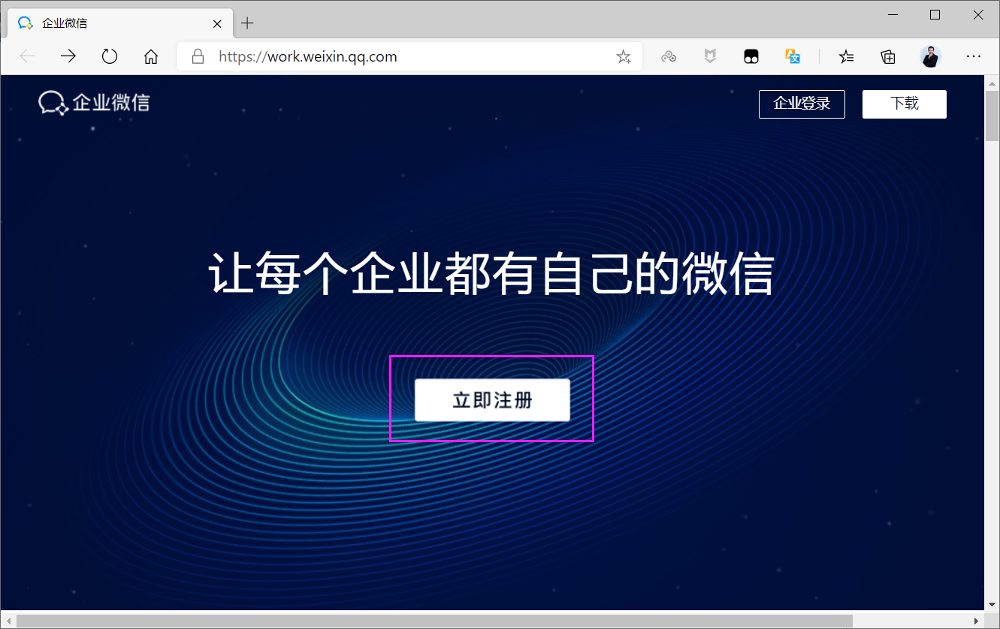
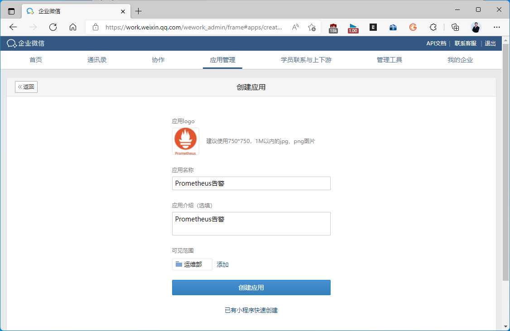
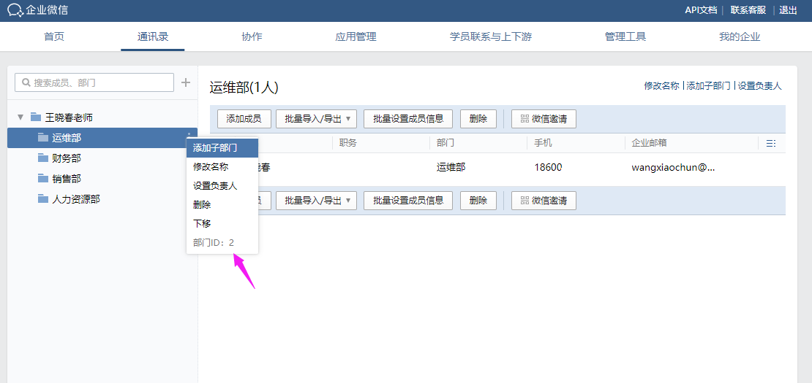
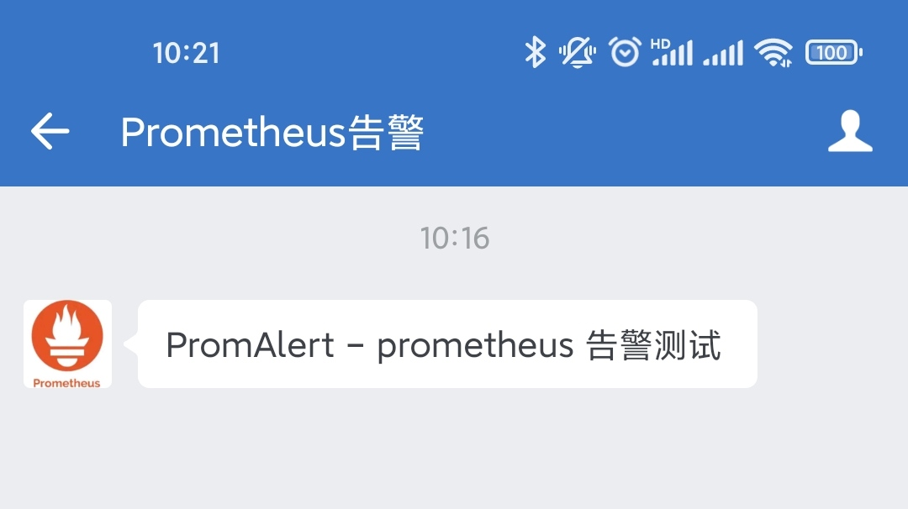
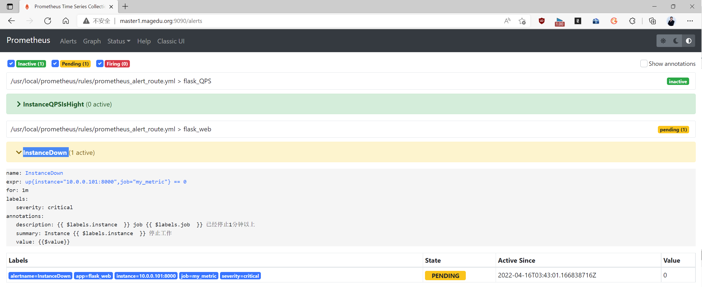
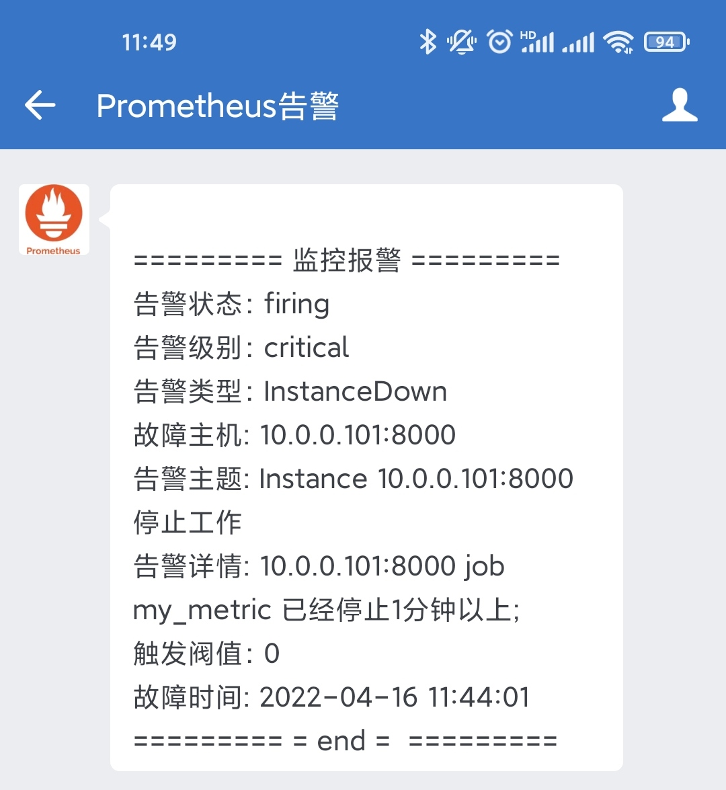
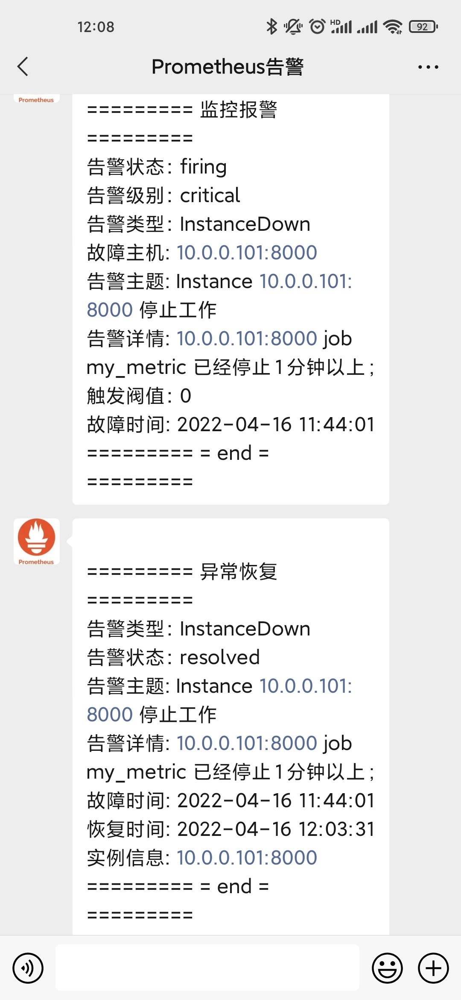
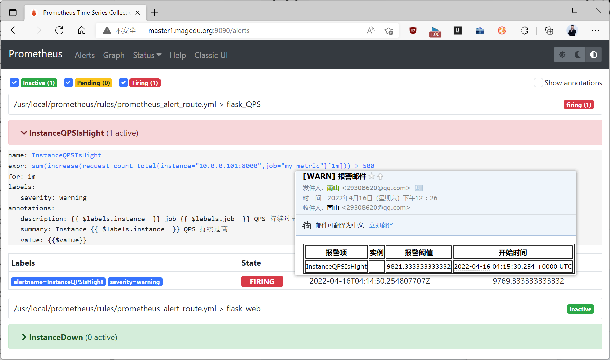

[← 返回 Prometheus 目录]({{ '/subjects/Prometheus/' | relative_url }})



# 14 企业微信告警

本章沿用前两章的 `InstanceDown` 和高 QPS 告警，新增企业微信通知渠道。目标是：严重的服务失联通知企业微信；一般的性能告警继续发邮件。企业微信应用的接口凭据与个人微信账号不是一回事，Alertmanager 使用的是企业微信应用接口。

## 5.7 企业微信告警的准备

### 5.7.1 需要哪些信息

在 [企业微信管理后台](https://work.weixin.qq.com/) 创建企业、部门或成员，再创建有相应可见范围的自建应用。实施前记录以下四项，并核对应用的可见范围确实包含目标成员或部门：

| 字段 | 用途 |
| --- | --- |
| 企业 ID（CorpID） | 标识企业 |
| 应用 Secret | 获取访问令牌，属于敏感凭据 |
| 应用 AgentId | 标识发送消息的应用 |
| 成员账号或部门 ID | 指定接收人或接收部门 |

原资料中的企业 ID、AgentId、Secret 和访问令牌只对应旧截图中的示例环境，不能用于新部署；其中 Secret 与令牌不应在文档或命令输出中公开。请使用自己的配置值，并妥善保存，必要时在企业微信后台轮换。后台页面随版本变化，但“创建应用 → 确认可见范围 → 记录四项参数”的逻辑不变。







### 5.7.2 在接入 Alertmanager 前测试接口

直接测试企业微信 API 可以先区分“应用凭据或可见范围错误”与“告警路由错误”。以下命令依赖 `jq`，只演示参数关系；运行时从受保护的环境或密钥管理系统注入变量，不要把真实 Secret 写入脚本仓库。

```bash
export WECHAT_CORP_ID='CORP_ID'
export WECHAT_SECRET='APP_SECRET'
export WECHAT_AGENT_ID='AGENT_ID'
export WECHAT_PARTY_ID='PARTY_ID'

TOKEN=$(curl -fsSG \
  --data-urlencode "corpid=$WECHAT_CORP_ID" \
  --data-urlencode "corpsecret=$WECHAT_SECRET" \
  'https://qyapi.weixin.qq.com/cgi-bin/gettoken' | jq -r '.access_token')
test -n "$TOKEN" && test "$TOKEN" != null
```

接口响应中 `errcode: 0` 表示取得令牌；访问令牌有有效期，不能作为长期静态凭据。再发送一条测试文本：

```bash
jq -n --arg party "$WECHAT_PARTY_ID" --argjson agent "$WECHAT_AGENT_ID" \
  '{toparty:$party,msgtype:"text",agentid:$agent,text:{content:"Prometheus 告警通道测试"}}' |
curl -fsS -H 'Content-Type: application/json' \
  --data-binary @- \
  "https://qyapi.weixin.qq.com/cgi-bin/message/send?access_token=$TOKEN"
```

响应 `errcode: 0` 只说明接口接受了请求；仍需在目标成员的企业微信中确认实际收到消息。若失败，优先核对应用 Secret、部门 ID、应用可见范围与接口返回的错误码。官方文档可查阅 [获取访问令牌](https://developer.work.weixin.qq.com/document/10013) 与 [发送应用消息](https://developer.work.weixin.qq.com/document/path/90236)。



## 5.8 在 Alertmanager 中增加企业微信接收者

在已有的 Alertmanager 配置中保留邮件接收者，增加企业微信全局参数和接收者。以下片段展示相关字段，需与原配置**合并**，不能再复制出另一套同名顶层 `route` 或 `receivers`。部署时将占位值放到受保护的本地配置，不要把真实 Secret 提交到仓库。

```yaml
global:
  wechat_api_url: 'https://qyapi.weixin.qq.com/cgi-bin/'
  wechat_api_corp_id: 'CORP_ID'
  wechat_api_secret: 'APP_SECRET'

route:
  receiver: email
  group_by: ['alertname', 'instance']
  group_wait: 30s
  group_interval: 5m
  repeat_interval: 4h
  routes:
    - receiver: wechat
      matchers:
        - 'severity="critical"'

receivers:
  - name: email
    email_configs:
      - to: 'oncall@example.com'
        send_resolved: true
  - name: wechat
    wechat_configs:
      - to_party: 'PARTY_ID'
        agent_id: 'AGENT_ID'
        send_resolved: true
        message: '{{ template "wechat.message" . }}'
```

顶层的 `email` 是默认路由，`critical` 告警命中子路由后只发送企业微信；`warning` 没有命中子路由，会发往默认邮箱。如果严重告警需要**同时**发邮件和企业微信，可设计两个并列子路由并配置 `continue`，或将两种通知配置放进同一接收者；不要以为顶层默认接收者必然再收到一份。

模板文件 `/usr/local/alertmanager/tmpl/wechat.tmpl` 可以显示同一分组中的多条告警。配置中的 `templates` 必须包含该文件，例如 `templates: ['/usr/local/alertmanager/tmpl/*.tmpl']`：

```gotemplate
{{ define "wechat.message" }}
{{ range .Alerts }}
状态：{{ .Status }}
级别：{{ .Labels.severity }}
告警：{{ .Labels.alertname }}
实例：{{ .Labels.instance }}
摘要：{{ .Annotations.summary }}
开始：{{ .StartsAt.Format "2006-01-02 15:04:05" }}
{{ if eq .Status "resolved" }}恢复：{{ .EndsAt.Format "2006-01-02 15:04:05" }}{{ end }}
---
{{ end }}
{{ end }}
```

时间格式使用 Go 的参考日期。显示时区取决于 Alertmanager 的运行环境；原资料直接给时间加 8 小时，遇到时区配置变化可能重复偏移。应统一服务进程时区，并用实际收到的消息核对时间。

```bash
amtool check-config /usr/local/alertmanager/conf/alertmanager.yml
systemctl restart alertmanager.service
systemctl status alertmanager.service
```

配置检查通过后，再看 Alertmanager 日志是否有企业微信接口返回的错误。只看到端口 `9093` 在监听，并不能证明通知已送达。

## 5.9 Prometheus 规则与端到端验证

沿用第 13 章的两条规则：`InstanceDown` 带 `severity: critical`；`InstanceQPSHigh` 带 `severity: warning`。若重新建立规则，可用下面的片段，保存后先执行 `promtool check rules <规则文件>`：

```yaml
groups:
  - name: flask-web
    rules:
      - alert: InstanceDown
        expr: up{job="my_metric"} == 0
        for: 1m
        labels:
          severity: critical
        annotations:
          summary: "{{ $labels.instance }} 指标服务失联"
      - alert: InstanceQPSHigh
        expr: rate(request_count_total{job="my_metric"}[1m]) > 500
        for: 1m
        labels:
          severity: warning
        annotations:
          summary: "{{ $labels.instance }} QPS 持续超过 500"
```

`rate(...[1m])` 的单位是每秒，表达式与“QPS 超过 500”一致；原资料使用 `increase(...[1m]) > 500` 实际表示一分钟内超过 500 次请求。停止 Flask 指标服务后，依次核对 Targets 为 `DOWN`、告警从 `pending` 变为 `firing`、Alertmanager 收到 `critical`、目标部门收到企业微信消息。恢复服务后，如启用了 `send_resolved`，应收到恢复消息。







测试高 QPS 时应以应用计数器和 PromQL 查询结果为准，而不是仅运行几十次 `curl` 就认定达到每秒 500 次。高 QPS 告警应走邮件默认路由，不应进入企业微信。若两个渠道都未通知，先检查 Prometheus 是否产生 `firing`；若只微信失败，检查企业微信接口和应用权限；若路由不符，核对 `severity` 标签及 Alertmanager 的路由树。




<nav class="article-end" aria-label="章节导航">
  <a href="{{ '/subjects/Prometheus/13-alert-templates-routing.html' | relative_url }}">← 上一章：告警模板、路由与抑制</a>
  <a href="{{ '/subjects/Prometheus/' | relative_url }}">返回 Prometheus 目录</a>
  <a href="{{ '/subjects/Prometheus/15-dingtalk-alerting.html' | relative_url }}">下一章：钉钉告警 →</a>
</nav>
