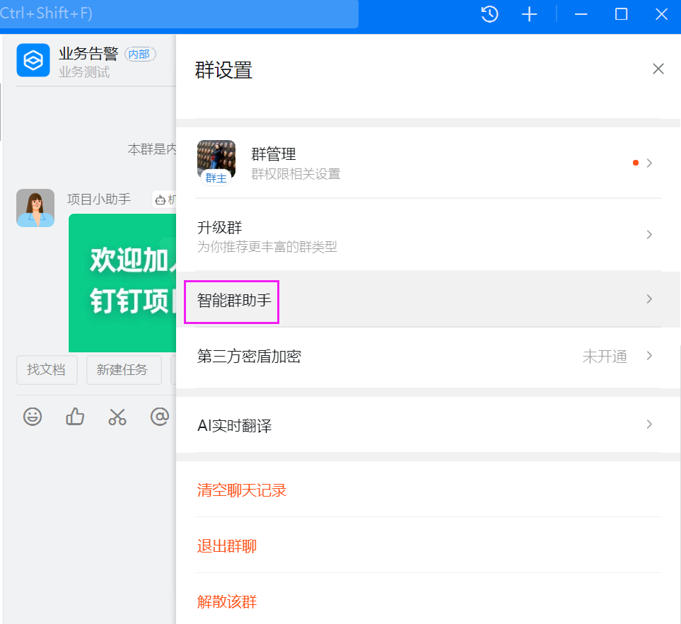
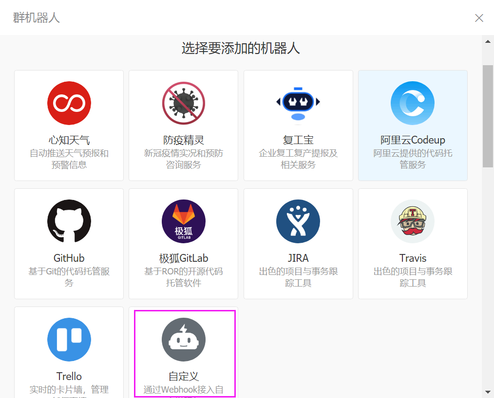
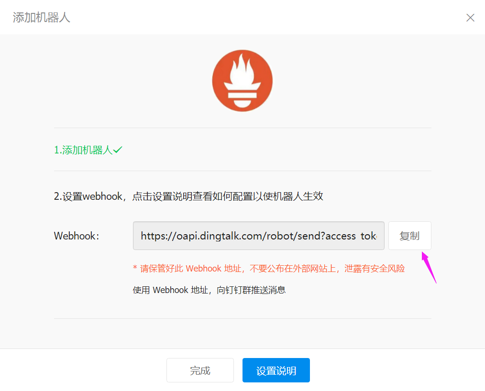
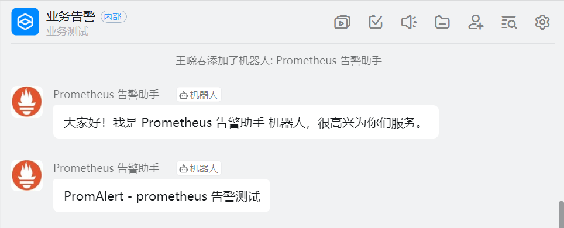
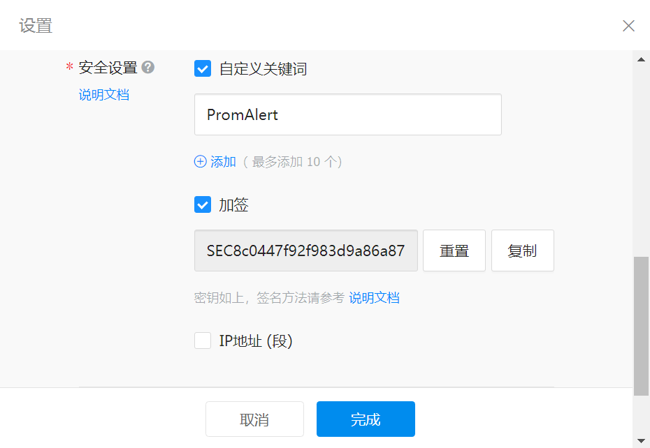
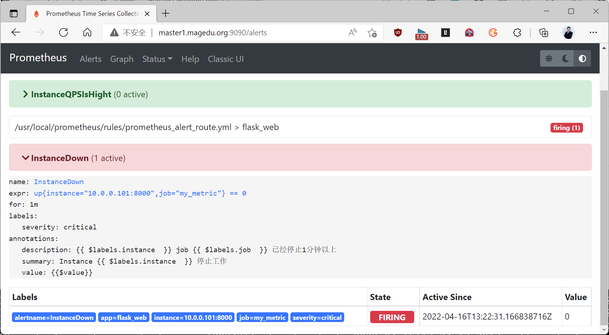
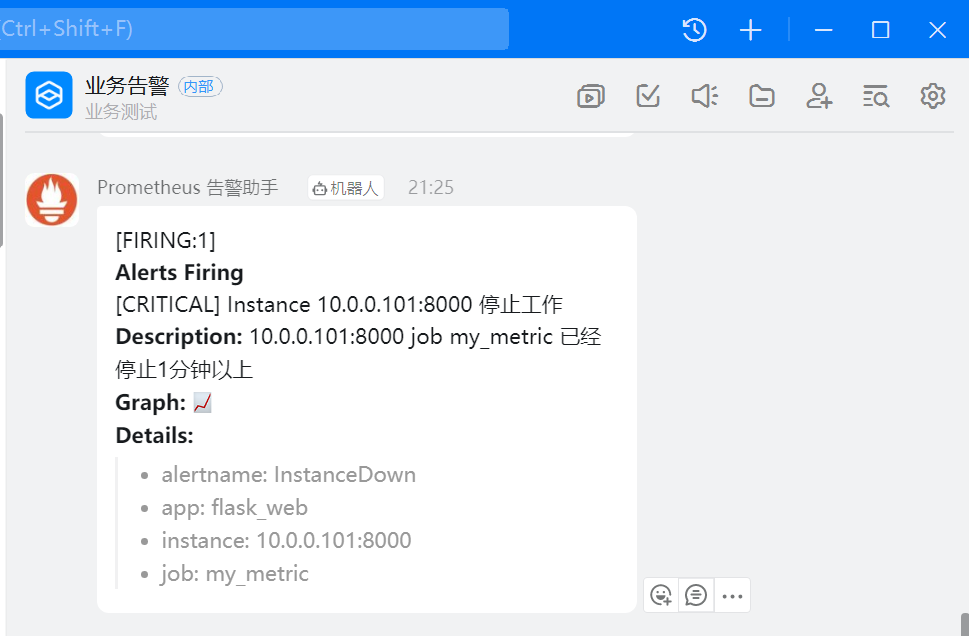
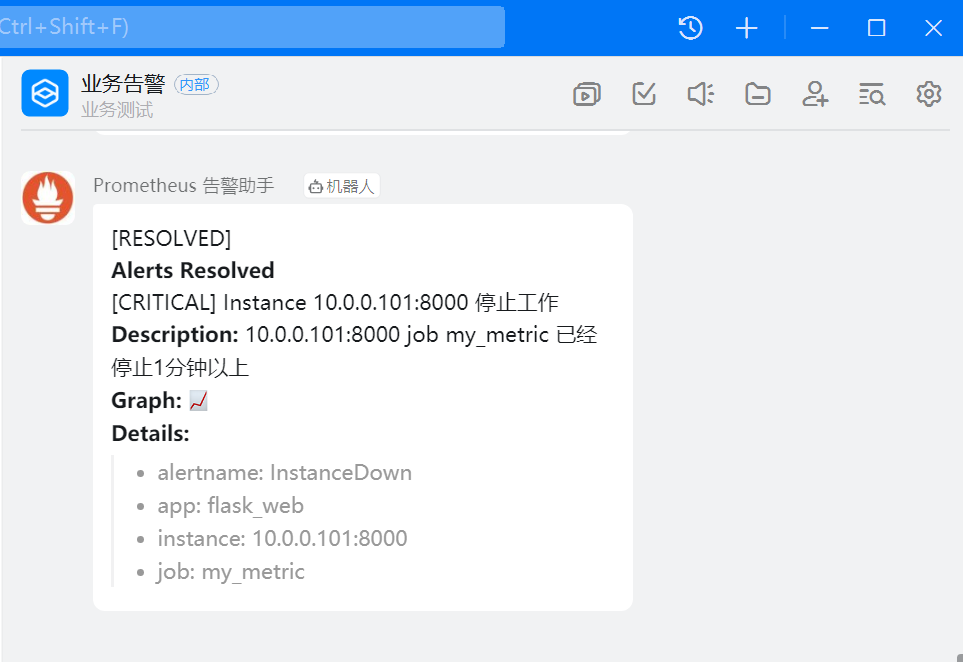
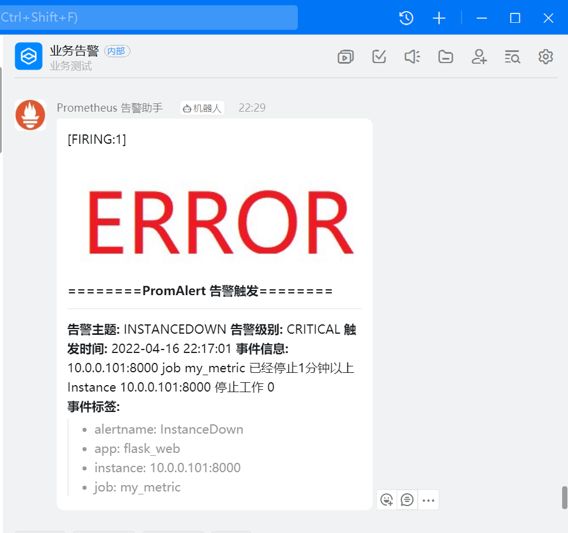
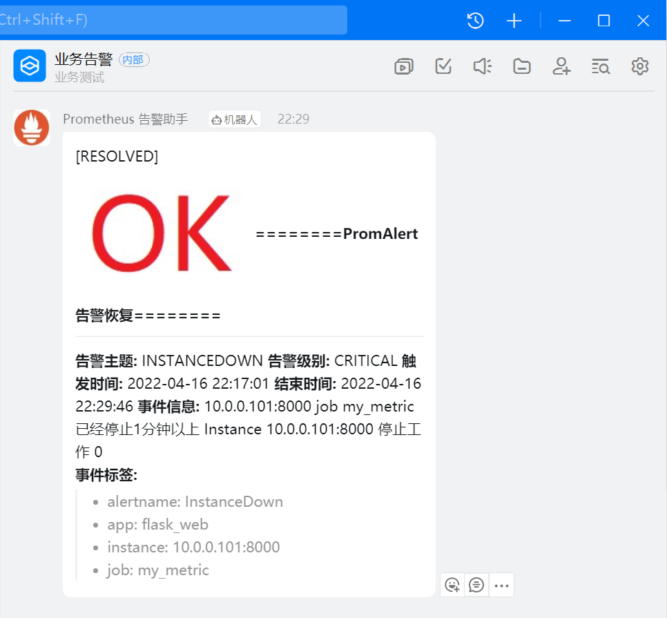

[← 返回 Prometheus 目录]({{ '/subjects/Prometheus/' | relative_url }})



# 15 钉钉告警

Prometheus 将规则告警发给 Alertmanager；Alertmanager 的通用 Webhook JSON **不能直接**当作钉钉群机器人消息发送。本章用 `prometheus-webhook-dingtalk` 作适配器：它接收 Alertmanager 的 Webhook，再按钉钉机器人格式和安全要求发送到群。这样可以把“规则是否触发”“Webhook 是否到达”“群消息是否被接受”分开排查。


## 5.8 准备钉钉群机器人

### 5.8.1 创建群与机器人

在钉钉客户端建立一个告警群，在群设置中添加自定义机器人，记录其 Webhook 地址。如果当前组织或客户端版本的机器人入口不同，应以钉钉官方界面为准。机器人 Webhook 中的 `access_token` 相当于发送凭据，不能提交到仓库或发到公开文档。机器人可以设置关键词、加签等安全条件；消息必须满足实际启用的条件。







先只启用关键词条件做一次接口测试。例如关键词设为 `PromAlert`，可从受保护的环境变量读取 Webhook：

```bash
export DINGTALK_WEBHOOK='https://oapi.dingtalk.com/robot/send?access_token=TOKEN'
curl -fsS -H 'Content-Type: application/json' \
  --data '{"msgtype":"text","text":{"content":"PromAlert：告警通道测试"}}' \
  "$DINGTALK_WEBHOOK"
```

接口返回 `errcode: 0` 后，还要到目标群确认消息出现；若提示关键词不匹配，检查发送内容是否包含**完全相同**的关键词。原资料中的 Webhook、签名密钥、时间戳和成功响应都只是当时的记录，不应用于新环境。



### 5.8.2 加签与关键词的区别

若机器人还开启了加签，发送请求时需要根据当前毫秒时间戳与签名密钥计算 HMAC-SHA256，再把 `timestamp`、`sign` 放入请求 URL。签名密钥与 Webhook Token 是**两个不同的值**。不要将原截图中的固定时间戳重复使用；它会过期。下面的 Python 片段演示计算方式，不向外部发送请求：

```python
import base64
import hashlib
import hmac
import os
import time
from urllib.parse import quote_plus

secret = os.environ["DINGTALK_SIGN_SECRET"]
timestamp = str(int(time.time() * 1000))
payload = f"{timestamp}\n{secret}".encode("utf-8")
signature = base64.b64encode(
    hmac.new(secret.encode("utf-8"), payload, hashlib.sha256).digest()
).decode("utf-8")
print("timestamp:", timestamp)
print("sign:", quote_plus(signature))
```

生产中由 `prometheus-webhook-dingtalk` 根据 `secret` 自动完成加签，不必每次手工运行该脚本。关键词仍需包含在适配器生成的消息正文中；加签成功不意味着关键词条件可以忽略。为减少联调变量，可以先只启用加签并确认送达，再按需要增加关键词并修改通知模板。



## 5.9 部署 Webhook 适配器

以 [prometheus-webhook-dingtalk](https://github.com/timonwong/prometheus-webhook-dingtalk) 的二进制部署为例。版本按目标平台选择；以下保留原教程使用的 `v2.1.0`。本地配置中的真实 Token 和 Secret 应限制文件访问权限，不要提交。

```bash
wget https://github.com/timonwong/prometheus-webhook-dingtalk/releases/download/v2.1.0/prometheus-webhook-dingtalk-2.1.0.linux-amd64.tar.gz
tar xf prometheus-webhook-dingtalk-2.1.0.linux-amd64.tar.gz -C /usr/local/
ln -s /usr/local/prometheus-webhook-dingtalk-2.1.0.linux-amd64 /usr/local/dingtalk
cp /usr/local/dingtalk/config.example.yml /usr/local/dingtalk/config.yml
```

`/usr/local/dingtalk/config.yml` 的关键部分如下，`url` 包含机器人的 Webhook Token，`secret` 是机器人加签密钥。只开启关键词而未开启加签时，不应凭空填写加签密钥。

```yaml
targets:
  webhook1:
    url: 'https://oapi.dingtalk.com/robot/send?access_token=TOKEN'
    secret: 'SIGN_SECRET'
```

直接启动时，所有命令行参数都应在同一行，不要复制 PDF 中 `--` 与参数名分离的折行：

```bash
/usr/local/dingtalk/prometheus-webhook-dingtalk \
  --config.file=/usr/local/dingtalk/config.yml \
  --web.listen-address=0.0.0.0:8060
```

若已作为服务运行，则无需另开手工进程占用 `8060`。长期运行可创建 `/etc/systemd/system/dingtalk.service`，让服务账户读取配置文件并启动：

```ini
[Unit]
Description=Prometheus Webhook DingTalk
After=network-online.target
Wants=network-online.target

[Service]
Type=simple
User=prometheus
Group=prometheus
ExecStart=/usr/local/dingtalk/prometheus-webhook-dingtalk --config.file=/usr/local/dingtalk/config.yml --web.listen-address=0.0.0.0:8060
Restart=on-failure

[Install]
WantedBy=multi-user.target
```

```bash
chown -R prometheus:prometheus /usr/local/prometheus-webhook-dingtalk-2.1.0.linux-amd64
chmod 600 /usr/local/dingtalk/config.yml
systemctl daemon-reload
systemctl enable --now dingtalk.service
systemctl status dingtalk.service
```

容器部署的原理相同：将适配器配置挂载到容器，确认配置路径与启动参数一致，并让 Alertmanager 能访问适配器的 `8060` 端口。不要把机器人的 Webhook 地址误填成 Alertmanager 目标地址；适配器 URL 应为 `http://<适配器主机>:8060/dingtalk/webhook1/send`，其中 `webhook1` 对应配置中的 `targets` 名称。


## 5.10 Alertmanager 接入与验证

在 Alertmanager 的现有配置中增加路由和接收者。下例让所有告警进入钉钉；如果要仅让 `critical` 发钉钉、其他仍发邮件，应使用第 13 章的子路由结构，而非复制第二个顶层 `route`。

```yaml
route:
  receiver: dingtalk
  group_by: ['alertname', 'instance']
  group_wait: 30s
  group_interval: 5m
  repeat_interval: 4h

receivers:
  - name: dingtalk
    webhook_configs:
      - url: 'http://10.0.0.100:8060/dingtalk/webhook1/send'
        send_resolved: true
```

```bash
amtool check-config /usr/local/alertmanager/conf/alertmanager.yml
systemctl restart alertmanager.service
```

这一配置只影响告警的**通知去向**。Prometheus 仍需加载告警规则，且 `alerting.alertmanagers` 必须指向 Alertmanager 的 `9093`，而不是适配器的 `8060`。停止上一章的 Flask 指标服务后，依次核对：Prometheus 中目标为 `DOWN` → 告警进入 `firing` → Alertmanager 收到告警 → 适配器日志显示成功转发 → 钉钉群收到消息。恢复服务后，`send_resolved: true` 应产生恢复通知。







如果适配器日志出现“关键词不匹配”，说明路由已到适配器，但消息正文不满足机器人安全设置；若是签名错误，检查 `secret` 与机器人配置，不要把 Webhook Token 当作 Secret。只检查适配器返回 HTTP 200 也不足以证明钉钉群已收到消息，应结合适配器日志和群内结果。

### 5.10.1 可选：定制钉钉消息

默认消息已经能完成告警链路。需要包含中文摘要、状态和实例时，可以在适配器支持的模板配置中加载模板，确保内容包含机器人所要求的关键词。原教程的大段模板混入旧版兼容定义、外链图标和 PDF 折行，复制后很难定位问题。先使用简洁的文本模板，确认通知成功后再逐步扩展：

```gotemplate
{{ define "ding.title" }}PromAlert {{ .Status }}{{ end }}
{{ define "ding.text" }}
## PromAlert 告警
{{ range .Alerts }}
- 状态：{{ .Status }}
- 告警：{{ .Labels.alertname }}
- 实例：{{ .Labels.instance }}
- 摘要：{{ .Annotations.summary }}
{{ end }}
{{ end }}
```

将其存为 `/usr/local/dingtalk/dingtalk.tmpl`，在适配器配置中加入以下字段，并保留原有 `targets`。模板名称须与 `default_message` 引用一致：

```yaml
templates:
  - /usr/local/dingtalk/dingtalk.tmpl
default_message:
  title: '{{ template "ding.title" . }}'
  text: '{{ template "ding.text" . }}'
```

重启适配器后重新触发一条测试告警，核对触发和恢复两种消息。图片并非发送告警的必要条件；如确需在群消息中显示图标，图片 URL 必须能被钉钉客户端访问，并且应由项目持续维护，避免外链失效。






<nav class="article-end" aria-label="章节导航">
  <a href="{{ '/subjects/Prometheus/14-wechat-alerting.html' | relative_url }}">← 上一章：微信告警</a>
  <a href="{{ '/subjects/Prometheus/' | relative_url }}">返回 Prometheus 目录</a>
  <a href="{{ '/subjects/Prometheus/16-alertmanager-ha.html' | relative_url }}">下一章：Alertmanager 高可用与其他应用 →</a>
</nav>
