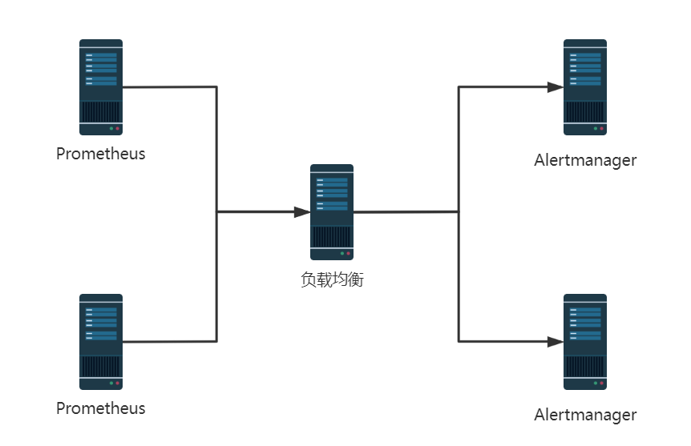
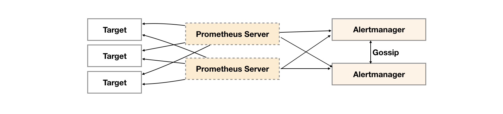
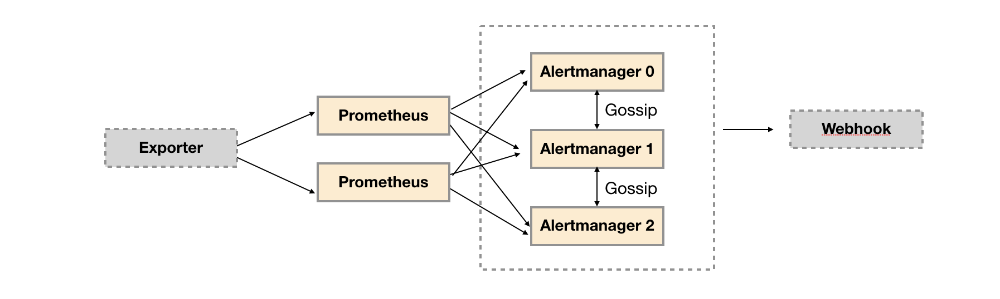
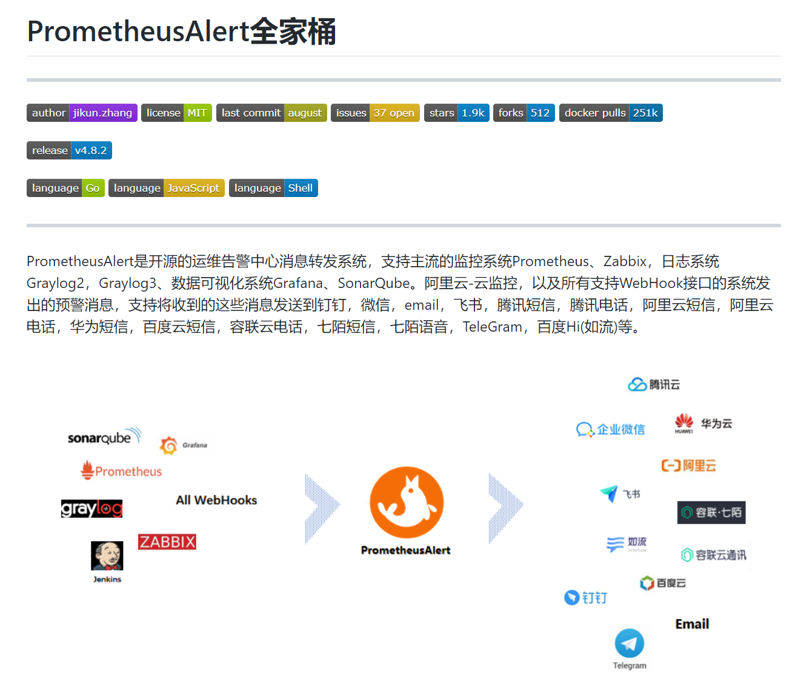
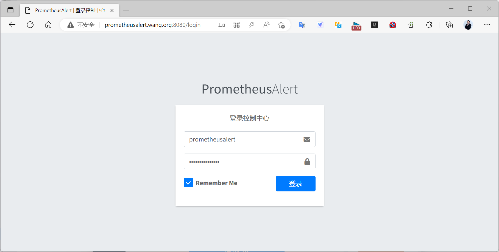
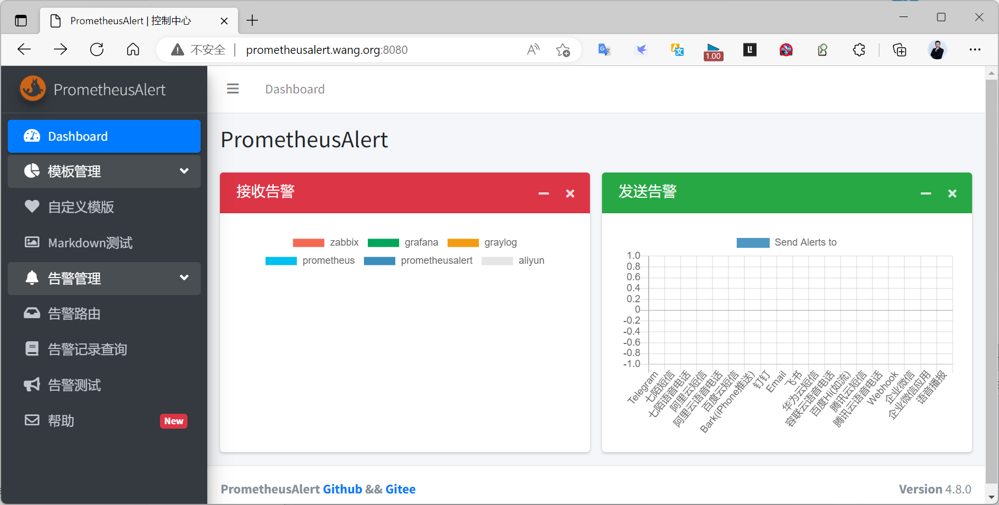

[← 返回 Prometheus 目录]({{ '/subjects/Prometheus/' | relative_url }})



# 16 Alertmanager 高可用与其他应用

## 5.9 Alertmanager 高可用

### 5.9.1 负载均衡



### 5.9.2 Gossip 谣言协议实现
https://yunlzheng.gitbook.io/prometheus-book/part-ii-prometheus-jin-jie/readmd/alertmanager-high-availability

Alertmanager引入了Gossip机制。Gossip机制为多个Alertmanager之间提供了信息传递的机制。确保及时在多个Alertmanager分别接收到相同告警信息的情况下，也只有一个告警通知被发送给Receiver。



Gossip是分布式系统中被广泛使用的协议，用于实现分布式节点之间的信息交换和状态同步。Gossip协议同步状态类似于流言或者病毒的传播，如下所示：


Gossip有两种实现方式分别为Push-based和Pull-based。

在Push-based当集群中某一节点A完成一个工作后，随机的挑选其它节点B并向其发送相应的消息，节点B接收到消息后在重复完成相同的工作，直到传播到集群中的所有节点。

而Pull-based的实现中节点A会随机的向节点B发起询问是否有新的状态需要同步，如果有则返回。

搭建本地集群环境

为了能够让Alertmanager节点之间进行通讯，需要在Alertmanager启动时设置相应的参数。其中主要的参数包括：
```text
--web.listen-address string      #当前实例Web监听地址和端口,默认9093，可以使用默认值
--cluster.listen-address string  #当前实例集群服务监听地址,默认9094，可以使用默认值，集群必选
--cluster.peer value             #后续集群实例在初始化时需要关联集群中的已有实例的服务地址,集群
的后续节点必选
```

范例：在不同主机用Alertmanager实现

第一台主机定义Alertmanager实例A，其中Alertmanager的服务运行在9093端口，集群服务地址运行在9094端口。
```text
alertmanager  --web.listen-address=":9093" --cluster.listen-address=":9094" --
config.file=/etc/prometheus/alertmanager.yml  --storage.path=/data/alertmanager/
```

第二台主机定义Alertmanager实例B，其中Alertmanager的服务运行在9093端口，集群服务运行在9094端口。

为了将A1，A2组成集群。 A2启动时需要定义--cluster.peer参数并且指向A1实例的集群服务地址:8001
```yaml
alertmanager  --web.listen-address=":9093" --cluster.listen-address=":9094" --
cluster.peer=A主机:9094 --config.file=/etc/prometheus/alertmanager.yml  --
storage.path=/data/alertmanager/
#创建Promthues集群配置文件/etc/prometheus/prometheus-ha.yml，完整内容如下：
global:
  scrape_interval: 15s
  scrape_timeout: 10s
  evaluation_interval: 15s
rule_files:
  - /etc/prometheus/rules/*.rules
alerting:
  alertmanagers:
  - static_configs:
    - targets:
      - A主机IP:9093
      - B主机IP:9093
```

范例：在同一个主机用Alertmanager多实例实现

定义Alertmanager实例A1，其中Alertmanager的服务运行在9093端口，集群服务地址运行在8001端口。
```text
alertmanager  --web.listen-address=":9093" --cluster.listen-address="127.0.0.1:8001"
--config.file=/etc/prometheus/alertmanager.yml  --storage.path=/data/alertmanager/
```

定义Alertmanager实例A2，其中Alertmanager的服务运行在9094端口，集群服务运行在8002端口。

为了将A1，A2组成集群。 A2启动时需要定义--cluster.peer参数并且指向A1实例的集群服务地址:8001
```text
alertmanager  --web.listen-address=":9094" --cluster.listen-address="127.0.0.1:8002"
--cluster.peer=127.0.0.1:8001 --config.file=/etc/prometheus/alertmanager.yml  --
storage.path=/data/alertmanager2/
```

范例: 同一个主机上alertmanager三个实例实现Promthues与Alertmanager HA部署结构


```yaml
#创建Alertmanager配置文件/etc/prometheus/alertmanager-ha.yml, 为了验证Alertmanager的集群
行为，这里在本地启动一个webhook服务用于打印Alertmanager发送的告警通知信息。
route:
  receiver: 'default-receiver'
receivers:
  - name: default-receiver
    webhook_configs:
    - url: 'http://127.0.0.1:5001/'
# 获取alertmanager提供的webhook示例，如果该目录下定义了main函数，go get会自动将其编译成可执行文
件
go get github.com/prometheus/alertmanager/examples/webhook
# 设置环境变量指向GOPATH的bin目录
export PATH=$GOPATH/bin:$PATH
# 启动服务
webhook
#a1:
alertmanager  --web.listen-address=":9093" --cluster.listen-address="127.0.0.1:8001"
--config.file=/etc/prometheus/alertmanager-ha.yml  --storage.path=/data/alertmanager/
--log.level=debug
#a2:
alertmanager  --web.listen-address=":9094" --cluster.listen-address="127.0.0.1:8002"
--cluster.peer=127.0.0.1:8001 --config.file=/etc/prometheus/alertmanager-ha.yml  --
storage.path=/data/alertmanager2/ --log.level=debug
#a3:
alertmanager  --web.listen-address=":9095" --cluster.listen-address="127.0.0.1:8003"
--cluster.peer=127.0.0.1:8001 --config.file=/etc/prometheus/alertmanager-ha.yml  --
storage.path=/data/alertmanager2/ --log.level=debug
#创建Promthues集群配置文件/etc/prometheus/prometheus-ha.yml，完整内容如下：
global:
  scrape_interval: 15s
  scrape_timeout: 10s
  evaluation_interval: 15s
rule_files:
  - /etc/prometheus/rules/*.rules
alerting:
  alertmanagers:
  - static_configs:
    - targets:
      - 127.0.0.1:9093
      - 127.0.0.1:9094
      - 127.0.0.1:9095
scrape_configs:
- job_name: prometheus
  static_configs:
  - targets:
    - localhost:9090
- job_name: 'node'
  static_configs:
  - targets: ['localhost:9100']
#同时定义告警规则文件/etc/prometheus/rules/hoststats-alert.rules，如下所示：
groups:
- name: hostStatsAlert
  rules:
  - alert: hostCpuUsageAlert
    expr: sum(avg without (cpu)(irate(node_cpu{mode!='idle'}[5m]))) by (instance) *
100 > 50
    for: 1m
    labels:
      severity: page
    annotations:
      summary: "Instance {{ $labels.instance }} CPU usgae high"
      description: "{{ $labels.instance }} CPU usage above 50% (current value: {{
$value }})"
  - alert: hostMemUsageAlert
    expr: (node_memory_MemTotal - node_memory_MemAvailable)/node_memory_MemTotal *
100 > 85
    for: 1m
    labels:
      severity: page
    annotations:
      summary: "Instance {{ $labels.instance }} MEM usgae high"
      description: "{{ $labels.instance }} MEM usage above 85% (current value: {{
$value }})"
#创建prometheus.procfile文件，创建两个Promthues节点，分别监听9090和9091端口:
#p1:
prometheus --config.file=/etc/prometheus/prometheus-ha.yml --
storage.tsdb.path=/data/prometheus/ --web.listen-address="127.0.0.1:9090"
#p2:
prometheus --config.file=/etc/prometheus/prometheus-ha.yml --
storage.tsdb.path=/data/prometheus2/ --web.listen-address="127.0.0.1:9091"
#node_exporter
node_exporter: node_exporter -web.listen-address="0.0.0.0:9100"
```

范例：docker compose 实现
```text
version: '3.6'
networks:
  monitoring:
    driver: bridge
    ipam:
      config:
         - subnet: 172.31.0.0/24
volumes:
  alertmanager01_data: {}
  alertmanager02_data: {}
  alertmanager03_data: {}
services:
  alertmanager01:
    image: prom/alertmanager:v0.24.0
    volumes:
      - ./alertmanager/:/etc/alertmanager/
      - alertmanager01_data:/alertmanager
    networks:
      - monitoring
    ports:
      - 9093:9093
    command:
      - '--config.file=/etc/alertmanager/config.yml'
      - '--storage.path=/alertmanager'
      - '--cluster.listen-address=0.0.0.0:9094'
      - '--cluster.peer-timeout=15s'
  alertmanager02:
    image: prom/alertmanager:v0.24.0
    volumes:
      - ./alertmanager/:/etc/alertmanager/
      - alertmanager02_data:/alertmanager
    networks:
      - monitoring
    ports:
      - 19093:9093
    command:
      - '--config.file=/etc/alertmanager/config.yml'
      - '--storage.path=/alertmanager'
      - '--cluster.listen-address=0.0.0.0:9094'
      - '--cluster.peer-timeout=15s'
      - '--cluster.peer=alertmanager01:9094'
  alertmanager03:
    image: prom/alertmanager:v0.24.0
    volumes:
      - ./alertmanager/:/etc/alertmanager/
      - alertmanager03_data:/alertmanager
    networks:
      - monitoring
    ports:
      - 29093:9093
    command:
      - '--config.file=/etc/alertmanager/config.yml'
      - '--storage.path=/alertmanager'
      - '--cluster.listen-address=0.0.0.0:9094'
      - '--cluster.peer-timeout=15s'
      - '--cluster.peer=alertmanager01:9094'
  prometheus-webhook-dingtalk:
    image: timonwong/prometheus-webhook-dingtalk:v2.1.0
    volumes:
      - ./dingtalk/:/etc/prometheus-webhook-dingtalk/
    #command:
      #- --config.file=config.yml
      #- --config.file=/etc/prometheus-webhook-dingtalk/config-with-template.yml
    networks:
      - monitoring
    ports:
      - 8060:8060
#prometheus.yml 添加配置
......
alerting:
  alertmanagers:
  - static_configs:
    - targets:
      - alert.bowen.org:9093
      - alert.bowen.org:19093
      - alert.bowen.org:29093
......
```

## 5.10 其它告警应用
https://github.com/feiyu563/PrometheusAlert



范例: Docker 部署 prometheus alert
```bash
docker run -d \
-p 8080:8080 \
-e PA_LOGIN_USER=prometheusalert \
-e PA_LOGIN_PASSWORD=PASSWORD \
-e PA_TITLE=PrometheusAlert \
-e PA_OPEN_FEISHU=1 \
-e PA_OPEN_DINGDING=1 \
-e PA_OPEN_WEIXIN=1 \
feiyu563/prometheus-alert:latest
#浏览器访问,用户名/密码默认是prometheusalert/prometheusalert
http://prometheusalert.bowen.org:8080
```







<nav class="article-end" aria-label="章节导航">
  <a href="{{ '/subjects/Prometheus/15-dingtalk-alerting.html' | relative_url }}">← 上一章：钉钉告警</a>
  <a href="{{ '/subjects/Prometheus/' | relative_url }}">返回 Prometheus 目录</a>
  <a href="{{ '/subjects/Prometheus/17-service-discovery-basics.html' | relative_url }}">下一章：服务发现基础、文件与 DNS →</a>
</nav>
