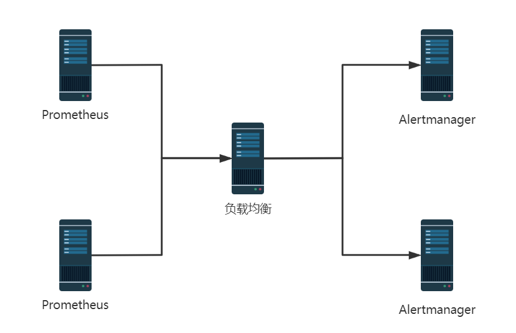
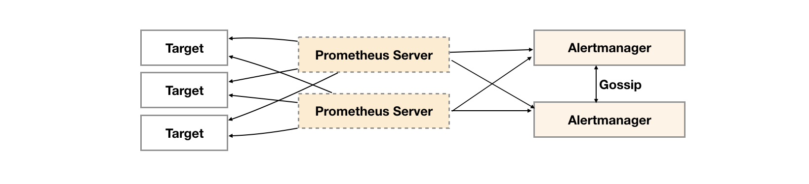
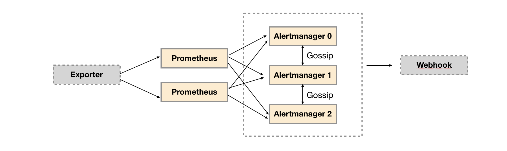
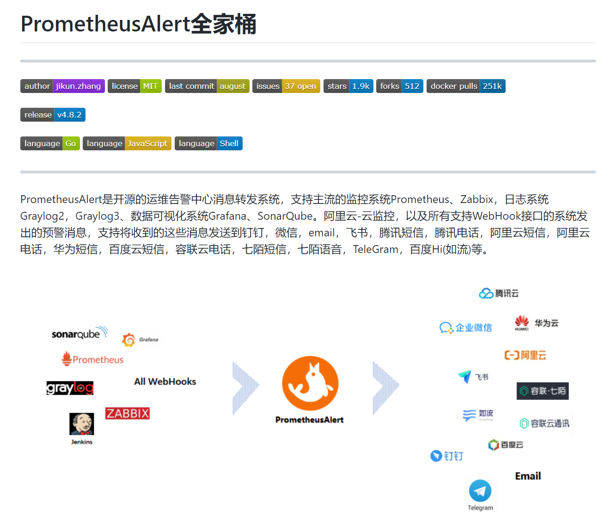
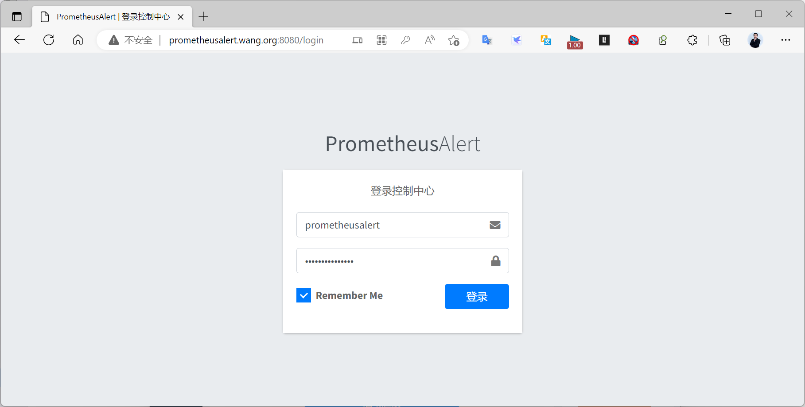
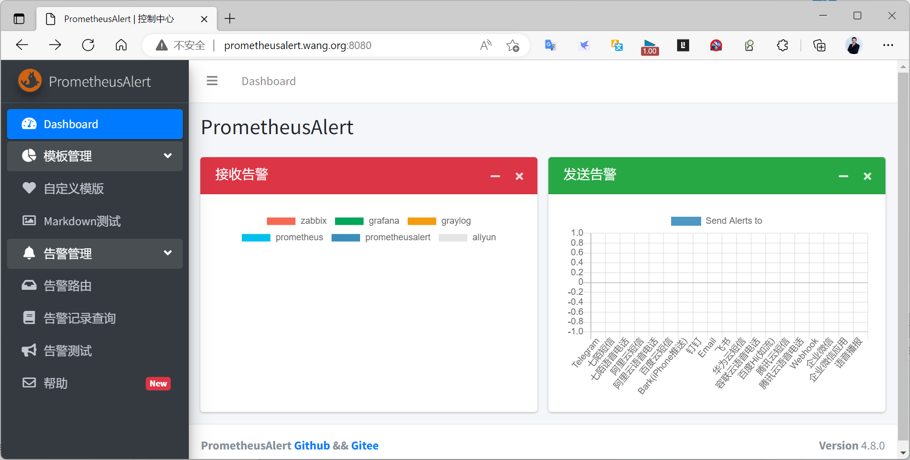

[← 返回 Prometheus 目录]({{ '/subjects/Prometheus/' | relative_url }})



# 16 Alertmanager 高可用

单个 Alertmanager 故障会影响告警通知。高可用的基本方案是运行多个 Alertmanager 实例，让 Prometheus 把同一告警发送到**每一个**实例，同时让这些实例组成集群。集群成员通过 gossip 交换静默、通知日志等状态，尽量避免重复通知；这属于最终一致的协调机制，不能承诺网络分区或故障切换期间“绝对只发送一次”。

## 为什么不是简单加一个负载均衡器

只在两个 Alertmanager 前放负载均衡器，每次告警请求可能只到达其中一个节点。若该节点随后故障，另一节点未必已收到需要处理的告警。Prometheus 的 `alerting.alertmanagers` 可以列出全部 Alertmanager 目标，让告警分别发送到各节点；集群再负责状态协作。






生产部署需关注三类地址：**9093** 是各实例的 Web/API 地址，供 Prometheus 发送告警；**9094** 通常用于集群通信，成员间要能互通相应 TCP/UDP 流量；`--cluster.peer` 指向已有成员的集群地址，而不是其 9093 Web 地址。具体监听端口可调整，但所有配置必须一致。

## 多主机部署的最小配置

假设 `am-a` 和 `am-b` 是两台可互通的主机，二者使用相同的 `alertmanager.yml`，但各有自己的数据目录。首先校验配置，再分别启动。下面命令用于说明参数关系；实际可由 systemd 或容器编排管理进程。

```bash
amtool check-config /etc/alertmanager/alertmanager.yml

# 在 am-a 主机上
alertmanager \
  --config.file=/etc/alertmanager/alertmanager.yml \
  --storage.path=/var/lib/alertmanager \
  --web.listen-address=:9093 \
  --cluster.listen-address=:9094

# 在 am-b 主机上
alertmanager \
  --config.file=/etc/alertmanager/alertmanager.yml \
  --storage.path=/var/lib/alertmanager \
  --web.listen-address=:9093 \
  --cluster.listen-address=:9094 \
  --cluster.peer=am-a:9094
```

集群状态共享不意味着可以共用同一个本地存储目录；每个实例都要独立的 `--storage.path`。原资料在三实例示例里让第二、第三个实例共用 `/data/alertmanager2/`，这会造成数据冲突。各节点也要保持配置文件、通知模板与网络可达性一致。

在 Prometheus 的现有配置中合并以下目标，然后运行 `promtool check config` 并重载。若有两个 Prometheus 副本，两个副本都应配置 Alertmanager 集群地址；Prometheus 的高可用和 Alertmanager 的高可用是两层不同问题。

```yaml
alerting:
  alertmanagers:
    - static_configs:
        - targets:
            - am-a:9093
            - am-b:9093
```



## Compose 中的三实例示例

在同一 Compose 网络中，三实例可互相解析服务名。先准备同一份 `alertmanager.yml` 并保证其中的接收器配置确实可用，再使用如下 `compose.yaml`。这里只展示集群层，**不会替你创建邮件、Webhook 或即时通讯的实际接收端**。

```yaml
services:
  alertmanager01:
    image: prom/alertmanager:v0.27.0
    command:
      - --config.file=/etc/alertmanager/alertmanager.yml
      - --storage.path=/alertmanager
      - --cluster.listen-address=0.0.0.0:9094
    volumes:
      - ./alertmanager.yml:/etc/alertmanager/alertmanager.yml:ro
      - am01_data:/alertmanager
    ports:
      - "9093:9093"
    networks: [monitoring]

  alertmanager02:
    image: prom/alertmanager:v0.27.0
    command:
      - --config.file=/etc/alertmanager/alertmanager.yml
      - --storage.path=/alertmanager
      - --cluster.listen-address=0.0.0.0:9094
      - --cluster.peer=alertmanager01:9094
    volumes:
      - ./alertmanager.yml:/etc/alertmanager/alertmanager.yml:ro
      - am02_data:/alertmanager
    ports:
      - "19093:9093"
    networks: [monitoring]

  alertmanager03:
    image: prom/alertmanager:v0.27.0
    command:
      - --config.file=/etc/alertmanager/alertmanager.yml
      - --storage.path=/alertmanager
      - --cluster.listen-address=0.0.0.0:9094
      - --cluster.peer=alertmanager01:9094
    volumes:
      - ./alertmanager.yml:/etc/alertmanager/alertmanager.yml:ro
      - am03_data:/alertmanager
    ports:
      - "29093:9093"
    networks: [monitoring]

volumes:
  am01_data:
  am02_data:
  am03_data:

networks:
  monitoring:
```

若 Prometheus 也加入 `monitoring` 网络，可配置 `alertmanager01:9093`、`alertmanager02:9093`、`alertmanager03:9093` 为目标；若在宿主机上运行，则使用宿主机地址及实际发布端口 9093、19093、29093。不能把容器内部 DNS 名称直接复制到网络外的 Prometheus 配置中。

```bash
docker compose config
docker compose up -d
docker compose ps
docker compose logs --tail 50 alertmanager01 alertmanager02 alertmanager03
```

## 验证故障切换与去重

先在各节点的 Status 页面或 `alertmanager_cluster_members` 指标中确认成员已互相发现，再触发一条带固定标签的测试告警。检查三个实例都收到告警、接收端通常只收到预期通知，并对比静默是否在节点间同步。之后停止其中一个实例，观察其余实例继续通知；恢复后再检查成员数与状态。**瞬时重复通知仍可能发生**，需结合告警分组间隔、网络故障和集群日志分析，不能把“只收到一次”当成永久保证。

原资料末尾的 PrometheusAlert 是独立的第三方告警聚合项目，不是 Alertmanager 集群的必需组件。若要接入它，应单独评估维护状态、版本、凭据保存和通知通道；不要把演示环境中的默认账号和口令用于实际部署。









<nav class="article-end" aria-label="章节导航">
  <a href="{{ '/subjects/Prometheus/15-dingtalk-alerting.html' | relative_url }}">← 上一章：钉钉告警</a>
  <a href="{{ '/subjects/Prometheus/' | relative_url }}">返回 Prometheus 目录</a>
  <a href="{{ '/subjects/Prometheus/17-service-discovery-basics.html' | relative_url }}">下一章：服务发现基础、文件与 DNS →</a>
</nav>
