[← 返回 Prometheus 目录]({{ '/subjects/Prometheus/' | relative_url }})



# 17 服务发现基础、文件与 DNS

# 6 服务发现

## 6.1 服务发现原理

### 6.1.1 服务发现介绍

Prometheus Server的数据抓取工作于Pull模型，因而，它必需要事先知道各Target的位置，然后才能从相应的Exporter或Instrumentation中抓取数据。

在不同的场景下，需要结合不同的机制来实现对应的数据抓取目的。

对于小型的系统环境来说，通过static_configs指定各Target便能解决问题，这也是最简单的配置方法,我们只需要在配置文件中，将每个Targets用一个网络端点（ip:port）进行标识；
```yaml
  - job_name: 'node_exporter'
    static_configs:
    - targets: ['10.0.0.101:9100']
```

对于中大型的系统环境或具有较强动态性的云计算环境来说，由于场景体量的因素，静态配置显然难以适用。

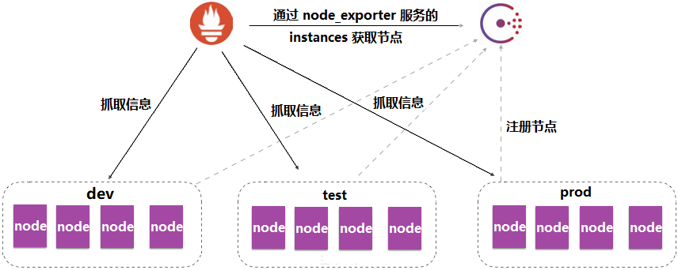

因此，Prometheus为此专门设计了一组服务发现机制，以便于能够基于服务注册中心自动发现、检测、分类可被监控的各Target，以及更新发生了变动的Target

各个节点会主动注册相关属性信息到服务注册中心，即使属性发生变动，注册中心的属性也会随之更改。

一旦节点过期了，或者失效了，服务注册中心，会周期性的方式自动将这些信息清理出去。

服务发现机制
https://prometheus.io/docs/prometheus/latest/configuration/configuration/

对于prometheus的服务发现机制，这里面提供了二十多种服务发现机制，常见的几种机制如下：

方法  解析

静态服
在Prometheus配置文件中通过static_config项,手动添加监控的主机实现  
务发现  

基于文
将各target记录到文件中，prometheus启动后，周期性刷新这个文件，从而获取最新的  
件的服  
target  
务发现  

基于
DNS的  
针对一组DNS域名进行定期查询，以发现待监控的目标，并持续监视相关资源的变动  
服务发  
现  

基于
Consul  
基于 Consul 服务实现动态自动发现  
服务发  
现  

基于 HTTP 的服务发现提供了一种更通用的方式来配置静态目标，并用作插入自定义服务
基于  
发现机制的接口。  
HTTP的  
它从包含零个或多个 <static_config> 列表的 HTTP 端点获取目标。目标必须回复 HTTP  
服务发  
200 响应。 HTTP header Content-Type 必须是 application/json，body 必须是有效的  
现  
JSON。  

基于API
支持将Kubernetes API Server中Node、Service、Endpoint、Pod和Ingress等资源类型下  
的服务  
相应的各资源对象视作target，并持续监视相关资源的变动。  
发现  

### 6.1.2 服务发现原理

发现原理

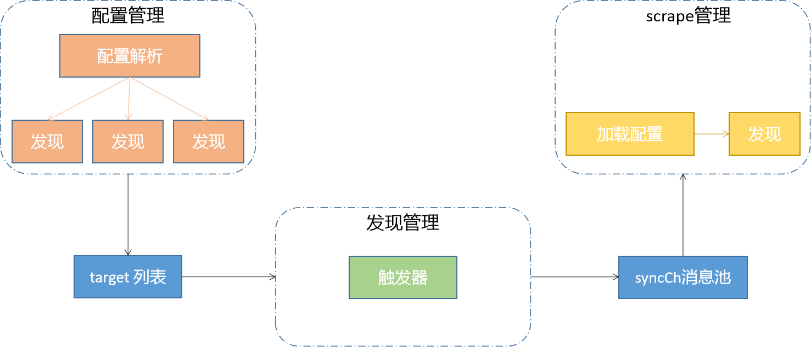

Prometheus服务发现机制大致涉及到三个部分：

配置处理模块解析的prometheus.yml配置中scrape_configs部分，将配置的job生成一个个Discover服
务，不同的服务发现协议都会有各自的Discoverer实现方式，它们根据实现逻辑去发现target，并将其  
放入到targets列表中  
DiscoveryManager组件内部有一个定时周期触发任务，每5秒检查target列表，如果有变更则将target  
列表中target信息放入到syncCh消息池中  
scrape组件会监听syncCh消息池，这样需要监控的target信息就传递给scrape组件，然后reload将  
target纳入监控开始抓取监控指标  

配置处理部分会根据scrape_configs部分配置的不同协议类型生成不同Discoverer，然后根据它们内部不同的实现逻辑去发现target，discoveryManager组件则相当于一个搬运工，scrape组件则是一个使用者，这两个组件都对不同服务发现协议的差异无所感知。

## 6.2 文件服务发现

### 6.2.1 文件发现服务说明

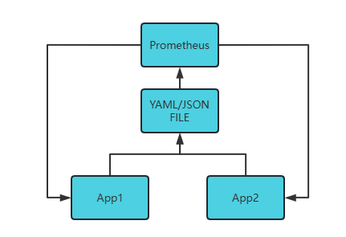

基于文件的服务发现是仅仅略优于静态配置的服务发现方式，它不依赖于任何平台或第三方服务，因而也是最为简单和通用的实现方式

文件发现原理

Target的文件可由手动创建或利用工具生成，例如Ansible或Saltstack等配置管理系统，也可能是由脚本
基于CMDB定期查询生成  
文件可使用YAML和JSON格式，它含有定义的Target列表，以及可选的标签信息,YAML 适合于运维场景,  
JSON 更适合于开发场景  
Prometheus Server定期从文件中加载Target信息，根据文件内容发现相应的Target  

参考资料:
https://prometheus.io/blog/2015/06/01/advanced-service-discovery/#custom-service-discovery
https://prometheus.io/docs/prometheus/latest/configuration/configuration/#file_sd_config

配置过程和格式
```yaml
#准备主机节点列表文件,可以支持yaml格式和json格式
#注意：此文件不建议就地编写生成，可能出现加载一部分的情况
cat targets/prometheus*.yaml
- targets:
  - master1:9100
  labels:
    app: prometheus
#修改prometheus配置文件自动加载实现自动发现
cat prometheus.yml
......
  - job_name: 'file_sd_prometheus'
    scrape_interval: 10s                #指定抓取数据的时间间隔,默认继取全局的配置15s
    file_sd_configs:
    - files:                     #指定要加载的文件列表
      - targets/prometheus*.yaml #要加载的yml或json文件路径，支持glob通配符,相对路径是相对于
prometheus.yml配置文件路径
      refresh_interval: 2m      #每隔2分钟重新加载一次文件中定义的Targets，默认为5m
#注意：文件格式都是yaml或json格式
```

文件发现会生成meta_label
```text
__meta_filepath="/usr/local/prometheus/conf/targets/prometheues-server.yml"
```

### 6.2.2 文件服务发现案例

#### 6.2.2.1 案例: YAML 格式

范例:  通过yaml格式的文件发现，将所有的节点都采用自动发现机制
```yaml
#创建目标目录
mkdir /usr/local/prometheus/conf/targets
cd /usr/local/prometheus/conf/targets
#添加linux主机目标
ls /usr/local/prometheus/conf/targets/
prometheues-flask.yml  prometheues-node.yml  prometheues-server.yml
#创建prometheus的服务配置
cat prometheues-server.yml
- targets:
  - 10.0.0.101:9090
  labels:
    app: prometheus-server
    job: prometheus-server
cat prometheues-node.yml
- targets:
  - 10.0.0.101:9100
  labels:
    app: prometheus
    job: prometheus
- targets:
  - 10.0.0.104:9100
  - 10.0.0.105:9100
  labels:
    app: node-exporter
    job: node
cat  prometheues-flask.yml
- targets:
  - 10.0.0.101:8000
  labels:
    app: flask-web
    job: prometheus-flask
#修改prometheus的配置文件，让它自动加载文件中的节点信息
cd /usr/local/prometheus/conf
cp prometheus.yml{,.bak}
#编辑配置文件
]#cat /usr/local/prometheus/conf/prometheus.yml
global:
  scrape_interval: 15s # Set the scrape interval to every 15 seconds. Default is
every 1 minute.
  evaluation_interval: 15s # Evaluate rules every 15 seconds. The default is every 1
minute.
  # scrape_timeout is set to the global default (10s).
# Alertmanager configuration
alerting:
  alertmanagers:
    - static_configs:
         - targets:
rule_files:
scrape_configs:
  - job_name: "file_sd_prometheus"
    scrape_interval: 10s  #指定抓取数据的时间间隔
    file_sd_configs:
    - files:
      - targets/prometheues-server.yml
      refresh_interval: 10s  #指定重读文件的时间间隔,默认值5m
  - job_name: 'file_sd_node_exporter'
    file_sd_configs:
    - files:
      - targets/prometheues-node.yml
      refresh_interval: 10s
  - job_name: 'file_sd_flask_web'
    file_sd_configs:
    - files:
      - targets/prometheues-flask.yml
      refresh_interval: 10s
#配置文件语法检查
promtool check config prometheus.yml
#重启服务
systemctl reload prometheus.service
#稍等几秒钟，到浏览器中查看监控目标
#结果显示：所有的节点都添加完毕了，而且每个节点都有自己的标签信息
```

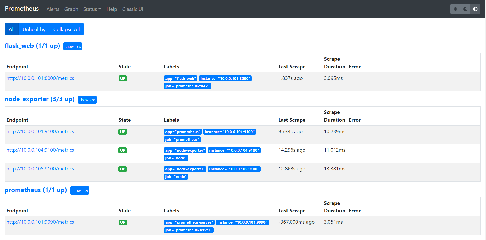
```yaml
#后续可以自由的编辑文件，无需重启prometheus服务，就可以做到自动发现的效果
cd /usr/local/prometheus/targets
vim  prometheues-node.yml
#添加linux主机目标
# cat prometheues-node.yml
- targets:
  - 10.0.0.104:9100
  - 10.0.0.105:9100
  - 10.0.0.106:9100 #加此行
....
#文件保存后，稍等几秒钟，会自动加载当前的配置文件里面的信息，查看一下浏览器
#结果显示：节点的自动服务发现成功了。以后，对所有节点批量管理的时候，借助于ansible等工具，就可以非常
轻松的实现
#如果将文件中的指定的节点行删除，Prometheus也会自动将其从发现列表中删除
```

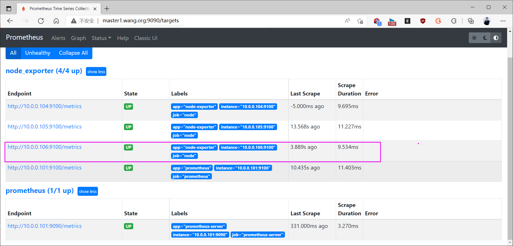

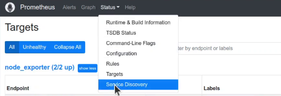

#### 6.2.2.2 案例: JSON 格式

可以利用工具将前面的YAML格式转换为JSON格式
```text
#安装工具
yaml2json
#网站
http://www.json2yaml.com/
```

范例: json格式的文件发现
```bash
#创建目标目录
mkdir /usr/local/prometheus/conf/targets
cd /usr/local/prometheus/conf/targets
#安装工具
apt update && apt install -y libghc-yaml-dev jq reserialize
#yaml转换为json格式
yaml2json /usr/local/prometheus/conf/targets/prometheus-server.yml |jq
[
  {
    "targets": [
      "10.0.0.101:9090"
    ],
    "labels": {
      "app": "prometheus-server",
      "job": "prometheus-server"
    }
  }
]
#编写定制的发现文件
cat prometheues-server.json
[
    {
         "target":[
             "10.0.0.101:9090"
        ],
         "labels":{
             "app":"prometheus-server",
             "job":"prometheus-server"
        }
    }
]
cat prometheues-node.json
[
  {
    "targets": [
      "10.0.0.101:9100"
    ],
    "labels": {
      "app": "prometheus",
      "job": "prometheus"
    }
  },
  {
    "targets": [
      "10.0.0.104:9100",
      "10.0.0.105:9100",
      "10.0.0.106:9100"
    ],
    "labels": {
      "app": "node-exporter",
      "job": "node"
    }
  }
]
cat prometheues-flask.json
[
  {
    "targets": [
      "10.0.0.101:8000"
    ],
    "labels": {
      "app": "flask-web",
      "job": "prometheus-flask"
    }
  }
]
#编辑prometheus配置文件
# cat /usr/local/prometheus/conf/prometheus.yml
。。。
scrape_configs:
  - job_name: "file_sd_prometheus"
    file_sd_configs:
    - files:
      - targets/prometheues-server.json
      refresh_interval: 10s
  - job_name: 'file_sd_node_exporter'
    file_sd_configs:
    - files:
      - targets/prometheues-node.json
      refresh_interval: 10s
  - job_name: 'file_sd_flask_web'
    file_sd_configs:
    - files:
      - targets/prometheues-flask.json
      refresh_interval: 10s
#检查语法
promtool  check config prometheus.yml
#生效
systemctl reload prometheus
#效果如下
```

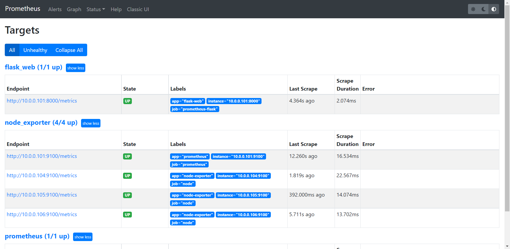

## 6.3 DNS 服务发现

### 6.3.1 DNS 服务发现说明

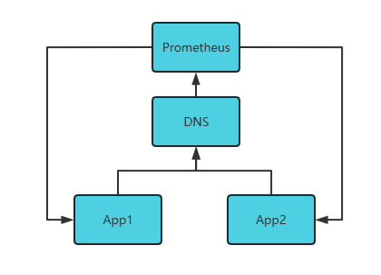

参考资料：
https://prometheus.io/docs/prometheus/latest/configuration/configuration/#dns_sd_config

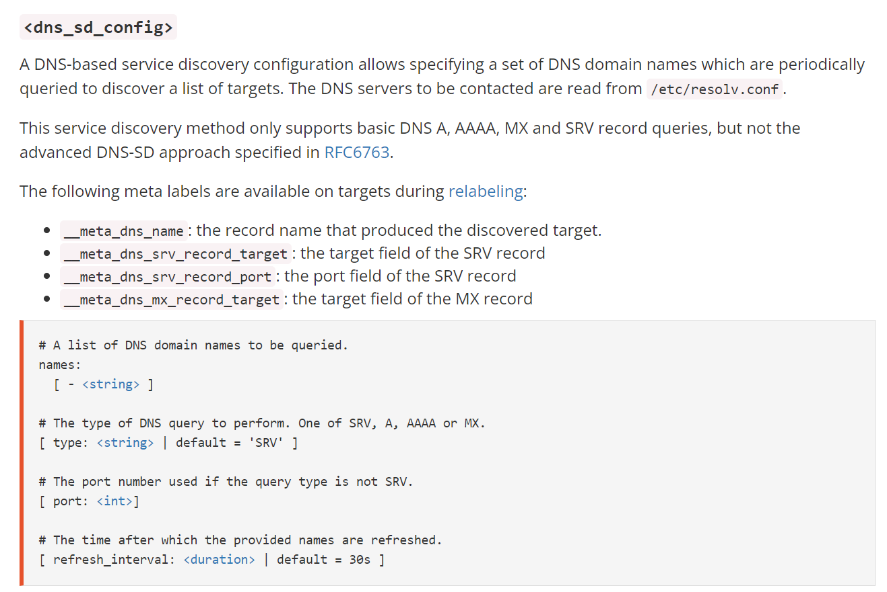

基于DNS的服务发现针对一组DNS域名进行定期查询，以发现待监控的目标

查询时使用的DNS服务器由Prometheus服务器的/etc/resolv.conf文件指定
该发现机制依赖于A、AAAA和SRV资源记录，且仅支持该类方法，尚不支持RFC6763中的高级DNS发现  
方式  

基于DNS服务发现会自动生成的元数据标签：
```text
__meta_dns_name
    the record name that produced the discovered target.
__meta_dns_srv_record_target
    the target field of the SRV record
__meta_dns_srv_record_port
    the port field of the SRV record
```

SRV 记录

SRV记录是服务器资源记录的缩写，记录服务器提供的服务，SRV记录的作用是说明一个服务器能够提供
什么样的服务。  
在RFC2052中才对SRV记录进行了定义，很多老版本的DNS服务器并不支持SRV记录。  
SRV 资源记录允许为单个域名使用多个服务器，轻松地将服务从一个主机移动到另一个主机，并将某些  
主机指定为服务的主服务器，将其他主机指定为备份  
客户端要求特定域名的特定服务/协议，并获取任何可用服务器的名称  
RFC2782中对于SRV的定义格式是：
_<Service>._<Proto>.<Name> TTL Class SRV Priority Weight Port Target
#格式解析：
Service   所需服务的符号名称，在Assigned Numbers或本地定义。
         服务标识符前面加下划线(_)，以避免与常规出现的DNS标签发生冲突。
Proto   所需协议的符号名称,该名称不区分大小写。_TCP和_UDP目前是该字段最常用的值
         前面加下划线_，以防止与自然界中出现的DNS标签发生冲突。
Name    此RR所指的域名。在这个域名下SRV RR是唯一的。
Class   定制DNS记录类，它主要有以下三种情况：
         对于涉及Internet的主机名、IP地址等DNS记录，记录的CLASS设置为IN。
         其他两类用的比较少，比如CS(CSNET类)、CH(CHAOS类)、HS(Hesiod)等。
         每个类都是一个独立的名称空间，其中DNS区域的委派可能不同。
Port    服务在目标主机上的端口。范围是0-65535。 这是网络字节顺序中的16位无符号整数。
Target  目标主机的域名。域名必须有一个或多个地址记录，域名绝不能是别名。
         敦促（但不强求）实现在附加数据部分中返回地址记录。
         值为"." 表示该域名明确无法提供该服务。

官方配置示例
```yaml
#参考资料：https://prometheus.io/blog/2015/06/01/advanced-service-discovery/#discovery-with-dns-srv-records
#定制job对象
job {
  name: "api-server"
  sd_name: "telemetry.eu-west.api.srv.example.org"
  metrics_path: "/metrics"
}
#定制解析记录
scrape_configs:
- job_name: 'myjob'
  dns_sd_configs:
  - names:
    - 'telemetry.eu-west.api.srv.example.org'
    - 'telemetry.us-west.api.srv.example.org'
    - 'telemetry.eu-west.auth.srv.example.org'
    - 'telemetry.us-east.auth.srv.example.org'
  relabel_configs:
  - source_labels: ['__meta_dns_name']
    regex:         'telemetry\.(.+?)\..+?\.srv\.example\.org'
    target_label:  'zone'
    replacement:   '$1'
  - source_labels: ['__meta_dns_name']
    regex:         'telemetry\..+?\.(.+?)\.srv\.example\.org'
    target_label:  'job'
    replacement:   '$1'
```

### 6.3.2 DNS服务发现案例

#### 6.3.2.1 部署和配置 DNS

部署DNS环境
```bash
#安装软件
apt update && apt -y install bind9 bind9utils bind9-doc bind9-host
named -v
#查看部署软件
dpkg -L bind9 | grep named.conf
/etc/bind/named.conf
/etc/bind/named.conf.default-zones
/etc/bind/named.conf.local
/etc/bind/named.conf.options
#定制正向解析zone的配置
cat >> /etc/bind/named.conf.default-zones
//定制网站主域名的zone配置
zone "bowen.org" {
        type master;
        file "/etc/bind/bowen.org.zone";
};
#定制主域名的zone文件
vim /etc/bind/bowen.org.zone
;
; BIND reverse data file for local loopback interface
;
$TTL  604800
@       IN      SOA     ns.bowen.org. admin.bowen.org. (
                        1         ; Serial
                        604800         ; Refresh
                        86400         ; Retry
                        2419200         ; Expire
                        604800 )       ; Negative Cache TTL
;
        IN      NS      master
master  IN      A       10.0.0.100
node1   IN      A       10.0.0.101
node2   IN      A       10.0.0.102
node3   IN      A       10.0.0.103
flask   IN      A       10.0.0.101
#检查配置文件
named-checkconf
#重启dns服务
rndc reload
systemctl restart named
systemctl status named
#配置prometheus服务器使用DNS域名服务器
vim /etc/netplan/01-netcfg.yaml
network:
  version: 2
  renderer: networkd
  ethernets:
    eth0:
      addresses:
      - 10.0.0.101/24
      gateway4: 10.0.0.2
      nameservers:
        search: [bowen.org,bowen.com]
        addresses: [10.0.0.100] #只保留当前的DNS服务器地址,不要再加其它DNS服务器地址,否则DNS
解析有问题
#应用网络配置
netplan apply
#确认dns解析效果
dig node1.bowen.org
host node1.bowen.org
nslookup node1.bowen.org
```

#### 6.3.2.2 配置 DNS服务支持 SRV 记录
```bash
#添加SRV记录
# vim /etc/bind/bowen.org.zone
... ...
node1   IN      A       10.0.0.101
node2   IN      A       10.0.0.102
node3   IN      A       10.0.0.103
flask   IN      A       10.0.0.101  #只有A记录
#添加下面的SRV记录,对应上面的三条A记录
_prometheus._tcp.bowen.org. 1H IN SRV 10 10 9100 node1.bowen.org.
_prometheus._tcp.bowen.org. 1H IN SRV 10 10 9100 node2.bowen.org.
_prometheus._tcp.bowen.org. 1H IN SRV 10 10 9100 node3.bowen.org.
#检查配置文件
named-checkconf
#生效
rndc reload
#测试解析
dig  srv _prometheus._tcp.bowen.org
host -t srv _prometheus._tcp.bowen.org
nslookup -q=srv _prometheus._tcp.bowen.org
```

#### 6.3.2.3 配置 Prometheus 使用 DNS
```yaml
# vim /usr/local/prometheus/conf/prometheus.yml
...
scrape_configs:
  - job_name: "prometheus"
    .......
#添加下面所有行
  - job_name: 'dns_sd_flask'  #实现单个主机定制的信息解析，也支持DNS或/etc/hosts
文件实现解析
    dns_sd_configs:
    - names: ['flask.bowen.org']
      type: A                            #指定记录类型，默认SRV
      port: 8000  #不是SRV时，需要指定Port号
      refresh_interval: 10s
  - job_name: 'dns_sd_node_exporter'  #实现批量主机解析
    dns_sd_configs:
    - names: ['_prometheus._tcp.bowen.org']    #SRV记录必须通过DNS的实现
      refresh_interval: 10s                   #指定DNS资源记录的刷新间隔,默认30s
    relabel_configs:                          #生成新的标签service，值为_prometheus._tcp
    - source_labels: ['__meta_dns_name']
      regex:         '(.+?)\.bowen\.org'
      target_label:  'service'
      replacement:   '$1'
#重启prometheus
promtool  check config /usr/local/prometheus/conf/prometheus.yml
systemctl reload prometheus
```

#### 6.3.2.4 验证结果

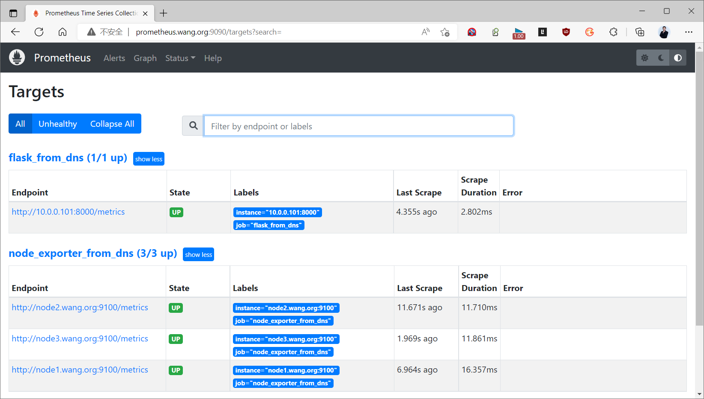

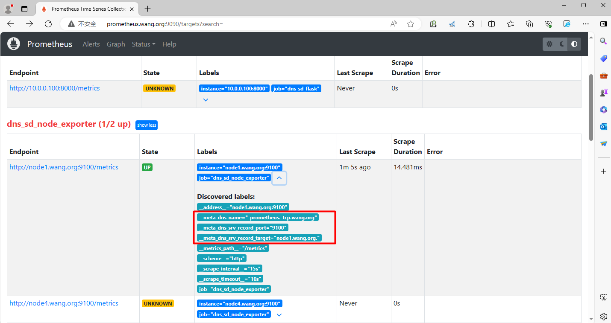

#### 6.3.2.5 添加和删除SRV记录
```bash
#删除node2和添加node4对应的SRV和A记录
[root@prometheus ~]#cat /etc/bind/bowen.org.zone
$TTL 1D
@   IN SOA  master admin (
                      1   ; serial
                    1D  ; refresh
                    1H  ; retry
                    1W  ; expire
                    3H )    ; minimum
                NS      master
master          A       10.0.0.100
node1   IN      A       10.0.0.101
node3   IN      A       10.0.0.103
node4   IN      A       10.0.0.104  #修改
flask   IN      A       10.0.0.101
_prometheus._tcp.bowen.org. 1H IN SRV 10 10 9100 node1.bowen.org.
_prometheus._tcp.bowen.org. 1H IN SRV 10 10 9100 node3.bowen.org.
_prometheus._tcp.bowen.org. 1H IN SRV 10 10 9100 node4.bowen.org. #修改
#注意:Ubuntu有DNS缓存,需要清除才能生效
[root@ubuntu2404 ~]#systemctl restart systemd-resolved.service
[root@prometheus ~]#rndc reload && netplan apply
server reload successful
#确认结果
[root@prometheus ~]#host -t srv _prometheus._tcp.bowen.org
_prometheus._tcp.bowen.org has SRV record 10 10 9100 node1.bowen.org.
_prometheus._tcp.bowen.org has SRV record 10 10 9100 node3.bowen.org.
_prometheus._tcp.bowen.org has SRV record 10 10 9100 node4.bowen.org.
```

#### 6.3.2.6 确认是否自动发现生效

登录 Prometheus 网站,查看是否生效

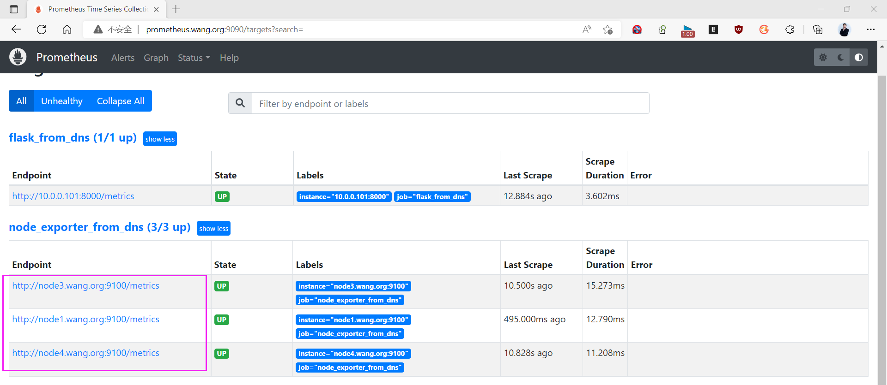



<nav class="article-end" aria-label="章节导航">
  <a href="{{ '/subjects/Prometheus/16-alertmanager-ha.html' | relative_url }}">← 上一章：Alertmanager 高可用与其他应用</a>
  <a href="{{ '/subjects/Prometheus/' | relative_url }}">返回 Prometheus 目录</a>
  <a href="{{ '/subjects/Prometheus/18-consul-introduction-single.html' | relative_url }}">下一章：Consul 简介与单机部署 →</a>
</nav>
