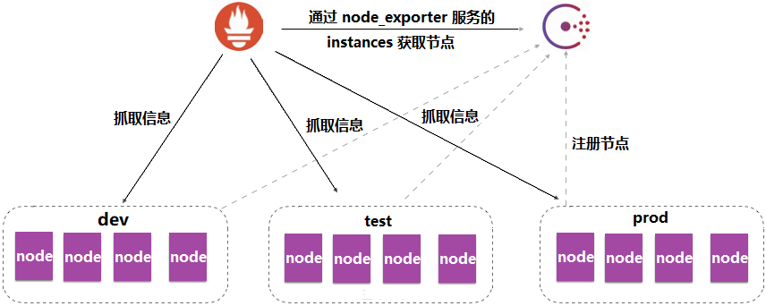
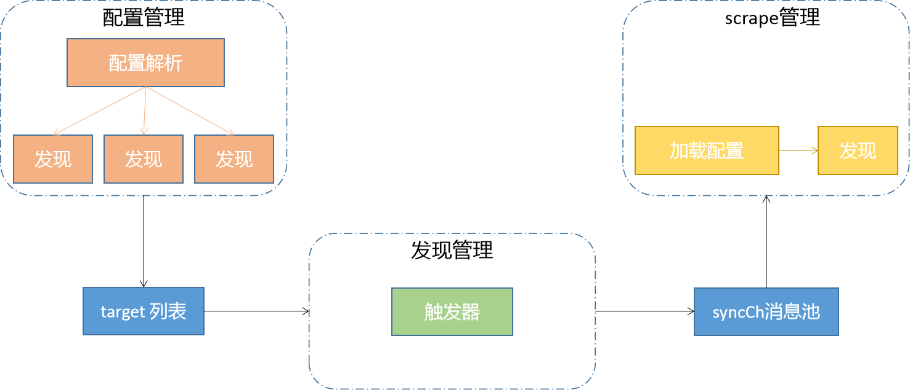
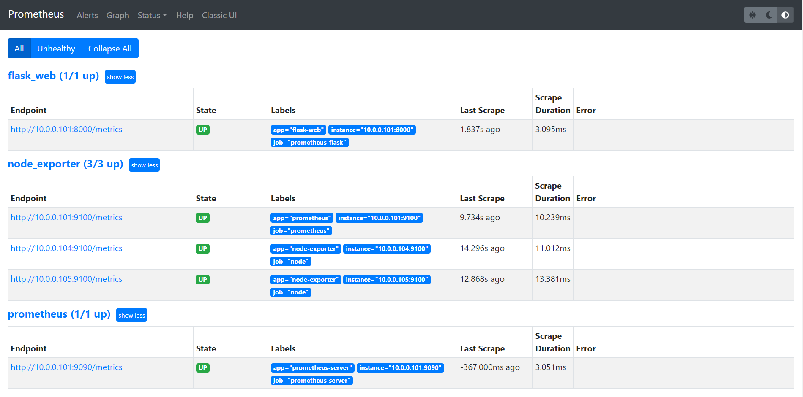
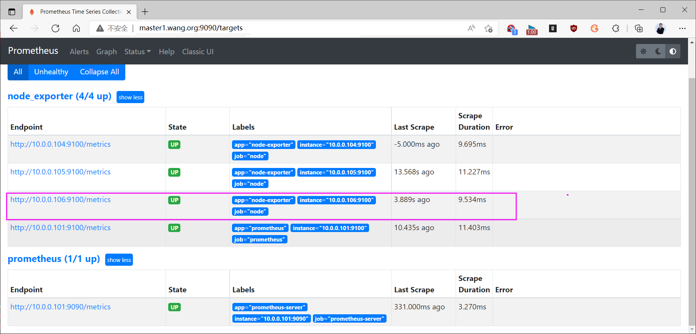
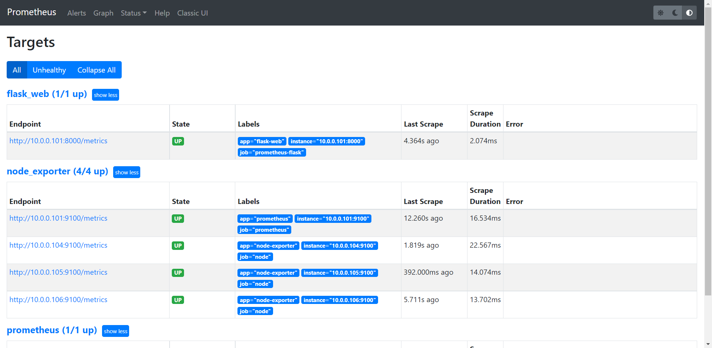
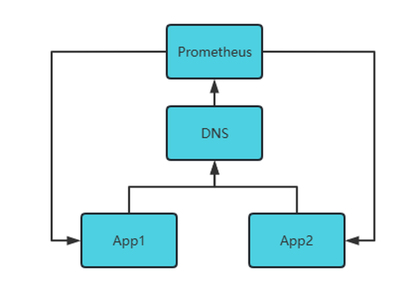
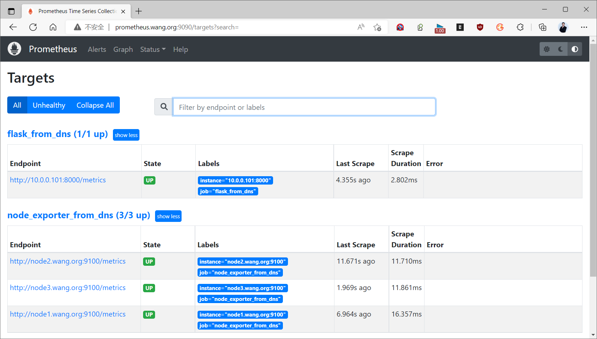
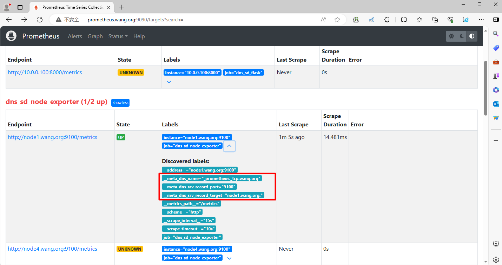
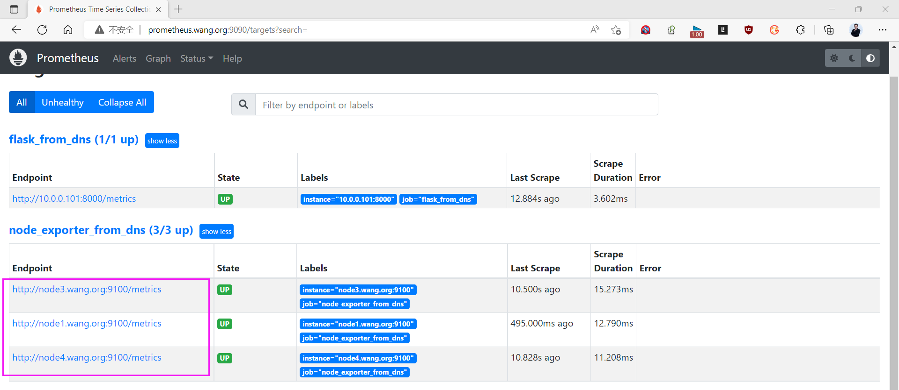

[← 返回 Prometheus 目录]({{ '/subjects/Prometheus/' | relative_url }})



# 17 服务发现基础、文件与 DNS

# 6 服务发现

Prometheus 使用拉取模型：每个抓取任务都要知道目标的地址和端口。固定环境里可将目标写进 `static_configs`；机器数量和地址经常变化时，让 Prometheus 从文件、DNS 或注册中心取得目标更容易维护。本章先掌握目标如何进入抓取流程，再分别用文件和 DNS 做两个可验证的实验。

## 6.1 服务发现原理

### 6.1.1 静态目标与动态来源

最小的静态任务写在 `prometheus.yml` 的 `scrape_configs` 中：

```yaml
scrape_configs:
  - job_name: node-exporter
    static_configs:
      - targets: ['10.0.0.101:9100']
```

新增机器时需要改主配置并重载。服务发现把变化的目标列表移到外部来源，Prometheus 定期读取来源、形成目标组，再按任务配置执行抓取。**发现目标不等于目标健康**：新目标进入 Targets 页面后，仍可能因为 Exporter 未启动、端口不通或 `metrics_path` 错误而显示 `DOWN`。



常见来源包括文件、DNS、Consul、HTTP 和 Kubernetes API。文件发现适合由 Ansible、CMDB 或部署流程生成的清单；DNS 适合已有域名或 SRV 记录的环境；Consul 与 Kubernetes 则能直接利用注册或资源变化。选择来源时，重点看谁维护目标列表、多久更新，以及目标标签从哪里来。具体配置以 [Prometheus 官方文档](https://prometheus.io/docs/prometheus/latest/configuration/configuration/) 为准。

### 6.1.2 从发现到抓取

每个 `scrape_configs` 任务可以配置一种或多种发现机制。发现器输出目标及元数据标签；随后 `relabel_configs` 可以改写、保留或丢弃目标；最后抓取器按地址和路径请求指标。Targets 页面中的“发现标签”和“目标标签”有区别：前者常以 `__meta_...` 开头，仅供目标重标记使用，不会自动成为存储时序的业务标签。



后面排查目标未出现时，先看 **Service Discovery**；目标已出现但采集失败时，再看 **Targets** 的错误信息。不要依赖旧资料中关于内部“每 5 秒同步通道”的实现细节判断是否正常，具体刷新间隔由发现方式及配置决定。

## 6.2 文件服务发现

### 6.2.1 文件格式与加载方式

文件发现通过 `file_sd_configs` 读取 YAML 或 JSON 目标组。每组都有 `targets` 列表，`labels` 可选。文件可手工维护，也可由配置管理系统或 CMDB 生成；更新时最好先写临时文件，再原子替换正式文件，避免 Prometheus 读到半成品。

假设主配置位于 `/usr/local/prometheus/conf/prometheus.yml`，目标文件放在同目录下的 `targets` 子目录：

```yaml
scrape_configs:
  - job_name: node-exporter
    file_sd_configs:
      - files:
          - targets/nodes/*.yml
        refresh_interval: 1m
```

相对路径以 Prometheus 主配置目录为基准，`files` 可使用通配符。文件更新后无需重新启动 Prometheus；但首次新增此抓取任务时仍需检查主配置并重载。可在 **Service Discovery** 页面看到对应文件来源与 `__meta_filepath` 元数据。


### 6.2.2 YAML 目标文件

建立 `/usr/local/prometheus/conf/targets/nodes/linux.yml`：

```yaml
- targets:
    - 10.0.0.101:9100
    - 10.0.0.104:9100
  labels:
    app: node-exporter
    environment: lab
```

这里不用在目标文件中再写 `job` 标签；任务的 `job_name` 已定义该标签。原资料同时在目标组里设置 `job`，容易和任务标签冲突，让查询结果难以预料。文件可以包含多个目标组，为不同组设置不同 `app` 或 `environment`。

```bash
promtool check config /usr/local/prometheus/conf/prometheus.yml
systemctl reload prometheus.service
```

先确认 101、104 两台的 Exporter 在 `9100` 端口可达，再在 Targets 页面查看状态。新增 `10.0.0.106:9100` 时只需编辑目标文件并等待文件发现刷新；删除地址也会使该目标退出发现列表。若希望部署系统自动生成此文件，应采用“写临时文件 → 校验 → 原子替换”的流程，而不是边写边暴露不完整内容。





### 6.2.3 JSON 目标文件

JSON 与 YAML 表达的是同一个“目标组数组”。以下可保存为 `/usr/local/prometheus/conf/targets/nodes/linux.json`：

```json
[
  {
    "targets": ["10.0.0.101:9100", "10.0.0.104:9100"],
    "labels": {
      "app": "node-exporter",
      "environment": "lab"
    }
  }
]
```

主配置中的 `files` 改为指向 `targets/nodes/*.json` 即可；同一任务也能同时匹配 YAML 和 JSON，但不要把同一目标放入两份文件造成重复采集。原资料某个 JSON 例子将键误写为 `target`，文件发现要求复数的 `targets`。可先用 `python -m json.tool <文件>` 检查 JSON 语法，再看 Prometheus 的 Service Discovery 和 Targets 页面确认内容真的生效。



## 6.3 DNS 服务发现

### 6.3.1 A 记录与 SRV 记录

`dns_sd_configs` 周期性查询域名。A/AAAA 记录只给出地址，因此任务必须另设端口；SRV 记录同时给出服务目标主机和端口，更适合一次发现同类 Exporter 的多台节点。Prometheus 使用系统 DNS 解析器，先用 `dig` 确认本机能查到记录，再排查 Prometheus 配置。



SRV 记录形式为 `_服务._协议.域名 TTL IN SRV 优先级 权重 端口 目标主机`。例如 `_node-exporter._tcp.example.org` 可以同时指向三个节点的 `9100` 端口。目标主机需有对应 A/AAAA 记录。DNS 发现产生的 `__meta_dns_name`、`__meta_dns_srv_record_target` 和 `__meta_dns_srv_record_port` 可用于重标记，但不会默认写入采集的时序标签。参阅 [官方 DNS 发现配置](https://prometheus.io/docs/prometheus/latest/configuration/configuration/#dns_sd_config)。

### 6.3.2 建立实验记录

如果已经有 DNS 管理平台，直接在平台创建记录即可；下面是 BIND 区域文件片段，用于说明 A 与 SRV 的对应关系。请把示例域名和地址换成实际实验环境值：

```zone
$TTL 300
@ IN SOA ns.example.org. admin.example.org. (2026101901 3600 900 604800 300)
@ IN NS ns.example.org.
ns    IN A 10.0.0.100
node1 IN A 10.0.0.101
node2 IN A 10.0.0.102
node3 IN A 10.0.0.103
flask IN A 10.0.0.101

_node-exporter._tcp IN SRV 10 10 9100 node1.example.org.
_node-exporter._tcp IN SRV 10 10 9100 node2.example.org.
_node-exporter._tcp IN SRV 10 10 9100 node3.example.org.
```

修改区域文件后递增 SOA 序列号，先执行 `named-checkzone example.org <区域文件>`，再重载 DNS 并用 `dig SRV _node-exporter._tcp.example.org` 验证。原资料通过修改宿主机 netplan 强制切换 DNS，这属于特定实验网络步骤；已有可用 DNS 时无需改全机网络配置，更不应在远程机器上盲目执行 `netplan apply`。

### 6.3.3 Prometheus 查询 DNS

两个抓取任务分别演示 A 和 SRV。A 记录需要显式 `port`；SRV 记录自带端口：

```yaml
scrape_configs:
  - job_name: flask-dns
    dns_sd_configs:
      - names: ['flask.example.org']
        type: A
        port: 8000
        refresh_interval: 30s
  - job_name: node-exporter-dns
    dns_sd_configs:
      - names: ['_node-exporter._tcp.example.org']
        type: SRV
        refresh_interval: 30s
```

若已有其他抓取任务，应把这两个条目加入原列表，不要重写整个 `scrape_configs`。执行 `promtool check config <主配置文件>` 并重载 Prometheus 后，在 Service Discovery 页面看 DNS 返回的目标，再到 Targets 页面确认 `8000` 和 `9100` 能被采集。





### 6.3.4 验证增删节点

在区域文件中移除 node2 的 SRV 记录、加入 node4 的 A 和 SRV 记录，递增 SOA 序列号并重载 DNS。先用 `dig SRV` 确认 DNS 响应已变化；再等待 TTL、DNS 缓存和 Prometheus 的 `refresh_interval`，观察 Service Discovery 的目标列表由 node2 变为 node4。若 DNS 结果已变而 Prometheus 未变，继续检查本机解析器缓存；若目标已变却显示 `DOWN`，检查 node4 的 Exporter 和网络端口。



文件和 DNS 发现都只负责提供“去哪里抓取”，并不自动保证目标可用。下一章开始使用 Consul 注册中心管理变化更频繁的服务与标签。


<nav class="article-end" aria-label="章节导航">
  <a href="{{ '/subjects/Prometheus/16-alertmanager-ha.html' | relative_url }}">← 上一章：Alertmanager 高可用与其他应用</a>
  <a href="{{ '/subjects/Prometheus/' | relative_url }}">返回 Prometheus 目录</a>
  <a href="{{ '/subjects/Prometheus/18-consul-introduction-single.html' | relative_url }}">下一章：Consul 简介与单机部署 →</a>
</nav>
