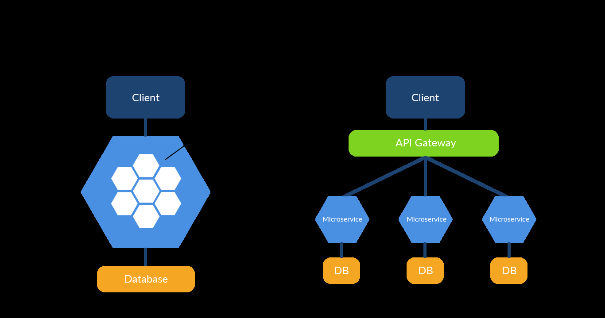
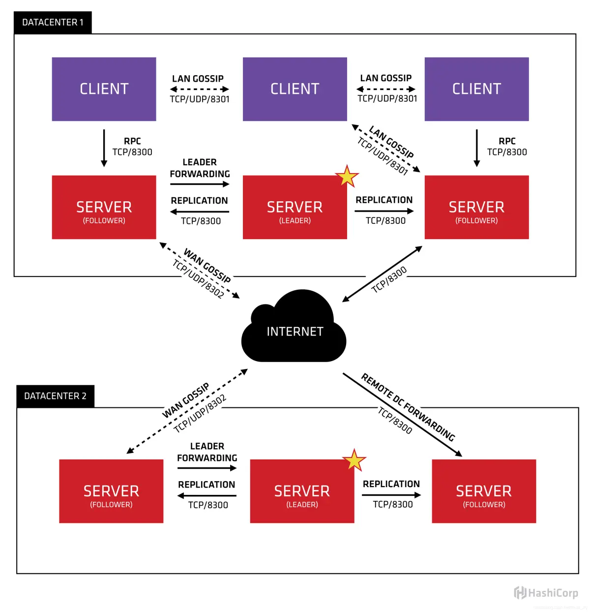
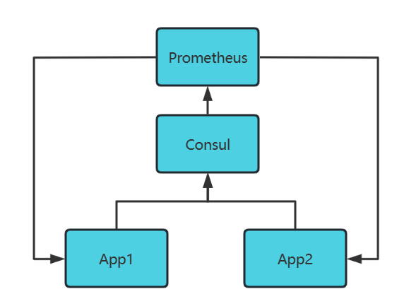
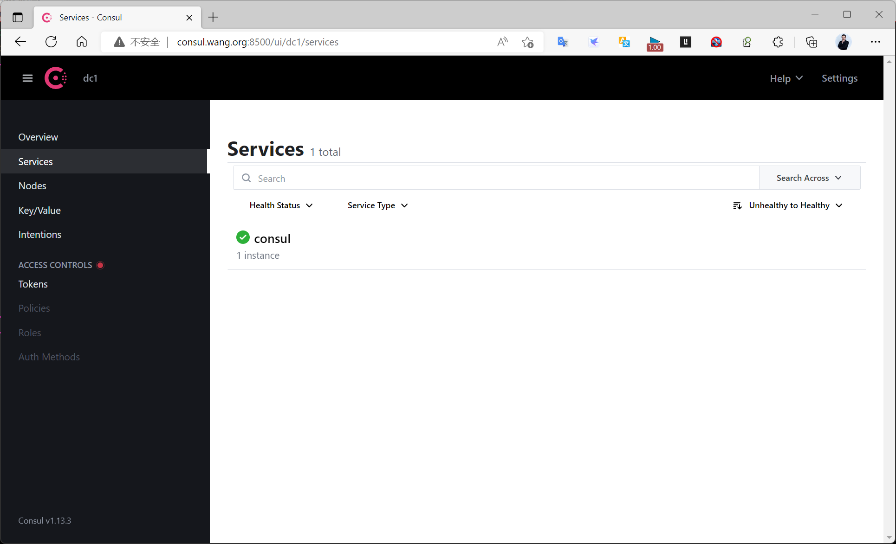
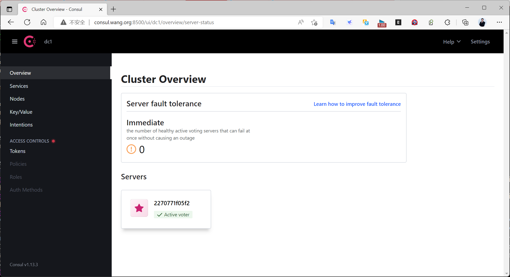

[← 返回 Prometheus 目录]({{ '/subjects/Prometheus/' | relative_url }})



# 18 Consul 简介与单机部署

## 6.4 Consul 服务发现

### 6.4.1 Consul 介绍


单体架构逐渐被微服务架构所替代，原本不同功能模被拆分成了多个不同的服务。

原本模块间的通信只需要函数调用就能够实现，现在却做不到了，因为它们不在同一个进程中，甚至服务都可能部署到不同的机房。



服务间的通信成为了迈向微服务大门的第一道难关：

ServiceA 如何知道 ServiceB 在哪里
ServiceB 可能会有多个副本提供服务，其中有些可能会挂掉，如何避免访问到"不健康的"的 ServiceB  
如何控制只有 ServiceA 可以访问到 ServiceB  

Consul 是HashiCorp 公司开发的一种服务网格解决方案，使团队能够管理服务之间以及跨本地和多云环境和运行时的安全网络连接。

Consul 提供服务发现、服务网格、流量管理和网络基础设施设备的自动更新

Consul是一个用来实现分布式系统的服务发现与配置的开源工具

Consul采用golang开发

Consul具有高可用和横向扩展特性。

Consul的一致性协议采用更流行的Raft 算法（Paxos的简单版本），用来保证服务的高可用

Consul 使用 GOSSIP 协议（P2P的分布式协议去中心化结构下，通过将信息部分传递，达到全集群的状态信息传播,和 Raft 目标是强一致性不同，Gossip 达到的是最终一致性）管理成员和广播消息, 并且支持 ACL 访问控制

Consul 自带一个Web UI管理系统，可以通过参数启动并在浏览器中直接查看信息。

Consul 提供了一个控制平面，使您能够注册、查询和保护跨网络部署的服务。控制平面是网络基础结构的一部分，它维护一个中央注册表来跟踪服务及其各自的 IP 地址。它是一个分布式系统，在节点集群上运行，例如物理服务器、云实例、虚拟机或容器。

官网:
https://www.consul.io/


帮助文档
https://developer.hashicorp.com/consul/docs

Consul 关键特性：

service discovery：consul通过DNS或者HTTP接口实现服务注册和服务发现

health checking：健康检测使consul可以快速的告警在集群中的操作。和服务发现的集成，可以防止服
务转发到故障的服务上面。  
key/value storage：一个用来存储动态配置的系统。提供简单的HTTP接口，可以在任何地方操作  
multi-datacenter：无需复杂的配置，即可支持任意数量的区域  

Consul的工作原理：



Agent 是一直运行在Consul集群中每个成员上的守护进程。通过运行 consul agent来启动。
Agent可以运行在client或者server模式。指定节点作为client或者server是非常简单的，除非有其他  
agent实例。  
所有的Agent都能运行DNS或者HTTP接口，并负责运行时检查和保持服务同步。  
Client 是一个转发所有RPC请求到server的代理。这个client是相对无状态的。client唯一执行的后台活  
动是加入LAN.  
Server是一个有一组扩展功能的代理，这些功能包括参与Raft选举，维护集群状态，响应RPC查询，与  
其他数据中心交互bowenossip和转发查询给leader或者远程数据中心。  
Datacenter 数据中心为私有、低延迟和高带宽的网络环境。这不包括通过公共 Internet 进行的通信  
Gossip：consul是建立在Serf (一个去中心化的服务发现和编排的解决方案，特点是轻量级和高可用，  
同时具备容错的特性)之上的，它提供了一个完整的gossip协议，用在很多地方。Serf提供了成员，故障  
检测和事件广播。Gossip的节点到节点之间的通信使用了UDP协议。gossip 属于 p2p协议,主要功能是  
去中心化。Gossip协议就是模拟人类中传播谣言的行为而来。首先要传播谣言就要有种子节点。种子节  

点每秒都会随机向其他节点发送自己所拥有的节点列表，以及需要传播的消息。任何新加入的节点，就
在这种传播方式下很快地被全网所知道。  
LAN Gossip：指在同一局域网或数据中心的节点上的LAN Gossip池。  
WAN Gossip：指包含服务器的WAN Gossip池，这些服务器在不同的数据中心，通过网络进行通信。  

上面显示的两个数据中心，分别标注为DATACENTER1和DATACENTER2，Consul对多数据中心有非常友好的支持。在两个数据中心分别布署有许多SERVER和CLIENT节点，节点之间通过GOSSIP流行病协议通信，每个节点有两个GOSSIP池（LAN池和WAN池），LAN池用于数据中心内部通讯，WAN池则对所有数据中心共享，用于跨数据中心通讯。

关于SERVER和CLIENT节点

Consul规定了所有的节点一律称为Agent，SERVER和CLIENT分别是Agent的两个模式。

在CLIENT模式下，Agent不保存数据，主要面向服务提供者和服务消费者，提供服务注册、服务查询、健康检测等功能。

在SERVER模式下，Agent除了支持CLIENT的所有功能外，还负责节点主从选举、数据存储，并维护数据一致性。

通常在单个数据中心，SERVER的布署数量在3~5个，而CLIENT节点，要求在除布署SERVER的机器外，每台都布署CLIENT。

关于多数据中心，通常情况下，不同的数据中心之间是不会同步数据的，但是当对另一个数据中心的资源进行请求时，本地SERVER会将该资源的RPC请求转发给SERVER，并返回结果。

Prometheus 基于的Consul服务发现过程：



安装并启动 Consul 服务
在Prometheus的配置中关联 Consul服务发现  
新增服务节点向Consul进行注册  
Prometheus 自动添加新增的服务节点的Target  

### 6.4.2 Consul 部署

#### 6.4.2.1 部署 Consul 单机

说明
https://developer.hashicorp.com/consul/docs/agent/config

6.4.2.1.1 包安装 Consul

官方安装
https://developer.hashicorp.com/consul/tutorials/production-deploy/deployment-guide

官方仓库安装
```bash
https://developer.hashicorp.com/consul/install#linux
#Ubuntu官方仓库安装
wget -O - https://apt.releases.hashicorp.com/gpg | sudo gpg --dearmor -o
/usr/share/keyrings/hashicorp-archive-keyring.gpg
echo "deb [arch=$(dpkg --print-architecture) signed-by=/usr/share/keyrings/hashicorp-
archive-keyring.gpg] https://apt.releases.hashicorp.com $(lsb_release -cs) main" |
sudo tee /etc/apt/sources.list.d/hashicorp.list
sudo apt update && sudo apt install consul
#RHEL系统官方仓库安装
sudo yum install -y yum-utils
sudo yum-config-manager --add-repo
https://rpm.releases.hashicorp.com/RHEL/hashicorp.repo
sudo yum -y install consul
```

范例: Ubuntu24.04 包安装 Consul
```bash
#Ubuntu2404没有内置consul源
[root@ubuntu2404 ~]#apt list consul
[root@ubuntu2404 ~]#wget -O - https://apt.releases.hashicorp.com/gpg | sudo gpg --
dearmor -o /usr/share/keyrings/hashicorp-archive-keyring.gpg
[root@ubuntu2404 ~]#echo "deb [arch=$(dpkg --print-architecture) signed-
by=/usr/share/keyrings/hashicorp-archive-keyring.gpg]
https://apt.releases.hashicorp.com $(lsb_release -cs) main" | sudo tee
/etc/apt/sources.list.d/hashicorp.list
[root@ubuntu2404 ~]#apt update &&  apt -y install consul
[root@ubuntu2404 ~]#consul version
Consul v1.21.0
Revision 4e96098f
Build Date 2025-05-06T11:58:51Z
Protocol 2 spoken by default, understands 2 to 3 (agent will automatically use
protocol >2 when speaking to compatible agents)
[root@ubuntu2404 ~]#systemctl enable --now  consul.service
Created symlink /etc/systemd/system/multi-user.target.wants/consul.service →
/usr/lib/systemd/system/consul.service.
Job for consul.service failed because a timeout was exceeded.
See "systemctl status consul.service" and "journalctl -xeu consul.service" for
details.
[root@ubuntu2404 ~]#systemctl is-active consul.service
activating
```

范例: Ubuntu20.04 包安装 Consul
```bash
#Ubuntu2204内置consul源，直接安装
[root@ubuntu2204 ~]#apt list consul
正在列表... 完成
consul/jammy 1.8.7+dfsg1-3 amd64
#官方仓库安装指定的新版本
[root@ubuntu2004 ~]#curl --fail --silent --show-error --location
https://apt.releases.hashicorp.com/gpg | \
      gpg --dearmor | \
      sudo dd of=/usr/share/keyrings/hashicorp-archive-keyring.gpg
[root@ubuntu2004 ~]#echo "deb [arch=amd64 signed-by=/usr/share/keyrings/hashicorp-
archive-keyring.gpg] https://apt.releases.hashicorp.com $(lsb_release -cs) main" | \
sudo tee -a /etc/apt/sources.list.d/hashicorp.list
[root@ubuntu2004 ~]#apt update
#查看版本
[root@ubuntu2004 ~]#apt-cache policy consul
consul:
  已安装：(无)
  候选： 1.13.3-1
  版本列表：
     1.13.3-1 500
         500 https://apt.releases.hashicorp.com focal/main amd64 Packages
     1.13.2-1 500
         500 https://apt.releases.hashicorp.com focal/main amd64 Packages
     1.13.1-1 500
         500 https://apt.releases.hashicorp.com focal/main amd64 Packages
     1.13.0-1 500
         500 https://apt.releases.hashicorp.com focal/main amd64 Packages
     1.12.6-1 500
         500 https://apt.releases.hashicorp.com focal/main amd64 Packages
.....
[root@ubuntu2004 ~]#apt-cache madison consul
    consul |   1.13.3-1 | https://apt.releases.hashicorp.com focal/main amd64
Packages
    consul |   1.13.2-1 | https://apt.releases.hashicorp.com focal/main amd64
Packages
    consul |   1.13.1-1 | https://apt.releases.hashicorp.com focal/main amd64
Packages
    consul |   1.13.0-1 | https://apt.releases.hashicorp.com focal/main amd64
Packages
    consul |   1.12.6-1 | https://apt.releases.hashicorp.com focal/main amd64
Packages
#安装指定版本
[root@ubuntu2004 ~]#apt -y install consul=1.8.3
#安装最新版
[root@ubuntu2004 ~]#apt -y install consul
#验证安装
[root@ubuntu2004 ~]#consul version
Consul v1.13.3
Revision b29e5894
Build Date 2022-10-19T19:49:59Z
Protocol 2 spoken by default, understands 2 to 3 (agent will automatically use
protocol >2 when speaking to compatible agents)
[root@ubuntu2004 ~]#dpkg -L consul
/etc
/etc/consul.d
/etc/consul.d/consul.env
/etc/consul.d/consul.hcl
/usr
/usr/bin
/usr/bin/consul
/usr/lib
/usr/lib/systemd
/usr/lib/systemd/system
/usr/lib/systemd/system/consul.service
[root@ubuntu2004 ~]#file /usr/bin/consul
/usr/bin/consul: ELF 64-bit LSB executable, x86-64, version 1 (SYSV), statically
linked, Go BuildID=h3PD7_qQnhb-Hlpm6hBZ/AvyIA6ksI178KPwRGeQA/h3zxbW9w-
7_vopwrYrCO/y8EehI8nf77n5Nc-lSAW, not stripped
[root@ubuntu2004 ~]#ldd /usr/bin/consul
    不是动态可执行文件
[root@ubuntu2004 ~]#cat /usr/lib/systemd/system/consul.service
[Unit]
Description="HashiCorp Consul - A service mesh solution"
Documentation=https://www.consul.io/
Requires=network-online.target
After=network-online.target
ConditionFileNotEmpty=/etc/consul.d/consul.hcl
[Service]
EnvironmentFile=-/etc/consul.d/consul.env
User=consul
Group=consul
ExecStart=/usr/bin/consul agent -config-dir=/etc/consul.d/
ExecReload=/bin/kill --signal HUP $MAINPID
KillMode=process
KillSignal=SIGTERM
Restart=on-failure
LimitNOFILE=65536
[Install]
WantedBy=multi-user.target
[root@ubuntu2004 ~]#cat /etc/consul.d/consul.env
[root@ubuntu2004 ~]#cat /etc/consul.d/consul.hcl
# Full configuration options can be found at https://www.consul.io/docs/agent/config
# datacenter
# This flag controls the datacenter in which the agent is running. If not provided,
# it defaults to "dc1". Consul has first-class support for multiple datacenters, but
# it relies on proper configuration. Nodes in the same datacenter should be on a
# single LAN.
#datacenter = "my-dc-1"
# data_dir
# This flag provides a data directory for the agent to store state. This is required
# for all agents. The directory should be durable across reboots. This is especially
# critical for agents that are running in server mode as they must be able to persist
# cluster state. Additionally, the directory must support the use of filesystem
# locking, meaning some types of mounted folders (e.g. VirtualBox shared folders) may
# not be suitable.
data_dir = "/opt/consul"
# client_addr
# The address to which Consul will bind client interfaces, including the HTTP and DNS
# servers. By default, this is "127.0.0.1", allowing only loopback connections. In
# Consul 1.0 and later this can be set to a space-separated list of addresses to bind
# to, or a go-sockaddr template that can potentially resolve to multiple addresses.
#client_addr = "0.0.0.0"
# ui
# Enables the built-in web UI server and the required HTTP routes. This eliminates
# the need to maintain the Consul web UI files separately from the binary.
# Version 1.10 deprecated ui=true in favor of ui_config.enabled=true
#ui_config{
#  enabled = true
#}
# server
# This flag is used to control if an agent is in server or client mode. When
provided,
# an agent will act as a Consul server. Each Consul cluster must have at least one
# server and ideally no more than 5 per datacenter. All servers participate in the
Raft
# consensus algorithm to ensure that transactions occur in a consistent, linearizable
# manner. Transactions modify cluster state, which is maintained on all server nodes
to
# ensure availability in the case of node failure. Server nodes also participate in a
# WAN gossip pool with server nodes in other datacenters. Servers act as gateways to
# other datacenters and forward traffic as appropriate.
#server = true
# Bind addr
# You may use IPv4 or IPv6 but if you have multiple interfaces you must be explicit.
#bind_addr = "[::]" # Listen on all IPv6
#bind_addr = "0.0.0.0" # Listen on all IPv4
#
# Advertise addr - if you want to point clients to a different address than bind or
LB.
#advertise_addr = "127.0.0.1"
# Enterprise License
# As of 1.10, Enterprise requires a license_path and does not have a short trial.
#license_path = "/etc/consul.d/consul.hclic"
# bootstrap_expect
# This flag provides the number of expected servers in the datacenter. Either this
value
# should not be provided or the value must agree with other servers in the cluster.
When
# provided, Consul waits until the specified number of servers are available and then
# bootstraps the cluster. This allows an initial leader to be elected automatically.
# This cannot be used in conjunction with the legacy -bootstrap flag. This flag
requires
# -server mode.
#bootstrap_expect=3
# encrypt
# Specifies the secret key to use for encryption of Consul network traffic. This key
must
# be 32-bytes that are Base64-encoded. The easiest way to create an encryption key is
to
# use consul keygen. All nodes within a cluster must share the same encryption key to
# communicate. The provided key is automatically persisted to the data directory and
loaded
# automatically whenever the agent is restarted. This means that to encrypt Consul's
gossip
# protocol, this option only needs to be provided once on each agent's initial
startup
# sequence. If it is provided after Consul has been initialized with an encryption
key,
# then the provided key is ignored and a warning will be displayed.
#encrypt = "..."
# retry_join
# Similar to -join but allows retrying a join until it is successful. Once it joins
# successfully to a member in a list of members it will never attempt to join again.
# Agents will then solely maintain their membership via gossip. This is useful for
# cases where you know the address will eventually be available. This option can be
# specified multiple times to specify multiple agents to join. The value can contain
# IPv4, IPv6, or DNS addresses. In Consul 1.1.0 and later this can be set to a go-
sockaddr
# template. If Consul is running on the non-default Serf LAN port, this must be
specified
# as well. IPv6 must use the "bracketed" syntax. If multiple values are given, they
are
# tried and retried in the order listed until the first succeeds. Here are some
examples:
#retry_join = ["consul.domain.internal"]
#retry_join = ["10.0.4.67"]
#retry_join = ["[::1]:8301"]
#retry_join = ["consul.domain.internal", "10.0.4.67"]
# Cloud Auto-join examples:
# More details - https://www.consul.io/docs/agent/cloud-auto-join
#retry_join = ["provider=aws tag_key=... tag_value=..."]
#retry_join = ["provider=azure tag_name=... tag_value=... tenant_id=... client_id=...
subscription_id=... secret_access_key=..."]
#retry_join = ["provider=gce project_name=... tag_value=..."]
[root@ubuntu2004 ~]#systemctl enable --now consul.service
[root@ubuntu2004 ~]#systemctl status consul.service
● consul.service - "HashiCorp Consul - A service mesh solution"
     Loaded: loaded (/lib/systemd/system/consul.service; enabled; vendor preset:
enabled)
     Active: active (running) since Fri 2022-10-28 22:49:08 CST; 1min 24s ago
       Docs: https://www.consul.io/
   Main PID: 5960 (consul)
      Tasks: 9 (limit: 2236)
     Memory: 24.2M
     CGroup: /system.slice/consul.service
             └─5960 /usr/bin/consul agent -config-dir=/etc/consul.d/
10月 28 22:49:08 ubuntu2004 consul[5960]: 2022-10-28T22:49:08.678+0800 [INFO]  agent:
started state syncer
10月 28 22:49:08 ubuntu2004 consul[5960]: 2022-10-28T22:49:08.678+0800 [INFO]  agent:
Consul agent running!
10月 28 22:49:08 ubuntu2004 consul[5960]: 2022-10-28T22:49:08.678+0800 [WARN]
agent.router.manager: No servers available
10月 28 22:49:08 ubuntu2004 consul[5960]: 2022-10-28T22:49:08.678+0800 [ERROR]
agent.anti_entropy: failed to sync remote state: error="No known Con>
10月 28 22:49:30 ubuntu2004 consul[5960]: 2022-10-28T22:49:30.288+0800 [WARN]
agent.router.manager: No servers available
10月 28 22:49:30 ubuntu2004 consul[5960]: 2022-10-28T22:49:30.288+0800 [ERROR]
agent.anti_entropy: failed to sync remote state: error="No known Con>
10月 28 22:49:58 ubuntu2004 consul[5960]: 2022-10-28T22:49:58.681+0800 [WARN]
agent.router.manager: No servers available
10月 28 22:49:58 ubuntu2004 consul[5960]: 2022-10-28T22:49:58.682+0800 [ERROR]
agent.anti_entropy: failed to sync remote state: error="No known Con>
10月 28 22:50:20 ubuntu2004 consul[5960]: 2022-10-28T22:50:20.389+0800 [WARN]
agent.router.manager: No servers available
10月 28 22:50:20 ubuntu2004 consul[5960]: 2022-10-28T22:50:20.389+0800 [ERROR]
agent.anti_entropy: failed to sync remote state: error="No known Con>
[root@ubuntu2004 ~]#ss -ntlup|grep consul
udp  UNCONN   0 0  127.0.0.1:8600   0.0.0.0:*   users:(("consul",pid=5960,fd=10))
udp  UNCONN   0 0            *:8301         *:*   users:(("consul",pid=5960,fd=8))
tcp  LISTEN   0 4096 127.0.0.1:8500   0.0.0.0:*   users:(("consul",pid=5960,fd=11))
tcp  LISTEN   0 4096 127.0.0.1:8600   0.0.0.0:*   users:(("consul",pid=5960,fd=9))
tcp  LISTEN   0 4096         *:8301         *:*   users:(("consul",pid=5960,fd=7))
#端口说明
8500 http 端口，用于 http 接口和 web ui
8300 server rpc 端口，同一数据中心 consul server 之间通过该端口通信
8301 serf lan 端口，同一数据中心 consul client 通过该端口通信
8302 serf wan 端口，不同数据中心 consul server 通过该端口通信
8600 dns 端口，用于服务发现
```

6.4.2.1.2 二进制安装 Consul

下载链接
https://releases.hashicorp.com/consul/

范例:
```bash
[root@ubuntu2404 ~]#wget
https://releases.hashicorp.com/consul/1.21.0/consul_1.21.0_linux_amd64.zip
[root@ubuntu2404 ~]#wget
https://releases.hashicorp.com/consul/1.20.4/consul_1.20.4_linux_amd64.zip
[root@ubuntu2204 ~]#wget
https://releases.hashicorp.com/consul/1.13.3/consul_1.13.3_linux_amd64.zip
[root@ubuntu2204 ~]#unzip consul_1.13.3_linux_amd64.zip -d /usr/local/bin/
[root@ubuntu2204 ~]#ls /usr/local/bin/
consul
[root@ubuntu2204 ~]#file /usr/local/bin/consul
/usr/local/bin/consul: ELF 64-bit LSB executable, x86-64, version 1 (SYSV),
statically linked, Go BuildID=h3PD7_qQnhb-Hlpm6hBZ/AvyIA6ksI178KPwRGeQA/h3zxbW9w-
7_vopwrYrCO/y8EehI8nf77n5Nc-lSAW, not stripped
[root@ubuntu2204 ~]#ldd /usr/local/bin/consul
    不是动态可执行文件
[root@ubuntu2204 ~]#consul  version
Consul v1.13.3
Revision b29e5894
Build Date 2022-10-19T19:49:59Z
Protocol 2 spoken by default, understands 2 to 3 (agent will automatically use
protocol >2 when speaking to compatible agents)
#查看consul帮助
[root@ubuntu2204 ~]#consul
Usage: consul [--version] [--help] <command> [<args>]
Available commands are:
    acl            Interact with Consul's ACLs
    agent          Runs a Consul agent
    catalog        Interact with the catalog
    config         Interact with Consul's Centralized Configurations
    connect        Interact with Consul Connect
    debug          Records a debugging archive for operators
    event          Fire a new event
    exec           Executes a command on Consul nodes
    force-leave    Forces a member of the cluster to enter the "left" state
    info           Provides debugging information for operators.
    intention      Interact with Connect service intentions
    join           Tell Consul agent to join cluster
    keygen         Generates a new encryption key
    keyring        Manages gossip layer encryption keys
    kv             Interact with the key-value store
    leave          Gracefully leaves the Consul cluster and shuts down
    lock           Execute a command holding a lock
    login          Login to Consul using an auth method
    logout         Destroy a Consul token created with login
    maint          Controls node or service maintenance mode
    members        Lists the members of a Consul cluster
    monitor        Stream logs from a Consul agent
    operator       Provides cluster-level tools for Consul operators
    peering        Create and manage peering connections between Consul clusters
    reload         Triggers the agent to reload configuration files
    rtt            Estimates network round trip time between nodes
    services       Interact with services
    snapshot       Saves, restores and inspects snapshots of Consul server state
    tls            Builtin helpers for creating CAs and certificates
    validate       Validate config files/directories
    version        Prints the Consul version
    watch          Watch for changes in Consul
#实现consul命令自动补全
[root@ubuntu2204 ~]#consul -autocomplete-install
#重新登录生效
[root@ubuntu2204 ~]#exit
[root@ubuntu2004 ~]#consul <TAB>
acl          config       event        info         keygen       leave        logout
      monitor      reload       snapshot     version
agent        connect      exec         intention    keyring      lock         maint
     operator     rtt          tls          watch
catalog      debug        force-leave  join         kv           login        members
     peering      services     validate
#创建用户
[root@ubuntu2204 ~]#useradd -s /sbin/nologin consul
#创建目录
[root@ubuntu2204 ~]#mkdir -p /data/consul /etc/consul.d
[root@ubuntu2204 ~]#chown -R consul:consul /data/consul /etc/consul.d
#以server模式启动服务cosnul agent
[root@ubuntu2204 ~]#/usr/local/bin/consul agent -server -ui -bootstrap-expect=1 -
data-dir=/data/consul  -config-dir=/etc/consul.d -node=consul -client=0.0.0.0
-server #定义agent运行在server模式
-bootstrap-expect #在一个datacenter中期望提供的server节点数目，当该值提供的时候，consul一直等
到达到指定server数目的时候才会引导整个集群，该标记不能和bootstrap共用
-bind：#该地址用来在集群内部的通讯，集群内的所有节点到地址都必须是可达的，默认是0.0.0.0
-node：#节点在集群中的名称，在一个集群中必须是唯一的，默认是该节点的主机名
-ui  #提供web ui的http功能
-rejoin #使consul忽略先前的离开，在再次启动后仍旧尝试加入集群中。
-config-dir #配置文件目录，里面所有以.json结尾的文件都会被加载
-client #consul服务侦听地址，这个地址提供HTTP、DNS、RPC等服务，默认是127.0.0.1:8500，要对外提
供服务改成0.0.0.0
#上面以root启动，会修改文件属性，导致无法用service启动，恢复原有属性
[root@ubuntu2404 ~]#chown -R consul:consul /data/consul /etc/consul.d
#创建service文件
[root@ubuntu2204 ~]#cat > /lib/systemd/system/consul.service <<EOF
[Unit]
Description="HashiCorp Consul - A service mesh solution"
Documentation=https://www.consul.io/
Requires=network-online.target
After=network-online.target
[Service]
Type=simple
User=consul
Group=consul
ExecStart=/usr/local/bin/consul agent -server -bind=10.0.0.100 -ui -bootstrap-
expect=1 -data-dir=/data/consul -node=consul -client=0.0.0.0 -config-
dir=/etc/consul.d
#ExecReload=/bin/kill --signal HUP \$MAINPID
KillMode=process
KillSignal=SIGTERM
Restart=on-failure
LimitNOFILE=65536
[Install]
WantedBy=multi-user.target
EOF
[root@ubuntu2204 ~]#systemctl daemon-reload
[root@ubuntu2204 ~]#systemctl enable --now consul.service
[root@ubuntu2204 ~]#ss -ntulp|grep consul
udp   UNCONN 0  0                  *:8301            *:*    users:
(("consul",pid=1114,fd=13))
udp   UNCONN 0  0                  *:8302            *:*    users:
(("consul",pid=1114,fd=9))
udp   UNCONN 0  0                  *:8600            *:*    users:
(("consul",pid=1114,fd=15))
tcp   LISTEN 0  4096               *:8300            *:*    users:
(("consul",pid=1114,fd=6))
tcp   LISTEN 0  4096               *:8301            *:*    users:
(("consul",pid=1114,fd=12))
tcp   LISTEN 0  4096               *:8302            *:*    users:
(("consul",pid=1114,fd=8))
tcp   LISTEN 0  4096               *:8500            *:*    users:
(("consul",pid=1114,fd=20))
tcp   LISTEN 0  4096               *:8600            *:*    users:
(("consul",pid=1114,fd=18))
```

启动成功后，可以访问下面链接
http://consul.bowen.org:8500



范例: 一键安装脚本
```bash
[root@ubuntu2004 ~]#cat install_consul.sh
#!/bin/bash
#
#FileName:          install_consul.sh
#Description:       The test script
CONSUL_VERSION=1.13.3
#CONSUL_VERSION=1.10.2
CONSUL_FILE=consul_${CONSUL_VERSION}_linux_amd64.zip
CONSUL_URL=https://releases.hashicorp.com/consul/${CONSUL_VERSION}/${CONSUL_FILE}
CONSUL_DATA=/data/consul
LOCAL_IP=`hostname -I|awk '{print $1}'`
msg_error() {
  echo -e "\033[1;31m$1\033[0m"
}
msg_info() {
  echo -e "\033[1;32m$1\033[0m"
}
msg_warn() {
  echo -e "\033[1;33m$1\033[0m"
}
color () {
    RES_COL=60
    MOVE_TO_COL="echo -en \\033[${RES_COL}G"
    SETCOLOR_SUCCESS="echo -en \\033[1;32m"
    SETCOLOR_FAILURE="echo -en \\033[1;31m"
    SETCOLOR_WARNING="echo -en \\033[1;33m"
    SETCOLOR_NORMAL="echo -en \E[0m"
    echo -n "$1" && $MOVE_TO_COL
    echo -n "["
    if [ $2 = "success" -o $2 = "0" ] ;then
         ${SETCOLOR_SUCCESS}
         echo -n $"  OK  "
    elif [ $2 = "failure" -o $2 = "1"  ] ;then
         ${SETCOLOR_FAILURE}
         echo -n $"FAILED"
    else
         ${SETCOLOR_WARNING}
         echo -n $"WARNING"
    fi
    ${SETCOLOR_NORMAL}
    echo -n "]"
    echo
}
install_consul () {
    if [ ! -f ${CONSUL_FILE} ] ;then
         wget -P /usr/local/src  ${CONSUL_URL}  ||  { color "下载失败!" 1 ; exit ; }
    fi
    unzip /usr/local/src/${CONSUL_FILE} -d /usr/local/bin/
    /usr/local/bin/consul -autocomplete-install
    useradd -s /sbin/nologin consul
    mkdir -p ${CONSUL_DATA} /etc/consul.d
    chown -R consul.consul ${CONSUL_DATA} /etc/consul.d
}
service_consul () {
cat <<EOF > /lib/systemd/system/consul.service
[Unit]
Description="HashiCorp Consul - A service mesh solution"
Documentation=https://www.consul.io/
Requires=network-online.target
After=network-online.target
[Service]
Type=simple
User=consul
Group=consul
ExecStart=/usr/local/bin/consul agent -server -ui -bootstrap-expect=1 -data-
dir=${CONSUL_DATA} -node=consul -client=0.0.0.0 -config-dir=/etc/consul.d
#ExecReload=/bin/kill --signal HUP \$MAINPID
KillMode=process
KillSignal=SIGTERM
Restart=on-failure
LimitNOFILE=65536
[Install]
WantedBy=multi-user.target
EOF
    systemctl daemon-reload
    systemctl enable --now consul.service
}
start_consul() {
    systemctl is-active consul
    if [ $? -eq 0 ];then
         echo
        color "Consul 安装完成!" 0
         echo "-------------------------------------------------------------------"
         echo -e "访问链接: \c"
        msg_info "http://${LOCAL_IP}:8500/"
    else
        color "Consul 安装失败!" 1
         exit
    fi
}
install_consul
service_consul
start_consul
```

6.4.2.1.3 Docker 启动 Consul
```bash
docker pull consul # 默认拉取latest
docker pull consul:1.6.1 # 拉取指定版本
docker run -d -p 8500:8500 --restart=always --name=consul consul:latest agent -server
-bind=10.0.0.100 -client=0.0.0.0 -bootstrap-expect=1 -ui
#相关参数
–net=host   #docker参数, 使得docker容器越过了netnamespace的隔离，免去手动指定端口映射的步骤
-server  #consul支持以server或client的模式运行, server是服务发现模块的核心, client主要用
于转发请求
-advertise #将本机私有IP传递到consul
-bootstrap-expect #指定consul将等待几个节点连通，成为一个完整的集群
-retry-join #指定要加入的consul节点地址，失败会重试, 可多次指定不同的地址
-bind  #该地址用来在集群内部的通讯，集群内的所有节点到地址都必须是可达的，默认是0.0.0.0,有多
个IP需要手动指定,否则会出错
-client  #设置客户端访问的监听地址,此地址提供HTTP、DNS、RPC等服务，默认是127.0.0.1,
0.0.0.0 表示任何地址可以访问
--name  #DOCKER容器的名称
-ui  #提供图形化的界面
```



6.4.2.1.4 基于 docker compose 部署 consul
```bash
[root@ubuntu2204 ~]#cat docker-compose.yml
version: '3.6'
volumes:
  consul_data: {}
networks:
  monitoring:
    driver: bridge
services:
  consul:
    image: consul:1.14
    volumes:
      - ./consul_configs:/consul/config
      - consul_data:/consul/data/
    networks:
      - monitoring
    ports:
      - 8500:8500
    command: ["consul","agent","-dev","-bootstrap","-config-dir","/consul/config","-
data-dir","/consul/data","-ui","-log-level","INFO","-bind","127.0.0.1","-
client","0.0.0.0"]
#准备配置文件
[root@ubuntu2204 ~]#cat consul_configs/nodes.json
{
  "services": [
    {
      "id": "node_exporter-prometheus",
      "name": "prometheus-server",
      "address": "prometheus.bowen.org",
      "port": 9100,
      "tags": ["nodes"],
      "checks": [{
         "http": "http://prometheus.bowen.org:9100/metrics",
         "interval": "5s"
      }]
    },
    {
      "id": "node_exporter-node01",
      "name": "server01.bowen.org",
      "address": "server01.bowen.org",
      "port": 9100,
      "tags": ["nodes"],
      "checks": [{
         "http": "http://server01.bowen.org:9100/metrics",
         "interval": "5s"
      }]
    },
    {
      "id": "node_exporter-node02",
      "name": "server02.bowen.org",
      "address": "server02.bowen.org",
      "port": 9100,
      "tags": ["nodes"],
      "checks": [{
         "http": "http://server02.bowen.org:9100/metrics",
         "interval": "5s"
      }]
    },
    {
      "id": "node_exporter-node03",
      "name": "server03.bowen.org",
      "address": "server03.bowen.org",
      "port": 9100,
      "tags": ["nodes"],
      "checks": [{
         "http": "http://server03.bowen.org:9100/metrics",
         "interval": "5s"
      }]
    }
  ]
}
[root@ubuntu2204 ~]#docker-compose up -d
```



<nav class="article-end" aria-label="章节导航">
  <a href="{{ '/subjects/Prometheus/17-service-discovery-basics.html' | relative_url }}">← 上一章：服务发现基础、文件与 DNS</a>
  <a href="{{ '/subjects/Prometheus/' | relative_url }}">返回 Prometheus 目录</a>
  <a href="{{ '/subjects/Prometheus/19-consul-cluster.html' | relative_url }}">下一章：Consul 集群部署 →</a>
</nav>
