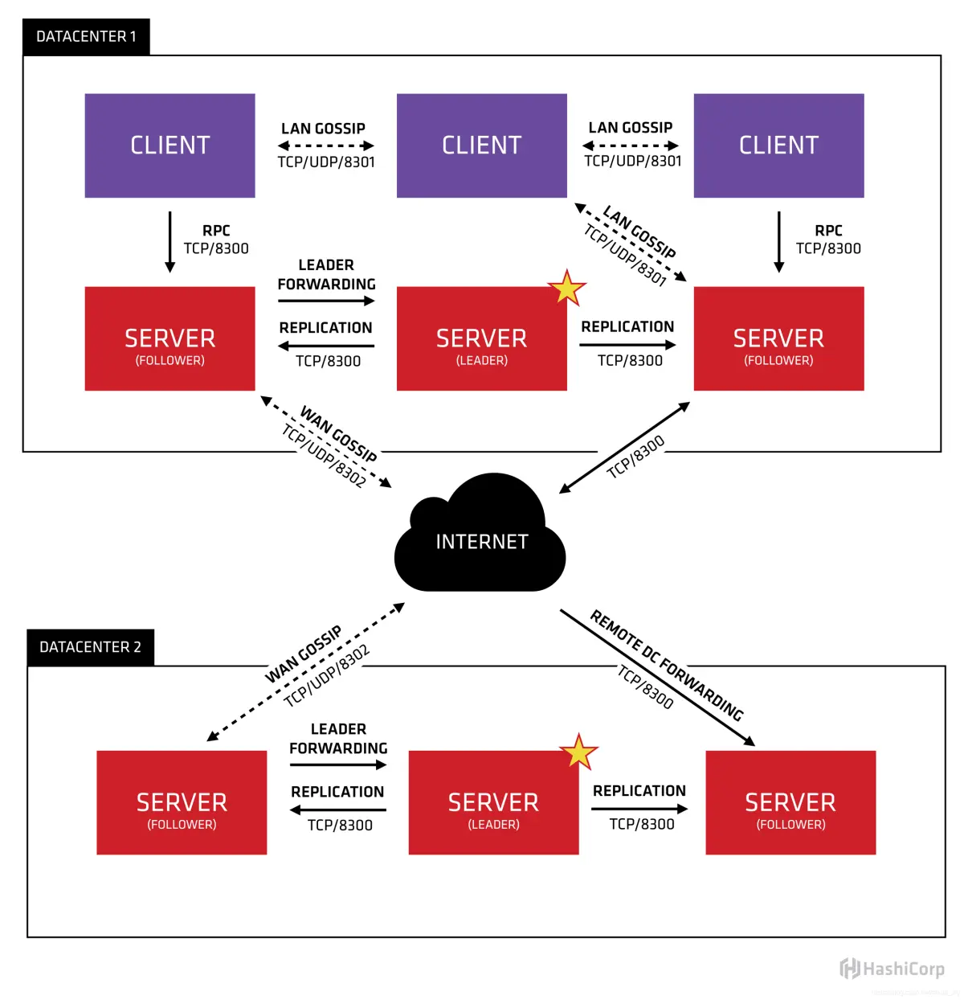
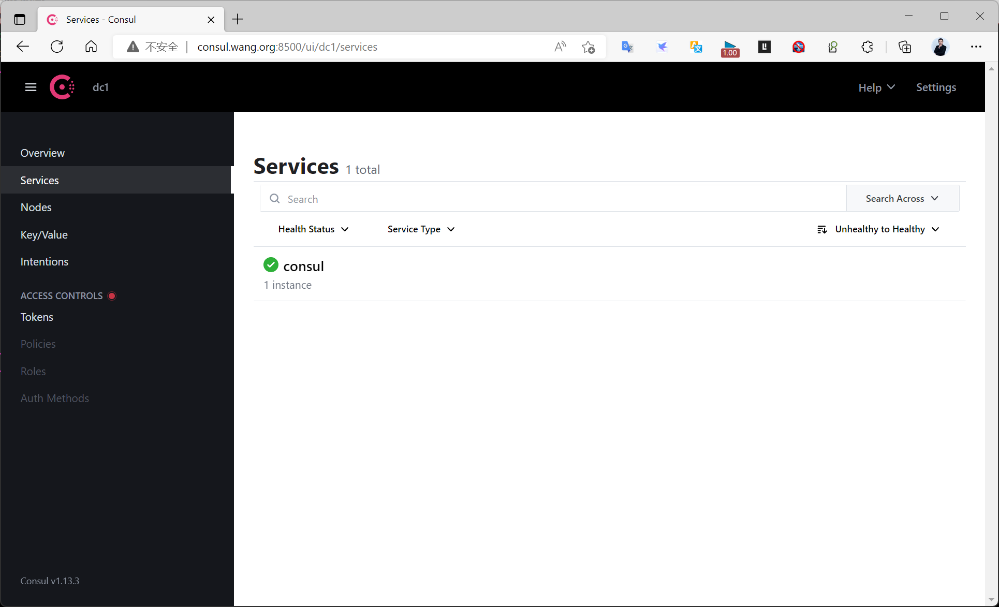
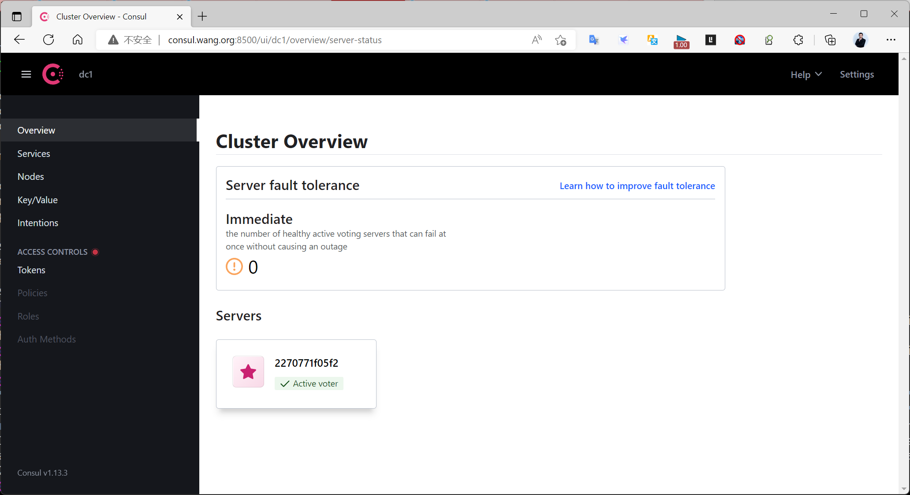

[← 返回 Prometheus 目录]({{ '/subjects/Prometheus/' | relative_url }})



# 18 Consul 简介与单机部署

## 6.4 Consul 服务发现

### 6.4.1 Consul 在监控链路中的位置

第 17 章的文件和 DNS 发现都需要有人维护目标清单。服务实例频繁启停时，可以让实例向 Consul 注册自己的地址、端口、服务名和健康检查，再让 Prometheus 从 Consul 查询这些信息。**Consul 负责登记与查询服务；Prometheus 仍然直接拉取 Exporter 的指标**，Consul 不替 Prometheus 存储时序数据。


Consul 具有服务发现、健康检查、键值存储以及服务网格等功能。本专题重点是前两项：服务注册时写入可访问的地址；健康检查帮助区分正常和故障实例；Prometheus 的 `consul_sd_configs` 将查询结果转换为抓取目标。Consul 的健康状态与 Prometheus Targets 的 `UP/DOWN` 不是同一个判断——前者来自 Consul 检查，后者来自 Prometheus 对指标端点的实际抓取。

Consul agent 有 server 和 client 两种运行模式。server 持有集群状态并参与 Raft 共识；client 不参与共识，主要在本机提供注册、查询与健康检查入口，并向 server 转发请求。Agent 之间使用 gossip 传播成员信息。单机 server 可用于学习与功能验证；生产要容忍单节点故障，通常部署 3 或 5 个 server，并根据网络与安全要求配置 client、ACL、TLS、gossip 加密和持久化。



从 Prometheus 的角度看，完整流程是：启动 Consul → 注册 Exporter 服务 → Consul 提供服务和健康状态 → Prometheus 发现目标 → Prometheus 请求 `/metrics` 并记录 `UP/DOWN`。后续章节再配置集群及 `consul_sd_configs`；本章先把一台单机 Consul 正确启动并验证。


### 6.4.2 单机部署前的选择

可选包安装、官方二进制或容器。以下三种方式用于对照，**选择一种即可**，避免多个实例争用同一数据目录或 `8500` 端口。示例版本沿用资料中的 Consul 1.x 系列，实际部署先查 [官方安装说明](https://developer.hashicorp.com/consul/install) 与 [Agent 配置文档](https://developer.hashicorp.com/consul/docs/agent/config)。不要把单机实验的 `bootstrap_expect = 1` 当作高可用配置。

#### 6.4.2.1 使用软件包

Ubuntu 可按官方仓库说明安装；下面展示关键步骤，发行版代号取自当前机器：

```bash
curl -fsSL https://apt.releases.hashicorp.com/gpg |
  sudo gpg --dearmor -o /usr/share/keyrings/hashicorp-archive-keyring.gpg
echo "deb [arch=$(dpkg --print-architecture) signed-by=/usr/share/keyrings/hashicorp-archive-keyring.gpg] https://apt.releases.hashicorp.com $(lsb_release -cs) main" |
  sudo tee /etc/apt/sources.list.d/hashicorp.list
sudo apt update
sudo apt install consul
consul version
```

安装包通常提供 `consul` 用户、`/etc/consul.d` 配置目录和 systemd 服务，但不同打包版本的默认 `consul.hcl` 不一定启用 server。原实验里安装后直接启动，日志反复提示 `No servers available`：进程虽然运行，当前 agent 却没有可连接的 server。处理方法不是反复重启，而是先确认它应当加入已有集群，还是承担单机 server 角色。

下面是**实验用** `/etc/consul.d/consul.hcl`。如实际主机有多块网卡，应将 `bind_addr` 改为同网段节点可达的具体地址；`client_addr = \"0.0.0.0\"` 仅表示监听所有接口，还需按环境限制外部访问。

```hcl
datacenter = "dc1"
data_dir = "/opt/consul"
server = true
bootstrap_expect = 1
bind_addr = "10.0.0.100"
client_addr = "0.0.0.0"
ui_config {
  enabled = true
}
```

确认数据目录归服务账户所有，校验配置后再启动：

```bash
sudo install -d -o consul -g consul /opt/consul
sudo consul validate /etc/consul.d
sudo systemctl enable --now consul
sudo systemctl status consul
consul members
curl -fsS http://127.0.0.1:8500/v1/status/leader
```

若返回空 leader，检查 `journalctl -u consul -e`、数据目录权限和 `bind_addr`。只看到进程或端口监听不足以证明 server 已选出 leader。Web UI 默认使用 `8500`，DNS 接口使用 `8600`；server RPC 常见端口为 `8300`，LAN gossip 为 `8301`，跨数据中心 WAN gossip 为 `8302`。对外开放这些端口前需按部署拓扑限定访问范围。



#### 6.4.2.2 使用官方二进制

不采用包管理时，可从 [官方发布页](https://releases.hashicorp.com/consul/) 选择对应架构的压缩包。下面保留原实验的 `1.21.0`，在其他平台应替换包名：

```bash
wget https://releases.hashicorp.com/consul/1.21.0/consul_1.21.0_linux_amd64.zip
unzip consul_1.21.0_linux_amd64.zip -d /usr/local/bin/
consul version
useradd -r -s /sbin/nologin consul
install -d -o consul -g consul /data/consul /etc/consul.d
```

把上一节的 HCL 配置保存到 `/etc/consul.d/consul.hcl`，并将 `data_dir` 改为 `/data/consul`。自行创建的 systemd 服务只需调用 `consul agent -config-dir=/etc/consul.d`，不要把每个参数再重复写入 `ExecStart`，否则文件配置与启动参数容易互相覆盖：

```ini
[Unit]
Description=HashiCorp Consul
After=network-online.target
Wants=network-online.target

[Service]
Type=simple
User=consul
Group=consul
ExecStart=/usr/local/bin/consul agent -config-dir=/etc/consul.d
Restart=on-failure

[Install]
WantedBy=multi-user.target
```

保存为 `/etc/systemd/system/consul.service`，运行 `consul validate /etc/consul.d`、`systemctl daemon-reload`、`systemctl enable --now consul`，再按包安装小节检查 leader。原资料的一键脚本将命令参数和 systemd 的 `ExecStart` 硬折行为多行，且重复创建账户和覆盖服务文件；对现有安装不宜直接运行。

#### 6.4.2.3 使用容器

容器方式同样需要持久化数据与一致的配置路径。以下 Compose 示例只用于本机实验，不与前两种方式同时运行：

```yaml
services:
  consul:
    image: hashicorp/consul:1.21
    command: agent -server -bootstrap-expect=1 -client=0.0.0.0 -ui -data-dir=/consul/data
    ports:
      - "8500:8500"
    volumes:
      - consul_data:/consul/data

volumes:
  consul_data:
```

启动后访问 `http://<主机>:8500` 并查询 `/v1/status/leader`。如果要让其他主机的 agent 加入此容器，单映射 `8500` 不够，还必须配置可达的 gossip/RPC 地址与端口；不应把这个单容器样例视作集群方案。原资料的 Compose 示例同时使用 `-dev` 和 `-bootstrap`，又把 `bind` 指向容器回环地址，难以扩展到真实节点，故这里保留清晰的单机语义。



### 6.4.3 本章检查点

无论选择哪种安装方式，都用同一组问题验证：`consul version` 是否可用；配置文件是否通过 `consul validate`；Agent 是否运行；`consul members` 是否显示预期节点；`/v1/status/leader` 是否非空；浏览器是否能按访问控制策略打开 UI。下一章将单机 server 扩展为集群，再讨论多节点之间的数据一致性与故障切换。


<nav class="article-end" aria-label="章节导航">
  <a href="{{ '/subjects/Prometheus/17-service-discovery-basics.html' | relative_url }}">← 上一章：服务发现基础、文件与 DNS</a>
  <a href="{{ '/subjects/Prometheus/' | relative_url }}">返回 Prometheus 目录</a>
  <a href="{{ '/subjects/Prometheus/19-consul-cluster.html' | relative_url }}">下一章：Consul 集群部署 →</a>
</nav>
